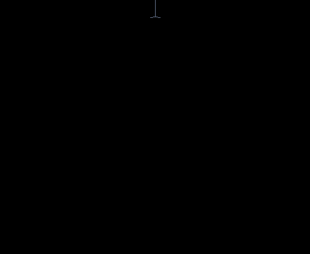
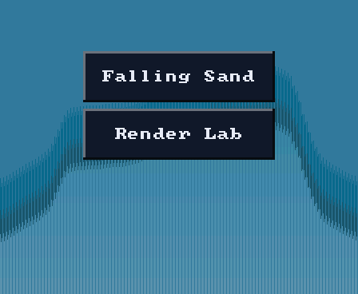
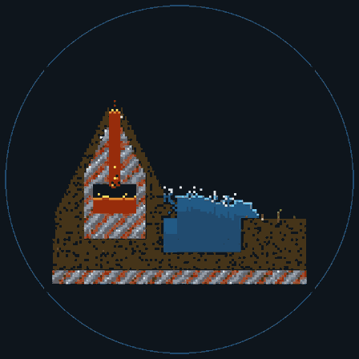
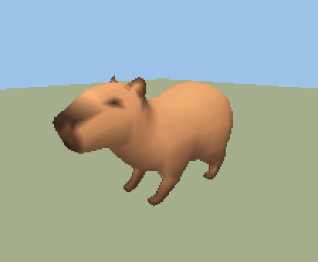
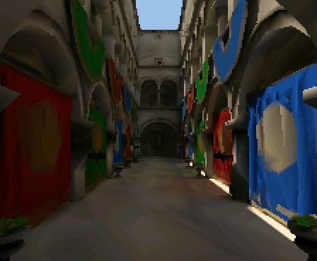

# Autana

[](https://github.com/jose-villegas/autana/actions/workflows/host-tests.yml)
[](https://github.com/jose-villegas/autana/actions/workflows/qemu-tests.yml)
[](https://github.com/jose-villegas/autana/actions/workflows/build-release.yml)
[](https://github.com/jose-villegas/autana/actions/workflows/build-diagnostics.yml)

Autana is software for the [Waveshare ESP32-S3-Touch-AMOLED-1.8](https://www.waveshare.com/esp32-s3-touch-amoled-1.8.htm): a home screen that launches a falling-sand sandbox and software-rendered mesh flythroughs. Touch and board motion control the apps. The firmware draws each frame in software and sends its pixels directly to the board's AMOLED screen.

The papers and specifications behind its techniques are in [Citations](docs/Citations.md).

<table>
<tr><th width="33%">Boot animation</th><th width="33%">Launcher, board rocking</th><th width="33%">Falling Sand, board turning</th></tr>
<tr><td width="33%"></td><td width="33%"></td><td width="33%"></td></tr>
<tr><th width="33%">Capybara, every clip</th><th width="33%">Sponza, baked light</th><th width="33%">Water, board tilting</th></tr>
<tr><td width="33%"></td><td width="33%"></td><td width="33%"></td></tr>
</table>

These images are host renders of the real firmware drawing code, sized to fit this grid. The boot clip follows the startup animation's timeline, the launcher backdrop responds to scripted rocking and lists the apps a release build carries, the sand clip runs the real simulation with scripted tilt, the capybara blends through each of its animation clips, the Sponza clip follows a camera flythrough with baked light, and the water clip runs the real fluid simulation with scripted tilt.

Image render commands are in each app's tools README ([sand](launcher/main/apps/sand/tools/README.md), [render lab](launcher/main/apps/render_lab/tools/README.md)) and the [render harness](docs/tools/Render-Harness.md#images-in-these-docs).

## Try it without a board

Use [Git Bash](https://git-scm.com/download/win) on Windows, or a terminal on Linux. You need a C compiler for your computer, plus a POSIX shell; **ESP-IDF and a board are not needed**. The renderer writes BMP files and also PNGs when Python has Pillow installed.

```sh
./launcher/tools/render/scenes/scene_viewer_render_host.sh
```

Open `launcher/tools/results/render/scene_viewer/landscape.bmp` to see the atrium. For a result in the terminal, run the portable tests:

```sh
./launcher/test/run_tests.sh
```

The test runner prints a verdict and saves its full log. It compiles and runs the parts of the firmware that do not need ESP32 peripherals. The [Testing Guide](docs/testing/README.md) explains what it covers; the [render harness](docs/tools/Render-Harness.md) lists other screens you can render. If the shell cannot find a C compiler, install one for your computer:

| System | Compiler setup |
|---|---|
| Windows | `winget install BrechtSanders.WinLibs.POSIX.UCRT` |
| Debian/Ubuntu | `sudo apt install build-essential` |

## What is here

- **Falling Sand:** pour powders and liquids with touch; the board's motion sensor steers gravity. Gas, fire, heat, and material reactions make the sandbox interactive. Start with the [sand overview](docs/sand/README.md), then the [simulation details](docs/sand/Sand-Simulation.md).
- **Render Lab:** flythroughs of Crytek Sponza with baked light, an animated capybara and a tank of simulated water that sloshes as the board tilts, all rendered in software. The [host renderer](launcher/main/apps/render_lab/tools/README.md) can produce still frames of these scenes without the board.
- **Input Lab:** tap small targets and see how far the touch panel's reading lands from where you aimed; the numbers behind the touch correction, explained in the [touch notes](docs/input/Touch.md).
- **Diagnostics:** a hardware self-test report and developer controls in development builds. The power-on check runs in every build. [Build variants](docs/tools/Build-Variants.md) explains which tools ship in each image.

Project applications live under `launcher/main/apps/`; system applications live under `launcher/main/shell/apps/`. The shell calls an app once per frame and presents its drawing to the panel. [Building an App](docs/firmware/Building-an-App.md) shows the smallest implementation; [Firmware](docs/firmware/README.md) explains how the pieces fit.

## Run it on the board

The firmware targets the Waveshare ESP32-S3-Touch-AMOLED-1.8 specifically. For a board build, install the commit in `launcher/idf-pin.json` and its tools. A build without it stops and prints the clone and install commands. autana finds it under `C:\Espressif` or `~/esp`; `IDF_PATH` set for one command selects another checkout ([Which ESP-IDF](docs/tools/Build-Environment.md#which-esp-idf)). On Windows, use Git Bash for these commands; the build wrapper calls the ESP-IDF Windows environment through `cmd`.

```sh
./tools/autana flash dev
./tools/autana monitor 30
```

`flash dev` builds the checkout you run it from and flashes it; `monitor 30` reads the serial console for 30 seconds. Board operations use a device lock. To call `autana` by name from future terminals, run `scripts/add-tools-to-path.sh` from the checkout you keep. See the [CLI guide](docs/cli/README.md) for screenshots, tests on the chip, and recovery. The [flashing and toolchain notes](docs/notes/Flashing-and-Toolchain.md) cover board setup problems.

## Find your way around

| If you want to... | Read |
|---|---|
| Change a game or add one | [Building an App](docs/firmware/Building-an-App.md), [Building a Screen](docs/ui/Building-a-Screen.md) |
| Draw 3D, import a mesh or set up a scene | [3D rendering and scenes](docs/render/README.md), [Building a Scene](docs/render/Building-a-Scene.md) |
| Understand gravity estimation and input features | [Input docs](docs/input/README.md) |
| Understand the frame loop and drawing path | [Firmware](docs/firmware/README.md), [Graphics](docs/gfx/README.md) |
| Follow the sand simulation | [Sand docs](docs/sand/README.md), [Simulation](docs/sand/Sand-Simulation.md) |
| Run or add tests | [Testing Guide](docs/testing/README.md) |
| Work with fonts and controls | [Text and Fonts](docs/gfx/Text-and-Fonts.md), [UI Toolkit](docs/ui/README.md) |
| Build, flash, test or drive the board with `autana` | [CLI guide](docs/cli/README.md), [board notes](docs/notes/README.md) |
| Render, check or generate with the repository's tools | [Tools index](docs/tools/README.md) |
| Play sounds or add one | [Audio docs](docs/audio/README.md), [Sound assets](docs/audio/Sound-Assets.md) |
| Check build flags and C style | [Build Variants](docs/tools/Build-Variants.md), [C Style Guide](docs/c-style/README.md) |
| Explore proposed work | [Rendering Roadmap](docs/plans/Autana-Rendering-Roadmap.md), [plans](docs/plans/README.md) |

The [`launcher/tools/` index](launcher/tools/README.md) maps build wrappers, generators, render scenes, and quality checks. `scripts/install-git-hooks.sh` installs optional local checks; [Mermaid diagrams](docs/tools/Mermaid-Diagrams.md) need `npm install -g @mermaid-js/mermaid-cli` if you edit them, and [math formulas](docs/tools/Math-Formulas.md) need `npm ci --prefix scripts/gates`. The complexity gate also needs `git submodule update --init`; see its [guide](docs/tools/Complexity-Gate.md).

Autana is actively developed by one maintainer and is not affiliated with Waveshare or Espressif. Its firmware is board-specific; its host tests and rendering tools let you explore substantial parts without hardware.
