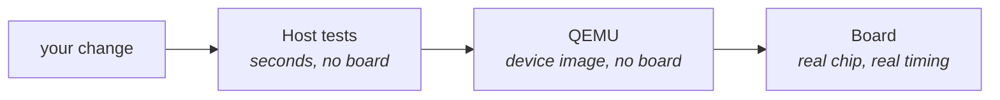
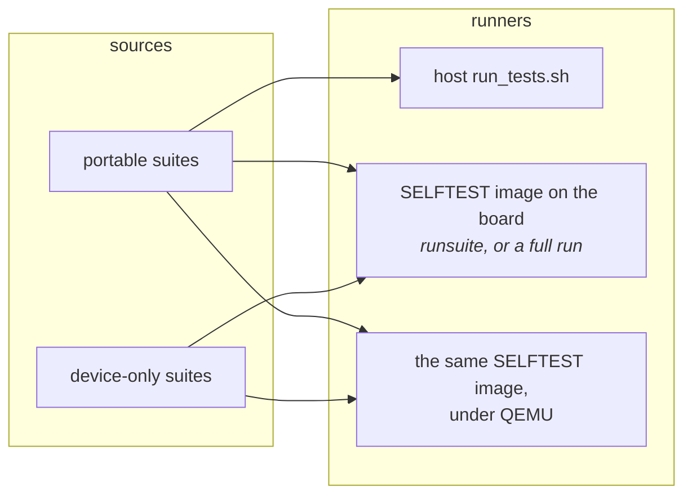

# Testing Guide

How this project tests firmware, and why. Read the topic you need; none of
them depends on reading the others first.

**First result, no hardware:** in Git Bash on Windows or a Linux terminal,
run `launcher/test/run_tests.sh`. It needs a host C compiler, not ESP-IDF
or a board. A good run ends with `0 Failures` and `OK`; most of the wait is
compiling. [Host tests](testing/Host-Tests.md#install-a-compiler) lists the
one-line compiler install.

Each step proves more and costs more. Stop at the first one that answers
your question.

| your question | read |
|---|---|
| How do I run the tests? | [Host tests](testing/Host-Tests.md) |
| Why does the host stop what the board would stop? | [Host tests: device limits](testing/Host-Tests.md#the-host-enforces-the-devices-memory-limits) |
| No board free, or no board at all | [QEMU](testing/QEMU.md) |
| One suite on the board, no rebuild | [Device tests: runsuite](testing/Device-Tests.md#runsuite-the-everyday-device-loop) |
| Console recipes, scene tour, pytest-embedded | [Device tests: pytest-embedded](testing/Device-Tests.md#console-recipes-and-lifecycle-coverage) |
| Is the board itself working? | [Device tests: POST](testing/Device-Tests.md#post-is-a-third-thing) |
| Instruction ratchet, frame watch, perf-test rules | [Performance and budgets](testing/Performance-and-Budgets.md) |
| How do I make this code testable? | [Writing a test](testing/Writing-a-Test.md#making-things-testable) |
| I am adding a suite | [Writing a test: adding a suite](testing/Writing-a-Test.md#adding-a-suite) |
| Which suite covers what I changed? | [Writing a test: finding suites](testing/Writing-a-Test.md#finding-the-suite-for-an-area) |
| What do RELEASE, DEVELOPMENT and SELFTEST gate? | [`Build-Variants.md`](Build-Variants.md) |
| I want to see a screen without flashing | [`tools/Render-Harness.md`](tools/Render-Harness.md) |
| CI says my function is too complex | [`tools/Complexity-Gate.md`](tools/Complexity-Gate.md) |

## Two runners, one set of suites

Portable suites (`launcher/test/suites/`, each package's `tests/`, each app's
`tests/`) compile into every runner that can take them. A device-only suite
guards its body with `#ifdef DEVICE_BUILD`; a host-only one uses the opposite
guard and registers once outside it.

| Runner | Runs | Proves | Cost |
|---|---|---|---|
| Host | portable suites | the logic is right on x86 | seconds once built |
| QEMU | every suite | the Xtensa build behaves; no timing | minutes, no board |
| Board | every suite | the same source works on this chip | `runsuite` seconds; full run about 18 minutes |

The host runner is the red-green-refactor loop. The board run is the
guarantee. It runs the portable suites too, because passing on a laptop does
not prove the Xtensa build behaves the same.

Release images contain no test code: the suites are never compiled in. See
[`Build-Variants.md`](Build-Variants.md#release-builds-contain-no-test-code).
