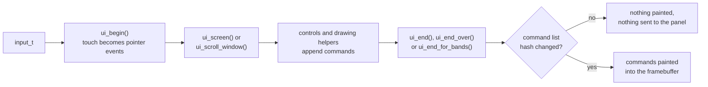
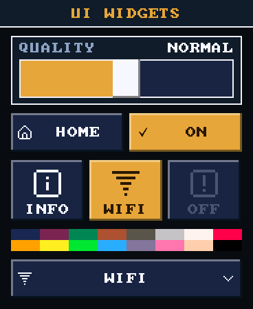
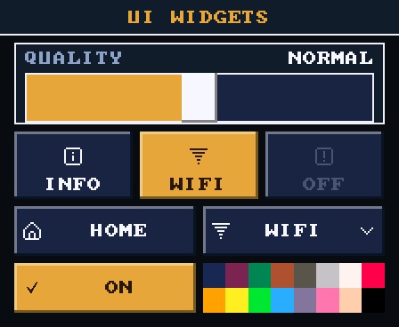
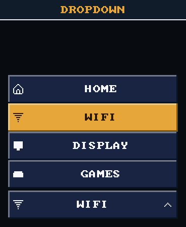
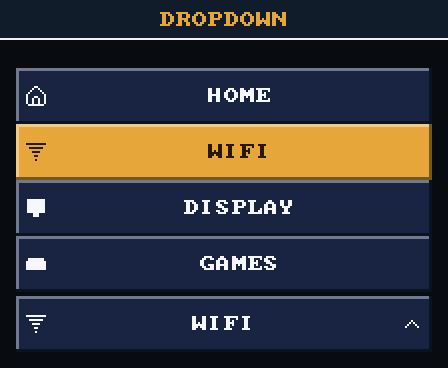
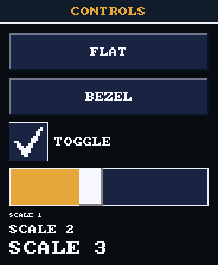
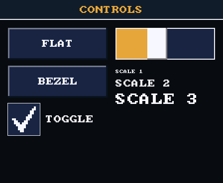

# UI Toolkit

What the shell's `launcher/main/ui/` layer gives any screen, in the shell or
in an app: the controls, the drawing helpers, the layout arithmetic and the
frame calls around them. A screen describes its whole UI again every frame
through the plain-value face in `ui/ui.h`, and the frame becomes a list of
drawing commands. This is the catalog. How to put a screen together, and the
house rules it must follow, are in
[`Building-a-Screen.md`](Building-a-Screen.md). The library behind the face
is private to `ui/`, and the include gate refuses it anywhere else.

The board is held either way up, so a screen must work in both
orientations, and every picture below shows both. Each comes from the real
code, drawn on a host by the gallery scene,
`launcher/tools/render/scenes/ui_widgets_render_host.sh` (see
[Regenerating the images](#regenerating-the-images)).

## At a glance

| A screen needs | Call | Header |
|---|---|---|
| a frame to draw in | `ui_begin()`, `ui_screen()`, `ui_end()` | `ui/ui.h` |
| a button, with or without an icon | `ui_button()`, `ui_button_icon()` | `ui/ui.h` |
| one of a row of choices, icon above label | `ui_tile()`, `ui_tile_icon()` | `ui/ui.h` |
| a whole-number setting | `ui_slider()` | `ui/ui.h` |
| on or off | `ui_toggle()` | `ui/ui.h` |
| a pick from a list, without scrolling the screen | `ui_dropdown()`, `ui_dropdown_icons()` | `ui/ui.h` |
| a captioned section, a title bar | `ui_panel()`, `ui_header()` | `ui/ui.h` |
| text aligned in a rect | `ui_text()`, `ui_text_right()`, `ui_text_centre()`, `ui_caption()` | `ui/ui.h` |
| a grid of colours | `ui_swatches()` | `ui/ui.h` |
| an icon | `ui_icon()`, `ui_check()` | `ui/ui.h` |
| rows that may overflow and scroll | `ui_scroll_window()`, `ui_row()`, `ui_next()` | `ui/ui.h` |
| a rect placed against an edge or centre | `ui_anchor_rect()`, `ui_rect_inset()`, `ui_centered_rect()` | `ui/layout/ui_anchor.h`, `ui/ui.h` |
| another text size | `ui_scale_begin()`, `ui_set_font_scaled()`, `ui_measure_text()` | `ui/ui.h` |
| raised buttons | `ui_set_button_style(UI_BUTTON_BEZEL)` | `ui/ui.h` |
| the UI turned with the board | `ui_set_transform()`, `ui_width()`, `ui_height()` | `ui/ui.h`, `ui/layout/ui_transform.h` |

## One frame



Nothing draws pixels directly. Every control and helper appends commands to
the frame's command list, and `ui_end()` paints them only when the list hashes
differently from the last frame, so a screen that does not change costs
nothing: hashing a few kilobytes of commands is far cheaper than repainting
and sending a whole screen to the panel. Anything painted outside the list is invisible to that hash and
survives on screen as a stale smear, which is why every entry below emits
commands. In an [expanded frame](Gfx-and-Presentation.md#expanded-frames)
`ui_end()` bins the commands as `ui_end_for_bands()` does, and the present
replays them over each strip it sends.

## A whole screen

 

This is the gallery's settings view, drawn by this code under the gallery's theme. The same
code draws both orientations, because it measures against `ui_width()`
rather than a fixed width:

```c
static int volume = 5;
static bool muted;
static int output;

static const char* const OUTPUTS[] = {"SPEAKER", "HEADPHONES", "BLUETOOTH", "OFF"};

static void
settings_frame(const input_t* input) {
    const int row_w = ui_width() - 2 * UI_MARGIN;
    ui_begin(input);
    ui_theme(&THEME);
    ui_screen();
    ui_header((recti_t){0, 0, ui_width(), UI_TITLE_HEIGHT}, "SETTINGS");
    ui_slider((recti_t){UI_MARGIN, 72, row_w, UI_TAP_MIN}, "volume", &volume, 0, 10);
    ui_toggle((recti_t){UI_MARGIN, 144, row_w, UI_TAP_MIN}, "MUTE", &muted);
    ui_dropdown((recti_t){UI_MARGIN, 216, row_w, UI_TAP_MIN}, "output", &output, OUTPUTS, 4);
    ui_end(0x0A0C14);
}
```

- **The caller owns every value.** `volume`, `muted` and `output` live in
  the screen, and each call is handed the current value. A slider, toggle
  or dropdown writes through the pointer and returns true on the frame it
  changed. Between frames the toolkit remembers only the pressed control and
  whether a dropdown's list is open and how far it is scrolled.
- **Labels are ids.** A control's identity is its label, so two controls with
  the same label are told apart by call order, which breaks if a screen
  skips one some frames; `"Text###key"` shows `Text` and keys on `key`
  alone.
- **One file here, three in a real screen.** A shipped screen splits this
  into layout, state and drawing, each tested on a host, as
  [`Building-a-Screen.md`](Building-a-Screen.md) describes: the screen in
  the app's `ui/` folder, its layout test in the app's `tests/`.

### Which control

| For | Use |
|---|---|
| a whole number in a range | `ui_slider()` |
| on or off | `ui_toggle()`, or two tiles when the choice deserves pictures |
| one of two to four choices, all worth seeing at once | a row of `ui_tile_icon()`s, with `selected` on the current one |
| one of a longer list, or where there is no room for a row | `ui_dropdown()` |
| an action | `ui_button_icon()`, or `ui_button()` for a label alone |

## Themed widgets

 

`ui_theme(&theme)` states a screen's colours once, for the rest of the
frame; `NULL` restores the shell look. `ui_theme_t`:

| Field | Used for |
|---|---|
| `panel_face`, `panel_edge` | `ui_panel()` and `ui_header()` |
| `button_face` | a control at rest |
| `accent` | headings |
| `accent_face`, `on_accent` | the selected choice, and the ink on it |
| `text`, `caption` | ink at rest, and captions |
| `muted` | a disabled control's ink |
| `text_scale` | label size, in glyph cells |
| `icon_side` | an icon beside a label (a tile sizes its own) |

Those are all of its fields; colours are `0xRRGGBB`.

```c
static const ui_theme_t THEME = {
    .panel_face = 0x131C2E,
    .accent_face = 0xE0A63C,
    /* ... */
    .text_scale = 2,
    .icon_side = 24,
};
```

| Control | Returns | Notes |
|---|---|---|
| `ui_button_icon()` | true on the frame a tap is released on it | icon at the left, label centred in the rest; a `NULL` icon is `ui_button()` |
| `ui_tile_icon()` | the same | icon above the label, `selected` drawn on `accent_face`; `ui_tile_icon_rect()` gives the icon's square, where a caller may draw its own picture instead |
| `ui_slider()` | whether the value changed | fill on `accent_face`, knob in `text` |
| `ui_toggle()` | whether the value changed | a box with a check, label beside it |
| `ui_dropdown()` | whether the pick changed the index | see below |

Wrap controls in `ui_disabled_begin(true)` / `ui_disabled_end()` to draw
them in `muted` and take no tap, and in `ui_color_begin(UI_COLOR_FACE, rgb)` or `UI_COLOR_TEXT` to recolour a
few (the gallery's ON button is `accent_face` with `on_accent` ink). Every
`_begin` pairs with its `_end`, at most `UI_FACE_SCOPE_DEPTH` deep, and a
disabled scope cannot be re-enabled by a nested one. A control
looks pressed only when a press has landed on it, never while a drag merely
slides across it.

### Dropdown

 

The dropdown shows the current item and a chevron. A tap opens the whole
list over the screen:

| | |
|---|---|
| Placement | below the dropdown when every row fits there, above when they fit there, otherwise over the canvas between its margins, covering the dropdown. |
| Scrolling | a list taller than its room scrolls, and opens with the current item centred. |
| Closing | a pick stays on screen `UI_DROPDOWN_CLOSE_FRAMES` frames after the finger lifts, so the choice is seen landing. A tap outside the list closes it. |
| Identity | give each dropdown its own label or `###key`. |

`ui_dropdown()` takes a `names` array; `ui_dropdown_icons()` adds a
parallel `icons` array. It needs at least one item.

## Plain controls

 

With no `ui_theme()` call these draw in the colours `ui_init()` sets. The
slider holds a whole number. Its geometry is the pure
`ui/controls/ui_slider.h`: the track, fill and knob for a value, and the
value under a finger, quantized and clamped.

### Button styles

`ui_style.h` decides how a button's frame looks, separately from what it is:

| | |
|---|---|
| `UI_BUTTON_FLAT` | a flat fill plus a one-pixel border. The default. |
| `UI_BUTTON_BEZEL` | lit from the top left, and sunk while a finger is on it. |

```c
ui_begin(input);
ui_set_button_style(UI_BUTTON_BEZEL);   /* every frame */
```

- **Stated every frame.** `ui_begin()` resets the style, because the whole
  shell shares one UI context: a style one screen chose would otherwise
  leak into the next app's buttons. It can change mid-frame, so one screen
  can mix both.
- **Buttons only.** Toggles and sliders frame themselves and
  are left alone.
- **The default is unchanged.** `UI_BUTTON_FLAT` and every non-button
  frame draw as the backend does with no style set.
- **Sunk on hover as well as focus.** On a touchscreen there is no pointer
  until a finger is on the glass, so hover is contact. The one synthesized
  frame before the press lands has hover but not focus yet, and keying on
  hover keeps the bezel sinking smoothly instead of flashing in a frame
  late.
- **Pure geometry.** `ui_bezel_spans()` and `ui_panel_spans()` return where
  the rectangles go and nothing else, so `test/suites/suite_ui_style.c`
  checks the shape without linking `draw.c`.

## Drawing helpers

| Helper | Draws |
|---|---|
| `ui_panel()` | a face with a plain border, grouping controls without inviting a press |
| `ui_header()` | a full-width bar with an edge along its bottom and a centred title |
| `ui_text()`, `ui_text_right()`, `ui_text_centre()` | a string clipped to a rect, centred vertically, aligned left, right or centre; `ui_caption()` in the caption colour |
| `ui_swatches()` | colours as a `cols` x `rows` grid of equal cells filling a rect |
| `ui_icon()` | an icon (a one-bit `draw_image_t` from a pack) filling a rect, in one colour, or a short text when there is no icon |
| `ui_fill()`, `ui_outline()`, `ui_bevel()`, `ui_check()` | the marks the controls are built from, for a screen drawing its own |

The system icons come from the engine pack through `ui_icon_image()`
(`ui/controls/ui_icons.h`), loaded by `ui_init()`;
an app's icons are a `ui_icon_set_t` in the app's own pack, which the app
loads with `ui_icon_set_load()` and releases with `ui_icon_set_release()`, so
deleting the app deletes them. Without a pack a control shows its label alone, and an
icon-only control its short text ([icons](tools/Icon-Baker.md)).

## Layout

| Constant | Value | For |
|---|---|---|
| `UI_TAP_MIN` | 56 | the smallest a control may be, in its smaller dimension |
| `UI_TAP_RECOMMENDED` | 64 | what a new control should aim for |
| `UI_ROW_HEIGHT` | 64 | a list row |
| `UI_ROW_GAP` | 8 | between rows |
| `UI_MARGIN` | 16 | from the canvas edge |
| `UI_TITLE_HEIGHT`, `UI_BANNER_HEIGHT` | 56 | a title strip; the empty status strip on the home screen |

The panel is about 322 pixels per inch, so a phone's 44 px is only 3.5 mm
here. 56 px is about 4.4 mm.

- **Canvas size.** `ui_width()` and `ui_height()` are the logical canvas:
  368x448 in portrait and 448x368 in landscape. Lay out against them,
  never `GFX_WIDTH`/`GFX_HEIGHT`. A layout that stacks in portrait usually
  wants rows or columns in landscape, as the widgets view above does, and a
  layout test holds it at both sizes.
- **Fixed rects.** `ui_centered_rect()` centres a rect horizontally.
  `ui_anchor_rect()` places one against a parent's edge, corner or centre
  (`UI_ANCHOR_*`) with a pivot and offset, and `ui_rect_inset()` makes a
  safe area.
- **Rows that may overflow.** Open the window with
  `ui_scroll_window(r)` and place rows with `ui_row()` and `ui_next()`.
  The window scrolls vertically once the rows overflow `r`; a horizontal
  drag is refused.

```c
ui_scroll_window((recti_t){0, 0, ui_width(), ui_height()});
for (int i = 0; i < count; i++) {
    ui_row(UI_ROW_HEIGHT);
    if (ui_button(ui_next(), labels[i])) { chosen = i; }
}
```

## Text

| Call | |
|---|---|
| `ui_set_font_scaled(draw_font_ui(), scale)` | the UI font at `scale` glyph cells, for the rest of the frame |
| `ui_measure_text()` | a string's width at the current font and scale |
| `ui_set_text_style()` | `UI_TEXT_PLAIN`, `UI_TEXT_OUTLINED` or `UI_TEXT_SHADOWED` |

A font and its scale ride inside every text command, so changing size costs
nothing extra. A text style does not, and needs `ui_invalidate()` when it
changes. The details are in [`Text-and-Fonts.md`](Text-and-Fonts.md).

## Orientation

`ui_set_transform()` maps every command through a fixed-point transform
before drawing, so the whole UI turns without any call site knowing.
`ui_transform_quarter_turn()` builds the one the shell uses. Only
axis-preserving transforms draw correctly, and
`ui_transform_is_axis_preserving()` says which those are.
`ui_layout_generation()` increments when the canvas shape changes: read
it, keep it, and compare later.

## Closing the frame

| Call | When |
|---|---|
| `ui_end(background)` | the usual case. `UI_NO_BACKGROUND` draws over an app's own output instead of clearing |
| `ui_end_over(paint_backdrop)` | the backdrop is a picture rather than a colour |
| `ui_end_for_bands()`, `ui_replay_band()` | band mode, where the screen is drawn a strip at a time with no whole framebuffer kept. The shell passes `ui_replay_band()` to `gfx_band_run()` as the per-band overlay (see [`Gfx-and-Presentation.md`](Gfx-and-Presentation.md)) |
| `ui_invalidate()` | something replaced the screen behind the UI's back, so the next `ui_end()` must repaint |

How a panel over a paused app and a drawn backdrop use these is in
[`Building-a-Screen.md`](Building-a-Screen.md#a-panel-over-a-paused-app).

## What a screen costs

The frame's command list is 8 KiB on the device (`MU_COMMANDLIST_SIZE`,
set in the vendored backend's header), and everything drawn spends it. An open dropdown list
adds its rows on top of the screen beneath it. The gallery's widgets page
with its list open exceeds 8 KiB on a 64-bit host, whose larger commands
need a 9 KiB limit in host tests and the render harness. The screen budget
suites reserve space for additional controls; their device/QEMU run checks
the device limit. A development build logs the high-water mark from
`ui_end()`; check it before adding a texture or another icon.

## Adding to the toolkit

A control belongs in `ui/`, as a face verb in `ui/ui.h` over a helper in
`ui/controls/` (private to `ui/`), not in a private copy in one app's
screen, once a second screen could use it. It must:

- take the screen's `ui_theme_t` rather than colours of its own
- use no app's vocabulary: say what shape of caller needs it
- emit commands, never pixels
- respect `UI_TAP_MIN`
- have a host test in `test/suites/suite_ui_widgets.c` that drives real
  taps through `ui_begin()`
- appear in the gallery scene (a view in
  `launcher/tools/render/scenes/ui_widgets_render_host.c`) and in this document

A control that shows everything at once sits inline, like
`ui_swatches()` or a row of tiles. One that must show more than its own
rect has room for opens over the screen the way `ui_dropdown()` does: its own
window, one open at a time, closed when a tap lands outside it. When a
control needs a colour no theme field means, add a field to `ui_theme_t` and
give it a value in every theme that exists, rather than reusing a field for
something else.

## Regenerating the images

```sh
sh launcher/tools/render/scenes/ui_widgets_render_host.sh
```

It renders each view to `launcher/tools/results/render/ui_widgets/` and
checks it against `ui_widgets_render_baseline.txt`, so a change that moves a
pixel fails until the new picture is looked at and re-pinned with
`--update-baseline`. `launcher/tools/render/render_doc_images.sh` turns those
renders into `docs/images/ui/`; see "Images in these docs" in
[`tools/Render-Harness.md`](tools/Render-Harness.md).

### Band replay measurements

The band bin is allocated once at UI initialization with `memory_alloc` and
`MEMORY_PSRAM`. Its capacity owner, `UI_BAND_BIN_MAX` in `ui/ui_internal.h`, derives
from `UI_BAND_BIN_MEASURED_PEAK` with the growth margin owned by
`UI_BAND_BIN_MARGIN_DIVISOR`; its byte size is that capacity times
`sizeof(ui_band_entry_t)`. Command and fill entries share storage for their
mutually exclusive payloads. Allocation failure retains no entries and uses
full-band repaint for bands touched by drawing.
Bands touched by drawing that does not fit replay the complete UI in painter's
order and remain dirty. Other bands replay the retained entries.
`ui_band_fallback_count()` reports full band replays in the current frame.

On a development build, `autana tune ui.band_stats_frames N` requests the next
N UI frame reports. Capture them with `autana monitor 30`. Repeat on launcher
home, an options screen, and a busy menu with its dropdown open:

```text
ui: band stats: fallbacks=<bands> ui_us=<microseconds> commands=<bytes> roots=<canvases>
```

`ui_us` measures UI finalization and painting, including binning and band replay;
it excludes command construction, application drawing, panel transfer and the
report itself. Band-frame reports appear at the next UI finalization, even
when unchanged bands skip painting. Full-frame painting reports zero fallbacks.
Compare frames with zero and positive fallback counts on the same screen to measure the fallback
cost. The request expires after N reports; zero disables it. Check the running
build id before and after each capture.

In a self-test build, the on-request suite `run_ui_band_perf_suite` measures
the options screen with its dither dropdown closed and open, and the shared
sparse and dense dropdown-menu fixture through the real band ring. Warm-up frames are presented before each measured range.
The menu fixture repeats each revision on consecutive frames, covering changing
and steady sparse content. Deferred cleanup restores the full framebuffer even
when an assertion fails. The host widget suite runs the same cases with the
engine and screen icon packs. Run the device suite with
`autana suite run_ui_band_perf_suite --flash`. Each case collects the frame
range owned by `MENU_FRAMES` in `suite_ui_widgets.c` in memory, then reports:

```text
ui_band_perf: case=NAME frames=N fallbacks=TOTAL frame_us=MEAN max_us=MAX
```

`fallbacks` is the total number of full band replays across the measured frames.
`frame_us` and `max_us` are the mean and maximum elapsed microseconds, including
command construction, finalization, drawing and band submission; they exclude
presentation waiting before the frame and the summary log. The suite asserts
zero fallbacks in every measured case. The host widget suite also exceeds the
bin capacity to verify that fallback matches a full repaint and preserves
dropdown painter order.
