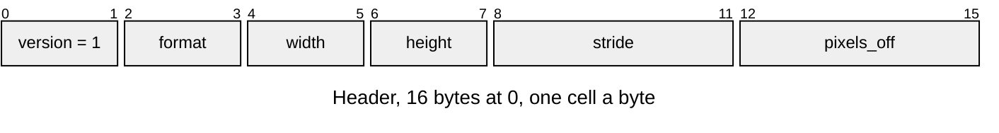
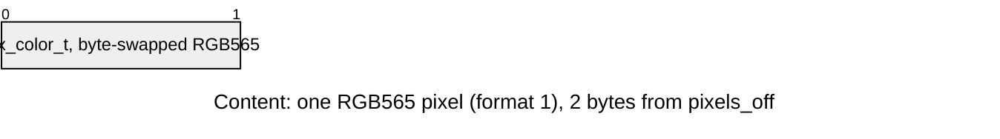
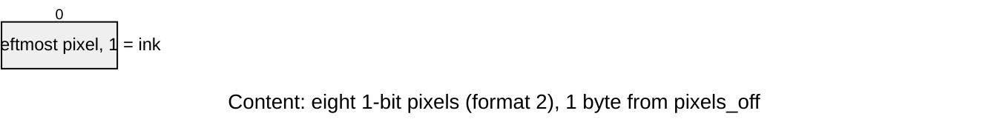

# Image entries

Part of the [asset docs](README.md). A picture is one entry of type `IMAG`, read in place.

## IMAG v1

`NAME.image.toml` names a PNG in its own folder (`source = "x.png"`) and how
many quarter turns clockwise take it to the stored pixels (`quarter_turns`, 0
to 3; a picture drawn in a landscape frame is turned into the panel's portrait
one once, here, so drawing it reads rows in order). The source must be opaque.







| Part | At | Size |
|---|---|---|
| Header | 0 | 16 bytes |
| Content: pixel rows | `pixels_off` | `stride * (height - 1) + width` pixels, top row first; 2 bytes each in format 1, one bit each in format 2 |

| Rule | Detail |
|---|---|
| Owners | `DRAW_IMAGE_VERSION`, `_FORMAT_RGB565` (1), `_FORMAT_MONO1` (2, for [icons](../tools/Icon-Baker.md)), `_HEADER_SIZE` (16), `_PIXEL_ALIGN` (4), `_MONO1_STRIDE_STEP` (8) in `draw_image_format.h` |
| Size | `width` and `height` are 1 to 65535 |
| Stride | pixels from one row's start to the next, at least `width`; a multiple of `DRAW_IMAGE_MONO1_STRIDE_STEP` in format 2, so a row is whole bytes |
| Pixels | `pixels_off` at least the header size; 4-aligned in format 1 |
| Errors | `ASSET_ERR_VERSION` for another version; `ASSET_ERR_FORMAT` for an unknown format, an empty picture, a short stride, a stride off its step or `pixels_off` inside the header; `ASSET_ERR_BOUNDS` for rows that leave the entry or misaligned RGB565 rows |
| View | the pixels `draw_image_open()` returns point into the entry |

## Example

Find an image entry in an open pack and read one pixel. The pixels are the entry's own bytes, so nothing is copied.

<!-- generated: asset-image-example check: python launcher/tools/gen/examples_doc.py --check -->
```c
/* Read a picture from a pack: the colour of one pixel of an RGB565 image entry. */
#include "draw/draw_image.h"
#include "gfx/target/gfx_color.h"

asset_status_t
image_example(const asset_pack_t* pack, const char* name, int x, int y, gfx_color_t* color) {
    asset_view_t entry;
    image_t image;
    asset_status_t status = asset_pack_find(pack, name, DRAW_IMAGE_ASSET, &entry);
    if (status == ASSET_OK) {
        status = draw_image_open(entry, &image);
    }
    if (status == ASSET_OK
        && (image.format != IMAGE_RGB565BE || x < 0 || y < 0 || x >= image.width || y >= image.height)) {
        status = ASSET_ERR_FORMAT;
    }
    if (status == ASSET_OK) {
        const gfx_color_t* row = image_row(&image, y);
        *color = row[x]; /* in place: no copy */
    }
    return status;
}
```
<!-- /generated: asset-image-example -->
