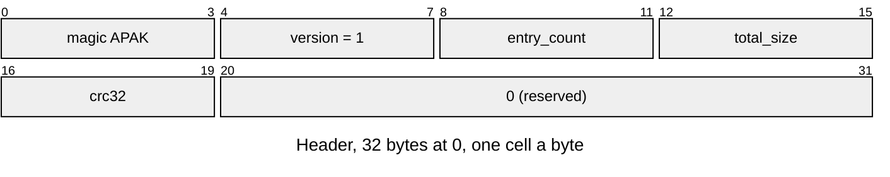
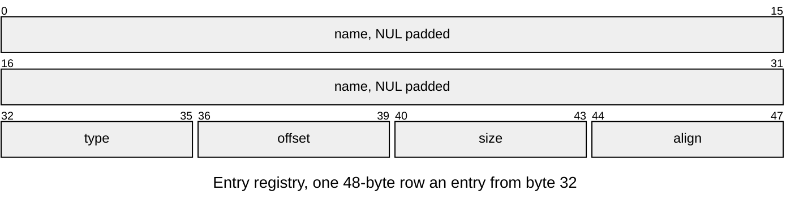
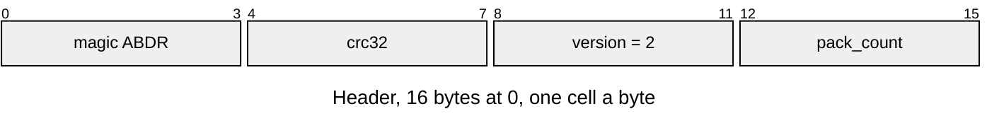
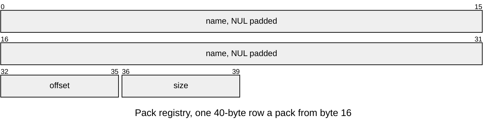

# Pack format

Part of the [asset docs](README.md). The two containers: the pack of named
entries, and the directory that says where each pack lies in a partition.

All integers in the pack format are little-endian. An entry never holds a
pointer: it names its own parts by offset from its own first byte, so the
bytes are usable as mapped and there is no fix-up pass. The [entry types](README.md#entry-types) are listed in the index.

## APAK v1

| Part | At | Size |
|---|---|---|
| Header | 0 | 32 bytes |
| Entry registry | 32 | 48 bytes an entry |
| Content: entry data | each row's `offset` | each row's `size`; zero padding up to the next entry's alignment |

| Rule | Detail |
|---|---|
| Owners | `ASSET_PACK_MAGIC`, `ASSET_PACK_VERSION`, `ASSET_PACK_HEADER_SIZE` (32), `ASSET_PACK_ENTRY_SIZE` (48), `ASSET_NAME_MAX` (32, with the NUL), all in `asset_pack.h`; Python reads the layout from its own `HEADER` and `ENTRY` structs |
| Header | `total_size` is the pack's size and at most the buffer's (a partition may be larger, never smaller); `crc32` is zlib's CRC-32 of every byte from 32 to `total_size` (`crc32_update()` in the hash package); the 12 reserved bytes are zero |
| Base | the pack starts on `ASSET_PACK_BASE_ALIGN` (16) bytes, which a page-aligned mapping and `aligned_alloc()` both give |
| Names | unique, ASCII, 1 to 31 characters; entries are found by name, then checked for their type |
| Type | four ASCII bytes, `ASSET_TYPE(a, b, c, d)` of the owning module |
| Alignment | `align` is a power of two, 16 by default; `offset` is a multiple of it and at or after the registry's end; `offset + size` stays inside `total_size` |
| Order | header, registry, entry data in registry order; gaps zero |
| Errors | the status each failure returns is under [Checks](#checks); `asset_pack_entry()` is the one place a row's offset becomes bytes |

## ABDR v2

A region that holds several packs, the device's partition, starts with a
directory that says where each lies.

| Part | At | Size |
|---|---|---|
| Header | 0 | 16 bytes |
| Pack registry | 16 | 40 bytes a pack |
| Content: packs | each row's `offset` | each row's `size`; each pack starts on its own MMU page, after the registry, in row order |

| Rule | Detail |
|---|---|
| Owners | `ASSET_DIRECTORY_MAGIC`, `_VERSION`, `_HEADER_SIZE` (16), `_ROW_SIZE` (40) and `ASSET_MMU_PAGE_SIZE` (65536) in `asset_directory_format.h`; Python reads them with `read_define()` |
| Header | `crc32` is zlib's CRC-32 of the bytes from 8 (the version) to the registry's end |
| Rows | name nonempty with room for its NUL, unique; `offset` a multiple of `ASSET_MMU_PAGE_SIZE`, past the registry and the previous pack; `offset + size` inside the region |
| Pages | the partition and every pack start on MMU pages, so releasing one mapping cannot invalidate another; padding costs less than a page a pack |
| Order | header, registry, then the packs in row order; gaps zero |

## Checks

`asset_pack_open(base, size)` takes a base pointer and a size and nothing else,
so what it checks and what it returns do not depend on where the bytes came
from. `asset_pack_total_size()` reads the size a pack states from its first 32
bytes, so a reader maps or reads the header first and then the pack alone.
`asset_directory_open()` checks a directory the same way, and
`asset_directory_size()` reads its size from its header. Opening a pack or a
directory, finding an entry and reading it each report the first failure:

| Status | Meaning |
|---|---|
| `ASSET_ERR_NO_PACK` | no bytes: no partition, no file |
| `ASSET_ERR_TRUNCATED` | shorter than a header, or than the size it states |
| `ASSET_ERR_MAGIC` | not an asset pack or pack directory |
| `ASSET_ERR_VERSION` | a pack, directory or entry format version this firmware does not read |
| `ASSET_ERR_SIZE` | the header is malformed: a size that cannot hold it, or reserved bytes in use |
| `ASSET_ERR_CRC` | the bytes do not match the checksum |
| `ASSET_ERR_BOUNDS` | an entry or one of its parts leaves its range, or is misaligned; a directory row outside the region, off its MMU page, over the rows or the pack before it, or with no room for its name's NUL |
| `ASSET_ERR_DUPLICATE` | two directory rows share a name |
| `ASSET_ERR_NOT_FOUND` | no entry or pack has that name |
| `ASSET_ERR_TYPE` | the entry is not of the type asked for |
| `ASSET_ERR_FORMAT` | inside its range, an entry holds a value its reader does not accept |
| `ASSET_ERR_FULL` | as many packs are mounted as the store holds |

A buffer may be larger than the pack, as a mapping is.
