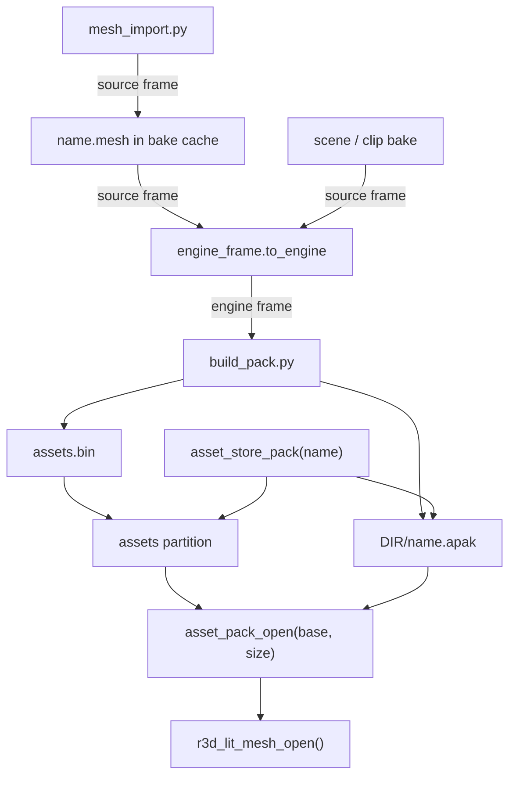
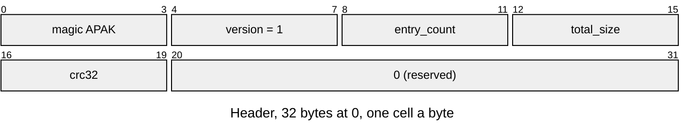
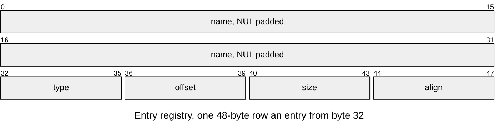
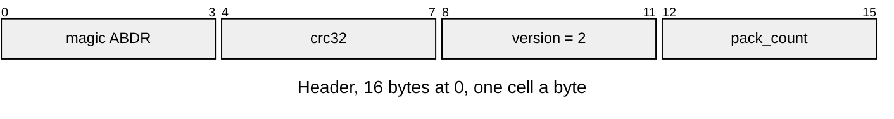
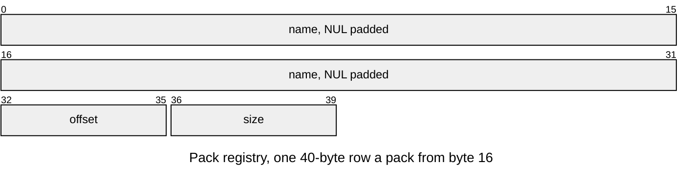
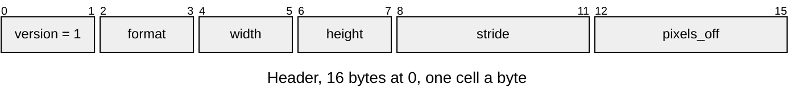
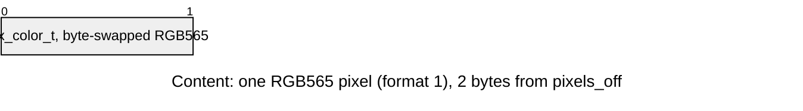
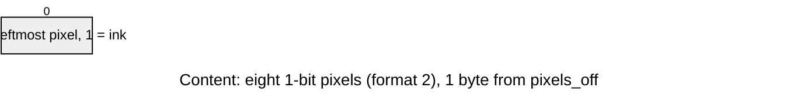
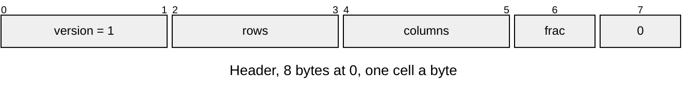
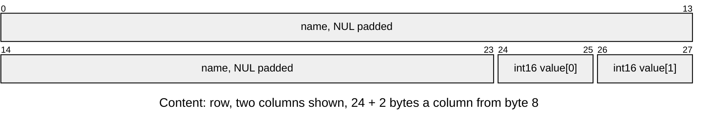

# Asset packs

Content that is data, not code, ships in **packs** and is read where it
lies: in a flash partition the firmware maps, or in a buffer a host read from
a file. Each pack is named after its root asset and is
mounted and checked alone, so reading one costs its own size only. A baked
mesh or an animation clip is one entry. Nothing is compiled into the app for it, so
the app image does not grow with content.

## Packs

A root is a source file nothing else names. `build_pack.py` finds the roots by
searching, so no list is kept:

| Root | Pack | Holds |
|---|---|---|
| `NAME.scene.toml` | `NAME` | its [scene entry](../render/Scene-Files.md#scne-v2) `NAME`, every mesh, skin, skeleton and clip it names |
| `NAME.import.toml` that no scene places | `NAME` | its variants' meshes |
| `NAME.anim.toml` that no scene names | `NAME` | its one clip, baked from its source |
| `NAME.sound.toml` | `NAME` | its one [sound](../audio/Sound-Assets.md), baked from the WAV it names |
| `NAME.image.toml` | `NAME` | its one picture, baked from the PNG it names |
| `NAME.icons.toml` | `NAME` | an image entry per [icon](../tools/Icon-Baker.md), named by the icon, baked from the set's atlas and SVGs |

A `NAME.pack.toml` makes its folder one pack, `NAME`: every root under that
folder puts its entries there instead of making a pack of its own, each with
its stem for id. Folder packs do not nest, and the file holds no settings yet.
The engine's own content, which any app may use, is the folder pack
`engine` (`launcher/main/engine/`); an app's artwork is a folder pack the app
names, mounted while it runs.

The default search is `launcher/main/`. An app's `demo_assets.toml` adds
each folder it names in `demo = ["name", ...]` from `launcher/demo/`.
Only apps name demo assets; a `demo_assets.toml` inside `launcher/demo/` is
refused. Reference content ships only through these selections; see the
[demo assets](../../launcher/demo/README.md).

Ids are unique within a pack whatever their type: the reader finds an entry
by name, then checks its type, so a scene and its clip cannot share a stem,
and `build_pack.py` refuses them, naming both files. A mesh or clip two roots
name would be a shared asset, a pack of its own the others depend on; that
loader is not built, so `build_pack.py` refuses such a tree and names the
entry.

## The pack format

All integers in the pack format are little-endian. An entry never holds a
pointer: it names its own parts by offset from its own first byte, so the
bytes are usable as mapped and there is no fix-up pass. An entry's type is
four characters stored in the registry, so a hex dump reads it; the module that
owns a kind of content defines its type, there is no central list, and
`asset_pack_find()` returns an entry's bytes only for the type asked for.

| Format | Version | Writer (Python) | Reader (C) | Layout |
|---|---|---|---|---|
| `APAK` pack | 1 | `asset/asset_pack.py` | `asset/asset_pack.c` | [APAK v1](#apak-v1) |
| `ABDR` directory | 2 | `asset/asset_directory.py` | `asset/asset_directory.c` | [ABDR v2](#abdr-v2) |
| `LMSH` lit mesh | none | `r3d/lit_mesh.py` | `render/r3d_lit_mesh.c` | [LMSH](../render/Baked-Mesh.md#lmsh) |
| `TRCK` animation tracks | 2 | `anim/tracks_asset.py` | `anim/anim_tracks.c` | [TRCK v2](../Animation-Tracks.md#trck-v2) |
| `SKEL` skeleton | 1 | `anim/skeleton_asset.py` | `anim/anim_skeleton.c` | [SKEL v1](../render/Skeleton-and-Skin.md#skel-v1) |
| `SKIN` skin | 2 | `r3d/skin_asset.py` | `render/r3d_skin.c` | [SKIN v2](../render/Skeleton-and-Skin.md#skin-v2) |
| `SCNE` scene | 2 | `r3d/scene_asset.py` | `scene/scene_asset.c` | [SCNE v2](../render/Scene-Files.md#scne-v2) |
| `SOND` sound | 1 | `audio/sound_asset.py` | `sound/sound.c` | [SOND v1](../audio/Sound-Assets.md#sond-v1) |
| `IMAG` picture | 1 | `gfx/image_asset.py` | `draw/draw_image.c` | [IMAG v1](#imag-v1) |
| `TABL` named int16 rows | 1 | `asset/table_asset.py` | `asset/asset_table.c` | [TABL v1](#tabl-v1) |

Writers are under `launcher/tools/`, readers under `launcher/main/`.

## APAK v1

| Part | At | Size |
|---|---|---|
| Header | 0 | 32 bytes |
| Entry registry | 32 | 48 bytes an entry |
| Content: entry data | each row's `offset` | each row's `size`; zero padding up to the next entry's alignment |

| Rule | Detail |
|---|---|
| Owners | `ASSET_PACK_MAGIC`, `ASSET_PACK_VERSION`, `ASSET_PACK_HEADER_SIZE` (32), `ASSET_PACK_ENTRY_SIZE` (48), `ASSET_NAME_MAX` (32, with the NUL), all in `asset_pack.h`; Python reads the layout from its own `HEADER` and `ENTRY` structs |
| Header | `total_size` is the pack's size and at most the buffer's (a partition may be larger, never smaller); `crc32` is zlib's CRC-32 of every byte from 32 to `total_size` (`asset_crc32()`); the 12 reserved bytes are zero |
| Base | the pack starts on `ASSET_PACK_BASE_ALIGN` (16) bytes, which a page-aligned mapping and `aligned_alloc()` both give |
| Names | unique, ASCII, 1 to 31 characters; entries are found by name, then checked for their type |
| Type | four ASCII bytes, `ASSET_TYPE(a, b, c, d)` of the owning module |
| Alignment | `align` is a power of two, 16 by default; `offset` is a multiple of it and at or after the registry's end; `offset + size` stays inside `total_size` |
| Order | header, registry, entry data in registry order; gaps zero |
| Errors | the status each failure returns is under [Checks](#checks); `asset_pack_entry()` is the one place a row's offset becomes bytes |

## ABDR v2

A region that holds several packs, the device's partition, starts with a
directory that says where each lies.

| Part | At | Size |
|---|---|---|
| Header | 0 | 16 bytes |
| Pack registry | 16 | 40 bytes a pack |
| Content: packs | each row's `offset` | each row's `size`; each pack starts on its own MMU page, after the registry, in row order |

| Rule | Detail |
|---|---|
| Owners | `ASSET_DIRECTORY_MAGIC`, `_VERSION`, `_HEADER_SIZE` (16), `_ROW_SIZE` (40) and `ASSET_MMU_PAGE_SIZE` (65536) in `asset_directory_format.h`; Python reads them with `read_define()` |
| Header | `crc32` is zlib's CRC-32 of the bytes from 8 (the version) to the registry's end |
| Rows | name nonempty with room for its NUL, unique; `offset` a multiple of `ASSET_MMU_PAGE_SIZE`, past the registry and the previous pack; `offset + size` inside the region |
| Pages | the partition and every pack start on MMU pages, so releasing one mapping cannot invalidate another; padding costs less than a page a pack |
| Order | header, registry, then the packs in row order; gaps zero |

## The entry types

An entry is read in place and an offset counts from its first byte. The mesh,
animation, skeleton, skin, scene and sound layouts are in the documents the
table above links.

### IMAG v1

`NAME.image.toml` names a PNG in its own folder (`source = "x.png"`) and how
many quarter turns clockwise take it to the stored pixels (`quarter_turns`, 0
to 3; a picture drawn in a landscape frame is turned into the panel's portrait
one once, here, so drawing it reads rows in order). The source must be opaque.

| Part | At | Size |
|---|---|---|
| Header | 0 | 16 bytes |
| Content: pixel rows | `pixels_off` | `stride * (height - 1) + width` pixels, top row first; 2 bytes each in format 1, one bit each in format 2 |

| Rule | Detail |
|---|---|
| Owners | `DRAW_IMAGE_VERSION`, `_FORMAT_RGB565` (1), `_FORMAT_MONO1` (2, for [icons](../tools/Icon-Baker.md)), `_HEADER_SIZE` (16), `_PIXEL_ALIGN` (4), `_MONO1_STRIDE_STEP` (8) in `draw_image_format.h` |
| Size | `width` and `height` are 1 to 65535 |
| Stride | pixels from one row's start to the next, at least `width`; a multiple of `DRAW_IMAGE_MONO1_STRIDE_STEP` in format 2, so a row is whole bytes |
| Pixels | `pixels_off` at least the header size; 4-aligned in format 1 |
| Errors | `ASSET_ERR_VERSION` for another version; `ASSET_ERR_FORMAT` for an unknown format, an empty picture, a short stride, a stride off its step or `pixels_off` inside the header; `ASSET_ERR_BOUNDS` for rows that leave the entry or misaligned RGB565 rows |
| View | the pixels `draw_image_open()` returns point into the entry |

### TABL v1

[`table_asset.py`](../../launcher/tools/asset/table_asset.py) writes generic
numeric tables. [`curve_asset.py`](../../launcher/tools/gfx/curve_asset.py)
bakes a `NAME.curve.toml` and the PNG it names into one: one bright line
crossing every column of the panel's landscape frame, stored as row `y` of
brightness-weighted heights.

| Part | At | Size |
|---|---|---|
| Header | 0 | 8 bytes |
| Content: rows | `8 + i * (24 + 2 * columns)` | `24 + 2 * columns` bytes a row, in the order written |

| Rule | Detail |
|---|---|
| Owners | `ASSET_TABLE_VERSION`, `_HEADER_SIZE` (8), `_NAME_SIZE` (24) in `asset_table_format.h` |
| Header | `frac` is the fractional bits of every value (0 to 255); the reserved byte is zero |
| Dimensions | 1 to 65535 rows and columns; the entry is exactly `8 + rows * (24 + 2 * columns)` bytes |
| Names | at most 23 UTF-8 bytes, then the NUL, in the 24-byte field |
| Values | int16, `VALUE_MIN` to `VALUE_MAX` in `table_asset.py` |
| Errors | `asset_table_open()`: `ASSET_ERR_BOUNDS` for an unaligned (2-byte) base or a short header; `ASSET_ERR_VERSION`; `ASSET_ERR_FORMAT` for empty dimensions, the reserved byte, a size off by a byte or an unterminated name. `asset_table_row()`: `ASSET_ERR_FORMAT` for another column count, `ASSET_ERR_NOT_FOUND` for an absent name |
| View | values point into the mounted pack; the reader allocates nothing |

## Checks

`asset_pack_open(base, size)` takes a base pointer and a size and nothing else,
so what it checks and what it returns do not depend on where the bytes came
from. `asset_pack_total_size()` reads the size a pack states from its first 32
bytes, so a reader maps or reads the header first and then the pack alone.
`asset_directory_open()` checks a directory the same way, and
`asset_directory_size()` reads its size from its header. Opening a pack or a
directory, finding an entry and reading it each report the first failure:

| Status | Meaning |
|---|---|
| `ASSET_ERR_NO_PACK` | no bytes: no partition, no file |
| `ASSET_ERR_TRUNCATED` | shorter than a header, or than the size it states |
| `ASSET_ERR_MAGIC` | not an asset pack or pack directory |
| `ASSET_ERR_VERSION` | a pack, directory or entry format version this firmware does not read |
| `ASSET_ERR_SIZE` | the header is malformed: a size that cannot hold it, or reserved bytes in use |
| `ASSET_ERR_CRC` | the bytes do not match the checksum |
| `ASSET_ERR_BOUNDS` | an entry or one of its parts leaves its range, or is misaligned; a directory row outside the region, off its MMU page, over the rows or the pack before it, or with no room for its name's NUL |
| `ASSET_ERR_DUPLICATE` | two directory rows share a name |
| `ASSET_ERR_NOT_FOUND` | no entry or pack has that name |
| `ASSET_ERR_TYPE` | the entry is not of the type asked for |
| `ASSET_ERR_FORMAT` | inside its range, an entry holds a value its reader does not accept |
| `ASSET_ERR_FULL` | as many packs are mounted as the store holds |

A buffer may be larger than the pack, as a mapping is.

## The store

`asset_store_pack(name)` mounts pack `name` and checks it on its first
use, then counts uses; `asset_store_release(name)` drops one, and at none the
pack is unmapped or freed. A missing or bad pack is `NULL` and one log
line saying why. At most `ASSET_STORE_MOUNTS_MAX` packs are mounted at once,
and the engine pack, mounted when the first system icon is drawn, keeps its
slot for the run; `asset_store_mounted()` counts them. `scene_load(id)` mounts pack `id` and opens its scene
entry `id`, every mesh, skin, skeleton and clip it names from it, failing on the
first missing or malformed one with the id and the status; `scene_unload()`
releases it. A scene that fails to load is not drawn; showing that is up to
the app.

## The device

`launcher/partitions.csv` holds the packs in a data partition labelled
`assets`, subtype `0x40` (the first application subtype), at the end of the
16 MB flash.

| Partition | Offset | Size |
|---|---|---|
| `nvs` | `0x9000` | `0x6000` |
| `phy_init` | `0xF000` | `0x1000` |
| `factory` (the app) | `0x10000` | `0x7F0000` |
| `coredump` | `0x800000` | `0x10000` |
| `assets` | `0x810000` | `0x7F0000` |

On the first mount the store finds the partition and reads its directory into
RAM, kept for good. Each pack is then mapped alone from its slot. The
directory copy holds no MMU page and keeps enumeration independent of pack
mounts. Reads of a mapped
pack go through the flash cache as the app's own const data does, so an entry
costs no RAM and no copy. When the partition table is older than the firmware,
the directory is missing or a check fails, the log says why and the content
that asked stays out.

## The host

The host lays packs out the way a card will: one file per pack,
`<dir>/<name>.apak`. `asset_file_open()` reads a file into aligned memory
outside the host tests' modelled heap, as a mapped partition costs the board
none, and calls the same `asset_pack_open()`. The store's `dir` is
`AUTANA_ASSET_DIR`, set per process; `run_tests.sh` and the render scripts
write the packs in the tree and set it, or build the folder into the
renderer.

## Tools

| Tool | Does |
|---|---|
| `mesh_import.py --out DIR` | bakes a mesh and writes `<name>.mesh`, one entry, into DIR (a scratch bake) |
| `build_pack.py -o DIR [--image FILE]` | writes `DIR/<pack>.apak` for each root in `launcher/main` and its selected demo folders, and with `--image` the partition image |
| `build_pack.py --pack-of ID` | prints the pack that holds mesh `ID` |
| `build_pack.py [--bake-cache DIR] [--offline]` | takes every mesh from the bake cache by `launcher/bakes.lock` |
| `build_pack.py --skip-unlocked FILE` | leaves out each pack whose bakes only lack their lock rows and names it in FILE; any other missing bake still fails |
| `bake/bake.py list\|check\|fetch` | the bakes the packs need, each keyed on what makes it, and the lock of their bytes |
| `bake/bake.py bake` then `lock --from-run N` | makes the bakes the lock lacks into the cache; locks the ones a CI run made |
| `rebake.py` | rewrites one `.mesh`'s clusters and octree; a fixed point |

`launcher/tools/asset/asset_pack.py` writes the pack,
`launcher/tools/asset/asset_directory.py` the directory,
`launcher/tools/r3d/mesh_asset.py` and `lit_mesh.py` the mesh
entry, `launcher/tools/anim/tracks_asset.py` of the clip entry,
`launcher/tools/gfx/image_asset.py` of the image entry, and
`launcher/tools/audio/sound_asset.py` of the [sound entry](../audio/Sound-Assets.md); `asset_pack.c`,
`asset_directory.c`, `r3d_lit_mesh.c`, `anim_tracks.c`, `draw_image.c` and
`sound.c` are the respective readers.

No mesh is committed: each is a bake product, fetched by its lock row; a clip
or image entry is baked from its source when the packs are built. Packs are never
committed: the firmware build, the host tests and
the render scripts each write the tree they are in, so there is no second copy
to keep in step.

How the meshes are cached
([Cached-Bakes-Design-Sketch.md](../plans/Cached-Bakes-Design-Sketch.md)):
`launcher/tools/bake/bake.py` keys each one on its recipe, its sources and
the code that bakes it; `launcher/bakes.lock`, written only by that tool,
records the bytes made for each key, and main publishes those files to the
repository's `bakes` release. `build_pack.py`, and so the firmware build, the
host tests and the render scripts, takes every mesh from the bake cache by
its lock row: the user cache, one per user and shared by every clone and
worktree, or the folder `AUTANA_BAKE_CACHE` names for one process. What the
cache lacks is downloaded from the release, or before main publishes it from
the CI run that made it (that needs a GitHub token: `GH_TOKEN`, or `gh`
signed in). **A build with a cold cache needs the network once**; offline, it
fails naming every mesh it cannot get. Files land in the cache by rename, so
builds running side by side never read half a file.

A pull request that changes what a mesh is made from gets its bake from the
Bakes workflow: its CPU job bakes the meshes the lock lacks and uploads them,
and the lock check fails until the author runs `bake.py lock --from-run N`
with that run and commits the lock. A fit needs the CUDA GPU, so the Bakes GPU
workflow makes it, started by hand on the branch; no pull request reaches that
runner. `--from-run` repeats, so the two runs lock together
(`--from-run CPU --from-run GPU`); two runs that made one key with different
bytes fail, naming both. Only a run's
files can be locked, so every locked file can be published from main; a fit's
reference frames stay on the machine that fitted. The exception is a seeded
row (`seeded = true`), written by `bake.py lock --seed` from the files the tree
held: its bytes were carried over, not made by the code its key names, and
`check` lists such rows until a run makes their keys again. A row a run wrote
names its `host`, the system and machine that made the bytes, since a bake
repeats byte for byte only on one kind of host (a Linux and a Windows Blender
export of the same `.blend` differ in the last bit of some animation keys).
A mesh bake differs by CPU vendor too (an AMD and an Intel host trace a few
rays an ulp apart), so the lock's `mesh_cpu_vendor` line names the vendor its
meshes were made on. A run records its host's vendor; `lock --from-run` refuses
a run that made a mesh on another vendor, naming both, and the CPU job fails
before baking when the hosted runner it got is another vendor's. Either way,
re-run the failed job until it lands on the lock's vendor.

The lock's `[[poses]]` rows hold the digest and count of each camera-path sampling.

| Who | Does |
|---|---|
| a build whose poses rows are all locked | reads them; never builds or runs `track_host`, so needs no host C compiler |
| a key whose row is missing | samples through `track_host` (a host C compiler), or leaves the bake unlocked, naming `bake.py lock` |
| `bake.py lock` | samples every needed row again and writes it with its `host`, dropping the rest; the only writer |
| `bake.py check` | samples every needed row again; a missing, unneeded or differing row fails, exactly |

### Flashing

The firmware build writes the packs to `assets/` in its build directory and
the partition image to `assets.bin`, listed with the partition's offset in
`flash_args`, so every `autana flash` writes the packs with the app.
`idf.py assets-flash` writes just that region, in seconds, after a change to
the meshes alone. The QEMU image carries it because it merges every file in
`flash_args`.
