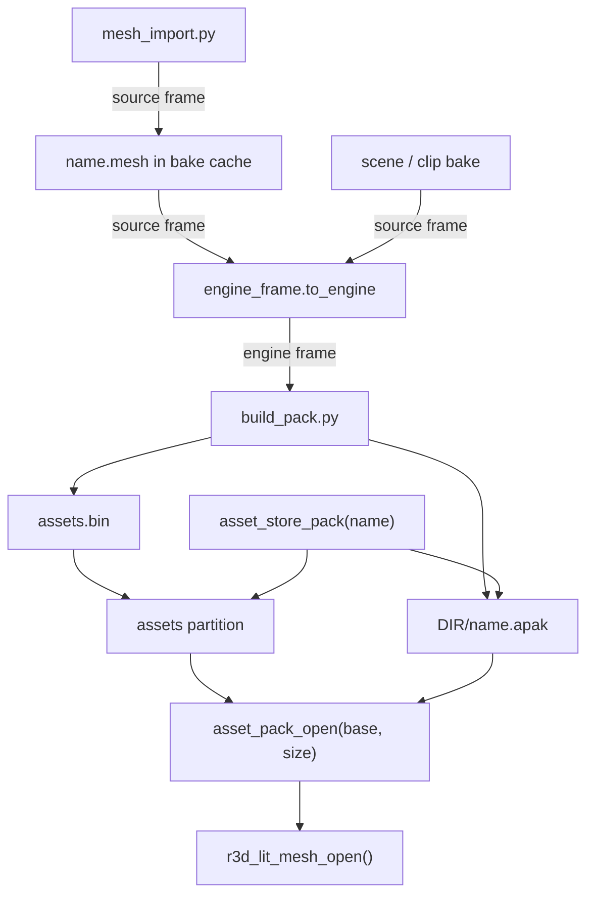
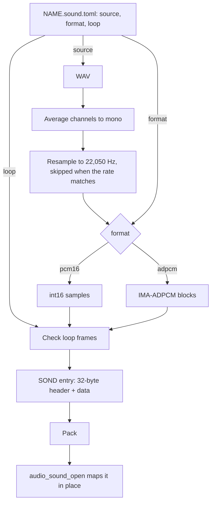

# Asset packs

Content that is data, not code, ships in **packs** and is read where it
lies: in a flash partition the firmware maps, or in a buffer a host read from
a file. Each pack is named after its root asset and is
mounted and checked alone, so reading one costs its own size only. A baked
mesh or an animation clip is one entry. Nothing is compiled into the app for it, so
the app image does not grow with content.

## Packs

A root is a source file nothing else names. `build_pack.py` finds the roots by
searching, so no list is kept:

| Root | Pack | Holds |
|---|---|---|
| `NAME.scene.toml` | `NAME` | its [scene entry](../render/Scene-Files.md#the-scene-entry) `NAME`, every mesh, skin, skeleton and clip it names |
| `NAME.import.toml` that no scene places | `NAME` | its variants' meshes |
| `NAME.anim.toml` that no scene names | `NAME` | its one clip, baked from its source |
| `NAME.sound.toml` | `NAME` | its one sound, baked from the WAV it names |
| `NAME.image.toml` | `NAME` | its one picture, baked from the PNG it names |
| `NAME.icons.toml` | `NAME` | an image entry per [icon](../tools/Icon-Baker.md), named by the icon, baked from the set's atlas and SVGs |

A `NAME.pack.toml` makes its folder one pack, `NAME`: every root under that
folder puts its entries there instead of making a pack of its own, each with
its stem for id. Folder packs do not nest, and the file holds no settings yet.
The engine's own content, which any app may use, is the folder pack
`engine` (`launcher/main/engine/`); an app's artwork is a folder pack the app
names, mounted while it runs.

The default search is `launcher/main/`. An app's `demo_assets.toml` adds
each folder it names in `demo = ["name", ...]` from `launcher/demo/`.
Only apps name demo assets; a `demo_assets.toml` inside `launcher/demo/` is
refused. Reference content ships only through these selections; see the
[demo assets](../../launcher/demo/README.md).

Ids are unique within a pack whatever their type: the reader finds an entry
by name, then checks its type, so a scene and its clip cannot share a stem,
and `build_pack.py` refuses them, naming both files. A mesh or clip two roots
name would be a shared asset, a pack of its own the others depend on; that
loader is not built, so `build_pack.py` refuses such a tree and names the
entry.

## The pack format

All integers in the pack format are little-endian. An entry never holds a
pointer: it names its own parts by offset from its own first byte, so the
bytes are usable as mapped and there is no fix-up pass.

| Part | Size | Holds |
|---|---|---|
| Header | 32 bytes | `"APAK"`, format version, entry count, total size, CRC-32 of every byte after the header, 12 reserved bytes that must be zero |
| Entry table | 48 bytes per entry | name (32 bytes, NUL padded, so at most 31 characters), type, offset, size, alignment |
| Entry data | each at an offset that is a multiple of its alignment, after the table | the entry's bytes |

Offsets in the table count from the start of the pack. The writer pads each
entry to its alignment (16 by default), and the pack must itself start on a
16-byte boundary, which a page-aligned mapping and `aligned_alloc()` both
give. The entry rows are read in one place, `asset_pack_entry()`.

An entry's type is four characters stored in the table, so a hex dump reads it.
The module that owns a kind of content defines its type, and there is no central
list; `asset_pack_find()` returns an entry's bytes only for the type asked for.

| Type | Entry | Defined by |
|---|---|---|
| `LMSH` | A lit mesh | [The baked mesh](../render/Mesh-Import.md#the-baked-mesh) |
| `TRCK` | The tracks of one animation | [The pack entry](../Animation-Tracks.md#the-pack-entry) |
| `IMAG` | A picture | [The image entry](#the-image-entry) |
| `TABL` | Named int16 rows | [The table entry](#the-table-entry) |

### The image entry

`NAME.image.toml` names a PNG in its own folder (`source = "x.png"`) and how
many quarter turns clockwise take it to the stored pixels
(`quarter_turns`, 0 to 3; a picture drawn in a landscape frame is turned
into the panel's portrait one once, here, so drawing it reads rows in
order). The source must be opaque. Offsets count from the entry's first
byte.

| Offset | Size | Holds |
|---|---|---|
| 0 | 2 | version, 1 |
| 2 | 2 | format: 1 is `gfx_color_t`, byte-swapped RGB565 as the panel takes it; 2 is one bit a pixel, the most significant bit leftmost and 1 ink, for [icons](../tools/Icon-Baker.md) |
| 4 | 2 | width |
| 6 | 2 | height |
| 8 | 4 | stride: pixels from one row's start to the next, at least the width; a whole number of bytes for one bit a pixel |
| 12 | 4 | where the rows start, after the header; 4-aligned for RGB565 |
| rows | stride x (height - 1) + width pixels | the pixels, top row first |

`draw_image_open()` returns `ASSET_ERR_VERSION` for another version,
`ASSET_ERR_FORMAT` for a format it does not read, an empty picture, a stride
shorter than a row or, one bit a pixel, not whole bytes, or rows over the
header, and `ASSET_ERR_BOUNDS` for rows that leave the entry or RGB565 rows
that are misaligned. The pixels it returns point into the
entry.

### The table entry

[`table_asset.py`](../../launcher/tools/asset/table_asset.py) writes generic
numeric tables. All fields are little-endian and offsets start at the entry's
first byte.

| Part | Size | Holds |
|---|---|---|
| Header | 8 bytes | u16 version (1), u16 rows, u16 columns, u8 fractional bits, u8 reserved (0) |
| Row | 24 + 2 x columns bytes | NUL-padded name[24], then int16 values[columns] |

Row i starts at `8 + i * (24 + 2 * columns)`. `asset_table_open()` requires
a 2-byte-aligned base and a complete header (`ASSET_ERR_BOUNDS`), version 1
(`ASSET_ERR_VERSION`), nonempty dimensions, zero reserved byte, exact entry
size and a NUL in every name (`ASSET_ERR_FORMAT`). `asset_table_row()` checks
the requested column count (`ASSET_ERR_FORMAT`) and looks up a name
(`ASSET_ERR_NOT_FOUND` when absent). Its values point into the mounted pack;
the reader allocates nothing.

[`curve_asset.py`](../../launcher/tools/gfx/curve_asset.py) bakes a
`NAME.curve.toml` and the PNG it names into entry NAME: one bright line
crossing every column of the panel's landscape frame, stored as row `y` of
brightness-weighted heights.

### The sound entry

[`sound_asset.py`](../../launcher/tools/audio/sound_asset.py) bakes
`NAME.sound.toml` and its WAV into entry NAME. The WAV supplies the level;
there is no gain setting. The TOML is the only source of format and loops.

| Key | Holds |
|---|---|
| `source` | Required WAV filename in the same folder, integer PCM 8/16/24/32-bit, any channel count |
| `format` | Required `"pcm16"` or `"adpcm"` |
| `loop` | Optional `[start, end]` in stored 22,050 Hz frames; omitted means one-shot |

Channels are averaged before a Hann-windowed sinc filter resamples to mono
22,050 Hz. The filter spans 32 zero crossings on either side and widens for
downsampling. Matching-rate sources skip it; samples round and clamp to int16.

The 32-byte header is little-endian; offsets count from the entry's first byte.

| At | Type | Holds |
|---|---|---|
| 0 | u16 | version 1 |
| 2 | u8 | format 0 PCM16 or 1 IMA-ADPCM |
| 3 | u8 | channels 1 |
| 4 | u32 | sample rate 22,050 Hz |
| 8 | u32 | nonzero frame count |
| 12 | u32 | loop start |
| 16 | u32 | loop end, exclusive; 0 means one-shot |
| 20 | u16 | block frames, 0 for PCM16; odd for ADPCM |
| 22 | u16 | reserved 0 |
| 24 | u32 | reserved 0 |
| 28 | u32 | data offset, at least 32 and 4-aligned |

PCM16 data is signed little-endian samples. Each ADPCM block holds an int16
predictor, u8 step index in 0..88 and u8 reserved zero, then low-nibble-first
IMA codes. Its byte size is `4 + (block_frames - 1) / 2`.

The baker takes its block size from `AUDIO_SOUND_DEFAULT_BLOCK_FRAMES` in
`audio_sound.h`. The first block starts at index zero; later blocks carry the
previous ending index. Each block opens with its first sample stored exactly
as the predictor. The last block is padded by repeating its final sample, and
`frames` tells the reader where to stop.

`audio_sound_open()` maps the samples in place through `asset_entry_read()`.
Failed opens zero the view.

| Status | Cause |
|---|---|
| `ASSET_ERR_VERSION` | Another version, checked by `asset_entry_validate()` |
| `ASSET_ERR_BOUNDS` | Data offset below 32 or misaligned, or data past the entry |
| `ASSET_ERR_FORMAT` | Unknown format, channels other than 1, rate other than 22,050 Hz, or zero frames |
| `ASSET_ERR_FORMAT` | Nonzero reserved fields or header gap |
| `ASSET_ERR_FORMAT` | PCM16 block_frames nonzero, or ADPCM block_frames even (including zero) |
| `ASSET_ERR_FORMAT` | Loop end 0 with start nonzero, or a loop without `start < end <= frames` |
| `ASSET_ERR_FORMAT` | ADPCM loop start off a block boundary |
| `ASSET_ERR_FORMAT` | ADPCM block header step index above 88 or reserved byte nonzero |

The baker rejects misaligned starts and names their two neighbours.

The M2 mixer reads sounds through `audio_sound_cursor_t`.
`audio_sound_seek()` selects a stored frame; ADPCM seeks must be block-aligned,
except that seeking to `frames` selects the end. A failed seek zeroes the cursor.
`audio_sound_read()` copies up to the requested int16 samples across blocks and
returns the count, stopping at `frames`. The cursor's `position` counts stored
frames, so the caller can bound reads at `loop_end` and loop by seeking to
`loop_start`. The view and its mapped pack must outlive the cursor.

`format` is the only switch.

## The pack directory

A region that holds several packs, the device's partition, starts with a
directory that says where each lies:

| Part | Size | Holds |
|---|---|---|
| Header | 16 bytes | `"ABDR"`, CRC-32 of every byte after it to the end of the rows, format version, pack count |
| Rows | 40 bytes per pack | name (32 bytes, NUL padded), offset from the region's start, size |
| Packs | each starting on its own 64 KB MMU page, after the rows, in row order | the pack's bytes |

The partition and every pack start on MMU pages so releasing one mapping
cannot invalidate another pack. Padding costs less than one MMU page per pack;
[`asset_directory.py`](../../launcher/tools/asset/asset_directory.py) writes version 2
using `ASSET_MMU_PAGE_SIZE` from `asset_directory.h`.

## Checks

`asset_pack_open(base, size)` takes a base pointer and a size and nothing else,
so what it checks and what it returns do not depend on where the bytes came
from. `asset_pack_total_size()` reads the size a pack states from its first 32
bytes, so a reader maps or reads the header first and then the pack alone.
`asset_directory_open()` checks a directory the same way, and
`asset_directory_size()` reads its size from its header. Opening a pack or a
directory, finding an entry and reading it each report the first failure:

| Status | Meaning |
|---|---|
| `ASSET_ERR_NO_PACK` | no bytes: no partition, no file |
| `ASSET_ERR_TRUNCATED` | shorter than a header, or than the size it states |
| `ASSET_ERR_MAGIC` | not an asset pack or pack directory |
| `ASSET_ERR_VERSION` | a pack, directory or entry format version this firmware does not read |
| `ASSET_ERR_SIZE` | the header is malformed: a size that cannot hold it, or reserved bytes in use |
| `ASSET_ERR_CRC` | the bytes do not match the checksum |
| `ASSET_ERR_BOUNDS` | an entry or one of its parts leaves its range, or is misaligned; a directory row outside the region, off its MMU page, over the rows or the pack before it, or with no room for its name's NUL |
| `ASSET_ERR_DUPLICATE` | two directory rows share a name |
| `ASSET_ERR_NOT_FOUND` | no entry or pack has that name |
| `ASSET_ERR_TYPE` | the entry is not of the type asked for |
| `ASSET_ERR_FORMAT` | inside its range, an entry holds a value its reader does not accept |
| `ASSET_ERR_FULL` | as many packs are mounted as the store holds |

A buffer may be larger than the pack, as a mapping is.

## The store

`asset_store_pack(name)` mounts pack `name` and checks it on its first
use, then counts uses; `asset_store_release(name)` drops one, and at none the
pack is unmapped or freed. A missing or bad pack is `NULL` and one log
line saying why. At most `ASSET_STORE_MOUNTS_MAX` packs are mounted at once,
and the engine pack, mounted when the first system icon is drawn, keeps its
slot for the run; `asset_store_mounted()` counts them. `scene_load(id)` mounts pack `id` and opens its scene
entry `id`, every mesh, skin, skeleton and clip it names from it, failing on the
first missing or malformed one with the id and the status; `scene_unload()`
releases it. A scene that fails to load is not drawn; showing that is up to
the app.

## The device

`launcher/partitions.csv` holds the packs in a data partition labelled
`assets`, subtype `0x40` (the first application subtype), at the end of the
16 MB flash.

| Partition | Offset | Size |
|---|---|---|
| `nvs` | `0x9000` | `0x6000` |
| `phy_init` | `0xF000` | `0x1000` |
| `factory` (the app) | `0x10000` | `0x7F0000` |
| `coredump` | `0x800000` | `0x10000` |
| `assets` | `0x810000` | `0x7F0000` |

On the first mount the store finds the partition and reads its directory into
RAM, kept for good. Each pack is then mapped alone from its slot. The
directory copy holds no MMU page and keeps enumeration independent of pack
mounts. Reads of a mapped
pack go through the flash cache as the app's own const data does, so an entry
costs no RAM and no copy. When the partition table is older than the firmware,
the directory is missing or a check fails, the log says why and the content
that asked stays out.

## The host

The host lays packs out the way a card will: one file per pack,
`<dir>/<name>.apak`. `asset_file_open()` reads a file into aligned memory
outside the host tests' modelled heap, as a mapped partition costs the board
none, and calls the same `asset_pack_open()`. The store's `dir` is
`AUTANA_ASSET_DIR`, set per process; `run_tests.sh` and the render scripts
write the packs in the tree and set it, or build the folder into the
renderer.

## Tools

| Tool | Does |
|---|---|
| `mesh_import.py --out DIR` | bakes a mesh and writes `<name>.mesh`, one entry, into DIR (a scratch bake) |
| `build_pack.py -o DIR [--image FILE]` | writes `DIR/<pack>.apak` for each root in `launcher/main` and its selected demo folders, and with `--image` the partition image |
| `build_pack.py --pack-of ID` | prints the pack that holds mesh `ID` |
| `build_pack.py [--bake-cache DIR] [--offline]` | takes every mesh from the bake cache by `launcher/bakes.lock` |
| `build_pack.py --skip-unlocked FILE` | leaves out each pack whose bakes only lack their lock rows and names it in FILE; any other missing bake still fails |
| `bake/bake.py list\|check\|fetch` | the bakes the packs need, each keyed on what makes it, and the lock of their bytes |
| `bake/bake.py bake` then `lock --from-run N` | makes the bakes the lock lacks into the cache; locks the ones a CI run made |
| `rebake.py` | rewrites one `.mesh`'s clusters and octree; a fixed point |

`launcher/tools/asset/asset_pack.py` writes the pack,
`launcher/tools/asset/asset_directory.py` the directory,
`launcher/tools/r3d/mesh_asset.py` and `lit_mesh.py` the mesh
entry, `launcher/tools/anim/tracks_asset.py` of the clip entry,
`launcher/tools/gfx/image_asset.py` of the image entry, and
`launcher/tools/audio/sound_asset.py` of the sound entry; `asset_pack.c`,
`asset_directory.c`, `r3d_lit_mesh.c`, `anim_tracks.c`, `draw_image.c` and
`audio_sound.c` are the respective readers.

No mesh is committed: each is a bake product, fetched by its lock row; a clip
or image entry is baked from its source when the packs are built. Packs are never
committed: the firmware build, the host tests and
the render scripts each write the tree they are in, so there is no second copy
to keep in step.

How the meshes are cached
([Cached-Bakes-Design-Sketch.md](../plans/Cached-Bakes-Design-Sketch.md)):
`launcher/tools/bake/bake.py` keys each one on its recipe, its sources and
the code that bakes it; `launcher/bakes.lock`, written only by that tool,
records the bytes made for each key, and main publishes those files to the
repository's `bakes` release. `build_pack.py`, and so the firmware build, the
host tests and the render scripts, takes every mesh from the bake cache by
its lock row: the user cache, one per user and shared by every clone and
worktree, or the folder `AUTANA_BAKE_CACHE` names for one process. What the
cache lacks is downloaded from the release, or before main publishes it from
the CI run that made it (that needs a GitHub token: `GH_TOKEN`, or `gh`
signed in). **A build with a cold cache needs the network once**; offline, it
fails naming every mesh it cannot get. Files land in the cache by rename, so
builds running side by side never read half a file.

A pull request that changes what a mesh is made from gets its bake from the
Bakes workflow: its CPU job bakes the meshes the lock lacks and uploads them,
and the lock check fails until the author runs `bake.py lock --from-run N`
with that run and commits the lock. A fit needs the CUDA GPU, so the Bakes GPU
workflow makes it, started by hand on the branch; no pull request reaches that
runner. `--from-run` repeats, so the two runs lock together
(`--from-run CPU --from-run GPU`); two runs that made one key with different
bytes fail, naming both. Only a run's
files can be locked, so every locked file can be published from main; a fit's
reference frames stay on the machine that fitted. The exception is a seeded
row (`seeded = true`), written by `bake.py lock --seed` from the files the tree
held: its bytes were carried over, not made by the code its key names, and
`check` lists such rows until a run makes their keys again. A row a run wrote
names its `host`, the system and machine that made the bytes, since a bake
repeats byte for byte only on one kind of host (a Linux and a Windows Blender
export of the same `.blend` differ in the last bit of some animation keys).
A mesh bake differs by CPU vendor too (an AMD and an Intel host trace a few
rays an ulp apart), so the lock's `mesh_cpu_vendor` line names the vendor its
meshes were made on. A run records its host's vendor; `lock --from-run` refuses
a run that made a mesh on another vendor, naming both, and the CPU job fails
before baking when the hosted runner it got is another vendor's. Either way,
re-run the failed job until it lands on the lock's vendor.

The lock's `[[poses]]` rows hold the digest and count of each camera-path sampling.

| Who | Does |
|---|---|
| a build whose poses rows are all locked | reads them; never builds or runs `track_host`, so needs no host C compiler |
| a key whose row is missing | samples through `track_host` (a host C compiler), or leaves the bake unlocked, naming `bake.py lock` |
| `bake.py lock` | samples every needed row again and writes it with its `host`, dropping the rest; the only writer |
| `bake.py check` | samples every needed row again; a missing, unneeded or differing row fails, exactly |

### Flashing

The firmware build writes the packs to `assets/` in its build directory and
the partition image to `assets.bin`, listed with the partition's offset in
`flash_args`, so every `autana flash` writes the packs with the app.
`idf.py assets-flash` writes just that region, in seconds, after a change to
the meshes alone. The QEMU image carries it because it merges every file in
`flash_args`.
