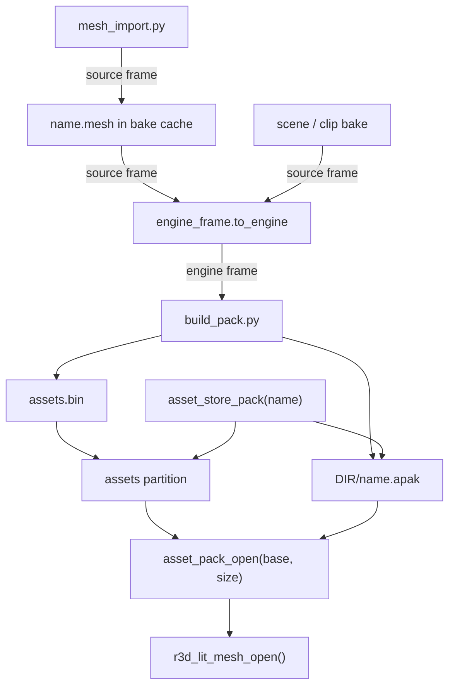

# Asset packs

Content that is data, not code, ships in **packs** and is read where it
lies: in a flash partition the firmware maps, or in a buffer a host read from
a file.

Each pack is named after its root asset and is mounted and checked alone, so
reading one costs its own size only. A baked mesh or an animation clip is one
entry. Nothing is compiled into the app for it, so the app image does not grow
with content.

## Pages

| Page | Holds |
|---|---|
| [Loading-Packs.md](Loading-Packs.md) | the store, the device and the host: mounting a pack, opening an entry, `scene_load` |
| [Pack-Format.md](Pack-Format.md) | the `APAK` pack, the `ABDR` directory and the checks every open makes |
| [Image-Entries.md](Image-Entries.md) | the `IMAG` picture and its reader |
| [Table-Entries.md](Table-Entries.md) | the `TABL` rows of int16 and `asset_table` |
| [Building-Packs.md](Building-Packs.md) | pack roots, the tools and flashing |
| [Bakes.md](Bakes.md) | bake keys, the lock, `check` and the poses rows |

## Entry types

An entry's type is four characters stored in the registry, so a hex dump
reads it. The module that owns a kind of content defines its type, there is no
central list, and `asset_pack_find()` returns an entry's bytes only for the type
asked for.

| Format | Version | Writer (Python) | Reader (C) | Layout |
|---|---|---|---|---|
| `APAK` pack | 1 | `asset/asset_pack.py` | `asset/asset_pack.c` | [APAK v1](Pack-Format.md#apak-v1) |
| `ABDR` directory | 2 | `asset/asset_directory.py` | `asset/asset_directory.c` | [ABDR v2](Pack-Format.md#abdr-v2) |
| `LMSH` lit mesh | none | `r3d/lit_mesh.py` | `render/r3d_lit_mesh.c` | [LMSH](../render/Baked-Mesh.md#lmsh) |
| `LCOL` colour sets | 1 | `r3d/lcol_asset.py` | `render/r3d_lit_mesh.c` | [LCOL v1](../render/Baked-Mesh.md#lcol-v1) |
| `TRCK` animation tracks | 3 | `anim/tracks_asset.py` | `anim/anim_tracks.c` | [TRCK v3](../render/Animation-Tracks.md#trck-v3) |
| `SKEL` skeleton | 1 | `anim/skeleton_asset.py` | `anim/anim_skeleton.c` | [SKEL v1](../render/Skeleton-and-Skin.md#skel-v1) |
| `SKIN` skin | 2 | `r3d/skin_asset.py` | `render/r3d_skin.c` | [SKIN v2](../render/Skeleton-and-Skin.md#skin-v2) |
| `SCNE` scene | 5 | `r3d/scene_asset.py` | `scene/scene_asset.c` | [SCNE v5](../render/Scene-Files.md#scne-v5) |
| `SOND` sound | 1 | `audio/sound_asset.py` | `sound/sound.c` | [SOND v1](../audio/Sound-Assets.md#sond-v1) |
| `IMAG` picture | 1 | `gfx/image_asset.py` | `draw/draw_image.c` | [IMAG v1](Image-Entries.md#imag-v1) |
| `TABL` named int16 rows | 1 | `asset/table_asset.py` | `asset/asset_table.c` | [TABL v1](Table-Entries.md#tabl-v1) |

Writers are under `launcher/tools/`, readers under `launcher/main/`.
