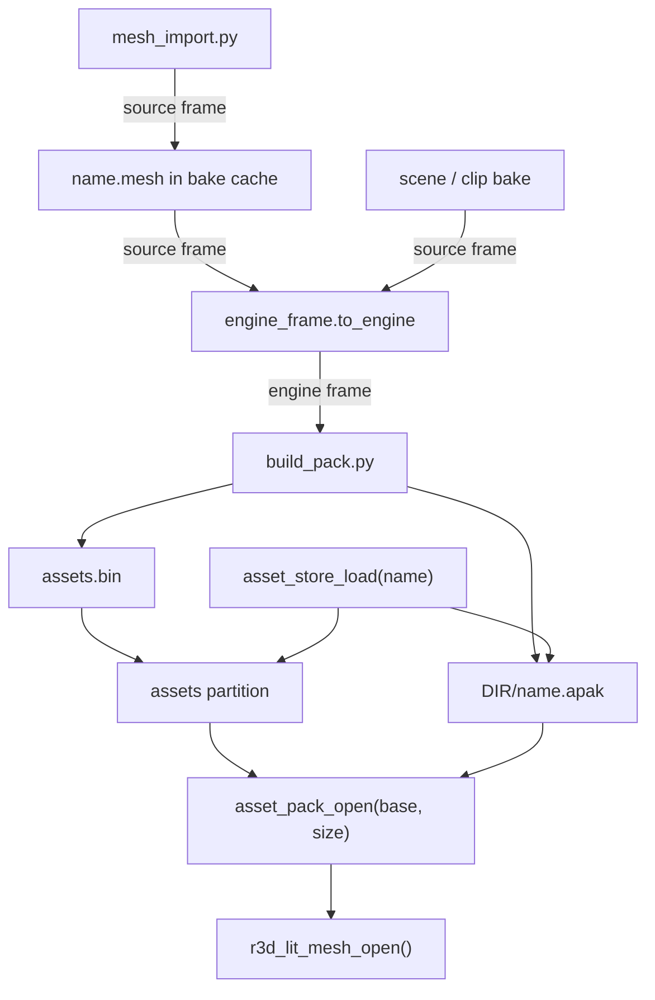

# Asset packs

Content that is data, not code, ships in **packs** and is read where it
lies: in a flash partition the firmware maps, or in a buffer a host read from
a file.

Each pack is named after its root asset and is mounted and checked alone, so
reading one costs its own size only. A baked mesh or an animation clip is one
entry. Nothing is compiled into the app for it, so the app image does not grow
with content.

## Pages

| Page | Holds |
|---|---|
| [Loading-Packs.md](Loading-Packs.md) | async loading, the store, the device and the host: mounting a pack, opening an entry, `scene_load` |
| [formats/](formats/README.md) | every entry layout, one page each, from the `APAK` pack and `ABDR` directory to each content type, and the checks every open makes |
| [Image-Entries.md](Image-Entries.md) | the `IMAG` picture and its reader |
| [Table-Entries.md](Table-Entries.md) | the `TABL` rows of int16 and `asset_table` |
| [Building-Packs.md](Building-Packs.md) | pack roots, the tools and flashing |
| [Bakes.md](Bakes.md) | bake keys, the lock, `check` and the poses rows |

## Entry types

An entry's type is four characters stored in the registry, so a hex dump
reads it. Each type's layout has its own page under
[formats/](formats/README.md), with the rules every entry keeps.
