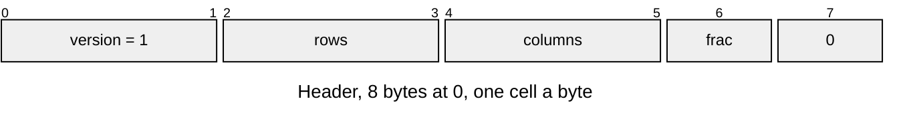
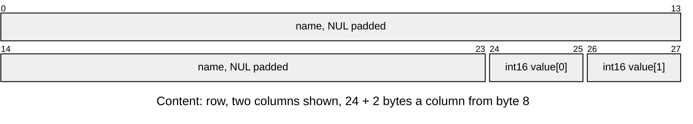

# Table entries

Part of the [asset docs](README.md). Named rows of int16 values are one entry of type `TABL`, read in place.

## TABL v1

[`table_asset.py`](../../launcher/tools/asset/table_asset.py) writes generic
numeric tables. [`curve_asset.py`](../../launcher/tools/gfx/curve_asset.py)
bakes a `NAME.curve.toml` and the PNG it names into one: one bright line
crossing every column of the panel's landscape frame, stored as row `y` of
brightness-weighted heights.





| Part | At | Size |
|---|---|---|
| Header | 0 | 8 bytes |
| Content: rows | `8 + i * (24 + 2 * columns)` | `24 + 2 * columns` bytes a row, in the order written |

| Rule | Detail |
|---|---|
| Owners | `ASSET_TABLE_VERSION`, `_HEADER_SIZE` (8), `_NAME_SIZE` (24) in `asset_table_format.h` |
| Header | `frac` is the fractional bits of every value (0 to 255); the reserved byte is zero |
| Dimensions | 1 to 65535 rows and columns; the entry is exactly `8 + rows * (24 + 2 * columns)` bytes |
| Names | at most 23 UTF-8 bytes, then the NUL, in the 24-byte field |
| Values | int16, `VALUE_MIN` to `VALUE_MAX` in `table_asset.py` |
| Errors | `asset_table_open()`: `ASSET_ERR_BOUNDS` for an unaligned (2-byte) base or a short header; `ASSET_ERR_VERSION`; `ASSET_ERR_FORMAT` for empty dimensions, the reserved byte, a size off by a byte or an unterminated name. `asset_table_row()`: `ASSET_ERR_FORMAT` for another column count, `ASSET_ERR_NOT_FOUND` for an absent name |
| View | values point into the mounted pack; the reader allocates nothing |

## Example

Find a table entry, look a row up by name and read its first value as a real number.

<!-- generated: asset-table-example check: python launcher/tools/gen/examples_doc.py --check -->
```c
/* Look a row up in a table entry: the first value of a named row, as a real number. */
#include "asset/asset_table.h"
#include "asset/asset_table_format.h"

asset_status_t
table_example(const asset_pack_t* pack, const char* table_name, const char* row_name, float* first) {
    asset_view_t entry;
    asset_table_t table;
    const int16_t* row = NULL;
    asset_status_t status = asset_pack_find(pack, table_name, ASSET_TABLE_ASSET, &entry);
    if (status == ASSET_OK) {
        status = asset_table_open(entry, &table);
    }
    if (status == ASSET_OK) {
        status = asset_table_row(&table, row_name, table.columns, &row);
    }
    if (status == ASSET_OK) {
        *first = (float)row[0] / (float)(1U << table.frac_bits); /* values are fixed point */
    }
    return status;
}
```
<!-- /generated: asset-table-example -->
