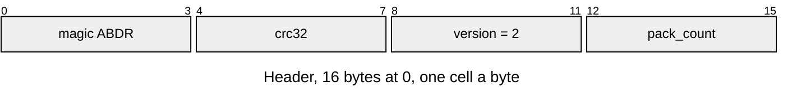
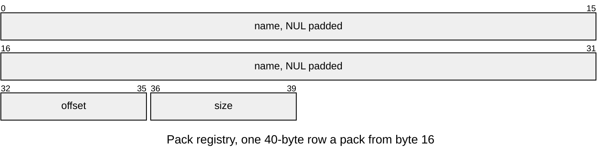

# ABDR v2 pack directory

A region that holds several packs, the device's partition, starts with a
directory that says where each lies. Layout defines:
[`asset/asset_directory_format.h`](../../../launcher/main/asset/asset_directory_format.h).

| Part | At | Size |
|---|---|---|
| Header | 0 | 16 bytes |
| Pack registry | 16 | 40 bytes a pack |
| Content: packs | each row's `offset` | each row's `size`; each pack starts on its own MMU page, after the registry, in row order |

| Rule | Detail |
|---|---|
| Owners | `ASSET_DIRECTORY_MAGIC`, `_VERSION`, `_HEADER_SIZE` (16), `_ROW_SIZE` (40) and `ASSET_MMU_PAGE_SIZE` (65536) in `asset_directory_format.h`; Python reads them with `read_define()` |
| Header | `crc32` is zlib's CRC-32 of the bytes from 8 (the version) to the registry's end |
| Rows | name nonempty with room for its NUL, unique; `offset` a multiple of `ASSET_MMU_PAGE_SIZE`, past the registry and the previous pack; `offset + size` inside the region |
| Pages | the partition and every pack start on MMU pages, so releasing one mapping cannot invalidate another; padding costs less than a page a pack |
| Order | header, registry, then the packs in row order; gaps zero |
