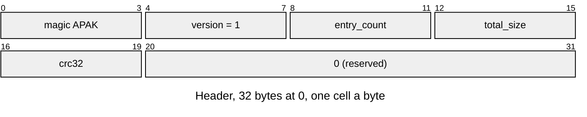
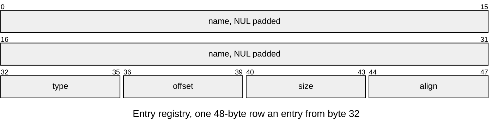

# APAK v1 pack

The pack: named, typed entries under one header and checksum ([Loading-Packs.md](../Loading-Packs.md) mounts one). Layout defines: [`asset/asset_pack.h`](../../../launcher/main/asset/asset_pack.h).

| Part | At | Size |
|---|---|---|
| Header | 0 | 32 bytes |
| Entry registry | 32 | 48 bytes an entry |
| Content: entry data | each row's `offset` | each row's `size`; zero padding up to the next entry's alignment |

| Rule | Detail |
|---|---|
| Owners | `ASSET_PACK_MAGIC`, `ASSET_PACK_VERSION`, `ASSET_PACK_HEADER_SIZE` (32), `ASSET_PACK_ENTRY_SIZE` (48), `ASSET_NAME_MAX` (32, with the NUL), all in `asset_pack.h`; Python reads the layout from its own `HEADER` and `ENTRY` structs |
| Header | `total_size` is the pack's size and at most the buffer's (a partition may be larger, never smaller); `crc32` is zlib's CRC-32 of every byte from 32 to `total_size` (`crc32_update()` in the hash package); the 12 reserved bytes are zero |
| Base | the pack starts on `ASSET_PACK_BASE_ALIGN` (16) bytes, which a page-aligned mapping and `aligned_alloc()` both give |
| Names | unique, ASCII, 1 to 31 characters; entries are found by name, then checked for their type |
| Type | four ASCII bytes, `ASSET_TYPE(a, b, c, d)` of the owning module |
| Alignment | `align` is a power of two, 16 by default; `offset` is a multiple of it and at or after the registry's end; `offset + size` stays inside `total_size` |
| Order | header, registry, entry data in registry order; gaps zero |
| Errors | the status each failure returns is under [Checks](README.md#checks); `asset_pack_entry()` is the one place a row's offset becomes bytes |
