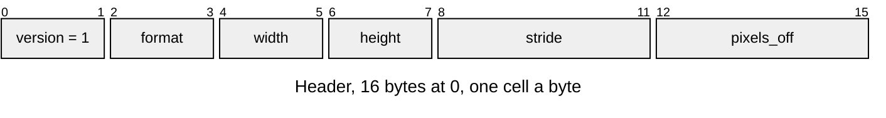
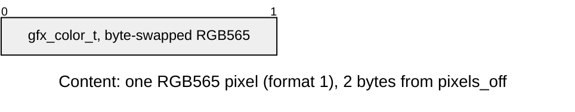
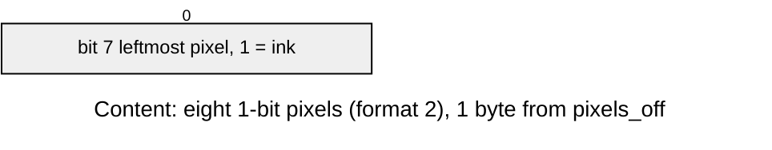

# IMAG v1 picture

A picture, read in place ([Image-Entries.md](../Image-Entries.md)). Layout defines: [`draw/draw_image_format.h`](../../../launcher/main/draw/draw_image_format.h).

| Part | At | Size |
|---|---|---|
| Header | 0 | 16 bytes |
| Content: pixel rows | `pixels_off` | `stride * (height - 1) + width` pixels, top row first; 2 bytes each in format 1, one bit each in format 2 |

| Rule | Detail |
|---|---|
| Owners | `DRAW_IMAGE_VERSION`, `_FORMAT_RGB565` (1), `_FORMAT_MONO1` (2, for [icons](../../tools/Icon-Baker.md)), `_HEADER_SIZE` (16), `_PIXEL_ALIGN` (4), `_MONO1_STRIDE_STEP` (8) in `draw_image_format.h` |
| Size | `width` and `height` are 1 to 65535 |
| Stride | pixels from one row's start to the next, at least `width`; a multiple of `DRAW_IMAGE_MONO1_STRIDE_STEP` in format 2, so a row is whole bytes |
| Pixels | `pixels_off` at least the header size; 4-aligned in format 1 |
| Errors | `ASSET_ERR_VERSION` for another version; `ASSET_ERR_FORMAT` for an unknown format, an empty picture, a short stride, a stride off its step or `pixels_off` inside the header; `ASSET_ERR_BOUNDS` for rows that leave the entry or misaligned RGB565 rows |
| View | the pixels `draw_image_open()` returns point into the entry |
