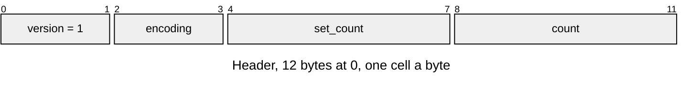

# LCOL v1 colour sets

Colour sets for a shared LMSH prototype, one set a placed copy ([Mesh-Import.md](../../render/offline/Mesh-Import.md#simplify) carves them). Layout defines: [`render/lcol_format.h`](../../../launcher/main/render/lcol_format.h).

A shared LMSH prototype has neither colour array. Each renderer selects a
mapped set from its `LCOL` entry; its mesh view owns the colour pointers
while geometry stays shared.

`r3d_lit_mesh_open_colours()` and `lcol_asset.name_for_mesh()` use exactly
`<mesh_id>.colors`. The mesh id must be nonempty and the result must fit
the pack name field.

| Encoding | Stride | Unit | Cell layout |
|---|---|---|---|
| 0: RGB888 | 3 bytes | vertex | `uint8 r, g, b` |
| 1: RGB565 | 2 bytes | triangle | little-endian `uint16` panel RGB565 |

| Part | At | Size |
|---|---|---|
| Version | 0 | u16 |
| Encoding | 2 | u16 |
| Set count | 4 | u32 |
| Element count | 8 | u32 |
| Sets | 12 | `set_count × count × stride` bytes |

| Rule | Detail |
|---|---|
| Owners | Layout constants in `render/lcol_format.h`; Python reads them with `read_define`. Writer and reader: `r3d/lcol_asset.py`; C opener: `r3d_lit_mesh_open_colours()` |
| Encoding | 0: RGB888, 3 bytes per vertex; 1: panel RGB565, 2 bytes per triangle; other encodings return `ASSET_ERR_FORMAT` |
| Counts | At least one set; `count` equals the prototype's vertex or triangle count for the encoding |
| Ownership | Both LMSH colour arrays are absent; LCOL holds all baked lighting for the prototype |
| Selection | SCNE `colour_set` is below `set_count`; `SCENE_ASSET_COLOUR_SET_OWN` requires LMSH colours; own colours require no LCOL, checked at pack time |
| Layout | Little-endian, header then contiguous sets; set k starts at `12 + k × count × stride`; no trailing bytes |
| Refusals | Versions other than 1 return `ASSET_ERR_VERSION`; invalid counts, selection or ownership return `ASSET_ERR_FORMAT`; an incomplete or oversized payload returns `ASSET_ERR_BOUNDS`; a missing LCOL returns `ASSET_ERR_NOT_FOUND` |

`lit_mesh.write_lit_mesh(colourless=True)` writes a prototype with neither colour array.
