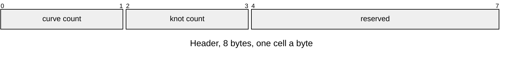
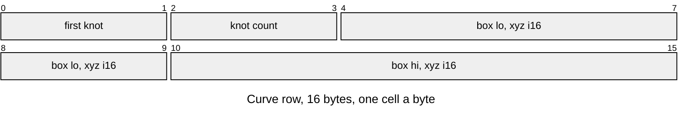
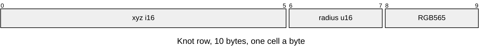

# LCRV thin curves

Radius-bearing polylines beside an object's LMSH. The reader holds pointers into
the pack; positions and radii use the LMSH's position scale.

| Part | At | Size |
|---|---|---|
| Header | 0 | 8 bytes |
| Curve rows | 8 | 16 bytes per curve |
| Knot rows | `8 + 16 * curve_count` | 10 bytes per knot; ends at entry end |

| Rule | Detail |
|---|---|
| Owners | `r3d/thin/curve_asset.py`; `render/curve/r3d_curve.h` and `r3d_lit_mesh.c` |
| Sibling | Entry type `LCRV`, named LMSH id plus `.crv`; optional |
| Byte order | Little-endian integers; colour stores panel byte-swapped RGB565 |
| Position | Signed ticks; model position is stored position divided by LMSH `position_scale` |
| Radius | Unsigned ticks at the same scale; nonnegative |
| Bounds | Signed ticks; includes every knot's radius, including quantisation rounding |
| Ranges | Curves own contiguous, disjoint knot ranges in row order; each has at least two knots |
| Counts | Both totals fit u16; empty sets have no rows |
| Reserved | Zero; no padding between records |
| Colour | Linear albedo times mean ring radiance, tone-mapped with the mesh's white, encoded to sRGB and packed |
