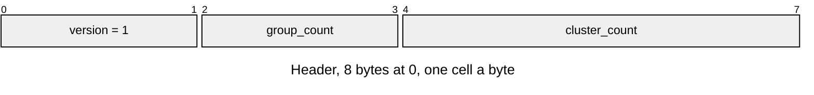
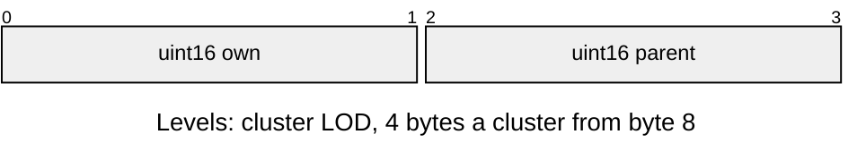
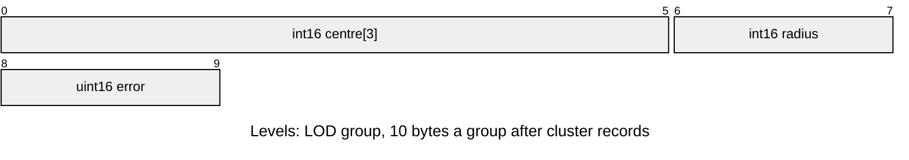

# LLOD v1 mesh levels

Levels for a sibling [LMSH](LMSH.md), named `<mesh_id>.lod`.
Layout defines: [`render/llod_format.h`](../../../launcher/main/render/llod_format.h).

| Part | At | Size |
|---|---|---|
| Header | 0 | `LLOD_HEADER_SIZE` bytes |
| Cluster records | `LLOD_HEADER_SIZE` | `cluster_count × sizeof(r3d_lit_cluster_lod_t)` |
| Group records | after cluster records | `group_count × sizeof(r3d_lit_lod_group_t)` |

| Rule | Detail |
|---|---|
| Owners | `render/llod_format.h` owns the header and suffix; `r3d_lit_mesh.h` owns both record layouts; `r3d/lod_asset.py` reads the defines and writes the entry |
| Version | `LLOD_VERSION`; other versions return `ASSET_ERR_VERSION` |
| Counts | Cluster count equals the mesh's; at least one group (`ASSET_ERR_FORMAT`), fewer than `R3D_LOD_NONE` groups (`ASSET_ERR_BOUNDS`) |
| Size | Exactly header, cluster records, group records, with no trailing bytes (`ASSET_ERR_BOUNDS`); little-endian, 4-byte aligned entry |
| Group ids | `own` is the group simplified into the cluster, `R3D_LOD_NONE` on a finest cluster; `parent` the group it belongs to, `R3D_LOD_NONE` when that group is never drawn coarse; each names a group or none (`ASSET_ERR_FORMAT`) |
| Group bounds | centre, radius and error in position ticks; radius at least 0; where a cluster has both ids, its own group sits inside its parent with `R3D_LOD_ENCLOSE_MARGIN` (1) ticks to spare and has no larger error (`ASSET_ERR_FORMAT`), so a parent never projects smaller and the pick's cut cannot crack |
| Opening | `r3d_lit_mesh_levels_from_asset()` attaches validated levels to an already loaded mesh; failure clears only its level pointers and count |
| Sibling | `r3d_lit_mesh_open()` resolves the sibling once; absent means finest only, any other failure clears the mesh and returns the error |

Level 0 is clusterlod's finest clusters. The import's `[geometry] lod` setting
controls whether the CPU bake builds a hierarchy.
