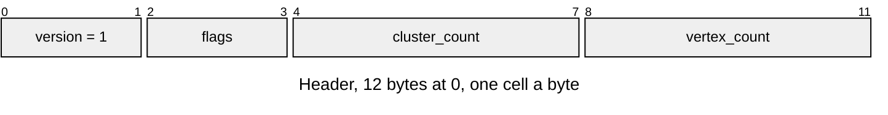
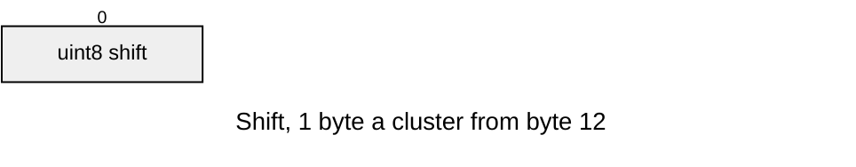
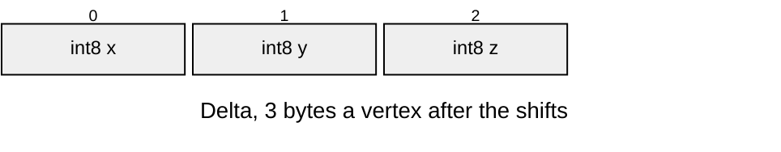
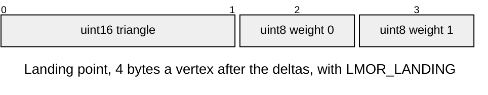

# LMOR v1 vertex morph targets

Geomorph targets for a sibling [LMSH](LMSH.md) that has [LLOD](LLOD.md) levels, named `<mesh_id>.morph`,
baked only when the import sets `[geometry] morph = true`.
Layout defines: [`render/lmor_format.h`](../../../launcher/main/render/lmor_format.h).

Each vertex of a cluster with a parent group stores where it lands on that
group's coarse surface. The transform blends it there as the group nears its
switch ([Levels-of-Detail.md](../frame/Levels-of-Detail.md#the-blend)).

| Part | At | Size |
|---|---|---|
| Header | 0 | `LMOR_HEADER_SIZE` bytes |
| Shifts | `LMOR_HEADER_SIZE` | `cluster_count` bytes, padded to 4 |
| Deltas | after the shifts | `vertex_count × LMOR_AXES` bytes, padded to 4 |
| Landing points | after the deltas, with `LMOR_LANDING` | `vertex_count × LMOR_LANDING_SIZE` bytes |

| Rule | Detail |
|---|---|
| Owners | `render/lmor_format.h` owns the header, flags and suffix; `r3d/morph_asset.py` reads the defines and writes the entry |
| Version | `LMOR_VERSION`; other versions return `ASSET_ERR_VERSION` |
| Counts | Cluster and vertex counts equal the mesh's, and the mesh has levels (`ASSET_ERR_FORMAT`) |
| Size | Exactly the parts the flags name, with no trailing bytes (`ASSET_ERR_BOUNDS`) |
| Target | A vertex's target in ticks is its position plus `delta << shift`, its cluster's shift at most `LMOR_SHIFT_MAX` (`ASSET_ERR_FORMAT`). A delta is -127 to 127, so negating one stays in int8 |
| Landing | `LMOR_LANDING` only on a mesh without face colours (`ASSET_ERR_FORMAT`). A landing point names a coarse triangle of the mesh and two corner weights, the third `LMOR_WEIGHT_WHOLE` minus both (`ASSET_ERR_FORMAT` past the triangle count or the whole) |
| Colour | The draw blends a vertex's colour toward the colours at its landing point, from whichever colours the mesh draws with, a copy's set included |
| No parent | A cluster without a parent group holds deltas of 0, never read |
| Opening | `r3d_lit_mesh_morph_from_asset()` attaches validated targets; failure clears only the morph pointers. `r3d_lit_mesh_open()` resolves the sibling after the levels; absent means no blend |
