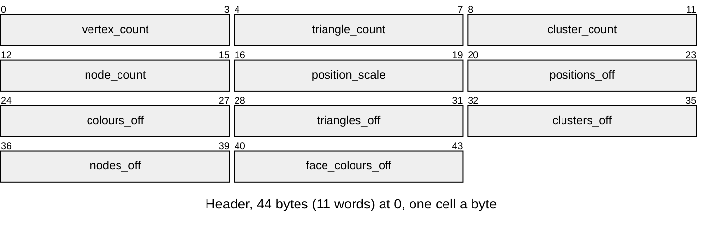
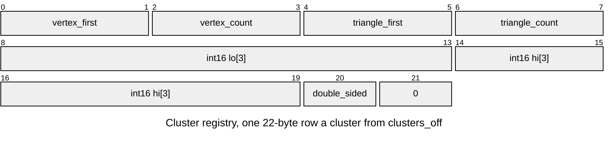
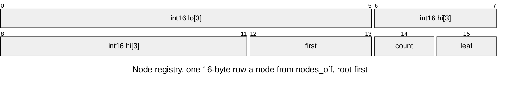
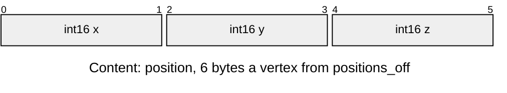
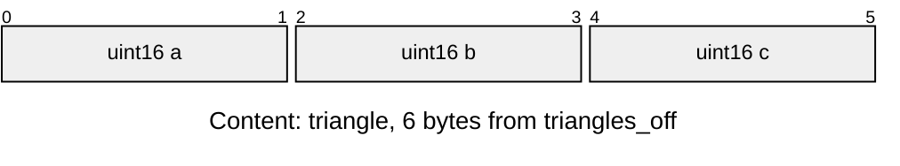
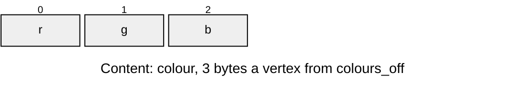
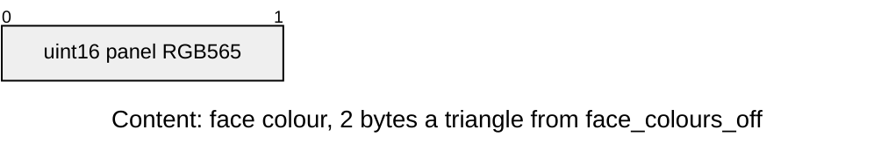

# LMSH lit mesh

The baked mesh a renderer draws, its clusters and tree explained in [Baked-Mesh.md](../../render/offline/Baked-Mesh.md). The tag and the `r3d_lit_cluster_t` and `r3d_lit_node_t` records are in [`render/r3d_lit_mesh.h`](../../../launcher/main/render/r3d_lit_mesh.h).

A baked mesh is an entry of type `LMSH` in the [asset pack](../README.md).
`r3d_lit_mesh_from_asset()` fills an `r3d_lit_mesh_t` with pointers into the
entry, once, and nothing is allocated or copied; the rasterizer reads that
struct.

| Part | At | Size |
|---|---|---|
| Header | 0 | 44 bytes |
| Content: positions | `positions_off` | 6 bytes a vertex |
| Content: colours | `colours_off`, or 0 when absent | 3 bytes a vertex |
| Content: triangles | `triangles_off` | 6 bytes each |
| Cluster registry | `clusters_off` | 22 bytes a cluster, the layout of `r3d_lit_cluster_t` |
| Node registry | `nodes_off` | 16 bytes a node, the layout of `r3d_lit_node_t`; `nodes[0]` is the root |
| Content: face colours | `face_colours_off`, or 0 when absent | 2 bytes a triangle |

| Rule | Detail |
|---|---|
| Owners | the header's word order is the `enum` in `r3d_lit_mesh.c`; `VERTEX_LIMIT` (65535) there caps the four counts (`ASSET_ERR_BOUNDS`); `r3d_lit_cluster_t` and `r3d_lit_node_t` are `_Static_assert`ed to 22 and 16 bytes with the field offsets above, and `lit_mesh.py`'s `CLUSTER` and `NODE` write the same bytes |
| Arrays | each offset a multiple of 4 and at least 44, the array inside the entry; the writer pads each array to 4 bytes and sets the offset of an empty one to 0 (`ASSET_ERR_BOUNDS`, also for a header shorter than 44 bytes); only colours and face colours may be 0 |
| Colour source | At most one of colours and face colours (`ASSET_ERR_FORMAT` for both) |
| Scale | `position_scale` is ticks per model unit, in 1..`INT_MAX` (`ASSET_ERR_FORMAT`); positions are int16 ticks |
| Counts | at least one cluster and one node (`ASSET_ERR_FORMAT`) |
| Clusters | vertex ranges tile every vertex once and in order: the first starts at 0, each starts at the previous end, the last ends at `vertex_count` (`ASSET_ERR_FORMAT`); each cluster's vertex and triangle ranges lie inside the mesh and its triangles index only its own vertices (`ASSET_ERR_BOUNDS`); the writer also tiles the triangle ranges in order |
| Nodes | a leaf's children are clusters, an inner node's are nodes, `first + count` inside that array; an inner node's children come after it, so a walk down the tree ends, and number at most `R3D_LIT_NODE_CHILDREN_MAX` (8), the octree's split (`ASSET_ERR_BOUNDS`); the writer limits `count` to `MAX_NODE_CHILDREN` and hangs every cluster off exactly one leaf |
| Order | header, then the arrays in the order of the Part table, each padded to 4; padding zero |
