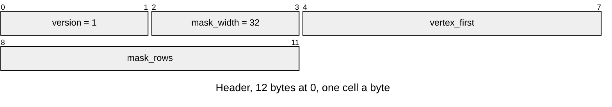

# LMSK v1 masked mesh

A one-bit atlas and affine UVs for a sibling [LMSH](LMSH.md), named
`<mesh_id>.mask`. Layout defines belong to
[`render/lmsk_format.h`](../../../launcher/main/render/lmsk_format.h).

| Part | At | Size |
|---|---|---|
| Header | 0 | `LMSK_HEADER_SIZE` bytes |
| UVs | `LMSK_HEADER_SIZE` | one `uint16 u, v` pair for each vertex from `vertex_first` to `vertex_count - 1` |
| Atlas | after UVs | one `uint32` for each of `mask_rows` rows |

| Rule | Detail |
|---|---|
| Owners | `lmsk_format.h` owns the header, width, UV fraction bits and suffix; `r3d/mask_asset.py` reads its defines |
| Header | Version equals `LMSK_VERSION`; width equals `LMSK_MASK_WIDTH` (`ASSET_ERR_FORMAT`) |
| Clusters | Masked clusters follow every unmasked cluster; `vertex_first` equals the first masked cluster's first vertex (`ASSET_ERR_FORMAT`) |
| Presence | Exactly one LMSK when LMSH has masked clusters, none otherwise (`ASSET_ERR_FORMAT`) |
| UV bounds | Every `u < mask_width << LMSK_UV_FRACTION_BITS` and `v < mask_rows << LMSK_UV_FRACTION_BITS` (`ASSET_ERR_BOUNDS`) |
| Size | Exactly header + UVs + atlas, with no trailing bytes (`ASSET_ERR_BOUNDS`); little-endian, 4-byte aligned entry |
| Levels | With [LLOD](LLOD.md), every masked cluster has `own == parent == R3D_LOD_NONE` (`ASSET_ERR_FORMAT`) |
| Texels | Bit `u` of atlas word `v` keeps texel `(u, v)` when set; cards stack by rows |
| Sampling | UVs interpolate affinely in screen space. Each span selects the atlas row at its centre pixel and steps only `u`; discarded texels write neither colour nor depth |

`r3d_lit_mesh_open()` resolves the sibling into a borrowed view. Without an
LMSK, the mask pointers and counts in `r3d_lit_mesh_t` are NULL and zero.
