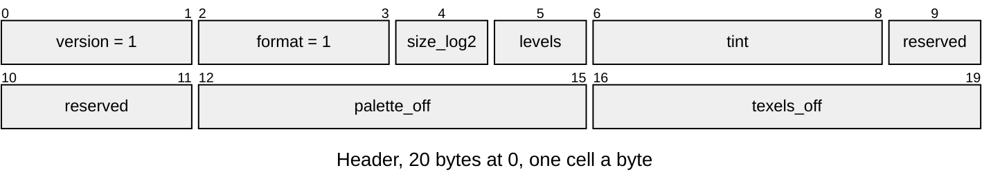

# LTEX v1 material texture

A material's albedo pattern as a tiled 4-bit indexed texture, which
[`render/texture/`](../../../launcher/main/render/texture/r3d_texture.h)
multiplies by a mesh's baked vertex light. Layout defines:
[`render/texture/r3d_texture.h`](../../../launcher/main/render/texture/r3d_texture.h).

The palette holds the pattern divided by its mean on screen, so a vertex
colour keeps its meaning (the surface's mean lit colour) and the texture only
modulates it. A mesh names its textures through its [LUVS](LUVS.md) entry:
texture k of mesh `<mesh_id>` is the entry `<mesh_id>.t<k>`.

| Part | At | Size |
|---|---|---|
| Version | 0 | u16 |
| Format | 2 | u16, 1: INDEX4 |
| Side | 4 | u8, level 0 is `1 << size_log2` texels square |
| Levels | 5 | u8, level 0 and each mip, each half the last |
| Tint | 6 | 3 × u8, r, g, b: the hue the colormap lights the pattern with, the mean vertex colour it is drawn on |
| Reserved | 9 | 3 bytes, zero |
| Palette | `palette_off` | 16 × {u8 r, g, b, 0}, 128 = the pattern's mean |
| Texels | `texels_off` | each level's `side² / 2` bytes, level 0 first |

| Rule | Detail |
|---|---|
| Owners | Layout constants in `render/texture/r3d_texture.h`; Python reads them with `read_define`. Writer: `r3d/texture/texture_asset.py`; C opener: `r3d_texture_from_asset()` |
| Texels | Row-major, two texels a byte, the low nibble the even column; a sampler wraps u and v by the level's side |
| Sides | `size_log2` from 1 to 8; the last level is at least 2 texels a side |
| Palette | A channel of 128 is the pattern's mean; up to 255, twice it, as the PS1's modulate. The device builds a 32-level colormap from the palette and the tint at open |
| Refusals | Versions other than 1 return `ASSET_ERR_VERSION`; another format, side or level count, or nonzero reserved bytes `ASSET_ERR_FORMAT`; a palette or level outside the entry `ASSET_ERR_BOUNDS` |
