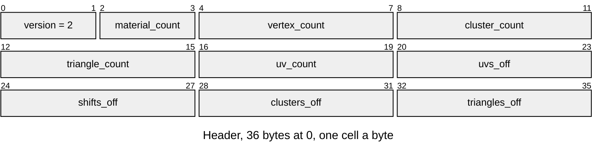

# LUVS v2 mesh texturing

Which triangles of an LMSH draw textured, on which of their cluster's charts,
each chart's [LTEX](LTEX.md) material, and each vertex's UV per chart. Layout
defines: [`render/texture/r3d_texture.h`](../../../launcher/main/render/texture/r3d_texture.h).

The entry is the mesh's sibling `<mesh_id>.uvs`; its material k is the LTEX
sibling `<mesh_id>.t<k>`. A mesh without one draws plain, and so does every
mesh until its renderer asks for its textures
([`renderer_set_textured()`](../../../launcher/main/scene/renderer/renderer.h)),
which opens them then. The texture bake
([`bake.py`](../../../launcher/tools/bake/bake.py)'s `texture` kind) writes both from the packed mesh and its source,
for the renderers a scene's `<scene>.textures.toml` names.

| Part | At | Size |
|---|---|---|
| Version | 0 | u16 |
| Materials | 2 | u16, 1 to 255 |
| Vertices | 4 | u32, the mesh's |
| Clusters | 8 | u32, the mesh's |
| Triangles | 12 | u32, the mesh's |
| UV count | 16 | u32, the vertices' and the chart 1 UVs after them |
| UVs | `uvs_off` | `uv_count` × {i16 u, v}, 1/16 texel of level 0, whole texture sides dropped |
| Shifts | `shifts_off` | `cluster_count` × i32: a vertex's chart 1 UV is UV `vertex + shift` |
| Cluster materials | `clusters_off` | `cluster_count` × 2 charts × u8, a material index or 255 for none |
| Triangle codes | `triangles_off` | ⌈`triangle_count` / 4⌉ bytes, triangle t at bits 2 × (t % 4) of byte t / 4: 0 plain, else 1 + its chart |

| Rule | Detail |
|---|---|
| Owners | Layout constants in [`render/texture/r3d_texture.h`](../../../launcher/main/render/texture/r3d_texture.h); Python reads them with `read_define`. Writer: [`r3d/texture/uv_transfer.py`](../../../launcher/tools/r3d/texture/uv_transfer.py); C opener: `r3d_texture_texturing_from_asset()` |
| Charts | Up to 2 a cluster, each a material and the plane of one source triangle. Chart 0 takes the material most of the cluster's area lies on; chart 1 the one most of what chart 0 left lies on, so a cluster across two materials or a fold textures both sides |
| UVs | A chart's UVs cover all its cluster's vertices: a vertex's texel is `uv / 16`; chart 0's sit at the vertex's index, chart 1's after every vertex's, only for the clusters with one. The texture repeats, so the bake drops the whole sides under a chart's mean: a wall many repeats long stays within int16 |
| Triangles | A triangle draws with the first chart whose material it lies on and whose plane it faces; the rest of the cluster draws plain, so a texture ends where its material does, not at a cluster's edge |
| Blends | A cluster in an LOD blend, a morph or a dither band, draws plain until its blend ends |
| Writers | A pass with writers draws MASK1 charts textured, the writers following each span, and INDEX4 charts plain |
| Layout | Little-endian; the UV and shift sections aligned to their element; no trailing bytes |
| Refusals | Versions other than 2 return `ASSET_ERR_VERSION`; counts that differ from the mesh's, no materials, a UV count below the vertex count, a material index past the count, a chart after one with no material, chart 1 UVs past `uv_count`, or a triangle code naming a chart its cluster lacks `ASSET_ERR_FORMAT`; a section outside the entry or misaligned `ASSET_ERR_BOUNDS`; a missing material `ASSET_ERR_NOT_FOUND` |
