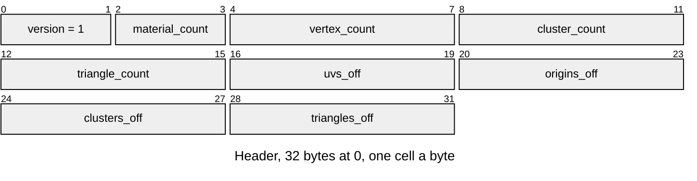

# LUVS v1 mesh texturing

Which triangles of an LMSH draw textured, with which [LTEX](LTEX.md) material,
and each vertex's UV. Layout defines:
[`render/texture/r3d_texture.h`](../../../launcher/main/render/texture/r3d_texture.h).

The entry is the mesh's sibling `<mesh_id>.uvs`; its material k is the LTEX
sibling `<mesh_id>.t<k>`. A mesh without one draws plain, and so does every
mesh until its renderer asks for its textures
([`renderer_set_textured()`](../../../launcher/main/scene/renderer/renderer.h)),
which opens them then. The texture bake
(`bake.py`'s `texture` kind) writes both from the packed mesh and its source,
for the renderers a scene's `<scene>.textures.toml` names.

| Part | At | Size |
|---|---|---|
| Version | 0 | u16 |
| Materials | 2 | u16, 1 to 255 |
| Vertices | 4 | u32, the mesh's |
| Clusters | 8 | u32, the mesh's |
| Triangles | 12 | u32, the mesh's |
| UVs | `uvs_off` | `vertex_count` × {i16 u, v}, 1/16 texel of level 0 from the vertex's cluster's origin |
| Origins | `origins_off` | `cluster_count` × {i16 u, v}, whole texture sides |
| Cluster materials | `clusters_off` | `cluster_count` × u8, a material index or 255 for none |
| Triangle bits | `triangles_off` | ⌈`triangle_count` / 8⌉ bytes, triangle t at bit t % 8 of byte t / 8: set draws textured |

| Rule | Detail |
|---|---|
| Owners | Layout constants in `render/texture/r3d_texture.h`; Python reads them with `read_define`. Writer: `r3d/texture/uv_transfer.py`; C opener: `r3d_texture_texturing_from_asset()` |
| UVs | A cluster's vertices all take its material's UVs: a vertex's texel is `origin × side + uv / 16`; origins keep a wall many repeats long within int16 |
| Clusters | A cluster takes the textured material most of its area lies on; one of material 255 draws with its vertex colours alone |
| Triangles | A set bit marks a triangle on its cluster's material that faces the plane its UVs map; the rest of the cluster draws plain, so a texture ends where its material does, not at a cluster's edge |
| Layout | Little-endian; the UV and origin sections 2-byte aligned; no trailing bytes |
| Refusals | Versions other than 1 return `ASSET_ERR_VERSION`; counts that differ from the mesh's, no materials, or a material index past the count `ASSET_ERR_FORMAT`; a section outside the entry or misaligned `ASSET_ERR_BOUNDS`; a missing material `ASSET_ERR_NOT_FOUND` |
