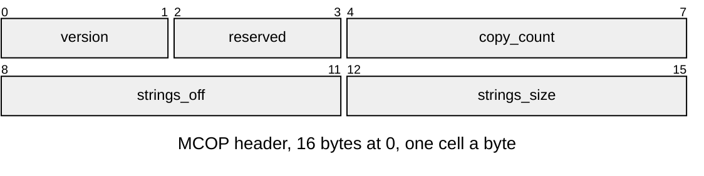

# MCOP v1 copy manifest

The copy manifest inside a host bake bundle; it never reaches the board. The bundle cache is [Bakes.md](../Bakes.md).

An APAK `.bundle` caches LMSH/LCOL products and a `copies` MCOP manifest.
`r3d/mesh_bundle.py` owns its reader and writer. Pack building ships the
products and discards the manifest; SCNE contains the authored rest and copies.

String offsets count from the string content's first byte.

| Part | At | Size |
|---|---|---|
| Header | 0 | `mesh_bundle.HEADER.size` |
| Copy registry | `HEADER.size` | One MCOP `NAME`, `TRANSFORM`, `RENDERER` and `METADATA` per copy |
| Content: strings | `strings_off` | `strings_size` bytes, NUL-terminated UTF-8 strings |

`mesh_bundle.py` defines each copy's rows independently of SCNE:

| Row | Encoding |
|---|---|
| `NAME` | NUL-padded copy name, `asset_pack.NAME_BYTES` bytes |
| `TRANSFORM` | Local matrix and position, 12 float32 values |
| `RENDERER` | Colour set, uint16; NUL-padded mesh id, `asset_pack.NAME_BYTES` bytes |
| `METADATA` | uint32 string offsets for owner, first source, copy source and sorted JSON match map |

Pack building expands copies into SCNE entities under the authored renderer.
SCNE names carry hashes computed by `build.name_hash`; MCOP names have no hash.

The reader rejects unknown versions, nonzero reserved fields, invalid section
bounds, duplicate names, nonfinite transforms and invalid string offsets.
Entries are sorted by name; string interning follows copy and metadata order.
