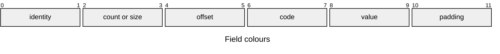

# Entry formats

Part of the [asset docs](../README.md). One page per format, as each has its
own header. Every page shows its records as packet diagrams, then a Part/At/Size
table and a Rule/Detail table whose Owners row names where the layout constants live.

## Field colours

A box's colour gives its field's role, the same on every page.
[`check_format_roles.py`](../../../scripts/gates/check_format_roles.py) derives
each role from the field's label, writes each diagram's `themeCSS` with
`--write`, and fails a diagram whose boxes do not match.

| Role | A field is one when |
|---|---|
| identity | it is the magic, the version or the checksum |
| count or size | its name ends in `count` or `_size`, or is one plural word |
| offset | its name ends in `_off`: where a part starts |
| code | the header names two or more of its values (`SOUND_FORMAT_*`) |
| value | anything else: the data itself |
| padding | it is zero or reserved |

## Every entry

Every device entry keeps these; MCOP stays on the host.

| Rule | Detail |
|---|---|
| Byte order | integers and floats are little-endian; the C views need a little-endian IEEE-754 binary32 host |
| Offsets | an entry never holds a pointer: it names its parts by offset from its own first byte, so the bytes are usable as mapped, with no fix-up pass; APAK and ABDR rows count from the pack's or the region's start |
| Type | four ASCII characters in the pack registry, `ASSET_TYPE(a, b, c, d)` of the module that owns the content; `asset_pack_find()` returns an entry's bytes only for the type asked for |
| Views | an open validates without allocating and borrows the pack's bytes, which must outlive the view; a failed open clears the view |
| Faults | another version, where the format has one, is `ASSET_ERR_VERSION`; a part out of range or misaligned `ASSET_ERR_BOUNDS`; a value breaking a rule `ASSET_ERR_FORMAT`. Each page gives the status of its refusals in its Rule/Detail table |

## Types

The module that owns a kind of content defines its type; there is no central
list in code. Writers are under `launcher/tools/`, readers and headers under
`launcher/main/`.

| Format | Version | Header | Writer (Python) | Reader (C) |
|---|---|---|---|---|
| [APAK](APAK.md) pack | 1 | [`asset/asset_pack.h`](../../../launcher/main/asset/asset_pack.h) | [`asset/asset_pack.py`](../../../launcher/tools/asset/asset_pack.py) | [`asset/asset_pack.c`](../../../launcher/main/asset/asset_pack.c) |
| [ABDR](ABDR.md) pack directory | 2 | [`asset/asset_directory_format.h`](../../../launcher/main/asset/asset_directory_format.h) | [`asset/asset_directory.py`](../../../launcher/tools/asset/asset_directory.py) | [`asset/asset_directory.c`](../../../launcher/main/asset/asset_directory.c) |
| [LMSH](LMSH.md) lit mesh | none | [`render/r3d_lit_mesh.h`](../../../launcher/main/render/r3d_lit_mesh.h) | [`r3d/lit_mesh.py`](../../../launcher/tools/r3d/lit_mesh.py), layout in [`r3d/mesh_asset.py`](../../../launcher/tools/r3d/mesh_asset.py) | [`render/r3d_lit_mesh.c`](../../../launcher/main/render/r3d_lit_mesh.c) |
| [LCOL](LCOL.md) colour sets | 1 | [`render/lcol_format.h`](../../../launcher/main/render/lcol_format.h) | [`r3d/lcol_asset.py`](../../../launcher/tools/r3d/lcol_asset.py) | [`render/r3d_lit_mesh.c`](../../../launcher/main/render/r3d_lit_mesh.c) |
| [TRCK](TRCK.md) animation tracks | 3 | [`anim/anim_tracks_format.h`](../../../launcher/main/anim/anim_tracks_format.h) | [`anim/tracks_asset.py`](../../../launcher/tools/anim/tracks_asset.py) | [`anim/anim_tracks.c`](../../../launcher/main/anim/anim_tracks.c) |
| [SKEL](SKEL.md) skeleton | 1 | [`anim/anim_skeleton_format.h`](../../../launcher/main/anim/anim_skeleton_format.h) | [`anim/skeleton_asset.py`](../../../launcher/tools/anim/skeleton_asset.py) | [`anim/anim_skeleton.c`](../../../launcher/main/anim/anim_skeleton.c) |
| [SKIN](SKIN.md) skin | 2 | [`render/r3d_skin_format.h`](../../../launcher/main/render/r3d_skin_format.h) | [`r3d/skin_asset.py`](../../../launcher/tools/r3d/skin_asset.py) | [`render/r3d_skin.c`](../../../launcher/main/render/r3d_skin.c) |
| [SCNE](SCNE.md) scene | 5 | [`scene/scene_format.h`](../../../launcher/main/scene/scene_format.h) | [`r3d/scene_asset.py`](../../../launcher/tools/r3d/scene_asset.py) | [`scene/scene_asset.c`](../../../launcher/main/scene/scene_asset.c) |
| [SOND](SOND.md) sound | 1 | [`sound/sound_format.h`](../../../launcher/main/sound/sound_format.h) | [`audio/sound_asset.py`](../../../launcher/tools/audio/sound_asset.py) | [`sound/sound.c`](../../../launcher/main/sound/sound.c) |
| [IMAG](IMAG.md) picture | 1 | [`draw/draw_image_format.h`](../../../launcher/main/draw/draw_image_format.h) | [`gfx/image_asset.py`](../../../launcher/tools/gfx/image_asset.py) | [`draw/draw_image.c`](../../../launcher/main/draw/draw_image.c) |
| [TABL](TABL.md) named int16 rows | 1 | [`asset/asset_table_format.h`](../../../launcher/main/asset/asset_table_format.h) | [`asset/table_asset.py`](../../../launcher/tools/asset/table_asset.py) | [`asset/asset_table.c`](../../../launcher/main/asset/asset_table.c) |
| [MCOP](MCOP.md) copy manifest, host bundles only | 1 | — | [`r3d/mesh_bundle.py`](../../../launcher/tools/r3d/mesh_bundle.py) | [`r3d/mesh_bundle.py`](../../../launcher/tools/r3d/mesh_bundle.py) |

## Checks

`asset_pack_open(base, size)` takes a base pointer and a size and nothing else,
so what it checks and what it returns do not depend on where the bytes came
from. `asset_pack_total_size()` reads the size a pack states from its first 32
bytes, so a reader maps or reads the header first and then the pack alone.

`asset_directory_open()` checks a directory the same way, and
`asset_directory_size()` reads its size from its header. Opening a pack or a
directory, finding an entry and reading it each report the first failure:

| Status | Meaning |
|---|---|
| `ASSET_ERR_NO_PACK` | no bytes: no partition, no file |
| `ASSET_ERR_TRUNCATED` | shorter than a header, or than the size it states |
| `ASSET_ERR_MAGIC` | not an asset pack or pack directory |
| `ASSET_ERR_VERSION` | a pack, directory or entry format version this firmware does not read |
| `ASSET_ERR_SIZE` | the header is malformed: a size that cannot hold it, or reserved bytes in use |
| `ASSET_ERR_CRC` | the bytes do not match the checksum |
| `ASSET_ERR_BOUNDS` | an entry or one of its parts leaves its range, or is misaligned; a directory row outside the region, off its MMU page, over the rows or the pack before it, or with no room for its name's NUL |
| `ASSET_ERR_DUPLICATE` | two directory rows share a name |
| `ASSET_ERR_NOT_FOUND` | no entry or pack has that name |
| `ASSET_ERR_TYPE` | the entry is not of the type asked for |
| `ASSET_ERR_FORMAT` | inside its range, an entry holds a value its reader does not accept |
| `ASSET_ERR_FULL` | as many packs are mounted as the store holds |

A buffer may be larger than the pack, as a mapping is.
