# SCNE v6 scene

One scene: its entities, their transforms and parents, the components on them, and the copies a renderer draws from one table ([Batches](#batches)) ([Scene-Files.md](../../render/scene/Scene-Files.md) is the authored file, [Scene-Manager.md](../../render/scene/Scene-Manager.md) the runtime). Layout defines: [`scene/scene_format.h`](../../../launcher/main/scene/scene_format.h); row structs in [`scene/scene_internal.h`](../../../launcher/main/scene/scene_internal.h).

`build_pack.py` bakes `NAME.scene.toml` into entry `NAME` of its own pack `NAME`, beside every mesh, skin, skeleton and clip it names; a scene and its clip cannot share a stem ([Building-Packs.md](../Building-Packs.md#packs)). `scene_load()` opens it and each entry it names, and fails naming whichever is missing or malformed.

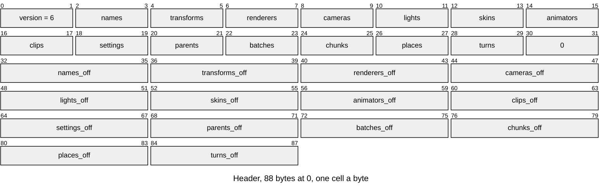

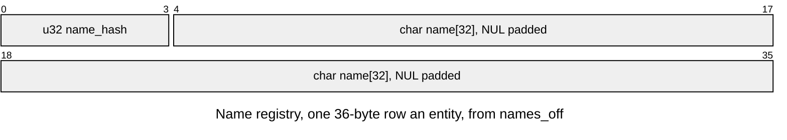

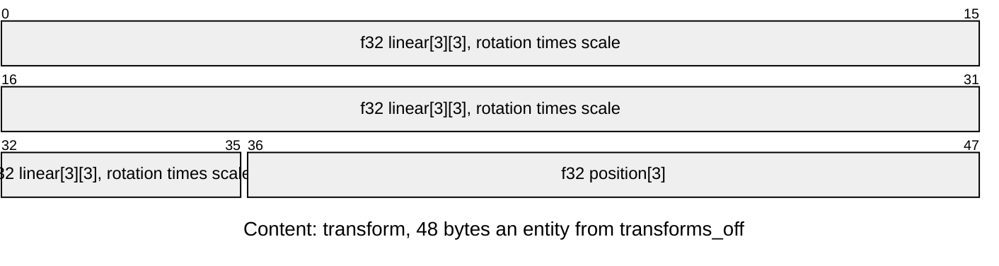

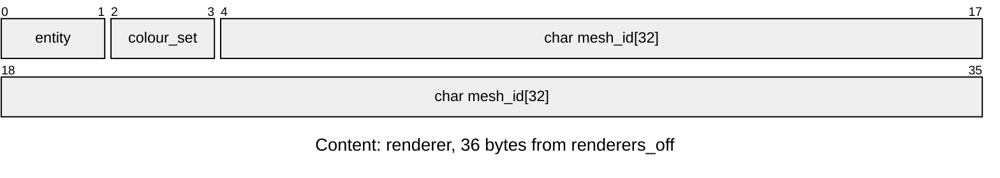

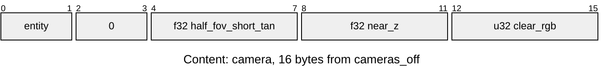

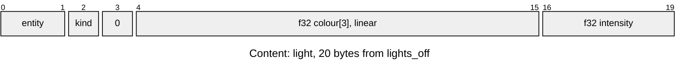

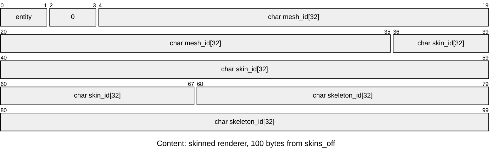

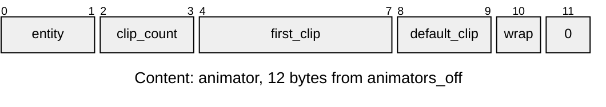

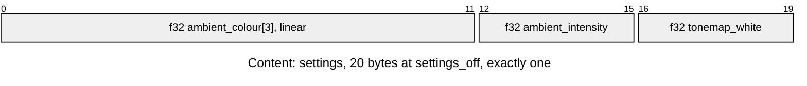

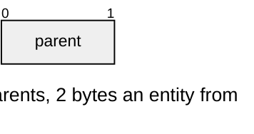

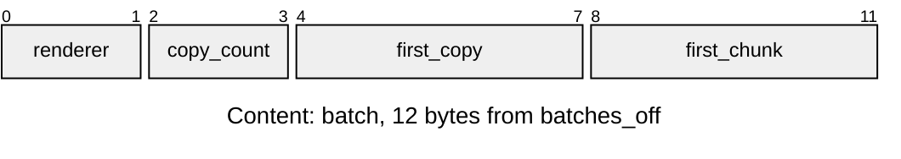

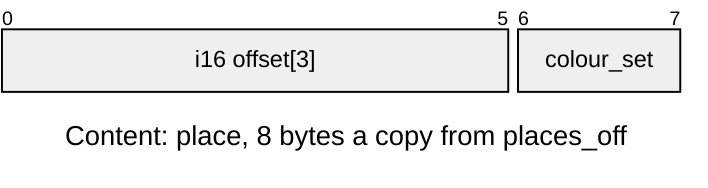

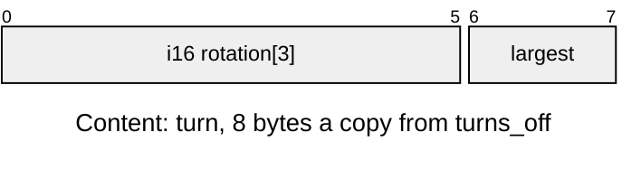

| Part | At | Size |
|---|---|---|
| Header | 0 | 88 bytes: fourteen u16 counts from `SCENE_ASSET_AT_COUNTS`, then fourteen u32 offsets from `SCENE_ASSET_AT_OFFSETS`, both in `scene_asset_part_t` order |
| Name registry | `names_off` | 36 bytes an entity |
| Content: transforms | `transforms_off` | 48 bytes an entity; the count equals the names' |
| Content: renderers | `renderers_off` | 36 bytes each |
| Content: cameras | `cameras_off` | 16 bytes each |
| Content: lights | `lights_off` | 20 bytes each |
| Content: skinned renderers | `skins_off` | 100 bytes each |
| Content: animators | `animators_off` | 12 bytes each |
| Clip registry | `clips_off` | 32 bytes a clip id, indexed by `first_clip` and `clip_count` |
| Content: settings | `settings_off` | 20 bytes, one row |
| Content: parents | `parents_off` | 2 bytes an entity; the count equals the names'; written for every scene, all roots included |
| Content: batches | `batches_off` | 12 bytes each, one for each renderer that draws copies |
| Content: chunks | `chunks_off` | 16 bytes each, each batch's chunks in turn |
| Content: places | `places_off` | 8 bytes a copy, each batch's copies in turn |
| Content: turns | `turns_off` | 8 bytes a copy, in the places' order; the count equals the places' |

| Rule | Detail |
|---|---|
| Owners | `SCENE_ASSET_VERSION`, `_HEADER_SIZE` (88), `_AT_COUNTS`, `_AT_OFFSETS`, `SCENE_ASSET_DEFAULT_CLIP_NONE` (0xFFFF), `SCENE_ASSET_PARENT_ROOT` (0xFFFF), `SCENE_ASSET_COLOUR_SET_OWN` (0xFFFF), `SCENE_LIGHT_KIND_DIRECTIONAL` (1), `SCENE_ASSET_NAME_SIZE` (36), `_NAME_AT_HASH` (0), `_NAME_AT_TEXT` (4) in `scene_format.h`; row structs in `scene_internal.h`, checked against the sizes above by `_Static_assert` |
| Layout | every part offset is a multiple of 4, at least 88, and the part ends inside the entry; the writer lays parts out in header order, each padded to 4 bytes |
| Counts | each at most 65535, entities at most 65534; names equals transforms and parents; turns equals places; settings is exactly 1 |
| Names | letters, digits and `_`, starting with a letter or `_`, at most 31 bytes; `name_hash` is `name_hash(name)` ([hash package](../../../launcher/packages/hash/README.md)) and never `NAME_HASH_NONE`, and finds compare it alone. The bake refuses a name that hashes to `NAME_HASH_NONE` and two names in one scene that share a hash, naming both |
| Transforms | in the parent's frame; scale positive. `scene_load()` refuses a shear or a reflection (determinant −1) and names its entity |
| Parents | `parent` is `SCENE_ASSET_PARENT_ROOT` or below its own entity, so one forward pass meets every parent before its children. A camera, light or skinned renderer is a root. An entity with children has a uniform scale, the same on every axis, and `scene_load()` refuses one that does not, naming it; `scene_asset.encode()` folds a parent's uneven scale into its children, refusing a parent that draws or a turned child the fold would shear. A mesh bundle's copies of one shape are one batch, on a child of the renderer that carries them ([MCOP](MCOP.md)). Transform and enabled state carry to descendants ([Scene-Manager.md](../../render/scene/Scene-Manager.md#hierarchy)) |
| Entities | the scene's objects in file order; every `entity` is below the names' count; at most one light, one skinned renderer and one animator an entity |
| Colour sets | own colours (`SCENE_ASSET_COLOUR_SET_OWN`) need no LCOL, checked at pack time, and authored scenes write own colours; [Selection and ownership](LCOL.md) |
| Text | `name`, `mesh_id`, `skin_id`, `skeleton_id` and clip ids are nonempty, NUL terminated, zero after the NUL |
| Camera | `half_fov_short_tan` and `near_z` finite and positive; `clear_rgb` (0xRRGGBB) at most `0xFFFFFF`. A camera `path` becomes an animator on its entity with one clip, default index zero and loop wrap; its `node` selects the tracks at bake time, and they bind to that entity through `ANIM_TARGET_SELF` |
| Light | `kind` is `SCENE_LIGHT_KIND_DIRECTIONAL`; colour in 0..1; intensity finite and at least 0. The light shines along `SCENE_LIGHT_AXIS` (+Y) turned by its entity's rotation; at run time it lights skinned renderers only, baked renderers carry their light. Sky and camera regions are bake inputs and are not stored |
| Animator | `first_clip + clip_count` within the clip count; `default_clip` is below `clip_count` or `SCENE_ASSET_DEFAULT_CLIP_NONE` (no playback); `wrap` is an `ANIM_CLAMP` or `ANIM_LOOP` code from [`anim/anim_track.h`](../../../launcher/main/anim/anim_track.h) |
| Settings | ambient colour in 0..1; `ambient_intensity` and `tonemap_white` finite and at least 0; absent ambient has zero intensity. Applied before lights attach; `tonemap_white` 0 is `SCENE_TONEMAP_WHITE_NONE`, the identity tone map |
| Batches | see [Batches](#batches) |
| Order | header, then parts in header order; every `0` above and every gap is zero |
| Errors | `ASSET_ERR_VERSION` for another version, v1 included, reported before its bounds; `ASSET_ERR_BOUNDS` for a part off its alignment or outside the entry; `ASSET_ERR_FORMAT` for the rest |

## Batches

A batch draws copies of one mesh from packed rows: one renderer and one entity, not one each. `render/batch/r3d_batch.h` owns the constants and decodes the rows; the cull tests each chunk's sphere, then each copy's, and draws the copies it keeps.

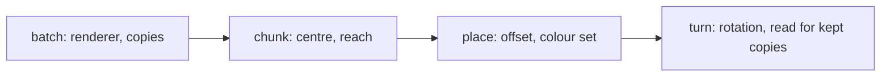

| Rule | Detail |
|---|---|
| Owners | `R3D_BATCH_CHUNK_COPIES` (16), `R3D_COPY_STEPS` (32767), `R3D_COPY_TURN_RANGE` (1/√2) in [`render/batch/r3d_batch.h`](../../../launcher/main/render/batch/r3d_batch.h) |
| Renderer | `renderer` names a renderers row, at most one batch each; that row's `colour_set` is 0, and its entity's transform is the batch's frame |
| Cover | batches take the places, turns and chunks in turn: `first_copy` is the copies before it, `first_chunk` the chunks before it, and together they cover every row; `copy_count` is at least 1 |
| Chunks | a batch's copy *k* is in its chunk *k* / 16; `centre` is finite, `reach` at least 0 and no copy's position farther from `centre`. The writer orders a batch's copies by the Morton code of their positions, so a chunk's copies are near each other |
| Position | `centre + offset × reach / R3D_COPY_STEPS`, the batch's frame |
| Turn | the three smaller components of the copy's unit quaternion, each in `R3D_COPY_STEPS` steps of `R3D_COPY_TURN_RANGE`, and `largest` (0 to 3: x, y, z, w) the one left out, never negative, rebuilt from the others. A copy turns and moves only: the writer refuses one that scales, shears or reflects |
| Colour set | each copy's LCOL set, below the mesh's set count; `scene_load()` opens the highest. The sets are resident together, set *s* at *s* times a set's length |
