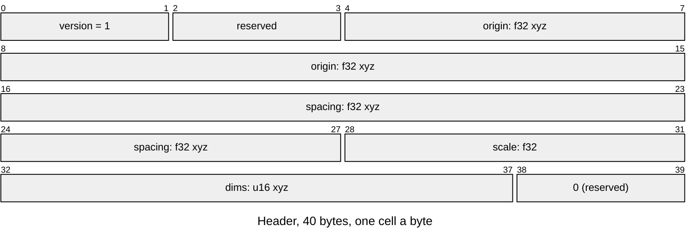
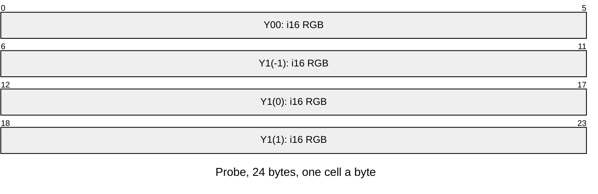

# SHPR v1 probe grid

Incident radiance in a regular grid of real L1 spherical harmonics.
The [probe baker](../../../launcher/tools/r3d/sh_probe_bake.py) owns the encoding;
[baking](../../render/offline/SH-Probes.md) describes the sampling.

| Field | Offset | Encoding |
|---|---|---|
| Version | 0 | u16, `VERSION` |
| Flags | 2 | u16, reserved, must be zero |
| Origin | 4 | Three f32, first cell centre in source coordinates |
| Spacing | 16 | Three positive f32, cell step in source units |
| Scale | 28 | Positive f32; coefficient = signed integer × scale |
| Dimensions | 32 | Three positive u16, x/y/z cell counts |
| Padding | 38 | Two zero bytes |
| Probes | 40 | `dims.x * dims.y * dims.z` records, each 12 i16, x fastest |

All multibyte fields are little-endian and aligned to their element, without a
magic prefix. The pack entry type is `SHPR`. The payload ends after the last
probe. Origin, spacing, scale and coefficients must be finite.

V1 includes direct lighting in the incident-radiance coefficients.

The coefficient order is constant, +y, +z, +x, each with consecutive RGB.
`Y00 = 0.5 sqrt(1/pi)` and `Y1 = 0.5 sqrt(3/pi)` follow
Sloan 2008[[129]](../../Citations.md#sloan-2008).
Scale covers the largest absolute coefficient without clipping; an all-zero
grid uses scale 1.

[`sh_probes.shpr`](../../../launcher/tools/tests/data/sh_probes.shpr) is the
cross-language golden fixture: origin `(1,2,3)`, spacing `(4,5,6)`, dimensions
`(2,1,1)`, scale `0.25`, stored integers `-12..11` in wire order.
