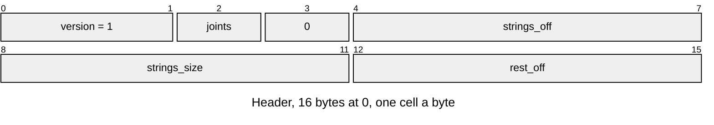
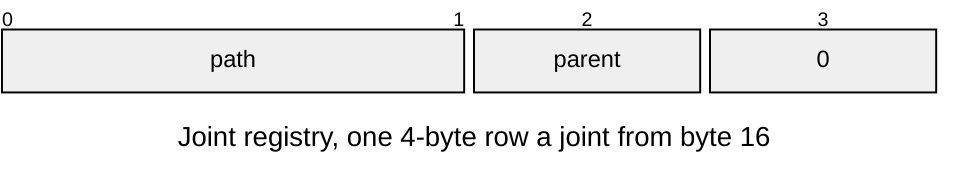
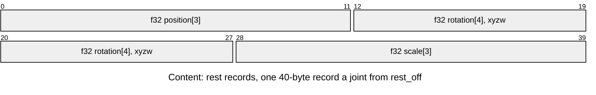

# SKEL v1 skeleton

A skinned mesh's joint tree and rest pose ([Skeleton-and-Skin.md](../../render/animation/Skeleton-and-Skin.md)). Layout defines: [`anim/anim_skeleton_format.h`](../../../launcher/main/anim/anim_skeleton_format.h).

| Part | At | Size |
|---|---|---|
| Header | 0 | 16 bytes |
| Joint registry | 16 | 4 bytes a joint; `path` is an offset within the strings |
| Content: rest records | `rest_off` | 40 bytes a joint |
| Content: strings | `strings_off` | UTF-8 joint paths, NUL terminated; ends at the entry end |

| Rule | Detail |
|---|---|
| Owners | `ANIM_SKELETON_VERSION`, `_HEADER_SIZE` (16), `_ROW_SIZE` (4), `_REST_WIDTH` (10 floats), `_JOINT_MAX` (254), `_ROOT` (255), `_STRING_MAX`, `_ALIGNMENT` (4) and the `_AT_*` offsets in `anim_skeleton_format.h` |
| Joints | 1..254 |
| Parents | `0xFF` is a root; any other parent is below its joint's index, so joint 0 is a root. Two roots under one armature node are allowed |
| Paths | from `gltf_read.skin_joint_paths`, starting at each root; nonempty, unique (checked by Python and C), each terminated within the table, which fits a u16 offset |
| Rest | finite; rotation with `abs(1 - sum(q*q))` at most `ANIM_SKELETON_UNIT_TOLERANCE` (1e-4, Python `UNIT_TOLERANCE`), boundary tests at the adjacent floats |
| Order | header, joint registry, rest records, strings; gaps and reserved bytes zero |
