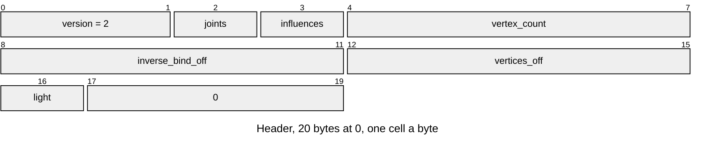
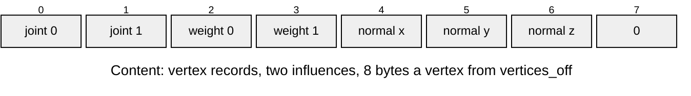

# SKIN v2 skin

Per vertex, which joints move it and by how much ([Skeleton-and-Skin.md](../../render/animation/Skeleton-and-Skin.md)). Layout defines: [`render/r3d_skin_format.h`](../../../launcher/main/render/r3d_skin_format.h).

```mermaid
---
config:
  themeCSS: "g:nth-of-type(2) rect:nth-of-type(1) { fill: #e3e3e3 !important; } g:nth-of-type(2) rect:nth-of-type(2) { fill: #e3e3e3 !important; } g:nth-of-type(2) rect:nth-of-type(3) { fill: #e3e3e3 !important; } g:nth-of-type(2) rect:nth-of-type(4) { fill: #e3e3e3 !important; } g:nth-of-type(2) rect:nth-of-type(5) { fill: #e3e3e3 !important; } g:nth-of-type(2) rect:nth-of-type(6) { fill: #e3e3e3 !important; } g:nth-of-type(2) rect:nth-of-type(7) { fill: #e3e3e3 !important; } g:nth-of-type(2) rect:nth-of-type(8) { fill: #e3e3e3 !important; } g:nth-of-type(2) rect:nth-of-type(9) { fill: #e3e3e3 !important; } g:nth-of-type(2) rect:nth-of-type(10) { fill: #e3e3e3 !important; } g:nth-of-type(2) rect:nth-of-type(11) { fill: #e3e3e3 !important; } g:nth-of-type(2) rect:nth-of-type(12) { fill: #ffffff !important; stroke-dasharray: 4 3 !important; } .packetLabel { fill: #1b1b1b !important; }"
  packet:
    bitsPerRow: 12
    bitWidth: 72
---
packet-beta
title Content: vertex records, four influences, 12 bytes a vertex from vertices_off
0: "joint 0"
1: "joint 1"
2: "joint 2"
3: "joint 3"
4: "weight 0"
5: "weight 1"
6: "weight 2"
7: "weight 3"
8: "normal x"
9: "normal y"
10: "normal z"
11: "0"
```

| Part | At | Size |
|---|---|---|
| Header | 0 | 20 bytes |
| Content: inverse binds | `inverse_bind_off` | 48 bytes a joint: `f32 matrix[3][4]`, row-major, model units |
| Content: vertex records | `vertices_off` | `2 * influences + 4` bytes a vertex: joints, then weights, then normal and a zero byte |

| Rule | Detail |
|---|---|
| Owners | `R3D_SKIN_VERSION`, `_HEADER_SIZE` (20), `_MATRIX_WIDTH` (12 floats), `_INFLUENCES_MIN` and `_MAX` (2, 4), `_WEIGHT_SUM` (255), `_NORMAL_SCALE` (127), `_ALIGNMENT` (4) and the `_AT_*` offsets in `r3d_skin_format.h` |
| Joints | 1..254, in SKEL order; vertex order is LMSH order |
| Influences | 2 or 4; joint indices below the joint count; weights sum to 255 |
| Values | every matrix value finite; normal components in -127..127, nonzero |
| Lighting | `R3D_SKIN_LIGHT_DIRECT` (0), `_RENORMALISED` (1) or `_TABLE` (2), set by the import's `[skin].lighting` (default `direct`) and copied to the renderer's private mode on attachment; unknown codes refused |
| Order | header, inverse binds, vertex records, ending at the entry end; gaps and padding zero |
| Binding | each open validates one entry; whoever binds SKIN to SKEL and LMSH checks joint and vertex counts |
