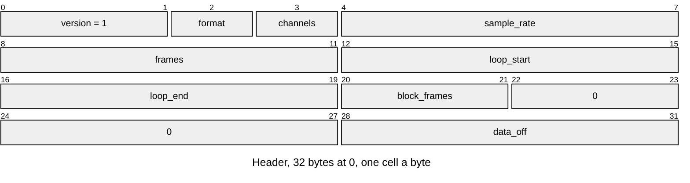
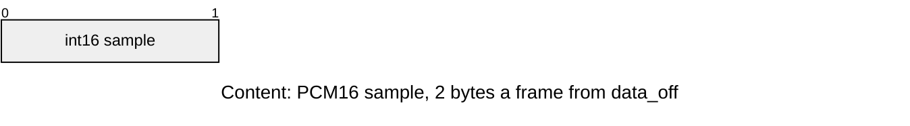
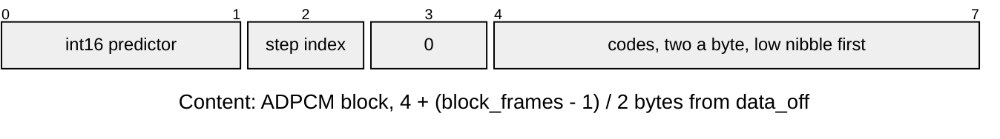

# SOND v1 sound

A mono 22,050 Hz sound, PCM16 or IMA-ADPCM ([Sound-Assets.md](../../audio/Sound-Assets.md)). Layout defines: [`sound/sound_format.h`](../../../launcher/main/sound/sound_format.h).

| Part | At | Size |
|---|---|---|
| Header | 0 | 32 bytes |
| Content: samples | `data_off` | PCM16: `2 * frames` bytes. ADPCM: `ceil(frames / block_frames)` blocks of `4 + (block_frames - 1) / 2` bytes |

| Rule | Detail |
|---|---|
| Owners | `sound_format.h`: `SOUND_VERSION`, `SOUND_HEADER_SIZE` (32), `SOUND_ALIGNMENT` (4), `SOUND_CHANNELS` (1), `SOUND_PCM_BYTES` (2), `SOUND_DEFAULT_BLOCK_FRAMES` (505), the `SOUND_AT_*` offsets and the format codes `SOUND_FORMAT_PCM16` (0) and `SOUND_FORMAT_IMA_ADPCM` (1). ADPCM block bytes and the step limit come from `audio_adpcm.h`. The baker and the reader both read these |
| Rate | `sample_rate` is `AUDIO_OUT_SAMPLE_RATE_HZ` (22050), so the mixer needs no resampling |
| Frames | nonzero; the last ADPCM block is padded by repeating its final sample and `frames` tells the reader where to stop |
| Data | `data_off` at least 32, a multiple of 4; the samples end inside the entry; the gap between header and data is zero |
| Reserved | the two reserved fields are zero |
| Blocks | PCM16 has `block_frames` 0; ADPCM has it odd, `SOUND_DEFAULT_BLOCK_FRAMES` by default |
| Loop | `loop_end` 0 means one-shot, with `loop_start` 0; a loop has `start < end <= frames`, and an ADPCM `loop_start` sits on a block boundary (the baker rejects a misaligned start and names its two neighbours) |
| ADPCM block | step index at most 88 (`AUDIO_ADPCM_STEP_INDEX_MAX`), reserved byte zero; the first block starts at step index 0 and later blocks carry the previous ending index; each block opens with its first sample stored exactly as the predictor |
| Errors | `ASSET_ERR_VERSION` for another version, checked by `asset_entry_validate()`; `ASSET_ERR_BOUNDS` for `data_off` below 32 or misaligned, or data past the entry; `ASSET_ERR_FORMAT` for the rest (unknown format, channels, rate, zero frames, nonzero reserved fields or gap, a `block_frames` the format forbids, a bad loop, a bad block header). A failed open zeroes the view |
