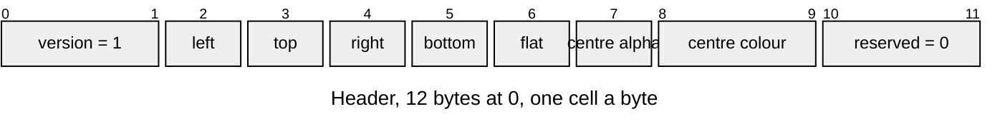

# SPRT v1 sprite

A picture with a nine-slice border, read in place ([Image-Entries.md](../Image-Entries.md#sprites)). Layout defines: [`draw/draw_image_format.h`](../../../launcher/main/draw/draw_image_format.h).

| Part | At | Size |
|---|---|---|
| Header | 0 | 12 bytes |
| Picture | 12 | the rest of the entry: an [IMAG](IMAG.md) entry whole, format 1 or 3, its offsets counted from its own start |

| Rule | Detail |
|---|---|
| Owners | `DRAW_SPRITE_ASSET`, `_VERSION`, `_HEADER_SIZE` (12), `_AT_BORDER` (2), `_AT_FLAT` (6), `_AT_CENTRE_ALPHA` (7), `_AT_CENTRE_COLOR` (8), `_AT_RESERVED` (10) in `draw_image_format.h` |
| Border | pixels of the stored picture kept 1:1 at each edge; `left + right` below its width and `top + bottom` below its height, so the centre is at least one pixel |
| Flat centre | `flat` 1 when every pixel inside the border has one alpha and, where that alpha is above 0, one colour: `centre colour` (byte-swapped RGB565) at `centre alpha`; else 0 and both are 0 |
| Picture | 4-aligned, since the header is 12 bytes and an entry starts 16-aligned |
| Name | the `.image.toml`'s stem, like an IMAG; one name holds one entry, a SPRT or an IMAG |
| Errors | `ASSET_ERR_VERSION` for another version; `ASSET_ERR_FORMAT` for `flat` above 1, reserved bytes in use or a one-bit picture; `ASSET_ERR_BOUNDS` for an entry shorter than the header or a border that leaves no centre; the picture's own errors as IMAG |
| View | the planes `draw_sprite_open()` returns point into the entry |
