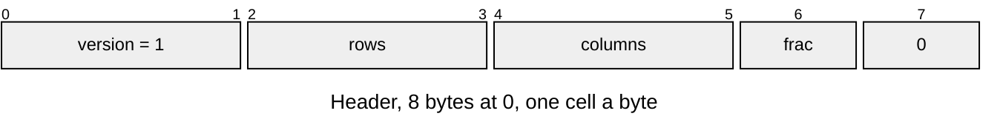
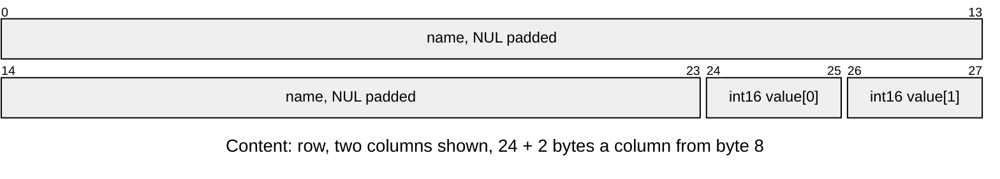

# TABL v1 table

Named rows of int16 values sharing one fractional-bit count ([Table-Entries.md](../Table-Entries.md)). Layout defines: [`asset/asset_table_format.h`](../../../launcher/main/asset/asset_table_format.h).

| Part | At | Size |
|---|---|---|
| Header | 0 | 8 bytes |
| Content: rows | `8 + i * (24 + 2 * columns)` | `24 + 2 * columns` bytes a row, in the order written |

| Rule | Detail |
|---|---|
| Owners | `ASSET_TABLE_VERSION`, `_HEADER_SIZE` (8), `_NAME_SIZE` (24) in `asset_table_format.h` |
| Header | `frac` is the fractional bits of every value (0 to 255); the reserved byte is zero |
| Dimensions | 1 to 65535 rows and columns; the entry is exactly `8 + rows * (24 + 2 * columns)` bytes |
| Names | at most 23 UTF-8 bytes, then the NUL, in the 24-byte field |
| Values | int16, `VALUE_MIN` to `VALUE_MAX` in `table_asset.py` |
| Errors | `asset_table_open()`: `ASSET_ERR_BOUNDS` for an unaligned (2-byte) base or a short header; `ASSET_ERR_VERSION`; `ASSET_ERR_FORMAT` for empty dimensions, the reserved byte, a size off by a byte or an unterminated name. `asset_table_row()`: `ASSET_ERR_FORMAT` for another column count, `ASSET_ERR_NOT_FOUND` for an absent name |
| View | values point into the mounted pack; the reader allocates nothing |
