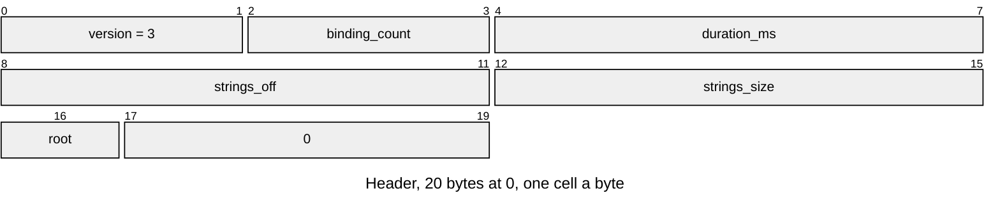
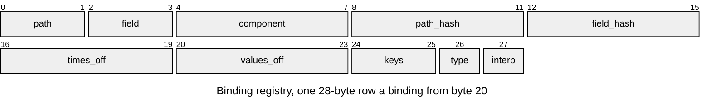

# TRCK v3 animation tracks

One animation clip: keyed fields bound by object path ([Animation-Tracks.md](../../render/animation/Animation-Tracks.md)). Layout defines: [`anim/anim_tracks_format.h`](../../../launcher/main/anim/anim_tracks_format.h).

| Part | At | Size |
|---|---|---|
| Header | 0 | 20 bytes |
| Binding registry | 20 | 28 bytes a binding; `path` and `field` are offsets within the strings |
| Content: strings | `strings_off` | `strings_size` bytes: deduplicated UTF-8 object paths and field names, each NUL terminated |
| Content: key arrays | each row's `times_off` and `values_off` | per binding, `keys` times (`f32`), then `keys * width` values (`f32`); a cubic binding holds in-tangent, value and out-tangent per key, so `3 * keys * width` |

| Rule | Detail |
|---|---|
| Owners | `ANIM_TRACKS_VERSION`, `_HEADER_SIZE` (20), `_ROW_SIZE` (28), `_ALIGNMENT` (4), `_CUBIC_RUNS` (3), `ANIM_BINDING_STRING_MAX` (255), `ANIM_ROOT_SCENE` (0), `ANIM_ROOT_SKELETON` (1) in `anim_tracks_format.h` |
| Header | `root` is `ANIM_ROOT_SCENE` or `ANIM_ROOT_SKELETON`; the 3 pad bytes are zero; `binding_count` at most 65535 |
| Strings | `strings_off` a multiple of 4, at or after the registry's end; a path or field is nonempty, at most `ANIM_BINDING_STRING_MAX` bytes, with no NUL, and ends inside the table, which fits a 16-bit offset |
| Hashes | FNV-1a 32 of each string's bytes via `name_hash`; stored equals computed and is nonzero, else `ASSET_ERR_FORMAT`. The bake refuses collisions among a clip's paths or among its fields. |
| Component | `u32` code, nonzero; written as `ASSET_TYPE` tags such as `ANIM_COMPONENT_TRANSFORM` (`TRNS`); the writer allows one binding per path, component and field |
| Type | an `anim_value_t` code (float, vec2, vec3, quaternion, colour) with width 1, 2, 3, 4 and 3 |
| Interp | an `anim_interp_t` code: step, linear or cubic |
| Keys | at least 1, at most 65535; times finite and strictly increasing, values finite, in seconds and the field's units |
| Arrays | 4-aligned, after the strings, inside the entry |
| Order | header, registry, strings, key arrays in registry order; all pad and gap bytes zero |
| Errors | `ASSET_ERR_VERSION` for another version; `ASSET_ERR_BOUNDS` for an unaligned base, a short header or registry, or strings or arrays out of place; `ASSET_ERR_FORMAT` for an unknown root, type or interpolation, a zero component or key count, nonzero padding, an unterminated string, or a time or value that is not finite or not increasing |
| Python | the reader makes the same layout and curve checks |

A row's `component` and `field` name what it drives. The components a scene binds:

| Component | Defined in | Fields |
|---|---|---|
| `TRNS` | `ANIM_COMPONENT_TRANSFORM`, `anim/anim_tracks_format.h` | `position` vec3, `rotation` quaternion, `scale` vec3 (`anim/pose/anim_pose.c`) |
| `CAMR` | `ANIM_COMPONENT_CAMERA`, `scene/camera/camera.h` | `half_fov_short_tan` float, `near_z` float (`CAMERA_FIELDS` in `camera.c`); the glTF bake writes only `half_fov_short_tan` |

[Binding any field](../../render/animation/Animation-Tracks.md#binding-any-field) adds a component.
