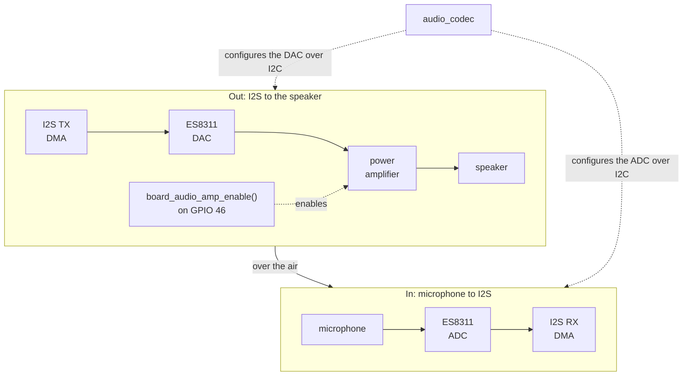
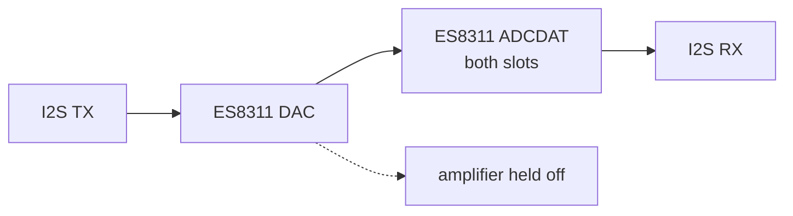
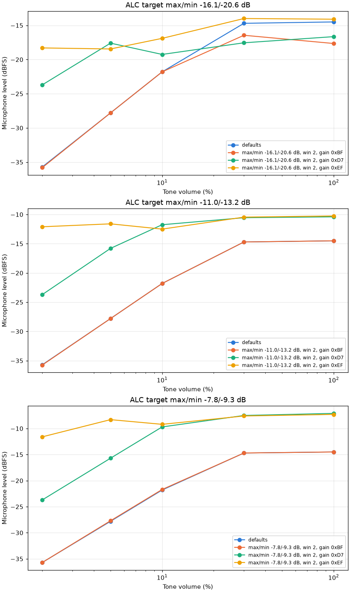
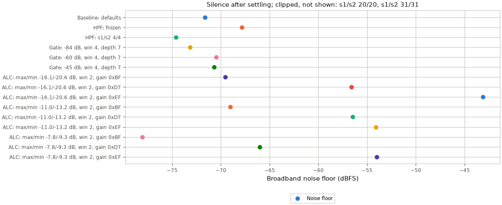
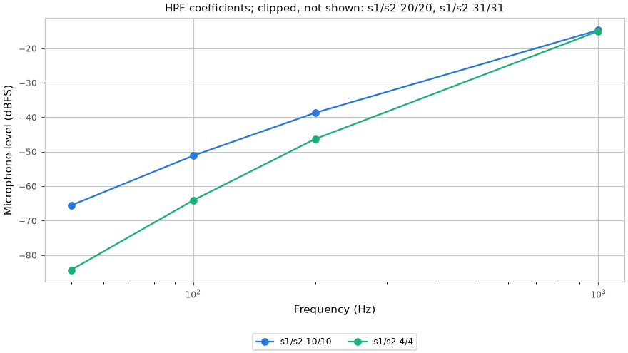
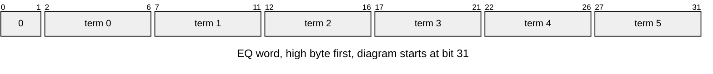
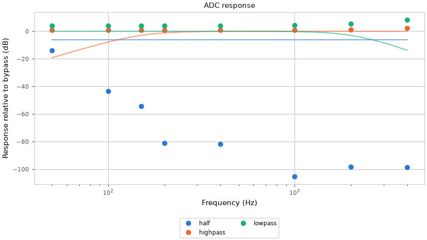
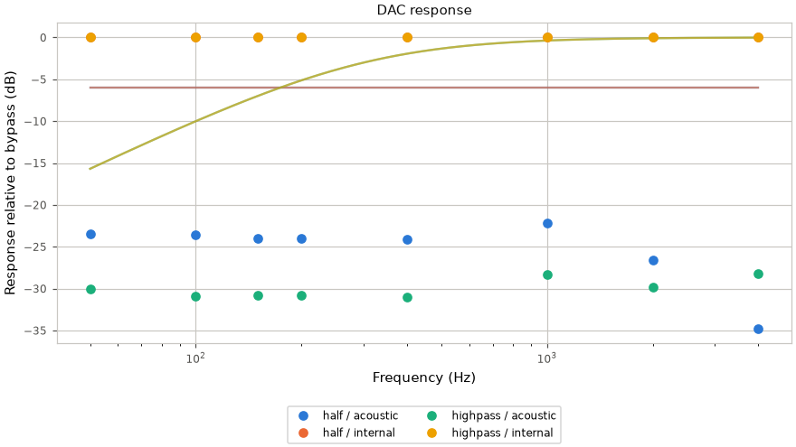
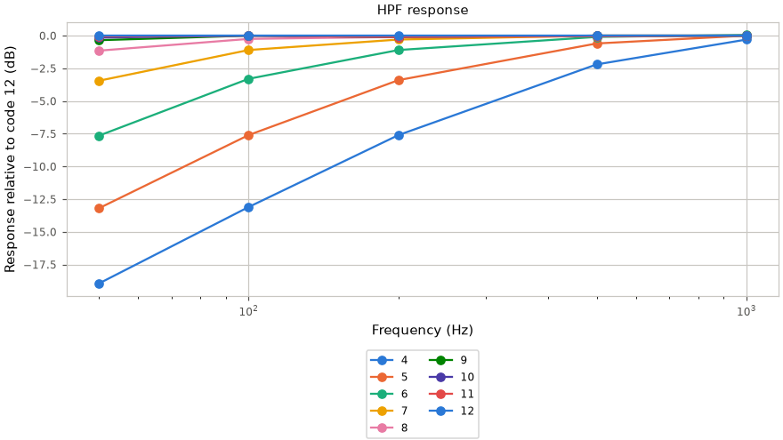

# Audio path

Part of the [audio docs](README.md). The board's audio wiring (amplifier pin, amplifier
startup, microphone gain) is in the [board notes](../notes/Board-and-Memory.md#audio).

## Path and lifetime

`sound_init()` opens the reference-counted `audio_codec` through `audio_out`
and keeps TX DMA for the firmware lifetime. `sound_mixer_device.c` owns the
only writer. Playback commands, voices, buses and the amplifier state machine
are described in [Sound-Mixer.md](Sound-Mixer.md) and [Mixer-Internals.md](Mixer-Internals.md).

RX is created and initialized only for a capture. Capture open and close run
as mixer commands: TX pauses around RX creation and teardown, then resumes.
The ESP32-S3 codec adapter defers RX shutdown while paired TX is active, so
teardown requests TX shutdown through that adapter before closing RX. Voice
positions hold across both capture operations.

Each direction uses an `AUDIO_CODEC_DMA_BLOCKS` x `AUDIO_CODEC_BLOCK_SAMPLES`
DMA ring (`launcher/main/audio/audio_codec.h`). PCM is mono, 16-bit at
`AUDIO_OUT_SAMPLE_RATE_HZ` (`launcher/main/audio/audio_out.h`). IDF allocates
the ring in `i2s_channel_init_std_mode()`, rather than `i2s_new_channel()`.
The codec, control and GPIO interfaces have one shared bring-up. The BSP's
`bsp_audio_*` helpers are unused because they have no deinit.

Signal path during a loopback check:



The [volume table](#level-vs-volume) shows the level at each tone gain.
The [duration table](#level-vs-duration) shows that waiting for amplifier
startup keeps short tones at the same level as long tones.

## Development check

Run `autana tone <hz> <ms> [volume] [--internal] [--json]`, or the console verb
`tone <hz> <ms> [volume] [internal]`.

`console_tone_check()` opens capture, measures its DMA-capable heap cost,
runs the check, and closes capture. `melody check` uses the same function
(`launcher/main/sound/console/console_tone.c`).

The console uses `audio_loopback_measure()` for a baseline, starts a SYSTEM-bus
tone through the mixer, measures again, then stops the voice. It waits for
amplifier warm-up before measuring. A Goertzel filter measures the requested frequency.<sup>[[72]](../Citations.md#goertzel-1958)</sup>

`--internal` routes DAC data to both ADCDAT slots inside the ES8311. It holds
the speaker amplifier off for the whole check. The verb restores the exact register
read-back and releases the hold on every exit, before closing capture.
Both modes refuse to measure until any pending register restore succeeds.



Each window's Goertzel phase<sup>[[72]](../Citations.md#goertzel-1958)</sup> is referenced to its first sample.

The wrapped difference between consecutive windows' phase advances and the
nominal advance gives the frequency offset, as in the phase vocoder<sup>[[82]](../Citations.md#flanagan-1966)</sup>,
here from a single bin rather than a filter bank.

The unambiguous offset range is ±sample rate / (2 × window samples). The reply
reports `path` and `measured_hz`; JSON adds `hz_error` in Hz, measured minus
requested.

The estimate is valid only while the tone stays within the unambiguous range
above; a drifting or modulated tone gives a wrong value.

The nominal frequency must be at least `AUDIO_FREQUENCY_MIN_CYCLES` cycles per window from DC and Nyquist.

Below `AUDIO_FREQUENCY_MIN_SAMPLES`, the reply says `measured n/a`
and both JSON frequency fields are null.

`thd_db` reports harmonic power relative to the fundamental in dB; null means unavailable.

`peak_dbfs` reports the largest absolute microphone sample in dBFS.
`noise_dbfs` is the broadband RMS of the silence baseline, before the tone starts.

The detector discards `AUDIO_LOOPBACK_SETTLE_MS` of capture before measuring.
Heard means tone minus silence is at least `AUDIO_LOOPBACK_HEARD_MARGIN_DB`
(`launcher/main/audio/audio_loopback.h`). Playback and capture buffers have
block size, independent of tone duration.

An acoustic heard result checks I2S in both directions, codec DAC and ADC,
amplifier, speaker and microphone. Internal feedback checks digital playback
and capture inside the codec.

`open_dma_bytes` reports the DMA-capable heap consumed by capture while TX
is open. Capture blocks the console task, away from the frame loop. Stop
other voices when measuring the speaker alone.

## Captured measurements

Tables and figures are generated from the committed captures.
Regenerate with `python launcher/tools/audio/audio_doc_tables.py --write`;
`--check` rejects stale tables. Levels are frequency-selective dBFS,
not calibrated sound pressure levels.

Capture the RAM, frequency, volume, duration and loopback points inside one lock:

```sh
autana --wait 3600 lock run -- python launcher/tools/audio/audio_path_capture.py --board <id>
python launcher/tools/audio/audio_doc_tables.py --write
```

### RAM

Use the [permanent mixer budget](Mixer-Cost.md#internal-ram) for boot-owned allocations;
a live tone reply's `open_dma_bytes` accounts for capture only.

<!-- generated: audio-ram sha256=9d04d18b931e0160b582642a7597ddc0179789c3e4ed1ba8c3adf75dd8dc7562 -->
> Generated by: `python launcher/tools/audio/audio_doc_tables.py --write`

[raw replies](data/audio_capture.txt).

| State | Free DMA heap (B) | open_dma_bytes (B) | Kept vs idle (B) | Largest DMA block (B) |
|---|---|---|---|---|
| Idle (first heap) | 91391 | n/a | n/a | 57344 |
| Open (first tone) | 89943 | 1448 | n/a | not captured |
| Open (later tones) | not captured | 1424, 1448 | n/a | not captured |
| After close (last heap) | 91367 | n/a | 24 | 57344 |

First-open free heap is idle minus `open_dma_bytes`; later opens report only the delta.
<!-- /generated: audio-ram -->

'Open (later tones)' lists every distinct delta the capture reports.

### Level vs frequency

<!-- generated: audio-frequency sha256=41879595123ab5b1fbe406bf295ee4bb60a47558657333ea914189258cdfb509 -->
> Generated by: `python launcher/tools/audio/audio_doc_tables.py --write`

[raw replies](data/audio_capture.txt).

Duration 500 ms; console default volume.

<picture>
  <source media="(prefers-color-scheme: dark)" srcset="../images/audio/audio-frequency-dark.png">
  <source media="(prefers-color-scheme: light)" srcset="../images/audio/audio-frequency.png">
  
</picture>

<details>
<summary>Numeric data</summary>

| Frequency (Hz) | Tone (dBFS) | Silence (dBFS) | Margin (dB) | Heard |
|---|---|---|---|---|
| 300 | -51.8 | -120.0 | 68.2 | yes |
| 500 | -40.3 | -116.8 | 76.5 | yes |
| 1000 | -32.9 | -106.6 | 73.7 | yes |
| 2000 | -39.6 | -120.0 | 80.4 | yes |
| 3000 | -50.1 | -119.8 | 69.7 | yes |
| 4000 | -45.6 | -120.0 | 74.4 | yes |
| 8000 | -46.2 | -112.3 | 66.1 | yes |

</details>
<!-- /generated: audio-frequency -->

### Level vs volume

<!-- generated: audio-volume sha256=dfa2959fdc666a8527e08f16f83c270fbec969f4f68574ad115f738b001bec19 -->
> Generated by: `python launcher/tools/audio/audio_doc_tables.py --write`

[raw replies](data/audio_capture.txt).

Frequency 1000 Hz; duration 500 ms.

<picture>
  <source media="(prefers-color-scheme: dark)" srcset="../images/audio/audio-volume-dark.png">
  <source media="(prefers-color-scheme: light)" srcset="../images/audio/audio-volume.png">
  
</picture>

<details>
<summary>Numeric data</summary>

| Volume (%) | Tone (dBFS) | Silence (dBFS) | Margin (dB) | Heard |
|---|---|---|---|---|
| 1 | -62.5 | -120.0 | 57.5 | yes |
| 3 | -52.8 | -120.0 | 67.2 | yes |
| 10 | -42.4 | -107.0 | 64.6 | yes |
| 30 | -32.9 | -118.4 | 85.5 | yes |
| 100 | -22.5 | -119.5 | 97.0 | yes |

</details>
<!-- /generated: audio-volume -->

### Level vs duration

<!-- generated: audio-duration sha256=3ef9c7347fd34887eeb41a42f4fe52764fb225a959d0d3a38055b786276141ee -->
> Generated by: `python launcher/tools/audio/audio_doc_tables.py --write`

[raw replies](data/audio_capture.txt).

Frequency 1000 Hz; console default volume.

| Duration (ms) | Tone (dBFS) | Silence (dBFS) | Margin (dB) | Heard |
|---|---|---|---|---|
| 20 | -32.9 | -98.5 | 65.6 | yes |
| 50 | -32.9 | -105.2 | 72.3 | yes |
| 100 | -32.9 | -98.6 | 65.7 | yes |
| 200 | -32.9 | -113.4 | 80.5 | yes |
| 500 | -32.9 | -106.6 | 73.7 | yes |
<!-- /generated: audio-duration -->

### Internal vs acoustic loopback

<!-- generated: audio-loopback sha256=33d418d61fbb00166cc329c1232d9d6c174f8096a89e16ce535bf01585344887 -->
> Generated by: `python launcher/tools/audio/audio_doc_tables.py --write`

[raw replies](data/audio_capture.txt).

Duration 500 ms; volume 30%.

| Frequency (Hz) | Acoustic level (dBFS) | Internal level (dBFS) | Acoustic error (Hz) | Internal error (Hz) |
|---|---|---|---|---|
| 500 | -40.3 | -10.5 | +0.01 | +0.02 |
| 1000 | -32.9 | -10.5 | +0.00 | +0.00 |
| 2000 | -39.6 | -10.5 | +0.00 | +0.00 |
| 4000 | -45.6 | -10.5 | +0.00 | +0.00 |
| 8000 | -46.2 | -10.5 | +0.00 | +0.00 |
<!-- /generated: audio-loopback -->

Internal level is the same at every frequency and equals the tone gain,
20 * log10(volume / 100) dBFS: the digital path adds no loss. Frequency error
is a small fraction of a hertz on both paths.

Acoustic level varies with frequency through the speaker, enclosure and
microphone. It also depends on how the board sits, so placement must be
considered when comparing captures.

DAC and ADC share one clock, so the estimate checks the tone generator and
capture path, not the crystal.

## Output limiter (DRC)

The ES8311 DAC limiter is controlled by `audio.drc`, `audio.drc_max`,
`audio.drc_min`, `audio.drc_win`, and `audio.drc_ramp`.
Level fields are datasheet indices; window and ramp fields are nibbles.

DRC limits engage only below static full-scale DAC output. The window sets
the detection/release rate; large values are too slow for short sounds.
Keep the EQ-bypass bit set.

`audio.codec_volume` sets codec output gain.
Defaults enable DRC with max=min index 2, window 4, ramp 2, and codec volume
`AUDIO_OUT_CODEC_VOLUME` (70%). The named defaults and volume curve endpoints
are owned by `audio_out.c`. Release writes the DRC registers once at open.
Development builds apply changed tunables on the next PCM write.

The amplifier compresses above about -21 dBFS of DAC output (codec 50% static).
The default limits DAC output at -20.6 dB with codec 70% make-up: quiet and medium
sounds play about 20 dB louder than codec 30%, full scale about 10.5 dB louder with lower THD.
Codec 100% with the limiter flattens every level, losing volume control.

Capture on a development image inside one board lock:

```sh
autana --wait 3600 lock run -- python launcher/tools/audio/audio_drc_sweep.py --board <id>
python launcher/tools/audio/audio_doc_tables.py --write
bash launcher/tools/render/render_doc_images.sh --audio
```

The sweep resets every audio tunable at exit. Its arguments select codec gains,
limiter fields, tone points, duration, and repeats. Tables and figures read
`docs/audio/data/audio_drc_capture.txt`.

THD sums harmonics 2..5 below Nyquist using a rectangular window; noise between bins is excluded.
Clean 500 ms host sines, including noninteger Hz, fall below `AUDIO_LOOPBACK_THD_FLOOR_DB` (-60 dB).

<!-- generated: audio-drc sha256=d9b14513c050501a91ecb526f5694d3325e8c39a74b690abaded74bc16f30dfd -->
> Generated by: `python launcher/tools/audio/audio_doc_tables.py --write`

[raw replies](data/audio_drc_capture.txt).

Levels and THD: 1000 Hz; worst peak includes every frequency.

<picture>
  <source media="(prefers-color-scheme: dark)" srcset="../images/audio/drc-level-dark.png">
  <source media="(prefers-color-scheme: light)" srcset="../images/audio/drc-level.png">
  
</picture>

<picture>
  <source media="(prefers-color-scheme: dark)" srcset="../images/audio/drc-thd-dark.png">
  <source media="(prefers-color-scheme: light)" srcset="../images/audio/drc-thd.png">
  
</picture>

| Setting | Level 10% (dBFS) | Level 30% (dBFS) | Level 100% (dBFS) | THD 100% (dB) |
|---|---|---|---|---|
| Default | -28.4 | -19.1 | -17.7 | -42.0 |
| Codec 50%, DRC off | -38.0 | -28.6 | -18.5 | -40.8 |

<details>
<summary>Per-configuration data</summary>

| Codec (%) | Static full-scale DAC output (dBFS) | DRC max/min (dB) | Window | Ramp | Level 10% (dBFS) | Level 30% (dBFS) | Level 100% (dBFS) | THD 100% (dB) | Worst peak (dBFS) | Mic clipped |
|---|---|---|---|---|---|---|---|---|---|---|
| 30 | -31.4 | off | 4 | 2 | -48.0 | -38.5 | -28.2 | -34.8 | -28.0 | no |
| 40 | -26.4 | off | 4 | 2 | -43.0 | -33.6 | -23.3 | -37.0 | -23.2 | no |
| 50 | -21.4 | off | 4 | 2 | -38.0 | -28.6 | -18.5 | -40.8 | -18.4 | no |
| 60 | -16.4 | off | 4 | 2 | -33.1 | -23.8 | -15.0 | -19.6 | -15.8 | no |
| 70 | -11.4 | off | 4 | 2 | -28.2 | -18.9 | -14.4 | -12.1 | -15.4 | no |
| 85 | -3.9 | off | 4 | 2 | -20.9 | -14.6 | -14.1 | -9.3 | -15.2 | no |
| 100 | 3.6 | off | 4 | 2 | -15.1 | -14.2 | -14.1 | -8.9 | -14.5 | no |
| 70 | -11.4 | max -24.1 / min -24.1 | 4 | 2 | -28.6 | -21.4 | -21.3 | -37.1 | -20.6 | no |
| 70 | -11.4 | max -24.1 / min -30.1 | 4 | 2 | -28.5 | -21.6 | -21.2 | -39.4 | -20.5 | no |
| 70 | -11.4 | max -20.6 / min -20.6 | 4 | 2 | -28.4 | -19.1 | -17.7 | -42.0 | -17.4 | no |
| 70 | -11.4 | max -20.6 / min -30.1 | 4 | 2 | -28.3 | -19.0 | -17.7 | -42.4 | -17.6 | no |
| 70 | -11.4 | max -18.1 / min -18.1 | 4 | 2 | -28.3 | -19.0 | -15.6 | -28.4 | -15.9 | no |
| 70 | -11.4 | max -18.1 / min -30.1 | 4 | 2 | -28.3 | -19.0 | -15.7 | -32.5 | -16.0 | no |
| 70 | -11.4 | max -16.1 / min -16.1 | 4 | 2 | -28.3 | -19.0 | -15.0 | -19.0 | -15.7 | no |
| 70 | -11.4 | max -16.1 / min -30.1 | 4 | 2 | -28.3 | -19.0 | -15.0 | -19.2 | -15.8 | no |
| 100 | 3.6 | max -24.1 / min -24.1 | 4 | 2 | -21.2 | -21.0 | -21.1 | -39.4 | -16.0 | no |
| 100 | 3.6 | max -24.1 / min -30.1 | 4 | 2 | -21.3 | -21.1 | -25.5 | -37.2 | -15.8 | no |
| 100 | 3.6 | max -20.6 / min -20.6 | 4 | 2 | -17.8 | -17.8 | -17.7 | -42.4 | -16.0 | no |
| 100 | 3.6 | max -20.6 / min -30.1 | 4 | 2 | -17.9 | -18.1 | -25.0 | -36.9 | -16.0 | no |
| 100 | 3.6 | max -18.1 / min -18.1 | 4 | 2 | -15.7 | -15.7 | -15.7 | -29.0 | -14.7 | no |
| 100 | 3.6 | max -18.1 / min -30.1 | 4 | 2 | -15.8 | -15.8 | -26.8 | -36.1 | -16.0 | no |
| 100 | 3.6 | max -16.1 / min -16.1 | 4 | 2 | -15.1 | -15.0 | -15.0 | -19.3 | -15.8 | no |
| 100 | 3.6 | max -16.1 / min -30.1 | 4 | 2 | -48.1 | -38.7 | -28.4 | -36.7 | -28.2 | no |

</details>
<!-- /generated: audio-drc -->

## Constraint for held-open audio

While audio is held open, the largest single contiguous internal DMA
allocation any caller needs must still be satisfiable. The power-on
self-test checks a floor for the largest DMA block, owned by
`MIN_LARGEST_DMA_BLOCK` in `launcher/main/selftest/post.c`. Audio buffers
must not fragment the largest block below that requirement. The [RAM table](#ram)
links to the raw capture and its provenance. `autana heap` reports the headroom with the
mixer running.

### Melody

`autana melody [volume]` plays the built-in phrase in rhythm.
`autana melody [volume] --check [--internal]` checks each note out of rhythm
through the same loopback path as `tone`. Volume defaults to the tone default.

The console forms are `melody [volume]` and
`melody check [volume] [internal]`. They block the console task.

Play mode returns `MELODY_END notes=<count> ms=<elapsed>`.
With `--json`, the host prints `{"notes": <count>, "ms": <elapsed>}`.

Check mode prints `MELODY note=<name> ` followed by the exact `TONE` reply,
then `MELODY_END notes=<count>`. A failure returns `MELODY_ERR <reason>`.
The host exits with status 1 if any note is not heard.

Check JSON is a list of tone result objects, each with `note` and
`cents_error` added. Cents error is `1200 * log2(measured_hz / hz)`;
it is null when the frequency estimate is unavailable.

## Microphone DSP (experiment)

The ES8311 ADC offers automatic level control (ALC), an automatic mute noise
gate, and a high-pass filter (HPF). Development captures apply these settings
after PGA gain; release defaults perform no DSP register writes.

| Feature | Tunables under `mic.` | Meaning |
|---|---|---|
| ALC | `alc`, `alc_max`, `alc_min`, `alc_win`, `alc_gain` | Enable, target indices, response window, maximum ADC gain code |
| Gate | `gate`, `gate_ng`, `gate_win`, `gate_depth` | Enable, threshold index, window, mute depth |
| HPF | `hpf`, `hpf_s1`, `hpf_s2` | Dynamic tracking or freeze, filter coefficients |

ALC adjusts gain toward its target range; its ADC volume code caps gain.
The gate attenuates quiet input. HPF dynamic mode tracks DC; freeze holds its
state. Field ranges, defaults and dB tables live in `audio_codec_mic.h`.

Capture open saves the exact register read-backs before changing DSP fields.
Close restores them before closing the device. A failed restore retains the
saved values and retries on the next close or open.

`mic.eq` enables the ADC biquad with coefficients stored in the codec.
The gate cannot wake the chip: the codec has no interrupt output, so I2S must keep running.

A software alternative is estimated at about 15 FPU operations: a one-pole
DC blocker (2 multiplies, 2 adds), envelope follower and gate (abs, one
multiply-add, compare/select), and a biquad (5 multiplies, 4 adds).

With loads and stores, estimate 20-25 cycles/sample. At 22,050 Hz,
25 * 22,050 = 0.55 million cycles/s, <= 0.25% of one 240 MHz core.
This is a cost estimate, not a measurement.

```sh
autana --wait 3600 lock run -- python launcher/tools/audio/audio_mic_dsp_sweep.py --board <id>
python launcher/tools/audio/audio_doc_tables.py --write
python launcher/tools/audio/audio_mic_dsp_figures.py --out docs/images/audio
```

Results:

- ALC acts only when its maximum gain code is above 0 dB (`0xBF`). Above it, ALC narrows the input span and lifts quiet input, but the silence floor rises by the same gain. It levels the signal; it does not improve SNR.
- The noise gate did not lower the silence floor at any swept threshold.
- A frozen HPF raises the floor. Coefficients 20 and 31 make the filter unstable (full-scale output); 4 cuts more low end than the default 10.
- The HPF curves include the speaker's own low-frequency roll-off, so only the difference between curves is the filter.

The sweep arguments select tone volumes, frequencies, repeats and DSP fields.
Every configuration sets all mic fields; exit resets them. Raw replies live
in `docs/audio/data/audio_mic_dsp_capture.txt`.

<!-- generated: audio-mic-dsp sha256=8236efd74b1459f89760f74561271fe6c97cf1a1d591fbd0734b287177e73503 -->
> Generated by: `python launcher/tools/audio/audio_doc_tables.py --write`

[raw replies](data/audio_mic_dsp_capture.txt).

Noise floor is broadband RMS after settling; SNR is the median paired 1 kHz tone minus that floor.

<picture>
  <source media="(prefers-color-scheme: dark)" srcset="../images/audio/mic-dsp-level-dark.png">
  <source media="(prefers-color-scheme: light)" srcset="../images/audio/mic-dsp-level.png">
  
</picture>

<picture>
  <source media="(prefers-color-scheme: dark)" srcset="../images/audio/mic-dsp-noise-dark.png">
  <source media="(prefers-color-scheme: light)" srcset="../images/audio/mic-dsp-noise.png">
  
</picture>

<picture>
  <source media="(prefers-color-scheme: dark)" srcset="../images/audio/mic-dsp-hpf-dark.png">
  <source media="(prefers-color-scheme: light)" srcset="../images/audio/mic-dsp-hpf.png">
  
</picture>

### Baseline

<details>
<summary>Numeric data</summary>

| Config | Noise floor (dBFS) | SNR at 1 kHz (dB) | Level 10% (dBFS) | Level 30% (dBFS) | Level 100% (dBFS) | THD 100% (dB) | Worst peak (dBFS) | Clipped |
|---|---|---|---|---|---|---|---|---|
| defaults | -71.7 | 51.7 | -21.8 | -14.7 | -14.5 | -13.6 | -15.7 | no |

</details>

### HPF

<details>
<summary>Numeric data</summary>

| Config | Noise floor (dBFS) | SNR at 1 kHz (dB) | Level 10% (dBFS) | Level 30% (dBFS) | Level 100% (dBFS) | THD 100% (dB) | Worst peak (dBFS) | Clipped |
|---|---|---|---|---|---|---|---|---|
| frozen | -67.8 | 45.4 | -21.8 | -14.7 | -14.5 | -13.6 | -15.7 | no |
| s1/s2 4/4 | -74.6 | 60.1 | n/a | -15.0 | n/a | n/a | -14.3 | no |
| s1/s2 20/20 | 0.0 | -120.0 | n/a | -120.0 | n/a | n/a | 0.0 | yes |
| s1/s2 31/31 | 0.0 | -120.0 | n/a | -120.0 | n/a | n/a | 0.0 | yes |

</details>

### Gate

<details>
<summary>Numeric data</summary>

| Config | Noise floor (dBFS) | SNR at 1 kHz (dB) | Level 10% (dBFS) | Level 30% (dBFS) | Level 100% (dBFS) | THD 100% (dB) | Worst peak (dBFS) | Clipped |
|---|---|---|---|---|---|---|---|---|
| -84 dB, win 4, depth 7 | -73.2 | 51.2 | -21.8 | -14.7 | -14.5 | -13.7 | -15.7 | no |
| -60 dB, win 4, depth 7 | -70.5 | 48.0 | -21.8 | -14.7 | -14.5 | -13.7 | -15.7 | no |
| -45 dB, win 4, depth 7 | -70.7 | 53.5 | -22.9 | -15.9 | -15.6 | -13.7 | -15.7 | no |

</details>

### ALC

<details>
<summary>Numeric data</summary>

| Config | Noise floor (dBFS) | SNR at 1 kHz (dB) | Level 10% (dBFS) | Level 30% (dBFS) | Level 100% (dBFS) | THD 100% (dB) | Worst peak (dBFS) | Clipped |
|---|---|---|---|---|---|---|---|---|
| max/min -16.1/-20.6 dB, win 2, gain 0xBF | -69.6 | 47.5 | -21.8 | -16.4 | -17.6 | -13.7 | -17.2 | no |
| max/min -16.1/-20.6 dB, win 2, gain 0xD7 | -56.6 | 37.9 | -19.2 | -17.5 | -16.6 | -13.7 | -13.2 | no |
| max/min -16.1/-20.6 dB, win 2, gain 0xEF | -43.1 | 25.5 | -16.9 | -14.0 | -14.1 | -13.7 | -1.3 | no |
| max/min -11.0/-13.2 dB, win 2, gain 0xBF | -69.0 | 45.9 | -21.8 | -14.7 | -14.5 | -13.7 | -15.7 | no |
| max/min -11.0/-13.2 dB, win 2, gain 0xD7 | -56.5 | 44.5 | -11.8 | -10.6 | -10.4 | -13.7 | -9.1 | no |
| max/min -11.0/-13.2 dB, win 2, gain 0xEF | -54.1 | 42.5 | -12.5 | -10.4 | -10.2 | -13.6 | -0.7 | no |
| max/min -7.8/-9.3 dB, win 2, gain 0xBF | -78.0 | 56.3 | -21.7 | -14.7 | -14.5 | -13.6 | -15.7 | no |
| max/min -7.8/-9.3 dB, win 2, gain 0xD7 | -66.0 | 56.3 | -9.7 | -7.5 | -7.1 | -13.6 | -7.0 | no |
| max/min -7.8/-9.3 dB, win 2, gain 0xEF | -54.0 | 45.8 | -9.2 | -7.6 | -7.3 | -13.6 | -0.7 | no |

</details>
<!-- /generated: audio-mic-dsp -->

## EQ format and HPF code probe

Each ES8311 EQ word stores six signed power-of-two (CSD) terms.
The sum is the coefficient; feedback is added:
`y[n] = b0*x[n] + b1*x[n-1] + b2*x[n-2] + a1*y[n-1] + a2*y[n-2]`.



| Part | At | Size |
|---|---|---|
| Word | Coefficient's base register | 4 consecutive registers, high byte first |
| Reserved | Word bits 31:30 | 2 zero bits |
| Terms | Word bits 29:0, most significant term first | Six 5-bit fields |

| Rule | Detail |
|---|---|
| Field | Bit 4 is sign (1 = negative); bits 3:0 give shift `k`, term value `±2^-k` |
| Value | Sum the terms; range -6 to +6, with resolution limited by the term budget |
| Zero | Cancelling `+2^-15` and `-2^-15` pairs (fields 15 and 31); an all-zero word means +6 |
| Feedback | Stored `a` is minus the textbook denominator coefficient |
| Design | `eq_encode()` selects the nearest representable six-term sum; nonfinite and out-of-range inputs raise |
| Registers | `audio_codec_eq.h` owns coefficient locations and term constants |

Firia Labs CodeX publishes Everest's DAC bass words at B0/B1/A1 registers
0x38/0x3C/0x40 (`FS=16000 FC=0.25 G=0..-26 dB`).
They cross-check the layout and feedback sign.<sup>[[102]](../Citations.md#firia-codex-codec)</sup>

Decoded A1 falls monotonically from 0.906 to -0.869 and DC gain steps 1.0 dB
per row. At G=0, A1 matches `exp(-2*pi*250/16000)`.

The Q2.28 reading was wrong: the captured high-pass words decode to +0.8 dB
at 50–150 Hz, +0.9 dB at 1 kHz and +2.2 dB at 4 kHz, matching measured
+0.9–1.0, +0.9 and +2.3 dB. Q2.28 zero means +6 feedback, predicting instability and silence.

CSD mode compares a 150 Hz Butterworth high-pass and a 300–3400 Hz voice
band-pass on ADC, plus a 200 Hz first-order low-cut and a -20 dB, 250 Hz bass
shelf on DAC. The shelf is designed at the board rate, independently of Firia's table.

Each load pulses RAM clear and restarts the codec state machine. Every case
measures the same tones against bypass; DAC also measures internally.
The generated verdict names passband points and applies a 3 dB tolerance on every path.

```sh
autana --wait 3600 lock run -- python launcher/tools/audio/mic/eq_probe_sweep.py --board <id> --mode csd
python launcher/tools/audio/audio_doc_tables.py --write
```

The default mode also maps HPF codes. Slot mode probes isolated registers;
its Q2.28 captures are mis-encoded. The HPF code map is independent of EQ.

`launcher/tools/audio/mic/board_capture.sh <id> <capture.py> [args] [--then <capture.py> [args]]...`
flashes and captures under one held lock, recording build ids before and after.
The capture tools require only the Python standard library.

<!-- generated: mic-eq-probe sha256=9549ff4750acd7850693e1bfb5d0eea35f05035fbf1cd133a93b50e5aca63626 -->
> Generated by: `python launcher/tools/audio/audio_doc_tables.py --write`

[raw replies](data/mic_eq_probe_capture.txt).

Responses subtract the matching bypass capture at each frequency. Error is measured minus designed response.

<picture>
  <source media="(prefers-color-scheme: dark)" srcset="../images/audio/mic-eq-probe-adc-dark.png">
  <source media="(prefers-color-scheme: light)" srcset="../images/audio/mic-eq-probe-adc.png">
  
</picture>

### ADC EQ: half

<details>
<summary>Numeric data</summary>

| Path | Hz | Measured (dB) | Designed (dB) | Error (dB) |
|---|---|---|---|---|
| acoustic | 50 | -13.95 | -6.02 | -7.93 |
| acoustic | 100 | -43.30 | -6.02 | -37.28 |
| acoustic | 150 | -54.20 | -6.02 | -48.18 |
| acoustic | 200 | -80.95 | -6.02 | -74.93 |
| acoustic | 400 | -81.70 | -6.02 | -75.68 |
| acoustic | 1000 | -105.20 | -6.02 | -99.18 |
| acoustic | 2000 | -98.20 | -6.02 | -92.18 |
| acoustic | 4000 | -98.80 | -6.02 | -92.78 |

</details>

### ADC EQ: highpass

<details>
<summary>Numeric data</summary>

| Path | Hz | Measured (dB) | Designed (dB) | Error (dB) |
|---|---|---|---|---|
| acoustic | 50 | 1.00 | -19.14 | 20.14 |
| acoustic | 100 | 0.90 | -7.83 | 8.73 |
| acoustic | 150 | 0.90 | -3.01 | 3.91 |
| acoustic | 200 | 0.85 | -1.19 | 2.04 |
| acoustic | 400 | 0.85 | -0.08 | 0.93 |
| acoustic | 1000 | 0.90 | -0.00 | 0.90 |
| acoustic | 2000 | 1.10 | -0.00 | 1.10 |
| acoustic | 4000 | 2.30 | -0.00 | 2.30 |

</details>

### ADC EQ: lowpass

<details>
<summary>Numeric data</summary>

| Path | Hz | Measured (dB) | Designed (dB) | Error (dB) |
|---|---|---|---|---|
| acoustic | 50 | 4.05 | -0.00 | 4.05 |
| acoustic | 100 | 4.00 | -0.00 | 4.00 |
| acoustic | 150 | 4.00 | -0.00 | 4.00 |
| acoustic | 200 | 4.00 | -0.00 | 4.00 |
| acoustic | 400 | 4.00 | -0.01 | 4.01 |
| acoustic | 1000 | 4.30 | -0.24 | 4.54 |
| acoustic | 2000 | 5.50 | -3.01 | 8.51 |
| acoustic | 4000 | 8.10 | -13.79 | 21.89 |

</details>

<picture>
  <source media="(prefers-color-scheme: dark)" srcset="../images/audio/mic-eq-probe-dac-dark.png">
  <source media="(prefers-color-scheme: light)" srcset="../images/audio/mic-eq-probe-dac.png">
  
</picture>

### DAC EQ: half

<details>
<summary>Numeric data</summary>

| Path | Hz | Measured (dB) | Designed (dB) | Error (dB) |
|---|---|---|---|---|
| acoustic | 50 | -23.50 | -6.02 | -17.48 |
| acoustic | 100 | -23.55 | -6.02 | -17.53 |
| acoustic | 150 | -24.05 | -6.02 | -18.03 |
| acoustic | 200 | -24.05 | -6.02 | -18.03 |
| acoustic | 400 | -24.15 | -6.02 | -18.13 |
| acoustic | 1000 | -22.15 | -6.02 | -16.13 |
| acoustic | 2000 | -26.60 | -6.02 | -20.58 |
| acoustic | 4000 | -34.75 | -6.02 | -28.73 |
| internal | 50 | 0.00 | -6.02 | 6.02 |
| internal | 100 | 0.00 | -6.02 | 6.02 |
| internal | 150 | 0.00 | -6.02 | 6.02 |
| internal | 200 | 0.00 | -6.02 | 6.02 |
| internal | 400 | 0.00 | -6.02 | 6.02 |
| internal | 1000 | 0.00 | -6.02 | 6.02 |
| internal | 2000 | 0.00 | -6.02 | 6.02 |
| internal | 4000 | 0.00 | -6.02 | 6.02 |

</details>

### DAC EQ: highpass

<details>
<summary>Numeric data</summary>

| Path | Hz | Measured (dB) | Designed (dB) | Error (dB) |
|---|---|---|---|---|
| acoustic | 50 | -30.10 | -15.69 | -14.41 |
| acoustic | 100 | -30.95 | -10.00 | -20.95 |
| acoustic | 150 | -30.75 | -6.99 | -23.76 |
| acoustic | 200 | -30.80 | -5.12 | -25.68 |
| acoustic | 400 | -31.00 | -1.94 | -29.06 |
| acoustic | 1000 | -28.30 | -0.37 | -27.93 |
| acoustic | 2000 | -29.80 | -0.09 | -29.71 |
| acoustic | 4000 | -28.20 | -0.02 | -28.18 |
| internal | 50 | 0.00 | -15.69 | 15.69 |
| internal | 100 | 0.00 | -10.00 | 10.00 |
| internal | 150 | 0.00 | -6.99 | 6.99 |
| internal | 200 | 0.00 | -5.12 | 5.12 |
| internal | 400 | 0.00 | -1.94 | 1.94 |
| internal | 1000 | 0.00 | -0.37 | 0.37 |
| internal | 2000 | 0.00 | -0.09 | 0.09 |
| internal | 4000 | 0.00 | -0.02 | 0.02 |

</details>

<picture>
  <source media="(prefers-color-scheme: dark)" srcset="../images/audio/mic-eq-probe-hpf-dark.png">
  <source media="(prefers-color-scheme: light)" srcset="../images/audio/mic-eq-probe-hpf.png">
  
</picture>

HPF responses subtract code 12; cutoffs interpolate in log frequency. No measured crossing is n/a.

<details>
<summary>Numeric data</summary>

| HPF s1 = s2 code | Cutoff relative to code 12 (Hz) | 50 Hz raw (dBFS) | 100 Hz raw (dBFS) | 200 Hz raw (dBFS) | 500 Hz raw (dBFS) | 1000 Hz raw (dBFS) |
|---|---|---|---|---|---|---|
| 4 | 436.5 | -84.80 | -64.40 | -46.50 | -22.00 | -15.10 |
| 5 | 228.0 | -79.05 | -58.90 | -42.30 | -20.40 | -14.80 |
| 6 | 109.9 | -73.50 | -54.60 | -40.00 | -19.90 | -14.75 |
| 7 | 57.1 | -69.30 | -52.40 | -39.20 | -19.80 | -14.80 |
| 8 | n/a | -67.00 | -51.55 | -39.00 | -19.80 | -14.80 |
| 9 | n/a | -66.20 | -51.30 | -39.00 | -19.80 | -14.80 |
| 10 | n/a | -66.00 | -51.30 | -39.00 | -19.80 | -14.80 |
| 11 | n/a | -65.90 | -51.30 | -39.00 | -19.85 | -14.80 |
| 12 | n/a | -65.85 | -51.30 | -38.90 | -19.80 | -14.80 |

</details>

> Generated by: `python launcher/tools/audio/audio_doc_tables.py --write`

[raw replies](data/mic_eq_slots_capture.txt).

Run 2. Isolated-slot decisions: ADC (0x1D: feedback, 0x21: feedback, 0x25: feedback, 0x29: feedback, 0x2D: feedback); DAC (0x38: unresolved, 0x3C: unresolved, 0x40: unresolved).

Numerators match 20 log10(v) within 1.5 dB at every probe tone and value; feedback slots are at or below -40 dB relative to bypass.

<picture>
  <source media="(prefers-color-scheme: dark)" srcset="../images/audio/mic-eq-slots-adc-dark.png">
  <source media="(prefers-color-scheme: light)" srcset="../images/audio/mic-eq-slots-adc.png">
  
</picture>

<details>
<summary>Numeric data</summary>

| Register | Value | Hz | Relative (dB) | Numerator (dB) | Decision |
|---|---|---|---|---|---|
| 0x1D | 0.25 | 100 | -43.20 | -12.04 | feedback |
| 0x1D | 0.25 | 1000 | -105.20 | -12.04 | feedback |
| 0x1D | 0.25 | 4000 | -99.10 | -12.04 | feedback |
| 0x1D | 0.5 | 100 | -43.20 | -6.02 | feedback |
| 0x1D | 0.5 | 1000 | -105.20 | -6.02 | feedback |
| 0x1D | 0.5 | 4000 | -99.10 | -6.02 | feedback |
| 0x21 | 0.25 | 100 | -43.20 | -12.04 | feedback |
| 0x21 | 0.25 | 1000 | -105.20 | -12.04 | feedback |
| 0x21 | 0.25 | 4000 | -99.10 | -12.04 | feedback |
| 0x21 | 0.5 | 100 | -43.20 | -6.02 | feedback |
| 0x21 | 0.5 | 1000 | -105.20 | -6.02 | feedback |
| 0x21 | 0.5 | 4000 | -99.10 | -6.02 | feedback |
| 0x25 | 0.25 | 100 | -43.20 | -12.04 | feedback |
| 0x25 | 0.25 | 1000 | -105.20 | -12.04 | feedback |
| 0x25 | 0.25 | 4000 | -99.10 | -12.04 | feedback |
| 0x25 | 0.5 | 100 | -43.20 | -6.02 | feedback |
| 0x25 | 0.5 | 1000 | -105.20 | -6.02 | feedback |
| 0x25 | 0.5 | 4000 | -99.10 | -6.02 | feedback |
| 0x29 | 0.25 | 100 | -43.20 | -12.04 | feedback |
| 0x29 | 0.25 | 1000 | -105.20 | -12.04 | feedback |
| 0x29 | 0.25 | 4000 | -99.10 | -12.04 | feedback |
| 0x29 | 0.5 | 100 | -43.20 | -6.02 | feedback |
| 0x29 | 0.5 | 1000 | -105.20 | -6.02 | feedback |
| 0x29 | 0.5 | 4000 | -99.10 | -6.02 | feedback |
| 0x2D | 0.25 | 100 | -43.20 | -12.04 | feedback |
| 0x2D | 0.25 | 1000 | -105.20 | -12.04 | feedback |
| 0x2D | 0.25 | 4000 | -99.10 | -12.04 | feedback |
| 0x2D | 0.5 | 100 | -43.20 | -6.02 | feedback |
| 0x2D | 0.5 | 1000 | -105.20 | -6.02 | feedback |
| 0x2D | 0.5 | 4000 | -99.10 | -6.02 | feedback |

</details>

<picture>
  <source media="(prefers-color-scheme: dark)" srcset="../images/audio/mic-eq-scale-adc-dark.png">
  <source media="(prefers-color-scheme: light)" srcset="../images/audio/mic-eq-scale-adc.png">
  
</picture>

<details>
<summary>Numeric data</summary>

| Check | Hz | Relative (dB) | Expected (dB) |
|---|---|---|---|
| zero | 100 | -43.20 | silence |
| zero | 1000 | -105.20 | silence |
| zero | 4000 | -99.10 | silence |
| unity | 100 | -43.20 | 0.00 |
| unity | 1000 | -105.20 | 0.00 |
| unity | 4000 | -99.10 | 0.00 |

</details>

ADC delay order/sign unresolved; design rerun skipped.

<details>
<summary>Numeric data</summary>

| Order/sign probe | Hz | Relative (dB) | Decided model (dB) |
|---|---|---|---|

</details>

<picture>
  <source media="(prefers-color-scheme: dark)" srcset="../images/audio/mic-eq-slots-dac-dark.png">
  <source media="(prefers-color-scheme: light)" srcset="../images/audio/mic-eq-slots-dac.png">
  
</picture>

<details>
<summary>Numeric data</summary>

| Register | Value | Hz | Relative (dB) | Numerator (dB) | Decision |
|---|---|---|---|---|---|
| 0x38 | 0.25 | 100 | -25.65 | -12.04 | unresolved |
| 0x38 | 0.25 | 1000 | -23.75 | -12.04 | unresolved |
| 0x38 | 0.25 | 4000 | -40.55 | -12.04 | unresolved |
| 0x38 | 0.5 | 100 | -26.70 | -6.02 | unresolved |
| 0x38 | 0.5 | 1000 | -25.75 | -6.02 | unresolved |
| 0x38 | 0.5 | 4000 | -40.25 | -6.02 | unresolved |
| 0x3C | 0.25 | 100 | -20.75 | -12.04 | unresolved |
| 0x3C | 0.25 | 1000 | -18.80 | -12.04 | unresolved |
| 0x3C | 0.25 | 4000 | -36.45 | -12.04 | unresolved |
| 0x3C | 0.5 | 100 | -20.45 | -6.02 | unresolved |
| 0x3C | 0.5 | 1000 | -19.35 | -6.02 | unresolved |
| 0x3C | 0.5 | 4000 | -36.45 | -6.02 | unresolved |
| 0x40 | 0.25 | 100 | -20.95 | -12.04 | unresolved |
| 0x40 | 0.25 | 1000 | -19.20 | -12.04 | unresolved |
| 0x40 | 0.25 | 4000 | -36.35 | -12.04 | unresolved |
| 0x40 | 0.5 | 100 | -20.55 | -6.02 | unresolved |
| 0x40 | 0.5 | 1000 | -19.25 | -6.02 | unresolved |
| 0x40 | 0.5 | 4000 | -36.90 | -6.02 | unresolved |

</details>

<picture>
  <source media="(prefers-color-scheme: dark)" srcset="../images/audio/mic-eq-scale-dac-dark.png">
  <source media="(prefers-color-scheme: light)" srcset="../images/audio/mic-eq-scale-dac.png">
  
</picture>

<details>
<summary>Numeric data</summary>

| Check | Hz | Relative (dB) | Expected (dB) |
|---|---|---|---|
| zero | 100 | -20.85 | silence |
| zero | 1000 | -18.75 | silence |
| zero | 4000 | -36.55 | silence |
| unity | 100 | -27.60 | 0.00 |
| unity | 1000 | -25.35 | 0.00 |
| unity | 4000 | -39.00 | 0.00 |

</details>

DAC delay order/sign unresolved; design rerun skipped.

<details>
<summary>Numeric data</summary>

| Order/sign probe | Hz | Relative (dB) | Decided model (dB) |
|---|---|---|---|

</details>

### EQ after a state-machine restart

These words were Q2.28 (mis-encoded). Each case loads the coefficients, then restarts the codec state machine (REG00: resets with CSM off, resets cleared, CSM on) before measuring.

> Generated by: `python launcher/tools/audio/audio_doc_tables.py --write`

[raw replies](data/mic_eq_restart_capture.txt).

| Owner | Case | Path | Hz | Measured minus bypass (dB) | Designed (dB) | Error (dB) |
|---|---|---|---|---|---|---|
| adc | unity | acoustic | 100 | -43.40 | 0.00 | -43.40 |
| adc | unity | acoustic | 1000 | -105.00 | 0.00 | -105.00 |
| adc | unity | acoustic | 4000 | -99.20 | 0.00 | -99.20 |
| adc | zero | acoustic | 100 | -43.40 | <= -40.00 | 0.00 |
| adc | zero | acoustic | 1000 | -105.00 | <= -40.00 | 0.00 |
| adc | zero | acoustic | 4000 | -99.20 | <= -40.00 | 0.00 |
| adc | half | acoustic | 100 | -43.40 | -6.02 | -37.38 |
| adc | half | acoustic | 1000 | -105.00 | -6.02 | -98.98 |
| adc | half | acoustic | 4000 | -99.20 | -6.02 | -93.18 |
| adc | highpass | acoustic | 100 | 0.90 | -7.83 | 8.73 |
| adc | highpass | acoustic | 1000 | 0.90 | -0.00 | 0.90 |
| adc | highpass | acoustic | 4000 | 2.20 | -0.00 | 2.20 |
| dac | unity | acoustic | 100 | -26.60 | 0.00 | -26.60 |
| dac | unity | acoustic | 1000 | -25.35 | 0.00 | -25.35 |
| dac | unity | acoustic | 4000 | -33.90 | 0.00 | -33.90 |
| dac | unity | internal | 100 | 0.00 | 0.00 | 0.00 |
| dac | unity | internal | 1000 | 0.00 | 0.00 | 0.00 |
| dac | unity | internal | 4000 | 0.00 | 0.00 | 0.00 |
| dac | zero | acoustic | 100 | -20.50 | <= -40.00 | 19.50 |
| dac | zero | acoustic | 1000 | -18.60 | <= -40.00 | 21.40 |
| dac | zero | acoustic | 4000 | -27.60 | <= -40.00 | 12.40 |
| dac | zero | internal | 100 | 0.00 | <= -40.00 | 40.00 |
| dac | zero | internal | 1000 | 0.00 | <= -40.00 | 40.00 |
| dac | zero | internal | 4000 | 0.00 | <= -40.00 | 40.00 |
| dac | half | acoustic | 100 | -23.75 | -6.02 | -17.73 |
| dac | half | acoustic | 1000 | -24.20 | -6.02 | -18.18 |
| dac | half | acoustic | 4000 | -34.45 | -6.02 | -28.43 |
| dac | half | internal | 100 | 0.00 | -6.02 | 6.02 |
| dac | half | internal | 1000 | 0.00 | -6.02 | 6.02 |
| dac | half | internal | 4000 | 0.00 | -6.02 | 6.02 |
| dac | highpass | acoustic | 100 | -30.75 | -10.00 | -20.75 |
| dac | highpass | acoustic | 1000 | -28.90 | -0.37 | -28.53 |
| dac | highpass | acoustic | 4000 | -28.25 | -0.02 | -28.23 |
| dac | highpass | internal | 100 | 0.00 | -10.00 | 10.00 |
| dac | highpass | internal | 1000 | 0.00 | -0.37 | 0.37 |
| dac | highpass | internal | 4000 | 0.00 | -0.02 | 0.02 |

ADC: Q2.28 words mis-encoded.

DAC: Q2.28 words mis-encoded.

### Signed power-of-two (CSD) EQ validation

> Generated by: `python launcher/tools/audio/audio_doc_tables.py --write`

[raw replies](data/mic_eq_csd_capture.txt).

Passband tolerance is 3 dB at the named frequencies; every path must pass.

adc csd-highpass: PASS (passband: 400, 1000, 2000, 4000 Hz).

<details>
<summary>Numeric data</summary>

| Path | Hz | Measured minus bypass (dB) | Designed (dB) | Error (dB) |
|---|---|---|---|---|
| acoustic | 50 | -17.10 | -19.14 | 2.04 |
| acoustic | 100 | -7.45 | -7.83 | 0.38 |
| acoustic | 150 | -2.80 | -3.01 | 0.21 |
| acoustic | 200 | -1.10 | -1.19 | 0.09 |
| acoustic | 400 | 0.00 | -0.08 | 0.08 |
| acoustic | 1000 | 0.00 | -0.00 | 0.00 |
| acoustic | 2000 | 0.00 | -0.00 | 0.00 |
| acoustic | 4000 | -0.10 | -0.00 | -0.10 |

</details>

adc csd-voice: PASS (passband: 400, 1000, 2000 Hz).

<details>
<summary>Numeric data</summary>

| Path | Hz | Measured minus bypass (dB) | Designed (dB) | Error (dB) |
|---|---|---|---|---|
| acoustic | 50 | -16.30 | -16.39 | 0.09 |
| acoustic | 100 | -10.55 | -10.60 | 0.05 |
| acoustic | 150 | -7.35 | -7.45 | 0.10 |
| acoustic | 200 | -5.40 | -5.41 | 0.01 |
| acoustic | 400 | -1.65 | -1.72 | 0.07 |
| acoustic | 1000 | 0.00 | -0.00 | 0.00 |
| acoustic | 2000 | -0.80 | -0.79 | -0.01 |
| acoustic | 4000 | -4.20 | -4.10 | -0.10 |

</details>

dac csd-lowcut: PASS (passband: 400, 1000, 2000, 4000 Hz).

<details>
<summary>Numeric data</summary>

| Path | Hz | Measured minus bypass (dB) | Designed (dB) | Error (dB) |
|---|---|---|---|---|
| acoustic | 50 | -12.35 | -12.31 | -0.04 |
| acoustic | 100 | -7.20 | -6.99 | -0.21 |
| acoustic | 150 | -4.60 | -4.44 | -0.16 |
| acoustic | 200 | -3.15 | -3.01 | -0.14 |
| acoustic | 400 | -1.10 | -0.97 | -0.13 |
| acoustic | 1000 | 0.00 | -0.17 | 0.17 |
| acoustic | 2000 | -0.05 | -0.04 | -0.01 |
| acoustic | 4000 | 0.00 | -0.01 | 0.01 |
| internal | 50 | 0.00 | -12.31 | 12.31 |
| internal | 100 | 0.00 | -6.99 | 6.99 |
| internal | 150 | 0.00 | -4.44 | 4.44 |
| internal | 200 | 0.00 | -3.01 | 3.01 |
| internal | 400 | 0.00 | -0.97 | 0.97 |
| internal | 1000 | 0.00 | -0.17 | 0.17 |
| internal | 2000 | 0.00 | -0.04 | 0.04 |
| internal | 4000 | 0.00 | -0.01 | 0.01 |

</details>

dac csd-shelf: PASS (passband: 1000, 2000, 4000 Hz).

<details>
<summary>Numeric data</summary>

| Path | Hz | Measured minus bypass (dB) | Designed (dB) | Error (dB) |
|---|---|---|---|---|
| acoustic | 50 | -17.60 | -18.56 | 0.96 |
| acoustic | 100 | -16.50 | -15.92 | -0.58 |
| acoustic | 150 | -13.80 | -13.53 | -0.27 |
| acoustic | 200 | -11.85 | -11.58 | -0.27 |
| acoustic | 400 | -7.10 | -6.74 | -0.36 |
| acoustic | 1000 | -0.80 | -2.06 | 1.26 |
| acoustic | 2000 | -0.60 | -0.59 | -0.01 |
| acoustic | 4000 | -0.10 | -0.13 | 0.03 |
| internal | 50 | 0.00 | -18.56 | 18.56 |
| internal | 100 | 0.00 | -15.92 | 15.92 |
| internal | 150 | 0.00 | -13.53 | 13.53 |
| internal | 200 | 0.00 | -11.58 | 11.58 |
| internal | 400 | 0.00 | -6.74 | 6.74 |
| internal | 1000 | 0.00 | -2.06 | 2.06 |
| internal | 2000 | 0.00 | -0.59 | 0.59 |
| internal | 4000 | 0.00 | -0.13 | 0.13 |

</details>
<!-- /generated: mic-eq-probe -->

## Playback DSP

Each block is measured where it should help: music at high volume for the limiter and the DAC EQ, and a steady 1 kHz tone with a 20 dB volume step and back for the soft ramps. [`playback_dsp_capture.py`](../../launcher/tools/audio/mic/playback_dsp_capture.py) records every take through the microphone; takes and raw replies are in [data/playback](data/playback/mic_playback_capture.txt).

| Block | Verdict | Why |
|---|---|---|
| DRC / limiter | keep (default) | At codec 100 % it costs 1.5 dB of music level and lowers 1 kHz full-scale THD from -9.2 to -15.8 dB; at 50-70 % this music stays under the limit, so it changes nothing |
| DAC soft ramp (`audio.drc_ramp`) | no measurable win; default 2 kept, it costs nothing audible | A hard 20 dB step on a steady tone clicks at most 0.9 dB above the steady tone at ramp 0 or 2 (two captures disagree on which is lower). Settling takes 15-45 ms at 0-2, about 240 ms at 6 |
| ADC soft ramp (0x15 b7:4) | keep a short ramp | Ramp 0 clicks 6.5 / 30.1 dB on the step; ramp 2 clicks 0.1 / 1.7 dB and settles in 35 ms; 6 and 10 take 450-550 ms. The driver's value, 4, lies between 2 and 6 |
| DAC EQ low-cut | works; no loudness win, not enabled | Loaded as signed power-of-two terms it follows its design (EQ section). On music at codec 70 / 100 %, a 200 or 400 Hz low-cut lowers the 300-3400 Hz level by 0.1-0.9 dB and leaves 1 kHz THD within 1 dB: removing lows frees no headroom on this speaker |

<!-- generated: mic-playback-dsp sha256=0f38af1ac0238d5de3a3f963b651df04c7a9947ea6c3a90f131c5b6cdedcad5f -->
> Generated by: `python launcher/tools/audio/audio_doc_tables.py --write`

Music levels use active frames in 300–3400 Hz. Cells are medians across takes; unsettled steps are n/a.

### Playback drc

| Codec (%) | DRC | Active level (dBFS) | Mic clips | 1000 Hz THD (dB) | 1000 Hz peak (dBFS) |
|---|---|---|---|---|---|
| 50 | off | -38.58 | 0.00 | n/a | n/a |
| 50 | default | -38.63 | 0.00 | n/a | n/a |
| 70 | off | -28.47 | 0.00 | n/a | n/a |
| 70 | default | -28.82 | 0.00 | n/a | n/a |
| 100 | off | -19.14 | 0.00 | -9.20 | -14.40 |
| 100 | default | -20.68 | 0.00 | -15.80 | -15.60 |

### Playback eq

| Codec (%) | HPF (Hz) | Active level (dBFS) | Mic clips | Below 200 Hz (dBFS) | 1000 Hz THD (dB) | 1000 Hz peak (dBFS) | 200 Hz THD (dB) | 200 Hz peak (dBFS) |
|---|---|---|---|---|---|---|---|---|
| 70 | bypass | -28.88 | 0.00 | -73.76 | -15.60 | -15.70 | -24.60 | -34.60 |
| 70 | 200 | -28.97 | 0.00 | -74.90 | -15.80 | -15.70 | -22.20 | -38.10 |
| 70 | 400 | -29.77 | 0.00 | -71.68 | -16.70 | -15.70 | -19.70 | -41.00 |
| 100 | bypass | -20.64 | 0.00 | -50.83 | -15.50 | -15.60 | -24.70 | -34.40 |
| 100 | 200 | -20.81 | 0.00 | -51.48 | -15.80 | -15.60 | -22.40 | -38.00 |
| 100 | 400 | -21.25 | 0.00 | -52.77 | -16.60 | -15.60 | -19.80 | -41.10 |

### Playback dac-ramp

| Ramp | Down click excess (dB) | Down settle (ms) | Up click excess (dB) | Up settle (ms) |
|---|---|---|---|---|
| 0 | 0.13 | 14.97 | 0.13 | 44.90 |
| 2 | 0.79 | 24.94 | 0.90 | 44.90 |
| 6 | 0.68 | 239.46 | 2.77 | 194.56 |
| 10 | 0.23 | 0.00 | 0.02 | 0.00 |

### Playback adc-ramp

| Ramp | Down click excess (dB) | Down settle (ms) | Up click excess (dB) | Up settle (ms) |
|---|---|---|---|---|
| 0 | 6.53 | 9.98 | 30.13 | 4.99 |
| 2 | 0.07 | 34.92 | 1.74 | 34.92 |
| 6 | 0.03 | 448.98 | 0.04 | 448.98 |
| 10 | -0.13 | 553.74 | -0.08 | 538.78 |
<!-- /generated: mic-playback-dsp -->

## HPF under taps

Scheduled 40 Hz bursts are a spectral proxy for handling noise, not mechanical
taps: the speaker cannot shake the board at 40 Hz. The capture compares low-band
energy, the 202 Hz haptic pulse and speech tones against HPF code 12.

Each burst window includes a 40 ms tail. Each take uses the median burst level,
then each arm uses the median across runs, relative to the reference arm.

Speech uses 300, 500, 1000, 2000 and 3400 Hz. The worst speech change is the
signed delta with the largest magnitude.

```sh
autana --wait 3600 lock run -- bash launcher/tools/audio/mic/board_capture.sh <id> launcher/tools/audio/mic/hpf_tap_capture.py --runs 3
```

The capture writes WAVs, JSON state and its command log under
`docs/audio/data/hpf_taps/`. `board_capture.sh --then` chains another capture
inside the same hold. Verdict thresholds live in `hpf_tap_tables.py`.

<!-- generated: mic-hpf-taps sha256=26867d5b1541e3a4fb6cf0537bf9891e0591d608232f693432996ad60d08ef1f -->
> Generated by: `python launcher/tools/audio/audio_doc_tables.py --write`

| Arm | Below 100 Hz in taps (dB) | Haptic 202 Hz (dB) | Worst speech-band change (dB) | 300 Hz (dB) | Verdict |
|---|---|---|---|---|---|
| Code 12 (reference) | 0.00 | 0.00 | 0.00 | 0.00 | keeps taps; keeps speech |
| Code 4 | -17.69 | -7.41 | -4.70 | -4.70 | cuts taps; changes speech |
| Code 5 | -11.98 | -3.19 | -1.60 | -1.60 | cuts taps; changes speech |
| Code 6 | -6.95 | -0.93 | -0.30 | -0.30 | keeps taps; keeps speech |
| Code 7 | -3.26 | -0.15 | 0.10 | 0.10 | keeps taps; keeps speech |
| Code 8 | -1.10 | 0.06 | 0.10 | 0.10 | keeps taps; keeps speech |
| Code 10 | 0.06 | 0.11 | 0.20 | 0.20 | keeps taps; keeps speech |
| Code 10 + EQ 150 Hz | -14.65 | -0.99 | -0.20 | -0.10 | cuts taps; keeps speech |
| Code 10 + EQ 100 Hz | -9.50 | -0.16 | -0.20 | 0.10 | keeps taps; keeps speech |
<!-- /generated: mic-hpf-taps -->

Only HPF code 10 with the 150 Hz ADC EQ high-pass passes both thresholds. It
cuts tap energy by about 15 dB and moves no speech tone by more than 0.2 dB.
Codes 4 and 5 cut taps too, but also take 1.6–4.7 dB off 300 Hz. Codes 6–10
alone and the 100 Hz EQ leave the taps.

| Setting | Kept | Why |
|---|---|---|
| HPF code 10 + ADC EQ 150 Hz high-pass | yes | cuts taps, keeps speech |
| HPF codes 4–5 | no | cut taps, dull speech |
| HPF codes 6–10 alone, ADC EQ 100 Hz | no | taps stay |

## EQ for voice

An external speaker plays LibriSpeech sentences in quiet and with seeded pink noise at 10 dB SNR.

All arms keep dynamic HPF code 10: bypass, 150 Hz Butterworth high-pass, voice band-pass, and a +6 dB presence peak at 3 kHz (Q 1).
The presence coefficients fit the CSD format and remain stable after quantization.

STOI uses the aligned clean sentence. Speech-band SNR compares 300–3400 Hz power in speech and gap frames selected from that reference.

Each material uses the median over runs; the table combines sentence deltas by median.
Level combines all material deltas; clips is the largest material median count.

An arm helps when noisy STOI improves by at least 0.02 or noisy SNR improves by at least 1 dB, with quiet STOI losing no more than 0.01.

Response matches design when every tone delta from bypass is within 1.5 dB of the ideal filter response.

Capture inside one held lock; scratch playback files are generated before recording:

```sh
autana --wait 3600 lock run -- python launcher/tools/audio/mic/eq_voice_capture.py --board <id> --runs 3 --host-gain 0 --host-device <output>
python launcher/tools/audio/audio_doc_tables.py --write
```

<!-- generated: mic-eq-voice sha256=08bcbeb3eec3a6f90ab6ad0f9c44b69f210ffb7289a10afd87dd662a7e347913 -->
> Generated by: `python launcher/tools/audio/audio_doc_tables.py --write`

| Arm | STOI quiet | STOI noise | SNR noise (dB) | Level (dB) | Clips | Worst response error (dB) | Verdict |
|---|---|---|---|---|---|---|---|
| bypass | 0.000 | 0.000 | 0.00 | 0.00 | 0.00 | 0.00 | reference; matches design |
| highpass | -0.005 | -0.007 | -0.04 | 0.01 | 0.00 | 0.60 | does not help; matches design |
| voice | -0.005 | -0.005 | 0.14 | -0.31 | 0.00 | 0.28 | does not help; matches design |
| presence | 0.003 | 0.001 | -0.29 | 0.65 | 0.00 | 0.37 | does not help; matches design |
<!-- /generated: mic-eq-voice -->

No voice EQ arm clears the bar: every STOI change is within 0.01 and every noisy SNR change within 0.3 dB, while each response matches its design.
The filters do what they are designed to do, but the codec path already passes speech cleanly, so the ADC EQ stays in bypass for voice.

## Recording the microphone

`autana mic record 1000 --settle 100 -o take.wav --json` records mono PCM16
and writes codec state to `take.json`. Duration, settling and write limits live
in `console_mic_parse.h`; the omitted settling interval is `AUDIO_LOOPBACK_SETTLE_MS`.

`--at <offset_ms> <reg> <value>` writes a codec register.
`--at <offset_ms> tone <hz> <duration_ms> <gain>` schedules `sound_play_tone`.

Offsets count from the first recorded sample. Negative offsets fall in settling,
with `-settle_ms` at the first settle block. Entries apply at block boundaries;
the allowed range is `[-settle_ms, take_ms)`.

A tone may last through the end of the take. Playback ramp captures schedule
`--at -500 tone 1000 3500 100` for a 3000 ms take with 500 ms settling, covering
both windows. Zero remains the first recorded block for writes and tones.

Capture applies `mic.*` tunables, including `mic.eq` (enabled means EQ active),
and restores capture-scoped registers on close. EQ defaults to bypass.
Coefficient registers persist and can be written with `autana codec <reg> <value>`.

`MIC_BEGIN` announces rate and sample count; `MIC_DATA` carries independent
base64 chunks of PCM16 little-endian samples. `MIC_END` completes the transfer.

`MIC_STATE` contains rate, sample count, registers and automute runs as
`[first_block, block_count]`. Writes use `[block, reg, value]`; tones use
`[block, hz, ms, gain]`.

Block size lives in `audio_codec.h`. Negative block indices identify entries
applied during settling.

Install `launcher/tools/audio/mic/requirements.txt`, then run:

```sh
python launcher/tools/audio/mic/mic_metrics.py take.wav --reference reference.wav --json
python launcher/tools/audio/mic/host_play.py reference.wav --gain -6
```

Use `host_play.py --list` to list outputs and `--device <name|index>` to select one.
With no output, it reports "no output device; connect or enable an audio output device and retry"
and exits non-zero. On Linux, install `libportaudio2` for PortAudio.

`noise_dbfs` is the take's broadband RMS level, the floor or hiss when nothing
plays. Metrics align the reference by correlation without gain normalization.
Levels are dBFS; speech-band SNR uses reference activity. Active level uses a
P.56-style envelope estimate, not a P.56 conformance measurement. STOI requires
matched rates. Synthetic material comes from `generate_noise.py` (`pink` or
`babble`, `--seconds`, `--seed`).

`eq_design_biquad()` returns RBJ `[b0,b1,b2,a1,a2]` with normalized denominator
`1 - a1*z^-1 - a2*z^-2`. `eq_encode()` packs signed power-of-two terms.
Synthetic material and speech-reference requirements are in [data](data/README.md).
