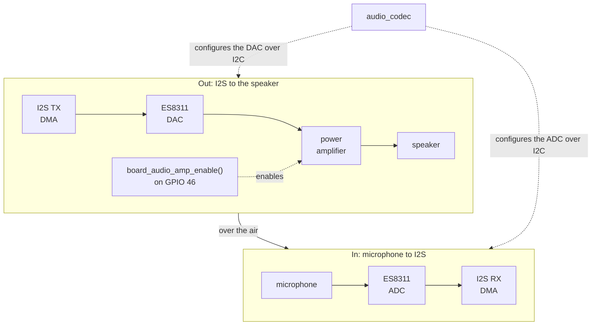
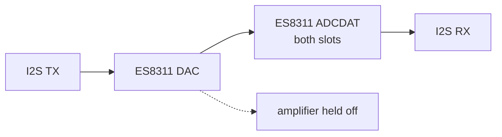

# Audio path

Part of the [audio docs](README.md). The board's audio wiring (amplifier pin, amplifier
startup, microphone gain) is in the [board notes](../notes/Board-and-Memory.md#audio).

## Path and lifetime

`sound_init()` opens the reference-counted `audio_codec` through `audio_out`
and keeps TX DMA for the firmware lifetime. `sound_mixer_device.c` owns the
only writer. Playback commands, voices, buses and the amplifier state machine
are described in [Sound-Mixer.md](Sound-Mixer.md).

RX is created and initialized only for a capture. Capture open and close run
as mixer commands: TX pauses around RX creation and teardown, then resumes.
The ESP32-S3 codec adapter defers RX shutdown while paired TX is active, so
teardown requests TX shutdown through that adapter before closing RX. Voice
positions hold across both capture operations.

Each direction uses an `AUDIO_CODEC_DMA_BLOCKS` x `AUDIO_CODEC_BLOCK_SAMPLES`
DMA ring (`launcher/main/audio/audio_codec.h`). PCM is mono, 16-bit at
`AUDIO_OUT_SAMPLE_RATE_HZ` (`launcher/main/audio/audio_out.h`). IDF allocates
the ring in `i2s_channel_init_std_mode()`, rather than `i2s_new_channel()`.
The codec, control and GPIO interfaces have one shared bring-up. The BSP's
`bsp_audio_*` helpers are unused because they have no deinit.

Signal path during a loopback check:

The [volume table](#level-vs-volume) shows the level at each tone gain.
The [duration table](#level-vs-duration) shows that waiting for amplifier
startup keeps short tones at the same level as long tones.

## Development check

Run `autana tone <hz> <ms> [volume] [--internal] [--json]`, or the console verb
`tone <hz> <ms> [volume] [internal]`.

`console_verb_tone()` opens capture, measures its DMA-capable heap cost, runs
the check, and closes capture
(`launcher/main/console/verbs/console_tone.c`).

The console uses `audio_loopback_measure()` for a baseline, starts a SYSTEM-bus
tone through the mixer, measures again, then stops the voice. It waits for
amplifier warm-up before measuring. A Goertzel filter measures the requested frequency.[[72]](../Citations.md#72)

`--internal` routes DAC data to both ADCDAT slots inside the ES8311. It holds
the speaker amplifier off for the whole check. The verb restores the exact register
read-back and releases the hold on every exit, before closing capture.
Both modes refuse to measure until any pending register restore succeeds.

Each window's Goertzel phase[[72]](../Citations.md#72) is referenced to its first sample.

The wrapped difference between consecutive windows' phase advances and the
nominal advance gives the frequency offset, as in the phase vocoder[[82]](../Citations.md#82),
here from a single bin rather than a filter bank.

The unambiguous offset range is ±sample rate / (2 × window samples). The reply
reports `path` and `measured_hz`; JSON adds `hz_error` in Hz, measured minus
requested.

The estimate is valid only while the tone stays within the unambiguous range
above; a drifting or modulated tone gives a wrong value.

The nominal frequency must be at least `AUDIO_FREQUENCY_MIN_CYCLES` cycles per window from DC and Nyquist.

Below `AUDIO_FREQUENCY_MIN_SAMPLES`, the reply says `measured n/a`
and both JSON frequency fields are null.

The detector discards `AUDIO_LOOPBACK_SETTLE_MS` of capture before measuring.
Heard means tone minus silence is at least `AUDIO_LOOPBACK_HEARD_MARGIN_DB`
(`launcher/main/audio/audio_loopback.h`). Playback and capture buffers have
block size, independent of tone duration.

An acoustic heard result checks I2S in both directions, codec DAC and ADC,
amplifier, speaker and microphone. Internal feedback checks digital playback
and capture inside the codec.

`open_dma_bytes` reports the DMA-capable heap consumed by capture while TX
is open. Capture blocks the console task, away from the frame loop. Stop
other voices when measuring the speaker alone.

## Captured measurements

Tables are generated from the committed capture, not edited by hand.
Regenerate with `python launcher/tools/audio/audio_doc_tables.py --write`;
`--check` rejects stale tables. Levels are frequency-selective dBFS,
not calibrated sound pressure levels.

### RAM

The table below is a capture of the stated board and image. Use the
[permanent mixer budget](Sound-Mixer.md#internal-ram) for boot-owned allocations;
a live tone reply's `open_dma_bytes` accounts for capture only.

<!-- generated: audio-ram sha256=a44c5ecc96a7f9540f8478813066ca98475c7a38dd89833df10327167c6251c7 -->
> Generated by: `python launcher/tools/audio/audio_doc_tables.py --write`

Board **A308**, build **164511c54388-dev** ([raw replies](data/audio_capture.txt)).

| State | Free DMA heap (B) | open_dma_bytes (B) | Kept vs idle (B) | Largest DMA block (B) |
|---|---|---|---|---|
| Idle (first heap) | 91391 | n/a | n/a | 57344 |
| Open (first tone) | 89943 | 1448 | n/a | not captured |
| Open (later tones) | not captured | 1424, 1448 | n/a | not captured |
| After close (last heap) | 91367 | n/a | 24 | 57344 |

First-open free heap is idle minus `open_dma_bytes`; later opens report only the delta.
<!-- /generated: audio-ram -->

The capture's second comment line identifies the re-read 3% tone; its 1448-byte
allocation is a first open after boot, listed under later tones above.

### Level vs frequency

<!-- generated: audio-frequency sha256=127906756bdffcfb05a1a41cbe1eb8db335a16c488f38ac6168ddfbb6f7edabc -->
> Generated by: `python launcher/tools/audio/audio_doc_tables.py --write`

Board **A308**, build **164511c54388-dev** ([raw replies](data/audio_capture.txt)).

Duration 500 ms; console default volume.

| Frequency (Hz) | Tone (dBFS) | Silence (dBFS) | Margin (dB) | Heard |
|---|---|---|---|---|
| 300 | -51.8 | -120.0 | 68.2 | yes |
| 500 | -40.3 | -116.8 | 76.5 | yes |
| 1000 | -32.9 | -106.6 | 73.7 | yes |
| 2000 | -39.6 | -120.0 | 80.4 | yes |
| 3000 | -50.1 | -119.8 | 69.7 | yes |
| 4000 | -45.6 | -120.0 | 74.4 | yes |
| 8000 | -46.2 | -112.3 | 66.1 | yes |
<!-- /generated: audio-frequency -->

### Level vs volume

<!-- generated: audio-volume sha256=0afa13ef7211f1664f65b9a4f6cd9c24215328007a77ced75c7c233b42f22c3b -->
> Generated by: `python launcher/tools/audio/audio_doc_tables.py --write`

Board **A308**, build **164511c54388-dev** ([raw replies](data/audio_capture.txt)).

Frequency 1000 Hz; duration 500 ms.

| Volume (%) | Tone (dBFS) | Silence (dBFS) | Margin (dB) | Heard |
|---|---|---|---|---|
| 1 | -62.5 | -120.0 | 57.5 | yes |
| 3 | -52.8 | -120.0 | 67.2 | yes |
| 10 | -42.4 | -107.0 | 64.6 | yes |
| 30 | -32.9 | -118.4 | 85.5 | yes |
| 100 | -22.5 | -119.5 | 97.0 | yes |
<!-- /generated: audio-volume -->

### Level vs duration

<!-- generated: audio-duration sha256=2ddcaf13213d47f67bd44a93998d00299a4fdf997e302724ab89046c581c5bd6 -->
> Generated by: `python launcher/tools/audio/audio_doc_tables.py --write`

Board **A308**, build **164511c54388-dev** ([raw replies](data/audio_capture.txt)).

Frequency 1000 Hz; console default volume.

| Duration (ms) | Tone (dBFS) | Silence (dBFS) | Margin (dB) | Heard |
|---|---|---|---|---|
| 20 | -32.9 | -98.5 | 65.6 | yes |
| 50 | -32.9 | -105.2 | 72.3 | yes |
| 100 | -32.9 | -98.6 | 65.7 | yes |
| 200 | -32.9 | -113.4 | 80.5 | yes |
| 500 | -32.9 | -106.6 | 73.7 | yes |
<!-- /generated: audio-duration -->

### Internal vs acoustic loopback

<!-- generated: audio-loopback sha256=45d39457759e15a5f337130c83ec0467f9b2da06425c4dde6cf507c6f87db038 -->
> Generated by: `python launcher/tools/audio/audio_doc_tables.py --write`

Board **A308**, build **164511c54388-dev** ([raw replies](data/audio_capture.txt)).

Internal vs acoustic loopback. Duration 500 ms; volume 30%.

| Frequency (Hz) | Acoustic level (dB) | Internal level (dB) | Acoustic Hz error | Internal Hz error |
|---|---|---|---|---|
| 500 | -40.3 | -10.5 | +0.01 | +0.02 |
| 1000 | -32.9 | -10.5 | +0.00 | +0.00 |
| 2000 | -39.6 | -10.5 | +0.00 | +0.00 |
| 4000 | -45.6 | -10.5 | +0.00 | +0.00 |
| 8000 | -46.2 | -10.5 | +0.00 | +0.00 |
<!-- /generated: audio-loopback -->

Internal level is flat at -10.5 dBFS across 500-8000 Hz: the default 30% tone
gain gives 20 * log10(0.30) = -10.5 dBFS, so the path adds no loss.
Silence reads the -120 dB floor. A board check can assert this internal level.

Acoustic level varies with frequency through the speaker, enclosure and
microphone. It also depends on how the board sits, so placement must be
considered when comparing captures.

Frequency error stays within a few hundredths of a hertz on both paths.
DAC and ADC share one clock, so the estimate checks the tone generator and
capture path, not the crystal.

## Constraint for held-open audio

While audio is held open, the largest single contiguous internal DMA
allocation any caller needs must still be satisfiable. The power-on
self-test checks a floor for the largest DMA block, owned by
`MIN_LARGEST_DMA_BLOCK` in `launcher/main/selftest/post.c`. Audio buffers
must not fragment the largest block below that requirement. The [RAM table](#ram)
identifies its capture image. `autana heap` reports the headroom with the
mixer running.
