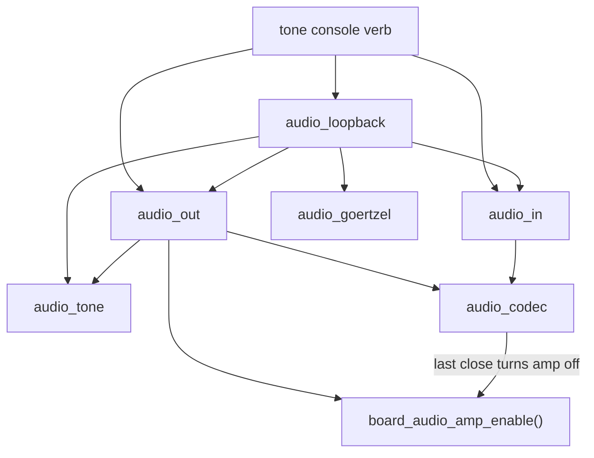
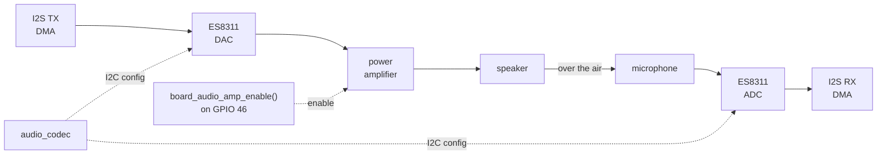

# Audio path

Part of the [audio docs](README.md). The board's audio wiring (amplifier pin, amplifier
startup, microphone gain) is in the [board notes](../notes/Board-and-Memory.md#audio).

## Path and lifetime

`audio_out` and `audio_in` share the reference-counted `audio_codec`
(`launcher/main/audio/audio_codec.c`). The first open creates the codec
interfaces and one duplex I2S channel pair; the last close deletes them.
Idle holds no codec or I2S objects; the small heap difference after close is
in the [RAM table](#ram).

Each direction uses an `AUDIO_CODEC_DMA_BLOCKS` x `AUDIO_CODEC_BLOCK_SAMPLES`
DMA ring (`launcher/main/audio/audio_codec.h`). PCM is mono, 16-bit;
`AUDIO_OUT_SAMPLE_RATE_HZ` is 22050 Hz (`launcher/main/audio/audio_out.h`).
The BSP's `bsp_audio_*` helpers are unused because they have no deinit.

Calls inside `launcher/main/audio/`:

Signal path during a loopback check:

The [volume table](#level-vs-volume) shows compression at high volume.
The [duration table](#level-vs-duration) shows that waiting for amplifier
startup keeps short tones at the same level as long tones.

## Development check

Run `autana tone <hz> <ms> [volume]`, or the console verb
`tone <hz> <ms> [volume]`. `console_verb_tone()` opens output and input,
measures their DMA heap cost, runs the check, and closes both
(`launcher/main/console/verbs/console_tone.c`).

`audio_loopback_check()` first records a silence baseline with the amplifier
off, then plays a tone while reading the microphone block by block. A
Goertzel filter measures level at the requested frequency.[[72]](../Citations.md#72)

The detector discards `AUDIO_LOOPBACK_SETTLE_MS` of capture before measuring.
Heard means tone minus silence is at least `AUDIO_LOOPBACK_HEARD_MARGIN_DB`
(`launcher/main/audio/audio_loopback.h`). Playback and capture buffers have
block size, independent of tone duration.

A heard result checks I2S in both directions, codec DAC and ADC, amplifier,
speaker and microphone end to end. `open_dma_bytes` reports the DMA-capable
heap consumed while both directions are open. Calls block and must be
serialized away from the frame loop (`launcher/main/audio/audio_out.h`).

## Captured measurements

Tables are generated from the committed capture, not edited by hand.
Regenerate with `python launcher/tools/audio/audio_doc_tables.py --write`;
`--check` rejects stale tables. Levels are frequency-selective dBFS from the
microphone, not calibrated sound pressure levels.

### RAM

Release builds don't compile `launcher/main/audio/`
(see `launcher/main/CMakeLists.txt`).

The reference-counted open/close and 0 B idle cost describe this milestone;
the mixer milestone allocates TX DMA at boot and updates this doc and its table.

<!-- generated: audio-ram sha256=570448eed63ae5ac5c6c9e10892409d2c16beff419df3a083348d33e0e41ab49 -->
> Generated by: `python launcher/tools/audio/audio_doc_tables.py --write`

Board **A308**, build **2521fd82ef55-dev** ([raw replies](data/audio_capture.txt)).

| State | Free DMA heap (B) | open_dma_bytes (B) | Kept vs idle (B) | Largest DMA block (B) |
|---|---|---|---|---|
| Idle (first heap) | 98223 | n/a | n/a | 65536 |
| Open (first tone) | 95127 | 3096 | n/a | not captured |
| Open (later tones) | not captured | 3040 | n/a | not captured |
| After close (last heap) | 98167 | n/a | 56 | 63488 |

First-open free heap is idle minus `open_dma_bytes`; later opens report only the delta.
<!-- /generated: audio-ram -->

### Level vs frequency

<!-- generated: audio-frequency sha256=03a8309737aedb2882c4afe9e63753d8b9555352584fb4fab0dabfddbf490cd9 -->
> Generated by: `python launcher/tools/audio/audio_doc_tables.py --write`

Board **A308**, build **2521fd82ef55-dev** ([raw replies](data/audio_capture.txt)).

Duration 500 ms; console default volume.

| Frequency (Hz) | Tone (dBFS) | Silence (dBFS) | Margin (dB) | Heard |
|---|---|---|---|---|
| 300 | -31.2 | -110.3 | 79.1 | yes |
| 1000 | -14.9 | -117.4 | 102.5 | yes |
| 3000 | -30.0 | -120.0 | 90.0 | yes |
<!-- /generated: audio-frequency -->

### Level vs volume

<!-- generated: audio-volume sha256=16d9ba57837baf7367414854b703d1ec886612cf872e956f87111612bc5fb6bb -->
> Generated by: `python launcher/tools/audio/audio_doc_tables.py --write`

Board **A308**, build **2521fd82ef55-dev** ([raw replies](data/audio_capture.txt)).

Frequency 1000 Hz; duration 500 ms.

| Volume (%) | Tone (dBFS) | Silence (dBFS) | Margin (dB) | Heard |
|---|---|---|---|---|
| 1 | -42.5 | -120.0 | 77.5 | yes |
| 3 | -33.0 | -120.0 | 87.0 | yes |
| 10 | -22.5 | -120.0 | 97.5 | yes |
| 30 | -14.9 | -120.0 | 105.1 | yes |
| 100 | -14.1 | -117.9 | 103.8 | yes |
<!-- /generated: audio-volume -->

### Level vs duration

<!-- generated: audio-duration sha256=95188d4afe82134cf5e06e574c0e666414fccd34171c3e639dadaab0fe2590f9 -->
> Generated by: `python launcher/tools/audio/audio_doc_tables.py --write`

Board **A308**, build **2521fd82ef55-dev** ([raw replies](data/audio_capture.txt)).

Frequency 1000 Hz; console default volume.

| Duration (ms) | Tone (dBFS) | Silence (dBFS) | Margin (dB) | Heard |
|---|---|---|---|---|
| 20 | -14.8 | -89.0 | 74.2 | yes |
| 50 | -14.8 | -95.2 | 80.4 | yes |
| 100 | -14.9 | -100.9 | 86.0 | yes |
| 200 | -14.9 | -108.3 | 93.4 | yes |
| 500 | -14.9 | -117.4 | 102.5 | yes |
<!-- /generated: audio-duration -->

## Decided for the mixer milestone

- A mixer task on core 1 is the only I2S writer.
- TX DMA (`AUDIO_CODEC_DMA_BLOCKS` x `AUDIO_CODEC_BLOCK_SAMPLES`, about 1 KB)
  is allocated once at boot. RX is allocated only while capturing.
- The amplifier stays on while audio is in use and goes off after a few idle seconds.
- The codec volume is fixed at or below 30 %; volume is applied in the mixer
  (int32, saturating).
- Sounds are PCM16 or IMA-ADPCM at `AUDIO_OUT_SAMPLE_RATE_HZ`, chosen per sound at bake time and
  stored as [sound entries](Sound-Assets.md), read in place through a cursor.
- API: audio_play / audio_stop / audio_set_gain now, and an ECS sound-source component later.
- The shell stops an app's voices when the app exits.

## Constraint for held-open audio

While audio is held open, the largest single contiguous internal DMA
allocation any caller needs must still be satisfiable. The power-on
self-test checks a floor for the largest DMA block, owned by
`MIN_LARGEST_DMA_BLOCK` in `launcher/main/selftest/post.c`. Audio buffers
must not fragment the largest block below that requirement. The [RAM table](#ram)
shows the captured headroom before and after close; the largest block while
open still needs measurement for a held-open caller.
