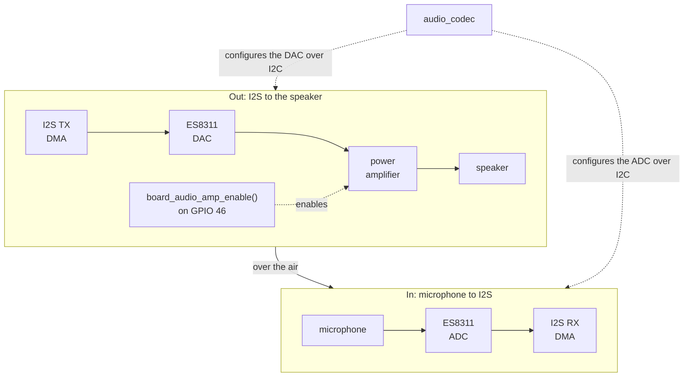
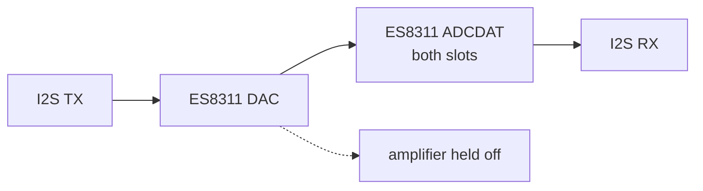
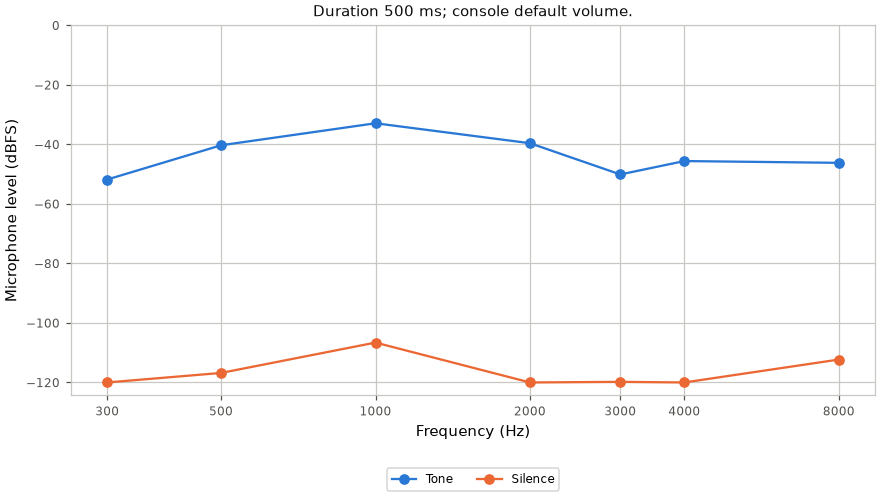
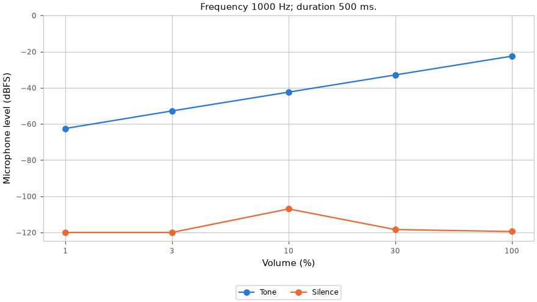
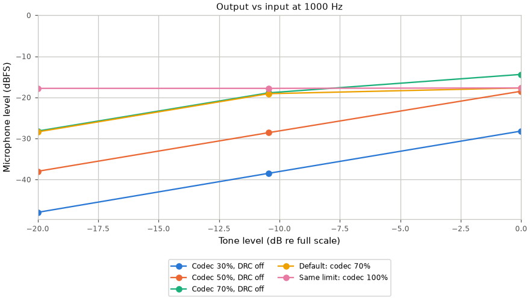
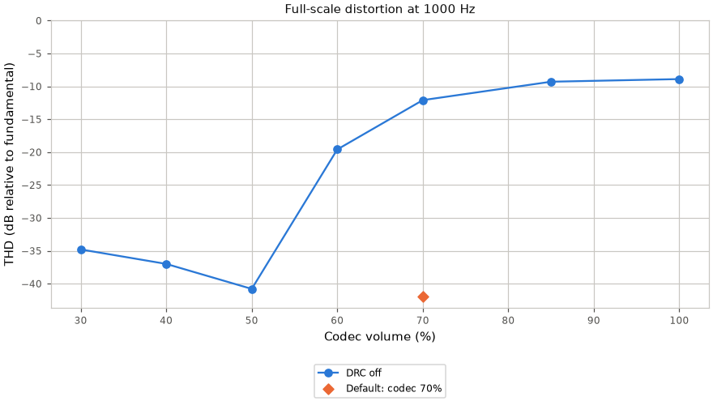

# Audio path

Part of the [audio docs](README.md). The board's audio wiring (amplifier pin, amplifier
startup, microphone gain) is in the [board notes](../notes/Board-and-Memory.md#audio).

## Path and lifetime

`sound_init()` opens the reference-counted `audio_codec` through `audio_out`
and keeps TX DMA for the firmware lifetime. `sound_mixer_device.c` owns the
only writer. Playback commands, voices, buses and the amplifier state machine
are described in [Sound-Mixer.md](Sound-Mixer.md) and [Mixer-Internals.md](Mixer-Internals.md).

RX is created and initialized only for a capture. Capture open and close run
as mixer commands: TX pauses around RX creation and teardown, then resumes.
The ESP32-S3 codec adapter defers RX shutdown while paired TX is active, so
teardown requests TX shutdown through that adapter before closing RX. Voice
positions hold across both capture operations.

Each direction uses an `AUDIO_CODEC_DMA_BLOCKS` x `AUDIO_CODEC_BLOCK_SAMPLES`
DMA ring (`launcher/main/audio/audio_codec.h`). PCM is mono, 16-bit at
`AUDIO_OUT_SAMPLE_RATE_HZ` (`launcher/main/audio/audio_out.h`). IDF allocates
the ring in `i2s_channel_init_std_mode()`, rather than `i2s_new_channel()`.
The codec, control and GPIO interfaces have one shared bring-up. The BSP's
`bsp_audio_*` helpers are unused because they have no deinit.

Signal path during a loopback check:



The [volume table](#level-vs-volume) shows the level at each tone gain.
The [duration table](#level-vs-duration) shows that waiting for amplifier
startup keeps short tones at the same level as long tones.

## Development check

Run `autana tone <hz> <ms> [volume] [--pulse MS] [--internal] [--json]`, or the console verb
`tone <hz> <ms> [volume] [pulse <ms>] [internal]`.

`console_tone_check()` opens capture, measures its DMA-capable heap cost,
runs the check, and closes capture. `melody check` uses the same function
(`launcher/main/sound/console/console_tone.c`).

The console uses `audio_loopback_measure()` for a baseline, starts a SYSTEM-bus
tone through the mixer, measures again, then stops the voice. It waits for
amplifier warm-up before measuring. A Goertzel filter measures the requested frequency.<sup>[[72]](../Citations.md#goertzel-1958)</sup>

With `--pulse`, capture selects samples by the IMU task's push clock,
not the observer's take clock. A pulse window must hold a full IMU queue
and fit `CONSOLE_TONE_PULSE_WINDOW_MAX_MS`.

Capture collects delayed batches for up to `IMU_BUZZ_WINDOW_MS` after the
pulse span. Only samples placed inside that span contribute to shake.
Buzz-rate polling and draining are bounded by `IMU_BUZZ_DRAIN_MAX_MS`; saved tunes stay unchanged.

Pulse shake needs `IMU_VIBRATION_MIN_SAMPLES` samples in the pulse span.
Gaps and lost samples invalidate shake only when their placed interval intersects
that span. `imu_gaps` counts queue gap reports across both capture windows.

Unavailable shake carries `shake_reason`, the warning text, in the reply and JSON.
Old replies without these fields parse with null values.

Pulse replies add `silence_pulse` and `tone_pulse` results. JSON groups each
window's status, take flags and lost samples under those keys.

`take_gaps` counts all take flags; `take_ms` places the first at the batch's
first retained sample, or the take clock for an empty batch. This is an
observation boundary, not the producer's gap timestamp.

`pulse_gaps` counts take flags that invalidate the pulse; `pulse_gap_ms`
places the first at the same boundary. `lost_samples` counts losses whose
interval overlaps the pulse; `lost_ms` places the first missing sample.

Times are milliseconds from that window's start. JSON times are null when
their count is zero. Status is `clean`, `gap`, `short`, `read_failed` or
`unavailable`; clean means the pulse supplied a valid shake reading.

`--internal` routes DAC data to both ADCDAT slots inside the ES8311. It holds
the speaker amplifier off for the whole check. The verb restores the exact register
read-back and releases the hold on every exit, before closing capture.
Both modes refuse to measure until any pending register restore succeeds.



Each window's Goertzel phase<sup>[[72]](../Citations.md#goertzel-1958)</sup> is referenced to its first sample.

The wrapped difference between consecutive windows' phase advances and the
nominal advance gives the frequency offset, as in the phase vocoder<sup>[[82]](../Citations.md#flanagan-1966)</sup>,
here from a single bin rather than a filter bank.

The unambiguous offset range is ±sample rate / (2 × window samples). The reply
reports `path` and `measured_hz`; JSON adds `hz_error` in Hz, measured minus
requested.

The estimate is valid only while the tone stays within the unambiguous range
above; a drifting or modulated tone gives a wrong value.

The nominal frequency must be at least `AUDIO_FREQUENCY_MIN_CYCLES` cycles per window from DC and Nyquist.

Below `AUDIO_FREQUENCY_MIN_SAMPLES`, the reply says `measured n/a`
and both JSON frequency fields are null.

`thd_db` reports harmonic power relative to the fundamental in dB; null means unavailable.

`peak_dbfs` reports the largest absolute microphone sample in dBFS.
`noise_dbfs` is the broadband RMS of the silence baseline, before the tone starts.

The detector discards `AUDIO_LOOPBACK_SETTLE_MS` of capture before measuring.
Heard means tone minus silence is at least `AUDIO_LOOPBACK_HEARD_MARGIN_DB`
(`launcher/main/audio/audio_loopback.h`). Playback and capture buffers have
block size, independent of tone duration.

An acoustic heard result checks I2S in both directions, codec DAC and ADC,
amplifier, speaker and microphone. Internal feedback checks digital playback
and capture inside the codec.

`open_dma_bytes` reports the DMA-capable heap consumed by capture while TX
is open. Capture blocks the console task, away from the frame loop. Stop
other voices when measuring the speaker alone.

## Captured measurements

Tables and figures are generated from the committed captures.
Regenerate with `python launcher/tools/audio/audio_doc_tables.py --write`;
`--check` rejects stale tables. Levels are frequency-selective dBFS,
not calibrated sound pressure levels.

Capture the RAM, frequency, volume, duration and loopback points inside one lock:

```sh
autana --wait 3600 lock run -- python launcher/tools/audio/audio_path_capture.py --board <id>
python launcher/tools/audio/audio_doc_tables.py --write
```

### RAM

Use the [permanent mixer budget](Mixer-Cost.md#internal-ram) for boot-owned allocations;
a live tone reply's `open_dma_bytes` accounts for capture only.

<!-- generated: audio-ram sha256=9d04d18b931e0160b582642a7597ddc0179789c3e4ed1ba8c3adf75dd8dc7562 -->
> Generated by: `python launcher/tools/audio/audio_doc_tables.py --write`

[raw replies](data/audio_capture.txt).

| State | Free DMA heap (B) | open_dma_bytes (B) | Kept vs idle (B) | Largest DMA block (B) |
|---|---|---|---|---|
| Idle (first heap) | 91391 | n/a | n/a | 57344 |
| Open (first tone) | 89943 | 1448 | n/a | not captured |
| Open (later tones) | not captured | 1424, 1448 | n/a | not captured |
| After close (last heap) | 91367 | n/a | 24 | 57344 |

First-open free heap is idle minus `open_dma_bytes`; later opens report only the delta.
<!-- /generated: audio-ram -->

'Open (later tones)' lists every distinct delta the capture reports.

### Level vs frequency

<!-- generated: audio-frequency sha256=41879595123ab5b1fbe406bf295ee4bb60a47558657333ea914189258cdfb509 -->
> Generated by: `python launcher/tools/audio/audio_doc_tables.py --write`

[raw replies](data/audio_capture.txt).

Duration 500 ms; console default volume.

<picture>
  <source media="(prefers-color-scheme: dark)" srcset="../images/audio/audio-frequency-dark.png">
  <source media="(prefers-color-scheme: light)" srcset="../images/audio/audio-frequency.png">
  
</picture>

<details>
<summary>Numeric data</summary>

| Frequency (Hz) | Tone (dBFS) | Silence (dBFS) | Margin (dB) | Heard |
|---|---|---|---|---|
| 300 | -51.8 | -120.0 | 68.2 | yes |
| 500 | -40.3 | -116.8 | 76.5 | yes |
| 1000 | -32.9 | -106.6 | 73.7 | yes |
| 2000 | -39.6 | -120.0 | 80.4 | yes |
| 3000 | -50.1 | -119.8 | 69.7 | yes |
| 4000 | -45.6 | -120.0 | 74.4 | yes |
| 8000 | -46.2 | -112.3 | 66.1 | yes |

</details>
<!-- /generated: audio-frequency -->

### Level vs volume

<!-- generated: audio-volume sha256=dfa2959fdc666a8527e08f16f83c270fbec969f4f68574ad115f738b001bec19 -->
> Generated by: `python launcher/tools/audio/audio_doc_tables.py --write`

[raw replies](data/audio_capture.txt).

Frequency 1000 Hz; duration 500 ms.

<picture>
  <source media="(prefers-color-scheme: dark)" srcset="../images/audio/audio-volume-dark.png">
  <source media="(prefers-color-scheme: light)" srcset="../images/audio/audio-volume.png">
  
</picture>

<details>
<summary>Numeric data</summary>

| Volume (%) | Tone (dBFS) | Silence (dBFS) | Margin (dB) | Heard |
|---|---|---|---|---|
| 1 | -62.5 | -120.0 | 57.5 | yes |
| 3 | -52.8 | -120.0 | 67.2 | yes |
| 10 | -42.4 | -107.0 | 64.6 | yes |
| 30 | -32.9 | -118.4 | 85.5 | yes |
| 100 | -22.5 | -119.5 | 97.0 | yes |

</details>
<!-- /generated: audio-volume -->

### Level vs duration

<!-- generated: audio-duration sha256=3ef9c7347fd34887eeb41a42f4fe52764fb225a959d0d3a38055b786276141ee -->
> Generated by: `python launcher/tools/audio/audio_doc_tables.py --write`

[raw replies](data/audio_capture.txt).

Frequency 1000 Hz; console default volume.

| Duration (ms) | Tone (dBFS) | Silence (dBFS) | Margin (dB) | Heard |
|---|---|---|---|---|
| 20 | -32.9 | -98.5 | 65.6 | yes |
| 50 | -32.9 | -105.2 | 72.3 | yes |
| 100 | -32.9 | -98.6 | 65.7 | yes |
| 200 | -32.9 | -113.4 | 80.5 | yes |
| 500 | -32.9 | -106.6 | 73.7 | yes |
<!-- /generated: audio-duration -->

### Internal vs acoustic loopback

<!-- generated: audio-loopback sha256=33d418d61fbb00166cc329c1232d9d6c174f8096a89e16ce535bf01585344887 -->
> Generated by: `python launcher/tools/audio/audio_doc_tables.py --write`

[raw replies](data/audio_capture.txt).

Duration 500 ms; volume 30%.

| Frequency (Hz) | Acoustic level (dBFS) | Internal level (dBFS) | Acoustic error (Hz) | Internal error (Hz) |
|---|---|---|---|---|
| 500 | -40.3 | -10.5 | +0.01 | +0.02 |
| 1000 | -32.9 | -10.5 | +0.00 | +0.00 |
| 2000 | -39.6 | -10.5 | +0.00 | +0.00 |
| 4000 | -45.6 | -10.5 | +0.00 | +0.00 |
| 8000 | -46.2 | -10.5 | +0.00 | +0.00 |
<!-- /generated: audio-loopback -->

Internal level is the same at every frequency and equals the tone gain,
20 * log10(volume / 100) dBFS: the digital path adds no loss. Frequency error
is a small fraction of a hertz on both paths.

Acoustic level varies with frequency through the speaker, enclosure and
microphone. It also depends on how the board sits, so placement must be
considered when comparing captures.

DAC and ADC share one clock, so the estimate checks the tone generator and
capture path, not the crystal.

## Output limiter (DRC)

The ES8311 DAC limiter is controlled by `audio.drc`, `audio.drc_max`,
`audio.drc_min`, `audio.drc_win`, and `audio.drc_ramp`.
Level fields are datasheet indices; window and ramp fields are nibbles.

DRC limits engage only below static full-scale DAC output. The window sets
the detection/release rate; large values are too slow for short sounds.
Keep the EQ-bypass bit set.

`audio.codec_volume` sets codec output gain.
Defaults enable DRC with max=min index 2, window 4, ramp 2, and codec volume
`AUDIO_OUT_CODEC_VOLUME` (70%). The named defaults and volume curve endpoints
are owned by `audio_out.c`. Release writes the DRC registers once at open.
Development builds apply changed tunables on the next PCM write.

The amplifier compresses above about -21 dBFS of DAC output (codec 50% static).
The default limits DAC output at -20.6 dB with codec 70% make-up: quiet and medium
sounds play about 20 dB louder than codec 30%, full scale about 10.5 dB louder with lower THD.
Codec 100% with the limiter flattens every level, losing volume control.

Capture on a development image inside one board lock:

```sh
autana --wait 3600 lock run -- python launcher/tools/audio/audio_drc_sweep.py --board <id>
python launcher/tools/audio/audio_doc_tables.py --write
bash launcher/tools/render/render_doc_images.sh --audio
```

The sweep resets every audio tunable at exit. Its arguments select codec gains,
limiter fields, tone points, duration, and repeats. Tables and figures read
`docs/audio/data/audio_drc_capture.txt`.

THD sums harmonics 2..5 below Nyquist using a rectangular window; noise between bins is excluded.
Clean 500 ms host sines, including noninteger Hz, fall below `AUDIO_LOOPBACK_THD_FLOOR_DB` (-60 dB).

<!-- generated: audio-drc sha256=d9b14513c050501a91ecb526f5694d3325e8c39a74b690abaded74bc16f30dfd -->
> Generated by: `python launcher/tools/audio/audio_doc_tables.py --write`

[raw replies](data/audio_drc_capture.txt).

Levels and THD: 1000 Hz; worst peak includes every frequency.

<picture>
  <source media="(prefers-color-scheme: dark)" srcset="../images/audio/drc-level-dark.png">
  <source media="(prefers-color-scheme: light)" srcset="../images/audio/drc-level.png">
  
</picture>

<picture>
  <source media="(prefers-color-scheme: dark)" srcset="../images/audio/drc-thd-dark.png">
  <source media="(prefers-color-scheme: light)" srcset="../images/audio/drc-thd.png">
  
</picture>

| Setting | Level 10% (dBFS) | Level 30% (dBFS) | Level 100% (dBFS) | THD 100% (dB) |
|---|---|---|---|---|
| Default | -28.4 | -19.1 | -17.7 | -42.0 |
| Codec 50%, DRC off | -38.0 | -28.6 | -18.5 | -40.8 |

<details>
<summary>Per-configuration data</summary>

| Codec (%) | Static full-scale DAC output (dBFS) | DRC max/min (dB) | Window | Ramp | Level 10% (dBFS) | Level 30% (dBFS) | Level 100% (dBFS) | THD 100% (dB) | Worst peak (dBFS) | Mic clipped |
|---|---|---|---|---|---|---|---|---|---|---|
| 30 | -31.4 | off | 4 | 2 | -48.0 | -38.5 | -28.2 | -34.8 | -28.0 | no |
| 40 | -26.4 | off | 4 | 2 | -43.0 | -33.6 | -23.3 | -37.0 | -23.2 | no |
| 50 | -21.4 | off | 4 | 2 | -38.0 | -28.6 | -18.5 | -40.8 | -18.4 | no |
| 60 | -16.4 | off | 4 | 2 | -33.1 | -23.8 | -15.0 | -19.6 | -15.8 | no |
| 70 | -11.4 | off | 4 | 2 | -28.2 | -18.9 | -14.4 | -12.1 | -15.4 | no |
| 85 | -3.9 | off | 4 | 2 | -20.9 | -14.6 | -14.1 | -9.3 | -15.2 | no |
| 100 | 3.6 | off | 4 | 2 | -15.1 | -14.2 | -14.1 | -8.9 | -14.5 | no |
| 70 | -11.4 | max -24.1 / min -24.1 | 4 | 2 | -28.6 | -21.4 | -21.3 | -37.1 | -20.6 | no |
| 70 | -11.4 | max -24.1 / min -30.1 | 4 | 2 | -28.5 | -21.6 | -21.2 | -39.4 | -20.5 | no |
| 70 | -11.4 | max -20.6 / min -20.6 | 4 | 2 | -28.4 | -19.1 | -17.7 | -42.0 | -17.4 | no |
| 70 | -11.4 | max -20.6 / min -30.1 | 4 | 2 | -28.3 | -19.0 | -17.7 | -42.4 | -17.6 | no |
| 70 | -11.4 | max -18.1 / min -18.1 | 4 | 2 | -28.3 | -19.0 | -15.6 | -28.4 | -15.9 | no |
| 70 | -11.4 | max -18.1 / min -30.1 | 4 | 2 | -28.3 | -19.0 | -15.7 | -32.5 | -16.0 | no |
| 70 | -11.4 | max -16.1 / min -16.1 | 4 | 2 | -28.3 | -19.0 | -15.0 | -19.0 | -15.7 | no |
| 70 | -11.4 | max -16.1 / min -30.1 | 4 | 2 | -28.3 | -19.0 | -15.0 | -19.2 | -15.8 | no |
| 100 | 3.6 | max -24.1 / min -24.1 | 4 | 2 | -21.2 | -21.0 | -21.1 | -39.4 | -16.0 | no |
| 100 | 3.6 | max -24.1 / min -30.1 | 4 | 2 | -21.3 | -21.1 | -25.5 | -37.2 | -15.8 | no |
| 100 | 3.6 | max -20.6 / min -20.6 | 4 | 2 | -17.8 | -17.8 | -17.7 | -42.4 | -16.0 | no |
| 100 | 3.6 | max -20.6 / min -30.1 | 4 | 2 | -17.9 | -18.1 | -25.0 | -36.9 | -16.0 | no |
| 100 | 3.6 | max -18.1 / min -18.1 | 4 | 2 | -15.7 | -15.7 | -15.7 | -29.0 | -14.7 | no |
| 100 | 3.6 | max -18.1 / min -30.1 | 4 | 2 | -15.8 | -15.8 | -26.8 | -36.1 | -16.0 | no |
| 100 | 3.6 | max -16.1 / min -16.1 | 4 | 2 | -15.1 | -15.0 | -15.0 | -19.3 | -15.8 | no |
| 100 | 3.6 | max -16.1 / min -30.1 | 4 | 2 | -48.1 | -38.7 | -28.4 | -36.7 | -28.2 | no |

</details>
<!-- /generated: audio-drc -->

## Constraint for held-open audio

While audio is held open, the largest single contiguous internal DMA
allocation any caller needs must still be satisfiable. The power-on
self-test checks a floor for the largest DMA block, owned by
`MIN_LARGEST_DMA_BLOCK` in `launcher/main/selftest/post.c`. Audio buffers
must not fragment the largest block below that requirement. The [RAM table](#ram)
links to the raw capture and its provenance. `autana heap` reports the headroom with the
mixer running.

### Melody

`autana melody [volume]` plays the built-in phrase in rhythm.
`autana melody [volume] --check [--internal]` checks each note out of rhythm
through the same loopback path as `tone`. Volume defaults to the tone default.

The console forms are `melody [volume]` and
`melody check [volume] [internal]`. They block the console task.

Play mode returns `MELODY_END notes=<count> ms=<elapsed>`.
With `--json`, the host prints `{"notes": <count>, "ms": <elapsed>}`.

Check mode prints `MELODY note=<name> ` followed by the exact `TONE` reply,
then `MELODY_END notes=<count>`. A failure returns `MELODY_ERR <reason>`.
The host exits with status 1 if any note is not heard.

Check JSON is a list of tone result objects, each with `note` and
`cents_error` added. Cents error is `1200 * log2(measured_hz / hz)`;
it is null when the frequency estimate is unavailable.

## Recording the microphone

`autana mic record 1000 --settle 100 -o take.wav --json` records mono PCM16
and writes codec state to `take.json`. Duration, settling and write limits live
in `console_mic_parse.h`; the omitted settling interval is `AUDIO_LOOPBACK_SETTLE_MS`.
`--at <ms> <reg> <value>` writes a codec register that far into the take.

`MIC_BEGIN` announces rate and sample count. `MIC_DATA` carries independent
base64 chunks of PCM16 little-endian samples. `MIC_STATE` contains the rate,
sample count, codec registers, scheduled writes and automute runs as
`[first_block, block_count]`. Block size lives in `audio_codec.h`; `MIC_END`
completes a successful transfer.

Install `launcher/tools/audio/mic/requirements.txt`, then run:

```sh
python launcher/tools/audio/mic/mic_metrics.py take.wav --reference reference.wav --json
```

`noise_dbfs` is the take's broadband RMS level, the floor or hiss when nothing
plays. Metrics align the reference by correlation without gain normalization.
Levels are dBFS; speech-band SNR uses reference activity. Active level uses a
P.56-style envelope estimate, not a P.56 conformance measurement. STOI requires
matched rates. Synthetic material comes from `generate_noise.py` (`pink` or
`babble`, `--seconds`, `--seed`).
