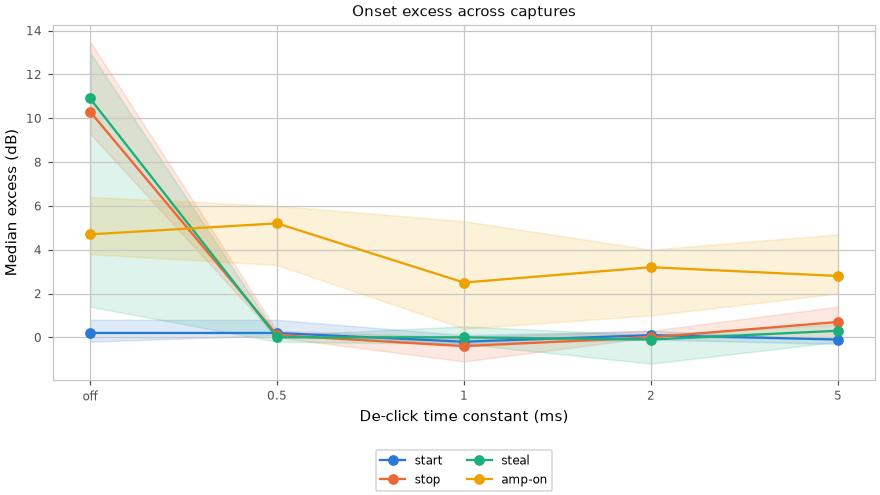

# Clicks

When a voice stops, is stolen or reaches its end, the [mixer](Sound-Mixer.md)
decays its last sample to zero with time constant `sound.declick_us` instead of
cutting it.

| Rule | Detail |
|---|---|
| Control | the playback API has no fade; seamless loops are the asset's job |
| Rounding | decay moves toward zero by at least one PCM unit per sample |
| Mid-block ends | tails start at their exact sample offset |

| Hot tunable | Effect |
|---|---|
| `sound.declick_us` | exponential decay time constant in microseconds (tau in frames after sample-rate conversion); zero disables it. Live changes need `--hot-tunables` |

A 1 ms time constant (`SOUND_DECLICK_US` in `sound_mixer.h`) removes stop and
steal clicks; half of that already does, so the default has 2x margin.

The amplifier switches on once at sound start, so its turn-on transient happens
before any sound; display wake will need the same transition when sleep exists.

## Measuring an onset

`autana sound onset <event> [hz] [gain]` ([Drive](../cli/Drive.md)) streams
microphone blocks on the console task. It reports second-difference peaks before
and after the trigger, their difference (`excess_db`), and the post-trigger
peak's `at_ms`.

| Event | Pre-trigger state | Trigger and capture |
|---|---|---|
| `amp-on` | Silent holder, amplifier held OFF for settling and the pre-window | Release the development hold; capture through amplifier startup plus one margin window |
| `start` | Silent holder, amplifier ON | Start the probe; short window |
| `stop` | Steady probe and silent holder, amplifier ON | Stop the probe; short window |
| `steal` | Oldest probe and silent holders fill the voice table | Add a holder; short window |

| Detail | Rule |
|---|---|
| Defaults | `CONSOLE_SOUND_ONSET_HZ` and `CONSOLE_SOUND_ONSET_GAIN` in `console_sound_parse.h` |
| Metric | the second difference suppresses a steady low tone; its peak is normalized to PCM full scale, so a sharp transient can exceed 0 dBFS |
| Settle | after capture opens, `AUDIO_LOOPBACK_SETTLE_MS` of microphone input is discarded before preparation or the pre-window, even with the amplifier OFF |
| Windows | derived from amplifier timing and the mixer block period; `at_ms` starts after the pre-window and includes queue and RX DMA latency |

[sound_onset_capture.py](../../launcher/tools/audio/sound_onset_capture.py)
measures the named arms in argument order, then resets the tunable to its
firmware default. Each capture record is `<arm>\t<command>\t<reply>`. A failed
onset is retried once; failures retain stdout, stderr, arm and event, and
exhausted retries leave fewer successful runs without stopping capture.

`audio_doc_tables.py --write` reads every `sound_onset_capture_*.txt` file in
`docs/audio/data`; `--check` rejects stale or invalid data.
`render_doc_images.sh --audio` renders the themed plot.

## Results

<!-- generated: sound-onset sha256=2b94893a38ee68c9ceb56b35fa5c2193e45c21cbb975143b0e9acb6a2b3ee5f4 -->
<picture>
  <source media="(prefers-color-scheme: dark)" srcset="../images/audio/sound-onset-dark.png">
  <source media="(prefers-color-scheme: light)" srcset="../images/audio/sound-onset.png">
  
</picture>

Lines show the median of capture medians; bands span their minimum to maximum.

Numeric cells show median (worst) excess dB; run counts appear only when incomplete.

Capture 1

> Generated by: `python launcher/tools/audio/audio_doc_tables.py --write`

[raw replies](data/sound_onset_capture_20e8.txt).

Numeric data

| Event | off | 500us | 1ms | 2ms | 5ms |
|---|---|---|---|---|---|
| amp-on | 3.8 (10.9) | 3.3 (10.1) | 2.5 (13.3) | 3.2 (8.5) | 2.8 (10.5) |
| start | 0.8 (1.3) | 0.8 (1.2) | 0.1 (1.2) | -0.1 (1.0) | -0.1 (0.5) |
| stop | 10.3 (11.9) | 0.0 (0.5) | -1.1 (0.3) | 0.0 (0.6) | 1.4 (2.0) |
| steal | 10.9 (12.2) | 0.0 (1.3) | -0.3 (0.3) | -0.1 (2.0) | 0.3 (1.6) |

Capture 2

> Generated by: `python launcher/tools/audio/audio_doc_tables.py --write`

[raw replies](data/sound_onset_capture_2124.txt).

Numeric data

| Event | off | 500us | 1ms | 2ms | 5ms |
|---|---|---|---|---|---|
| amp-on | 6.4 (6.9) | 6.0 (7.5) | 0.4 (7.8) | 1.0 (8.5) | 2.0 (7.9) |
| start | 0.2 (1.0) | 0.2 (1.8) | -0.3 (1.0) | 0.1 (1.6) | -0.1 (0.2) |
| stop | 13.5 (13.8) | 0.3 (1.2) | -0.4 (1.3) | 0.3 (0.7) | 0.0 (0.2) |
| steal | 13.0 (13.6) | -0.2 (0.5) | 0.5 (1.2) | 0.1 (1.0) | 0.6 (0.9) |

Capture 3

> Generated by: `python launcher/tools/audio/audio_doc_tables.py --write`

[raw replies](data/sound_onset_capture_a308.txt).

Numeric data

| Event | off | 500us | 1ms | 2ms | 5ms |
|---|---|---|---|---|---|
| amp-on | 4.7 (5.1) | 5.2 (5.6) | 5.3 (11.5) | 4.0 (6.0) | 4.7 (6.1) |
| start | -0.2 (0.2) | 0.1 (0.6) | -0.2 (1.1) | 0.3 (1.5) | -0.3 (0.6) |
| stop | 9.3 (9.8) | 0.1 (0.9) | 0.0 (0.9) | 0.0 (0.8) | 0.7 (1.5) |
| steal | 1.4 (9.6) | 0.1 (0.6) | 0.0 (0.2) | -1.2 (0.2) | -0.2 (1.0) |

<!-- /generated: sound-onset -->
