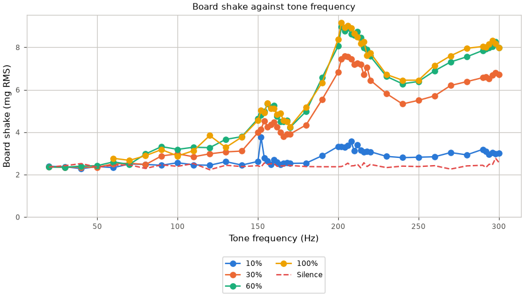
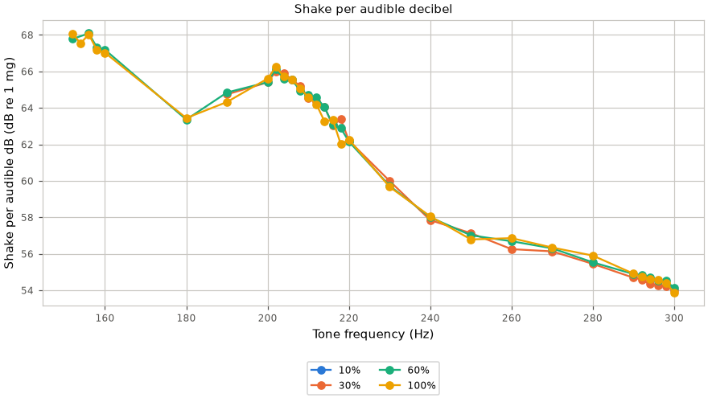

# Low-frequency buzz

Can a low tone shake the board enough to feel while it stays barely audible?
This page holds the sweep that answers it: board shake from the IMU against
loudness from the microphone, for tones from 20 to 300 Hz.

The coupling capacitor and resistor ahead of the amplifier make a high-pass
near 10 Hz, so every swept tone reaches the speaker. The 1 W speaker bounds
the loudest a tone may be held: see Safety.

## How a point is measured

`autana tone <hz> <ms> <volume>` measures twice: once over silence, once while
the tone plays. In development builds its reply also carries the board's
shake over both windows.

| Quantity | Source | Detail |
|---|---|---|
| Shake (mg RMS) | IMU accelerometer samples the IMU task queued during each window | Spread of each sample around the window's mean. The mean holds gravity and tilt, so only shaking remains |
| IMU rate | `IMU_BUZZ_ODR_CODE` during the check, `IMU_ODR_CODE` after | The sensor's default bandwidth is half its rate, so the normal rate is blind above about 110 Hz; the check asks the IMU task to run it 4x faster, and each switch queues a gap |
| Window | the newest `IMU_FIFO_SAMPLES` samples of the tone | Long enough for three cycles of the lowest tone |
| Silence (mg RMS) | the same reading over the silent window | The noise floor; shake counts only at twice this |
| Tone, THD (dBFS, dB) | the loopback Goertzel at the tone and its harmonics | As in [Audio-Path.md](Audio-Path.md) |
| Audible (dBFS, A) | tone plus harmonics, A-weighted<sup>[[96]](../Citations.md#iec-61672-1)</sup> | Harmonic power is taken as all at the second harmonic. A small cone is heard mostly through its harmonics at low frequency |
| Score (dB) | 20 log10 of the shake above the floor, minus the audible level | Higher means more shake for the same loudness |

The microphone's own low-frequency roll-off is not corrected, so the
audible level of the lowest tones reads low. The hand check below covers it.

## Safety

The sweep holds tones for at most 500 ms, with a rest between them.
Below 60 Hz it stays at 60% volume or less, since low tones move the cone
furthest. The full-volume point is one burst per frequency, at 60 Hz or above.

## Results

<!-- generated: audio-buzz sha256=3ae8c410c72ad58513a73dec7ce489c1855afa8b509f72181e3469d780c19696 -->
> Generated by: `python launcher/tools/audio/audio_doc_tables.py --write`

[raw replies](data/audio_buzz_capture.txt).

Shake counts where it reaches 2x the silent board's reading.

| Finding | Frequency (Hz) | Volume (%) | Shake (mg RMS) | Audible (dBFS, A) |
|---|---|---|---|---|
| Most shake per audible dB | 156 | 60 | 5.34 | -54.6 |
| Most shake at 60% | 202 | 60 | 8.97 | -47.4 |

<picture>
  <source media="(prefers-color-scheme: dark)" srcset="../images/audio/buzz-shake-dark.png">
  <source media="(prefers-color-scheme: light)" srcset="../images/audio/buzz-shake.png">
  
</picture>

<picture>
  <source media="(prefers-color-scheme: dark)" srcset="../images/audio/buzz-score-dark.png">
  <source media="(prefers-color-scheme: light)" srcset="../images/audio/buzz-score.png">
  
</picture>

<details>
<summary>Numeric data</summary>

| Hz | Volume (%) | Runs | Shake (mg RMS) | Worst peak (mg) | Silence (mg RMS) | Tone (dBFS) | Silence (dBFS) | THD (dB) | Audible (dBFS, A) | Score (dB) |
|---|---|---|---|---|---|---|---|---|---|---|
| 20 | 10 | 3 | 2.39 | 6.43 | 2.48 | -100.2 | -114.9 | -3.8 | -138.3 | below floor |
| 20 | 30 | 3 | 2.36 | 5.58 | 2.39 | -90.7 | -106.0 | -14.0 | -137.1 | below floor |
| 20 | 60 | 3 | 2.36 | 6.28 | 2.36 | -85.9 | -109.4 | 3.1 | -117.3 | below floor |
| 30 | 10 | 3 | 2.37 | 6.39 | 2.33 | -88.6 | -111.8 | -13.2 | -126.0 | below floor |
| 30 | 30 | 3 | 2.35 | 6.52 | 2.40 | -78.7 | -104.7 | -23.3 | -118.9 | below floor |
| 30 | 60 | 3 | 2.35 | 6.43 | 2.42 | -74.8 | -116.9 | -4.4 | -105.7 | below floor |
| 40 | 10 | 3 | 2.28 | 6.14 | 2.44 | -80.6 | -105.1 | -23.6 | -114.8 | below floor |
| 40 | 30 | 3 | 2.35 | 5.93 | 2.51 | -70.8 | -111.5 | -30.1 | -105.3 | below floor |
| 40 | 60 | 3 | 2.40 | 6.24 | 2.52 | -67.5 | -110.4 | -8.9 | -97.1 | below floor |
| 50 | 10 | 3 | 2.38 | 5.83 | 2.28 | -74.8 | -111.1 | -29.9 | -105.0 | below floor |
| 50 | 30 | 3 | 2.35 | 6.38 | 2.33 | -65.4 | -106.6 | -32.9 | -95.6 | below floor |
| 50 | 60 | 3 | 2.42 | 5.35 | 2.35 | -62.3 | -104.8 | -12.1 | -90.0 | below floor |
| 60 | 10 | 3 | 2.33 | 6.84 | 2.35 | -70.9 | -108.7 | -33.4 | -97.9 | below floor |
| 60 | 30 | 3 | 2.50 | 7.15 | 2.46 | -61.2 | -114.5 | -35.0 | -88.2 | below floor |
| 60 | 60 | 3 | 2.60 | 6.74 | 2.44 | -58.5 | -114.8 | -15.2 | -84.3 | below floor |
| 60 | 100 | 1 | 2.77 | 5.98 | 2.25 | -58.2 | -107.5 | -14.8 | -83.9 | below floor |
| 70 | 10 | 3 | 2.50 | 7.91 | 2.35 | -67.6 | -105.7 | -37.2 | -92.1 | below floor |
| 70 | 30 | 3 | 2.54 | 7.32 | 2.46 | -57.9 | -112.7 | -35.5 | -82.4 | below floor |
| 70 | 60 | 3 | 2.48 | 5.72 | 2.46 | -55.4 | -116.8 | -16.9 | -79.1 | below floor |
| 70 | 100 | 1 | 2.67 | 5.78 | 2.48 | -55.2 | -109.3 | -16.9 | -78.9 | below floor |
| 80 | 10 | 3 | 2.48 | 5.54 | 2.42 | -65.0 | -110.8 | -42.5 | -87.4 | below floor |
| 80 | 30 | 3 | 2.47 | 6.69 | 2.61 | -55.2 | -114.4 | -35.8 | -77.6 | below floor |
| 80 | 60 | 3 | 2.97 | 6.01 | 2.29 | -52.8 | -114.9 | -18.4 | -74.7 | below floor |
| 80 | 100 | 1 | 2.89 | 6.75 | 2.47 | -52.9 | -120.0 | -18.2 | -74.8 | below floor |
| 90 | 10 | 3 | 2.44 | 6.64 | 2.44 | -62.6 | -108.3 | -42.1 | -83.2 | below floor |
| 90 | 30 | 3 | 2.88 | 7.12 | 2.41 | -52.9 | -113.1 | -36.0 | -73.5 | below floor |
| 90 | 60 | 3 | 3.32 | 7.08 | 2.46 | -50.7 | -107.0 | -20.9 | -71.1 | below floor |
| 90 | 100 | 1 | 3.18 | 6.55 | 2.65 | -50.6 | -111.7 | -19.6 | -70.9 | below floor |
| 100 | 10 | 3 | 2.56 | 6.24 | 2.42 | -60.6 | -110.4 | -42.7 | -79.7 | below floor |
| 100 | 30 | 3 | 2.98 | 6.81 | 2.42 | -50.9 | -111.8 | -36.6 | -70.0 | below floor |
| 100 | 60 | 3 | 3.19 | 7.53 | 2.39 | -49.0 | -111.6 | -20.0 | -67.9 | below floor |
| 100 | 100 | 1 | 2.88 | 5.75 | 2.52 | -48.7 | -104.9 | -20.1 | -67.6 | below floor |
| 110 | 10 | 3 | 2.46 | 6.27 | 2.40 | -58.9 | -113.6 | -41.2 | -76.7 | below floor |
| 110 | 30 | 3 | 2.84 | 7.18 | 2.39 | -49.1 | -119.5 | -36.2 | -66.9 | below floor |
| 110 | 60 | 3 | 3.29 | 8.04 | 2.52 | -47.1 | -116.3 | -21.6 | -64.8 | below floor |
| 110 | 100 | 1 | 3.13 | 6.18 | 2.56 | -47.0 | -116.3 | -21.8 | -64.7 | below floor |
| 120 | 10 | 3 | 2.44 | 7.07 | 2.60 | -57.3 | -109.2 | -41.6 | -74.0 | below floor |
| 120 | 30 | 3 | 2.98 | 8.71 | 2.74 | -47.5 | -107.8 | -36.0 | -64.2 | below floor |
| 120 | 60 | 3 | 3.27 | 8.56 | 2.23 | -45.6 | -109.0 | -20.8 | -62.1 | below floor |
| 120 | 100 | 1 | 3.84 | 8.03 | 2.41 | -45.5 | -111.8 | -21.3 | -62.0 | below floor |
| 130 | 10 | 3 | 2.61 | 6.97 | 2.37 | -55.9 | -104.6 | -43.2 | -71.6 | below floor |
| 130 | 30 | 3 | 3.07 | 9.96 | 2.51 | -46.1 | -108.9 | -36.1 | -61.8 | below floor |
| 130 | 60 | 3 | 3.66 | 17.58 | 2.44 | -44.4 | -111.4 | -20.7 | -59.9 | below floor |
| 130 | 100 | 1 | 3.28 | 6.48 | 2.40 | -44.2 | -107.6 | -21.0 | -59.7 | below floor |
| 140 | 10 | 3 | 2.45 | 6.98 | 2.46 | -54.6 | -113.3 | -41.3 | -69.4 | below floor |
| 140 | 30 | 3 | 3.11 | 7.69 | 2.35 | -44.8 | -119.6 | -36.0 | -59.6 | below floor |
| 140 | 60 | 3 | 3.79 | 7.90 | 2.38 | -43.2 | -112.9 | -19.6 | -57.8 | below floor |
| 140 | 100 | 1 | 3.77 | 6.67 | 2.33 | -43.0 | -116.3 | -20.6 | -57.6 | below floor |
| 150 | 10 | 3 | 2.62 | 6.09 | 2.51 | -53.4 | -110.1 | -42.3 | -67.4 | below floor |
| 150 | 30 | 3 | 3.98 | 9.45 | 2.41 | -43.6 | -114.9 | -36.0 | -57.6 | below floor |
| 150 | 60 | 3 | 4.63 | 10.03 | 2.42 | -42.0 | -114.5 | -20.7 | -55.8 | below floor |
| 150 | 100 | 1 | 4.55 | 7.92 | 2.32 | -41.8 | -106.3 | -22.3 | -55.7 | below floor |
| 152 | 10 | 3 | 3.76 | 63.78 | 2.53 | -53.1 | -107.9 | -43.8 | -66.9 | below floor |
| 152 | 30 | 3 | 4.14 | 8.60 | 2.36 | -43.3 | -111.2 | -36.7 | -57.1 | below floor |
| 152 | 60 | 3 | 4.80 | 10.10 | 2.36 | -41.7 | -113.3 | -20.7 | -55.4 | 67.8 |
| 152 | 100 | 1 | 5.02 | 11.52 | 2.43 | -41.5 | -105.1 | -22.7 | -55.2 | 68.1 |
| 154 | 10 | 3 | 2.78 | 10.46 | 2.58 | -52.9 | -116.6 | -42.6 | -66.6 | below floor |
| 154 | 30 | 3 | 4.54 | 11.03 | 2.53 | -43.1 | -115.2 | -37.0 | -56.8 | below floor |
| 154 | 60 | 3 | 4.98 | 9.95 | 2.55 | -41.4 | -109.4 | -21.4 | -54.9 | below floor |
| 154 | 100 | 1 | 4.91 | 10.04 | 2.38 | -41.3 | -118.5 | -23.0 | -54.9 | 67.5 |
| 156 | 10 | 3 | 2.64 | 6.25 | 2.45 | -52.6 | -114.2 | -40.9 | -66.1 | below floor |
| 156 | 30 | 3 | 4.24 | 8.42 | 2.56 | -42.8 | -110.7 | -37.9 | -56.3 | below floor |
| 156 | 60 | 3 | 5.34 | 9.92 | 2.48 | -41.2 | -115.1 | -21.6 | -54.6 | 68.1 |
| 156 | 100 | 1 | 5.36 | 9.48 | 2.41 | -41.0 | -108.1 | -23.1 | -54.4 | 68.0 |
| 158 | 10 | 3 | 2.48 | 5.68 | 2.49 | -52.4 | -114.4 | -41.9 | -65.8 | below floor |
| 158 | 30 | 3 | 4.36 | 8.68 | 2.36 | -42.6 | -107.4 | -38.3 | -56.0 | below floor |
| 158 | 60 | 3 | 5.16 | 11.59 | 2.51 | -41.0 | -116.8 | -21.4 | -54.2 | 67.3 |
| 158 | 100 | 1 | 5.11 | 9.62 | 2.41 | -40.8 | -107.1 | -23.5 | -54.1 | 67.2 |
| 160 | 10 | 3 | 2.70 | 6.74 | 2.38 | -52.2 | -113.4 | -41.5 | -65.4 | below floor |
| 160 | 30 | 3 | 4.47 | 8.78 | 2.27 | -42.4 | -110.0 | -36.1 | -55.6 | below floor |
| 160 | 60 | 3 | 5.26 | 10.08 | 2.52 | -40.8 | -112.6 | -21.4 | -53.9 | 67.2 |
| 160 | 100 | 1 | 5.13 | 10.43 | 2.27 | -40.6 | -108.3 | -24.2 | -53.8 | 67.0 |
| 162 | 10 | 3 | 2.60 | 5.75 | 2.29 | -52.0 | -116.6 | -39.4 | -65.1 | below floor |
| 162 | 30 | 3 | 4.24 | 9.40 | 2.48 | -42.2 | -113.2 | -34.6 | -55.3 | below floor |
| 162 | 60 | 3 | 4.76 | 9.23 | 2.39 | -40.5 | -111.6 | -21.8 | -53.5 | below floor |
| 162 | 100 | 1 | 4.83 | 8.14 | 2.54 | -40.4 | -117.3 | -24.0 | -53.4 | below floor |
| 164 | 10 | 3 | 2.49 | 5.68 | 2.45 | -51.8 | -111.4 | -38.5 | -64.8 | below floor |
| 164 | 30 | 3 | 3.98 | 8.00 | 2.42 | -42.0 | -113.1 | -33.7 | -55.0 | below floor |
| 164 | 60 | 3 | 4.49 | 8.95 | 2.41 | -40.3 | -113.3 | -21.6 | -53.1 | below floor |
| 164 | 100 | 1 | 4.89 | 9.40 | 2.46 | -40.1 | -109.2 | -24.0 | -53.0 | below floor |
| 166 | 10 | 3 | 2.54 | 6.65 | 2.41 | -51.6 | -116.6 | -37.3 | -64.4 | below floor |
| 166 | 30 | 3 | 3.79 | 8.21 | 2.34 | -41.8 | -112.8 | -34.1 | -54.6 | below floor |
| 166 | 60 | 3 | 4.51 | 8.49 | 2.41 | -40.1 | -116.0 | -21.5 | -52.8 | below floor |
| 166 | 100 | 1 | 4.56 | 7.70 | 3.00 | -39.9 | -115.0 | -23.9 | -52.7 | below floor |
| 168 | 10 | 3 | 2.55 | 6.09 | 2.55 | -51.4 | -107.8 | -40.9 | -64.1 | below floor |
| 168 | 30 | 3 | 3.90 | 8.89 | 2.41 | -41.6 | -110.3 | -35.7 | -54.3 | below floor |
| 168 | 60 | 3 | 4.56 | 9.61 | 2.44 | -39.9 | -110.5 | -21.6 | -52.5 | below floor |
| 168 | 100 | 1 | 4.51 | 8.54 | 2.39 | -39.7 | -113.6 | -24.0 | -52.3 | below floor |
| 170 | 10 | 3 | 2.53 | 7.31 | 2.34 | -51.2 | -111.8 | -41.2 | -63.8 | below floor |
| 170 | 30 | 3 | 3.91 | 8.44 | 2.34 | -41.4 | -114.8 | -36.0 | -54.0 | below floor |
| 170 | 60 | 3 | 4.22 | 9.00 | 2.43 | -39.7 | -108.9 | -21.3 | -52.1 | below floor |
| 170 | 100 | 1 | 4.25 | 7.60 | 6.71 | -39.5 | -110.5 | -24.8 | -52.0 | below floor |
| 180 | 10 | 3 | 2.54 | 6.05 | 2.55 | -50.2 | -115.8 | -40.3 | -62.1 | below floor |
| 180 | 30 | 3 | 4.34 | 9.39 | 2.37 | -40.4 | -111.3 | -35.8 | -52.3 | below floor |
| 180 | 60 | 3 | 4.98 | 9.11 | 2.38 | -38.7 | -118.8 | -22.3 | -50.5 | 63.4 |
| 180 | 100 | 1 | 5.18 | 10.23 | 2.58 | -38.5 | -120.0 | -25.3 | -50.4 | 63.4 |
| 190 | 10 | 3 | 2.89 | 7.18 | 2.52 | -49.2 | -109.6 | -41.0 | -60.6 | below floor |
| 190 | 30 | 3 | 5.54 | 11.72 | 2.40 | -39.4 | -115.3 | -35.7 | -50.8 | 64.7 |
| 190 | 60 | 3 | 6.57 | 12.11 | 2.37 | -37.8 | -109.6 | -23.6 | -49.1 | 64.8 |
| 190 | 100 | 1 | 6.33 | 10.38 | 2.33 | -37.6 | -120.0 | -25.6 | -48.9 | 64.3 |
| 200 | 10 | 3 | 3.33 | 7.86 | 2.45 | -48.3 | -115.7 | -39.9 | -59.1 | below floor |
| 200 | 30 | 3 | 6.84 | 11.45 | 2.54 | -38.5 | -116.7 | -35.6 | -49.3 | 65.4 |
| 200 | 60 | 3 | 8.06 | 13.16 | 2.37 | -36.9 | -111.3 | -23.9 | -47.7 | 65.4 |
| 200 | 100 | 1 | 8.38 | 15.01 | 2.40 | -36.7 | -113.4 | -26.9 | -47.5 | 65.6 |
| 202 | 10 | 3 | 3.33 | 7.22 | 2.37 | -48.1 | -111.8 | -41.3 | -58.8 | below floor |
| 202 | 30 | 3 | 7.45 | 13.36 | 2.41 | -38.3 | -111.7 | -36.3 | -49.0 | 66.0 |
| 202 | 60 | 3 | 8.97 | 15.54 | 2.38 | -36.7 | -112.6 | -24.1 | -47.4 | 66.1 |
| 202 | 100 | 1 | 9.17 | 14.59 | 2.45 | -36.6 | -109.2 | -27.2 | -47.3 | 66.2 |
| 204 | 10 | 3 | 3.30 | 8.31 | 2.26 | -48.0 | -107.4 | -40.1 | -58.6 | below floor |
| 204 | 30 | 3 | 7.58 | 13.69 | 2.31 | -38.1 | -114.1 | -36.1 | -48.7 | 65.9 |
| 204 | 60 | 3 | 8.77 | 14.73 | 2.44 | -36.5 | -116.2 | -24.4 | -47.1 | 65.6 |
| 204 | 100 | 1 | 8.94 | 14.04 | 2.36 | -36.4 | -112.2 | -27.4 | -47.0 | 65.7 |
| 206 | 10 | 3 | 3.37 | 7.49 | 2.38 | -47.8 | -119.8 | -40.0 | -58.3 | below floor |
| 206 | 30 | 3 | 7.55 | 13.04 | 2.39 | -37.9 | -116.4 | -36.0 | -48.4 | 65.5 |
| 206 | 60 | 3 | 8.92 | 15.78 | 2.54 | -36.4 | -113.7 | -24.7 | -46.9 | 65.5 |
| 206 | 100 | 1 | 9.03 | 14.24 | 2.20 | -36.2 | -109.1 | -26.9 | -46.7 | 65.6 |
| 208 | 10 | 3 | 3.57 | 8.14 | 2.55 | -47.6 | -111.6 | -39.4 | -58.0 | below floor |
| 208 | 30 | 3 | 7.44 | 13.56 | 2.39 | -37.8 | -116.0 | -36.0 | -48.2 | 65.2 |
| 208 | 60 | 3 | 8.62 | 14.71 | 2.41 | -36.2 | -114.6 | -24.9 | -46.6 | 64.9 |
| 208 | 100 | 1 | 8.92 | 15.13 | 2.48 | -36.0 | -117.7 | -28.3 | -46.4 | 65.1 |
| 210 | 10 | 3 | 3.11 | 6.92 | 2.51 | -47.5 | -120.0 | -40.3 | -57.9 | below floor |
| 210 | 30 | 3 | 7.19 | 11.99 | 2.45 | -37.6 | -114.1 | -35.2 | -47.9 | 64.5 |
| 210 | 60 | 3 | 8.57 | 15.17 | 2.42 | -36.1 | -116.2 | -24.8 | -46.4 | 64.7 |
| 210 | 100 | 1 | 8.67 | 15.26 | 2.61 | -35.9 | -111.6 | -28.0 | -46.2 | 64.6 |
| 212 | 10 | 3 | 3.40 | 8.37 | 2.37 | -47.3 | -115.8 | -40.2 | -57.6 | below floor |
| 212 | 30 | 3 | 7.24 | 12.80 | 2.36 | -37.4 | -118.6 | -34.1 | -47.7 | 64.4 |
| 212 | 60 | 3 | 8.75 | 14.12 | 2.49 | -35.9 | -112.7 | -24.5 | -46.1 | 64.6 |
| 212 | 100 | 1 | 8.49 | 13.93 | 2.24 | -35.7 | -111.1 | -27.8 | -45.9 | 64.2 |
| 214 | 10 | 3 | 3.16 | 6.89 | 2.36 | -47.1 | -113.7 | -39.5 | -57.3 | below floor |
| 214 | 30 | 3 | 7.19 | 13.20 | 2.45 | -37.3 | -120.0 | -34.3 | -47.5 | 64.1 |
| 214 | 60 | 3 | 8.47 | 14.10 | 2.32 | -35.7 | -114.1 | -25.1 | -45.8 | 64.0 |
| 214 | 100 | 1 | 8.18 | 14.68 | 3.02 | -35.5 | -118.3 | -27.8 | -45.6 | 63.3 |
| 216 | 10 | 3 | 3.08 | 9.06 | 2.59 | -46.9 | -109.8 | -39.0 | -57.0 | below floor |
| 216 | 30 | 3 | 6.71 | 12.13 | 2.53 | -37.1 | -110.3 | -33.9 | -47.2 | 63.0 |
| 216 | 60 | 3 | 7.97 | 14.10 | 2.56 | -35.5 | -118.0 | -25.7 | -45.5 | 63.1 |
| 216 | 100 | 1 | 8.27 | 14.13 | 2.56 | -35.4 | -110.6 | -28.5 | -45.4 | 63.4 |
| 218 | 10 | 3 | 3.10 | 6.89 | 2.31 | -46.8 | -110.9 | -38.7 | -56.8 | below floor |
| 218 | 30 | 3 | 7.06 | 12.35 | 2.26 | -36.9 | -113.4 | -34.1 | -46.9 | 63.4 |
| 218 | 60 | 3 | 7.91 | 14.00 | 2.38 | -35.4 | -113.0 | -25.4 | -45.3 | 62.9 |
| 218 | 100 | 1 | 7.61 | 12.77 | 3.09 | -35.2 | -108.6 | -28.2 | -45.2 | 62.0 |
| 220 | 10 | 3 | 3.08 | 7.50 | 2.43 | -46.6 | -115.3 | -40.7 | -56.5 | below floor |
| 220 | 30 | 3 | 6.45 | 12.01 | 2.45 | -36.8 | -111.5 | -35.0 | -46.7 | 62.2 |
| 220 | 60 | 3 | 7.58 | 14.45 | 2.48 | -35.2 | -111.4 | -25.8 | -45.0 | 62.2 |
| 220 | 100 | 1 | 7.74 | 13.48 | 2.51 | -35.1 | -120.0 | -28.9 | -45.0 | 62.3 |
| 230 | 10 | 3 | 2.86 | 7.01 | 2.39 | -45.8 | -119.3 | -40.1 | -55.3 | below floor |
| 230 | 30 | 3 | 5.82 | 11.37 | 2.33 | -36.0 | -112.8 | -34.7 | -45.5 | 60.0 |
| 230 | 60 | 3 | 6.63 | 11.75 | 2.33 | -34.5 | -120.0 | -22.5 | -43.9 | 59.7 |
| 230 | 100 | 1 | 6.72 | 11.68 | 2.44 | -34.3 | -120.0 | -27.8 | -43.7 | 59.7 |
| 240 | 10 | 3 | 2.80 | 6.96 | 2.45 | -45.1 | -113.3 | -40.6 | -54.2 | below floor |
| 240 | 30 | 3 | 5.33 | 10.45 | 2.35 | -35.2 | -108.7 | -34.5 | -44.2 | 57.8 |
| 240 | 60 | 3 | 6.28 | 11.22 | 2.40 | -33.7 | -111.8 | -27.8 | -42.7 | 58.0 |
| 240 | 100 | 1 | 6.45 | 11.39 | 2.45 | -33.5 | -119.0 | -30.6 | -42.5 | 58.1 |
| 250 | 10 | 3 | 2.82 | 6.49 | 2.35 | -44.3 | -117.3 | -40.6 | -53.0 | below floor |
| 250 | 30 | 3 | 5.50 | 9.82 | 2.31 | -34.5 | -114.8 | -34.4 | -43.2 | 57.1 |
| 250 | 60 | 3 | 6.39 | 12.46 | 2.38 | -32.9 | -118.0 | -29.0 | -41.6 | 57.0 |
| 250 | 100 | 1 | 6.45 | 11.53 | 2.59 | -32.7 | -110.8 | -30.7 | -41.4 | 56.8 |
| 260 | 10 | 3 | 2.84 | 6.66 | 2.44 | -43.6 | -112.1 | -41.3 | -51.9 | below floor |
| 260 | 30 | 3 | 5.71 | 10.72 | 2.45 | -33.7 | -115.4 | -34.2 | -42.0 | 56.3 |
| 260 | 60 | 3 | 6.89 | 14.29 | 2.42 | -32.2 | -112.7 | -29.6 | -40.5 | 56.7 |
| 260 | 100 | 1 | 7.15 | 11.98 | 2.42 | -32.0 | -119.4 | -31.5 | -40.3 | 56.9 |
| 270 | 10 | 3 | 3.04 | 6.87 | 2.19 | -42.9 | -115.7 | -41.1 | -50.9 | below floor |
| 270 | 30 | 3 | 6.20 | 11.62 | 2.36 | -33.0 | -114.6 | -33.9 | -41.0 | 56.1 |
| 270 | 60 | 3 | 7.31 | 13.68 | 2.26 | -31.5 | -118.2 | -30.5 | -39.5 | 56.3 |
| 270 | 100 | 1 | 7.60 | 13.73 | 2.58 | -31.3 | -113.7 | -30.6 | -39.3 | 56.3 |
| 280 | 10 | 3 | 2.93 | 6.17 | 2.39 | -42.2 | -120.0 | -41.7 | -49.8 | below floor |
| 280 | 30 | 3 | 6.38 | 11.00 | 2.28 | -32.3 | -113.6 | -33.6 | -39.9 | 55.4 |
| 280 | 60 | 3 | 7.55 | 12.50 | 2.41 | -30.8 | -115.1 | -31.3 | -38.4 | 55.5 |
| 280 | 100 | 1 | 7.95 | 13.04 | 2.19 | -30.6 | -109.8 | -31.1 | -38.2 | 55.9 |
| 290 | 10 | 3 | 3.19 | 7.83 | 2.38 | -41.5 | -119.1 | -42.1 | -48.8 | below floor |
| 290 | 30 | 3 | 6.57 | 10.83 | 2.36 | -31.6 | -113.7 | -33.4 | -38.9 | 54.7 |
| 290 | 60 | 3 | 7.85 | 12.99 | 2.44 | -30.1 | -117.8 | -31.1 | -37.4 | 54.9 |
| 290 | 100 | 1 | 8.04 | 12.11 | 2.46 | -29.9 | -118.0 | -31.0 | -37.2 | 54.9 |
| 292 | 10 | 3 | 3.10 | 6.79 | 2.56 | -41.4 | -120.0 | -41.2 | -48.7 | below floor |
| 292 | 30 | 3 | 6.60 | 11.14 | 2.32 | -31.5 | -112.9 | -33.6 | -38.8 | 54.6 |
| 292 | 60 | 3 | 7.92 | 13.19 | 2.34 | -30.0 | -116.8 | -31.2 | -37.3 | 54.9 |
| 292 | 100 | 1 | 8.00 | 12.49 | 2.38 | -29.8 | -112.7 | -30.3 | -37.1 | 54.7 |
| 294 | 10 | 3 | 2.96 | 6.77 | 2.52 | -41.2 | -118.4 | -43.6 | -48.4 | below floor |
| 294 | 30 | 3 | 6.53 | 10.33 | 2.31 | -31.4 | -118.8 | -33.0 | -38.6 | 54.3 |
| 294 | 60 | 3 | 7.99 | 14.00 | 2.49 | -29.9 | -115.9 | -30.2 | -37.1 | 54.7 |
| 294 | 100 | 1 | 8.16 | 12.52 | 2.48 | -29.6 | -116.0 | -30.4 | -36.8 | 54.6 |
| 296 | 10 | 3 | 3.04 | 7.62 | 2.58 | -41.1 | -116.6 | -43.3 | -48.3 | below floor |
| 296 | 30 | 3 | 6.68 | 11.95 | 2.36 | -31.2 | -117.6 | -34.3 | -38.4 | 54.3 |
| 296 | 60 | 3 | 8.05 | 12.39 | 2.46 | -29.7 | -115.1 | -31.6 | -36.9 | 54.5 |
| 296 | 100 | 1 | 8.32 | 13.47 | 2.69 | -29.5 | -116.1 | -30.7 | -36.7 | 54.6 |
| 298 | 10 | 3 | 2.98 | 7.01 | 2.75 | -41.0 | -109.8 | -42.2 | -48.1 | below floor |
| 298 | 30 | 3 | 6.80 | 11.51 | 2.49 | -31.1 | -109.2 | -33.6 | -38.2 | 54.2 |
| 298 | 60 | 3 | 8.27 | 14.01 | 2.77 | -29.6 | -118.7 | -31.2 | -36.7 | 54.5 |
| 298 | 100 | 1 | 8.18 | 13.11 | 2.35 | -29.4 | -112.8 | -30.6 | -36.5 | 54.4 |
| 300 | 10 | 3 | 3.00 | 6.05 | 2.56 | -40.9 | -114.9 | -41.9 | -48.0 | below floor |
| 300 | 30 | 3 | 6.71 | 11.14 | 2.35 | -31.0 | -111.4 | -33.2 | -38.0 | 54.0 |
| 300 | 60 | 3 | 7.99 | 12.62 | 2.58 | -29.5 | -117.9 | -31.0 | -36.5 | 54.1 |
| 300 | 100 | 1 | 7.99 | 13.73 | 2.39 | -29.2 | -115.9 | -30.4 | -36.2 | 53.9 |

</details>
<!-- /generated: audio-buzz -->

## Felt by hand

Board held in the hand, 3 s tones at the strongest points above:

| Tone | Felt | Heard |
|---|---|---|
| 156 Hz, 60% | no | quietly |
| 202 Hz, 10% | no | faintly |
| 202 Hz, 30% | yes | clearly, but softly |
| 202 Hz, 60% | yes | clearly |
| 300 Hz, 60% | yes | too loud for feedback |

Felt and heard rise together: no tone shakes the board while staying silent.
The board's resonance, near 200 Hz, gives the most feel for its loudness. Its
strength follows the volume up to the limiter, which stops any gain above 60%.

## Run it

Board flat on a desk, untouched, in a quiet room, on a screen that reads no
motion (the launcher home's ridge reacts to shaking):

```sh
autana --wait 3600 lock run -- python launcher/tools/audio/audio_buzz_sweep.py --board <id> --surface "desk, face up"
python launcher/tools/audio/audio_doc_tables.py --write
```
