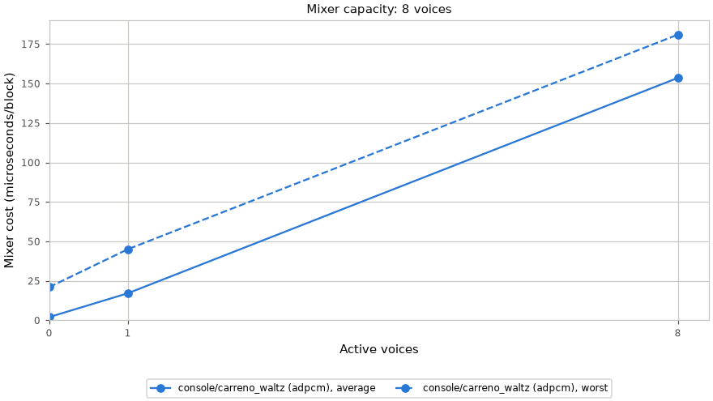
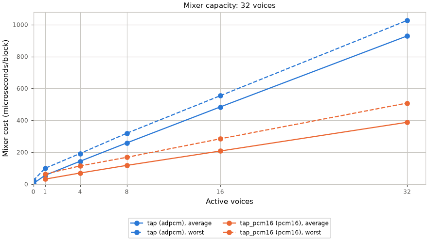
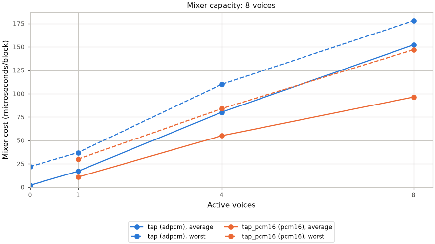

# Mixer cost

What the [sound mixer](Sound-Mixer.md) costs: block time, frame time while a voice
plays, and internal RAM. Every measured table below is generated from committed captures.

| Cost | Value |
|---|---|
| A sound | its pack bytes in flash (2.5 KB for the engine `tap`); no RAM beyond its `sound_t` |
| Internal heap, vs the same build without the mixer | −6,300 B free (2.2 % of 282,739); largest free block −4,096 B |
| Hot path in internal RAM | The sample mixer, reader and ADPCM decoder use IRAM; the ADPCM tables use DRAM. [audio_out.h](../../launcher/main/audio/audio_out.h) holds the placement budget. Tones render from flash. |
| Extra RAM during a development capture | about 1.4 KB of microphone buffers (`open_dma_bytes` 1,448): TX is already open, so only RX is new. Closing frees it, within a few dozen bytes. [Audio-Path's RAM capture](Audio-Path.md#ram) predates the mixer and opened both channels |
| Frame time, one voice looping vs silence | [below](#frame-time-with-a-voice-playing) |

The mixer allocates internal heap at boot whether or not anything plays. Internal
RAM is the chip's fast on-die memory; the 8 MB PSRAM (slower external RAM) is
unused.

## Block time and voice count

[sound_mix_capture.py](../../launcher/tools/audio/sound_mix_capture.py) captures
feed the table; regenerate it with `python launcher/tools/audio/audio_doc_tables.py --write`.

<!-- generated: sound-mix-cost sha256=99b59dafa53858bbcd7c1079c513db3843c419fec9c4607a658a09b6f24e9c4e -->
> Generated by: `python launcher/tools/audio/audio_doc_tables.py --write`

[raw capture](data/sound_mix_capture_long.txt).

capacity **8 voices**, window **1.5 s**, block period **5804.99 µs**.

<picture>
  <source media="(prefers-color-scheme: dark)" srcset="../images/audio/sound_mix_capture_long-dark.png">
  <source media="(prefers-color-scheme: light)" srcset="../images/audio/sound_mix_capture_long.png">
  
</picture>

Numeric data

| Sound | Voices | Average µs | Worst µs | Core-1 load, average % | Core-1 load, worst % | Blocks | present ms/frame | Frame total ms/frame | present change ms/frame |
|---|---|---|---|---|---|---|---|---|---|
| console/carreno_waltz (adpcm) | 0 | 2.00 | 21.00 | 0.03 | 0.36 | 2598 | 9.82 | 18.81 | +0.00 |
| console/carreno_waltz (adpcm) | 1 | 17.10 | 45.00 | 0.29 | 0.78 | 2599 | 9.83 | 18.82 | +0.01 |
| console/carreno_waltz (adpcm) | 8 | 153.60 | 181.00 | 2.65 | 3.12 | 2607 | 9.88 | 18.90 | +0.06 |

Highest-point memory (bytes):

| stack_min_free | margin | stack | voices | queue | mixer |
|---|---|---|---|---|---|
| 588 | 512 | 2560 | 256 | 340 | 828 |

> Generated by: `python launcher/tools/audio/audio_doc_tables.py --write`

[raw capture](data/sound_mix_capture_v32.txt).

capacity **32 voices**, window **1.5 s**, block period **5804.99 µs**.

<picture>
  <source media="(prefers-color-scheme: dark)" srcset="../images/audio/sound_mix_capture_v32-dark.png">
  <source media="(prefers-color-scheme: light)" srcset="../images/audio/sound_mix_capture_v32.png">
  
</picture>

Numeric data

| Sound | Voices | Average µs | Worst µs | Core-1 load, average % | Core-1 load, worst % | Blocks | present ms/frame | Frame total ms/frame | present change ms/frame |
|---|---|---|---|---|---|---|---|---|---|
| tap (adpcm) | 0 | 4.00 | 23.00 | 0.07 | 0.40 | 2601 | 9.04 | 17.63 | +0.00 |
| tap (adpcm) | 1 | 54.90 | 99.00 | 0.95 | 1.71 | 2596 | 9.05 | 17.74 | +0.01 |
| tap (adpcm) | 4 | 143.30 | 192.00 | 2.47 | 3.31 | 2602 | 9.10 | 17.74 | +0.07 |
| tap (adpcm) | 8 | 258.30 | 319.00 | 4.45 | 5.50 | 2600 | 9.19 | 17.80 | +0.15 |
| tap (adpcm) | 16 | 483.70 | 554.00 | 8.33 | 9.54 | 2599 | 9.39 | 18.09 | +0.35 |
| tap (adpcm) | 32 | 928.70 | 1026.00 | 16.00 | 17.67 | 2604 | 10.03 | 18.83 | +0.99 |
| tap_pcm16 (pcm16) | 1 | 31.00 | 63.00 | 0.53 | 1.09 | 2602 | 9.05 | 17.61 | +0.01 |
| tap_pcm16 (pcm16) | 4 | 69.50 | 114.00 | 1.20 | 1.96 | 2604 | 9.08 | 17.63 | +0.04 |
| tap_pcm16 (pcm16) | 8 | 117.30 | 168.00 | 2.02 | 2.89 | 2601 | 9.09 | 17.83 | +0.05 |
| tap_pcm16 (pcm16) | 16 | 207.30 | 284.00 | 3.57 | 4.89 | 2600 | 9.13 | 17.81 | +0.09 |
| tap_pcm16 (pcm16) | 32 | 387.40 | 508.00 | 6.67 | 8.75 | 2601 | 9.30 | 18.05 | +0.26 |

Highest-point memory (bytes):

| stack_min_free | margin | stack | voices | queue | mixer |
|---|---|---|---|---|---|
| 596 | 512 | 2560 | 896 | 1108 | 2132 |

> Generated by: `python launcher/tools/audio/audio_doc_tables.py --write`

[raw capture](data/sound_mix_capture_v8.txt).

capacity **8 voices**, window **1.5 s**, block period **5804.99 µs**.

<picture>
  <source media="(prefers-color-scheme: dark)" srcset="../images/audio/sound_mix_capture_v8-dark.png">
  <source media="(prefers-color-scheme: light)" srcset="../images/audio/sound_mix_capture_v8.png">
  
</picture>

Numeric data

| Sound | Voices | Average µs | Worst µs | Core-1 load, average % | Core-1 load, worst % | Blocks | present ms/frame | Frame total ms/frame | present change ms/frame |
|---|---|---|---|---|---|---|---|---|---|
| tap (adpcm) | 0 | 2.00 | 22.00 | 0.03 | 0.38 | 2595 | 9.82 | 18.79 | +0.00 |
| tap (adpcm) | 1 | 17.00 | 37.00 | 0.29 | 0.64 | 2599 | 9.83 | 18.81 | +0.01 |
| tap (adpcm) | 4 | 80.20 | 110.00 | 1.38 | 1.89 | 2599 | 9.85 | 18.87 | +0.03 |
| tap (adpcm) | 8 | 152.20 | 178.00 | 2.62 | 3.07 | 2595 | 9.88 | 18.92 | +0.07 |
| tap_pcm16 (pcm16) | 1 | 10.80 | 30.00 | 0.19 | 0.52 | 2599 | 9.82 | 18.81 | +0.00 |
| tap_pcm16 (pcm16) | 4 | 55.00 | 84.00 | 0.95 | 1.45 | 2599 | 9.85 | 18.88 | +0.03 |
| tap_pcm16 (pcm16) | 8 | 96.40 | 147.00 | 1.66 | 2.53 | 2602 | 9.84 | 18.89 | +0.03 |

Highest-point memory (bytes):

| stack_min_free | margin | stack | voices | queue | mixer |
|---|---|---|---|---|---|
| 588 | 512 | 2560 | 256 | 340 | 828 |
<!-- /generated: sound-mix-cost -->

In the long-sound capture, the launcher ridge repainted in full during part of
each point with the waltz playing (`ridge.paint` up to 41 ms worst in the raw
capture). That repaint lifts Frame total; mixer and present time did not change.

## Frame time with a voice playing

The same build runs on both sides: one looping voice vs silence over the
repository's standard seeded perf suites. The exact command is `command` in
[the comparison data](data/sound_gate.json).

<!-- generated: sound-gate sha256=ca02d5812f23570c7e5bae0dfdb423e20549ac4625137ef8f8196777a56efadf -->
> Generated by: `python launcher/tools/audio/sound_gate_tables.py --write`

[raw capture](data/sound_gate.json).

Seed cap 4 per side; threshold ±1%; alpha 0.05.

| Rows measured | inconclusive | no change | regressed | Worst Delta time % | Worst row interval (Delta %) | Intervals wholly above zero |
|---|---|---|---|---|---|---|
| 75 | 27 | 45 | 3 | 2.88 | -4.26, 10.57 | 55 |
<!-- /generated: sound-gate -->

<!-- generated: sound-gate-mix sha256=0c77585bd431f0b066134638b056e642abba0fd53ab613486cc13d99e96b9219 -->
> Generated by: `python launcher/tools/audio/sound_gate_tables.py --write`

[raw capture](data/sound_gate.json).

| Arm | Average ms/block | Worst ms/block | Blocks |
|---|---|---|---|
| Silence | 0.00 | 0.02 | 180265 |
| One looping voice | 0.04 | 0.12 | 113842 |
<!-- /generated: sound-gate-mix -->

Block counts differ between arms because some captures have no mixer entry.
Averages cover the blocks in captures that report it.

## Measuring it

| Number | Command |
|---|---|
| Measurement image | `python launcher/tools/audio/sound_mix_image.py SCRATCH --sound tap --format pcm16 --voices N` prepares a detached scratch copy; flash it with `autana --project SCRATCH flash dev` |
| Mix capture | From the scratch tree, `python launcher/tools/audio/sound_mix_capture.py --tree . --board ID --sounds tap,tap_pcm16 --out docs/audio/data/sound_mix_capture_NAME.txt`; copy the capture here and run `audio_doc_tables.py --write` |
| One long voice mixed with short ones | `sound_mix_capture.py --sounds console/carreno_waltz --voices 1,8 --fill-sound engine/tap`; voice counts include the long voice |
| CPU | the `sound_mix` entry in the frame-cost report a development build prints, average/worst ms per block |
| Heap and largest block | `autana heap --json`, against a build without the mixer |
| Frame time with a voice | the repeat command in [the comparison data](data/sound_gate.json) |
| Mixer sizes and stack headroom | `autana sound stats` ([Drive](../cli/Drive.md)) |
| Capture RX DMA | `open_dma_bytes` in `autana tone ... --json` |

Hold one board lock across flashing and capture. The image script's header
contains the scratch-copy recipe.

| Rule | Why |
|---|---|
| Silence is checked before each point and active voices before monitoring | a point measured in the wrong state is rejected |
| Tables reject missing voice checks and rising drop counts | dropped commands mean the voices never all played |
| Present and frame-total times are means of window averages | present change uses the same capture's silent point |
| `profile/frame_cost.c` adds the mixer's time to the report separately | the mixer runs on another task, so a frame stage cannot bracket it |

## Internal RAM

`autana sound stats` prints the mixer's own allocations:

| Part | Bytes | Where it lives |
|---|---|---|
| Task stack (`stack`) | 2,560 | `SOUND_MIXER_TASK_STACK`; holds the block's mix, decode and output buffers |
| TX sample buffers (`tx_samples`) | 1,024 | `AUDIO_CODEC_DMA_BLOCKS` x `AUDIO_CODEC_BLOCK_SAMPLES` x 16-bit, allocated once at boot |
| Mixer and control state (`mixer`) | 828 | voice table, bus table and development stats |
| Command queue (`queue`) | 340 | `SOUND_MIXER_QUEUE_DEPTH` 16-byte entries plus the queue's own control block |
| Total | 4,752 | |

The other 1.6 KB of the heap cost is ESP-IDF's: the I2S channel, DMA
descriptors, codec handles, the task control block and allocation headers.

`stack_min_free` in `sound stats` is the stack's high-water mark. The playback
peak was 1,964 bytes, so `SOUND_MIXER_STACK_PLAYBACK_BYTES` rounds it up to
2,048 and `SOUND_MIXER_STACK_MARGIN_BYTES` adds 512.
