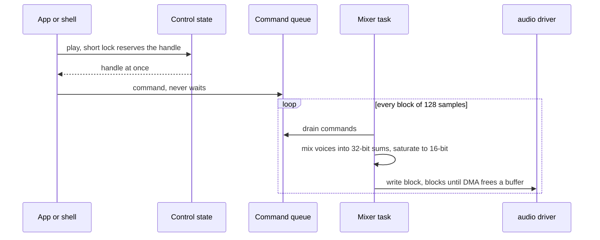
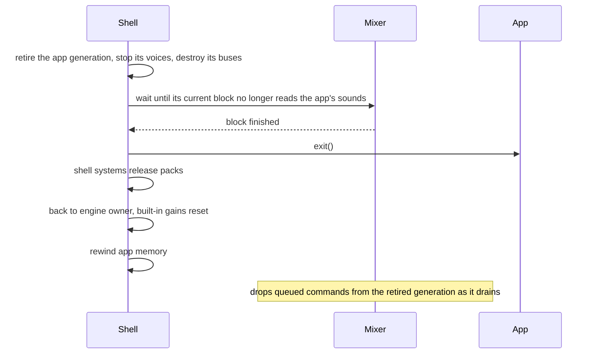
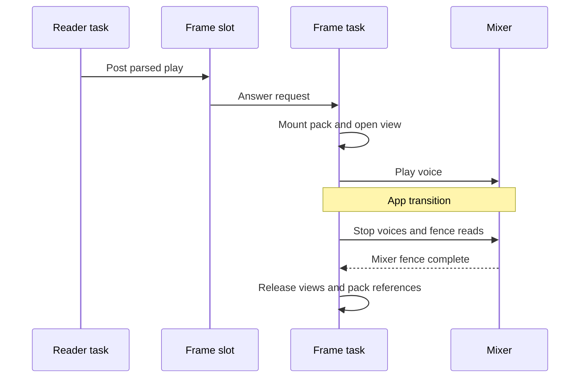
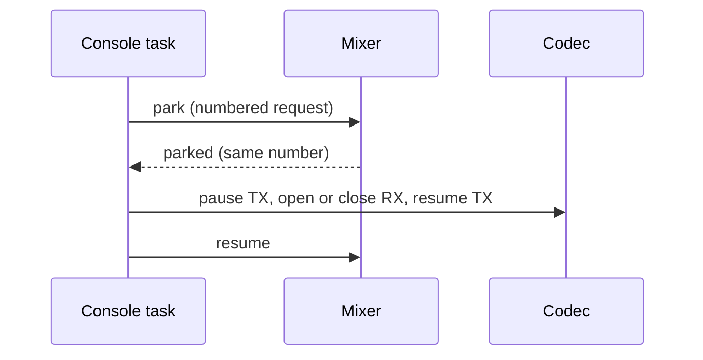

# Mixer internals

For firmware contributors. One task on core 1 is the only writer to the speaker:
callers queue commands, and the task mixes and writes one block at a time. The app
side is the [Sound mixer](Sound-Mixer.md) reference.

## Scheduling

| Constant (`sound_engine.h`) | What it limits | Where its value comes from |
|---|---|---|
| `SOUND_MIXER_TASK_CORE` | the core the mixer runs on | core 1, beside present and the job worker |
| `SOUND_MIXER_TASK_PRIORITY` | its priority | above `PRESENT_TASK_PRIORITY` and `JOB_CORE1_PRIORITY` |
| `SOUND_MIXER_TASK_STACK` | its stack | `SOUND_MIXER_STACK_PLAYBACK_BYTES` + `SOUND_MIXER_STACK_MARGIN_BYTES` |
| `SOUND_MIXER_COMMANDS_PER_VOICE` | commands per voice between drains | one play and one control call |
| `SOUND_MIXER_QUEUE_DEPTH` | queued commands | `SOUND_MIXER_COMMANDS_PER_VOICE * SOUND_VOICE_COUNT` |
| `SOUND_MIXER_BLOCK_FRAMES` | frames mixed per write | `AUDIO_CODEC_BLOCK_SAMPLES` |

A block lasts `SOUND_MIXER_BLOCK_FRAMES / AUDIO_OUT_SAMPLE_RATE_HZ` seconds. Present
(the task that pushes frames to the display) and the job worker (the background task
for frame work) share core 1. The mixer preempts both, then blocks in the driver's
write for most of each block.

## Locking

Callers never wait for the mixer. A short lock covers only handle reservation;
decoding, mixing and I2S writes happen outside it. The full rules are in the
comment at `control_lock` in `sound_mixer_device.c`.

## Queue and overflow

| Field of a queue entry | Holds |
|---|---|
| Opcode and flags | play, stop, gain, bus or capture command; loop and tone flags |
| Voice handle | the slot and its voice generation |
| App generation | which app sent it, so commands from an exited app are dropped |
| Options | bus, gain and priority |
| Payload | the sound pointer, a tone frequency and duration, or a capture sequence number |

Each entry is 16 bytes, checked at compile time against `SOUND_COMMAND_BYTES`.
When the queue is full the command is dropped:

| Call | Result |
|---|---|
| `sound_play()` | the null voice |
| `sound_bus_create()` | an invalid bus |
| stop and gain calls | nothing changes |
| any dropped command | `dropped_commands` in `autana sound stats` goes up |

## Amplifier

The sound task enables the amplifier once at startup. It stays on while the
screen is on; display sleep is not implemented.

| State | Output |
|---|---|
| Warming | silence for `AUDIO_OUT_AMP_STARTUP_MS`, with every voice's position held |
| On | the mix, or silence without voices; idle time does not disable the amplifier |

During silence the task keeps writing blocks, so the DMA never runs dry. The TX
channel's auto-clear setting zeroes stale data if it ever does. See
[Clicks](Clicks.md) for transient measurements.

## App exit

At exit the shell retires the app's sounds before anything is freed. Each app gets a
new app generation when it enters, and every voice, bus and queued command records
the generation that made it.

| Rule | Detail |
|---|---|
| Calls during `exit()` | change nothing, and `sound_play()` returns the null voice |
| Engine-owned sounds | the ones the shell plays survive every exit, so their storage must too |
| Gains | the SYSTEM bus keeps the shell's UI volume, and SFX, MUSIC, HAPTIC and master reset |
| Stuck mixer | past `SOUND_EXIT_READ_TIMEOUT_MS` the board aborts rather than free memory it might read |
| Console sound views | live in PSRAM and are released at the next app transition, after the mixer fence ([below](#console-play)); a timeout keeps them mapped for a later one |

Distinct mounted packs share `ASSET_STORE_MOUNTS_MAX` slots with other asset users.

### Console play

A play from the terminal replies `SOUND_END` or `SOUND_ERR <reason>`. It carries `voice` and
`open_us`, the time `sound_open()` spent checking the entry and its ADPCM block headers (zero for a cached view).

## Capture

A development capture (`autana tone`) parks the mixer while its own task changes the
codec's input. Parked means the mixer stops between blocks and holds every voice's position.

The ESP32-S3 codec adapter refuses to change RX (the microphone input) while TX (the
speaker output) runs, which is why TX pauses. Each request carries a number, so a late
reply to a timed-out request never satisfies the next one. The `tone` verb plays an
engine tone on the SYSTEM bus through the mixer
([capture and detection](Audio-Path.md#development-check)).

## Initialization failure

If the codec or the task cannot start, sound is off and boot continues.

| Where | What happens |
|---|---|
| Log | the failed step, once |
| POST (the power-on self-test) | `audio: init failed (<step>)` |
| `sound_play()` | the null voice |
| `sound_bus_create()` | an invalid bus |
| `sound_is_playing()` | false |
| Other calls | nothing |

Later driver errors are logged each time. POST keeps the first startup failure.
