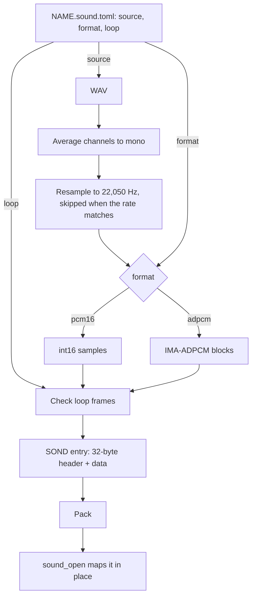

# Sound assets

Part of the [audio docs](README.md). A sound is one entry in an [asset pack](../assets/README.md), type `SOND`, read in place from the mapped pack.

[`sound_asset.py`](../../launcher/tools/audio/sound_asset.py) bakes
`NAME.sound.toml` and its WAV into entry NAME. The WAV supplies the level;
there is no gain setting. The TOML is the only source of format and loops.

| Key | Holds |
|---|---|
| `source` | Required WAV filename in the same folder, integer PCM 8/16/24/32-bit, any channel count |
| `format` | Required `"pcm16"` or `"adpcm"` |
| `loop` | Optional `[start, end]` in stored 22,050 Hz frames; omitted means one-shot |

Channels are averaged before a Hann-windowed sinc filter resamples to mono
22,050 Hz. The filter spans 32 zero crossings on either side and widens for
downsampling. Matching-rate sources skip it; samples round and clamp to int16.

The 32-byte header is little-endian; offsets count from the entry's first byte.

| At | Type | Holds |
|---|---|---|
| 0 | u16 | version 1 |
| 2 | u8 | format 0 PCM16 or 1 IMA-ADPCM |
| 3 | u8 | channels 1 |
| 4 | u32 | sample rate 22,050 Hz |
| 8 | u32 | nonzero frame count |
| 12 | u32 | loop start |
| 16 | u32 | loop end, exclusive; 0 means one-shot |
| 20 | u16 | block frames, 0 for PCM16; odd for ADPCM |
| 22 | u16 | reserved 0 |
| 24 | u32 | reserved 0 |
| 28 | u32 | data offset, at least 32 and 4-aligned |

PCM16 data is signed little-endian samples. Each ADPCM block holds an int16
predictor, u8 step index in 0..88 and u8 reserved zero, then low-nibble-first
IMA codes. Its byte size is `4 + (block_frames - 1) / 2`.

The baker takes its block size from `SOUND_DEFAULT_BLOCK_FRAMES` in
`sound/sound.h`. The stored sample rate is `AUDIO_OUT_SAMPLE_RATE_HZ` from
`audio/audio_out.h`, so the mixer needs no resampling. The first block starts at index zero; later blocks carry the
previous ending index. Each block opens with its first sample stored exactly
as the predictor. The last block is padded by repeating its final sample, and
`frames` tells the reader where to stop.

`sound_open()` maps the samples in place through `asset_entry_read()`.
Failed opens zero the view.

| Status | Cause |
|---|---|
| `ASSET_ERR_VERSION` | Another version, checked by `asset_entry_validate()` |
| `ASSET_ERR_BOUNDS` | Data offset below 32 or misaligned, or data past the entry |
| `ASSET_ERR_FORMAT` | Unknown format, channels other than 1, rate other than 22,050 Hz, or zero frames |
| `ASSET_ERR_FORMAT` | Nonzero reserved fields or header gap |
| `ASSET_ERR_FORMAT` | PCM16 block_frames nonzero, or ADPCM block_frames even (including zero) |
| `ASSET_ERR_FORMAT` | Loop end 0 with start nonzero, or a loop without `start < end <= frames` |
| `ASSET_ERR_FORMAT` | ADPCM loop start off a block boundary |
| `ASSET_ERR_FORMAT` | ADPCM block header step index above 88 or reserved byte nonzero |

The baker rejects misaligned starts and names their two neighbours.

A mixer reads a sound through `sound_cursor_t`.
`sound_seek()` selects a stored frame; ADPCM seeks must be block-aligned,
except that seeking to `frames` selects the end. A failed seek zeroes the cursor.
`sound_read()` copies up to the requested int16 samples across blocks and
returns the count. A one-shot stops at `frames`; a loop wraps from `loop_end`
to `loop_start` internally and keeps filling the requested buffer. The cursor's
read-only `position` shows the next stored frame for progress displays. The view
and its mapped pack must outlive the cursor.

`format` is the only switch.
