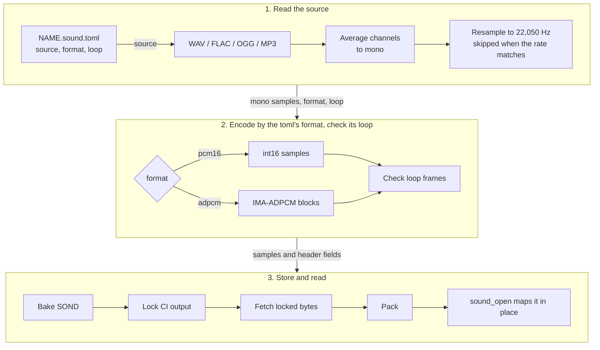

# Sound assets

Part of the [audio docs](README.md). A sound is one entry in an [asset pack](../assets/README.md), type `SOND`, read in place from the mapped pack.

[`bake.py`](../../launcher/tools/bake/bake.py) makes every `NAME.sound.toml`
into a cached `NAME.sond` entry, including the engine's sounds. The source
supplies the level; the TOML owns format and loops.

| Key | Holds |
|---|---|
| `source` | Required WAV, FLAC, OGG or MP3 filename in the same folder; any channel count |
| `format` | Required `"pcm16"` or `"adpcm"` |
| `loop` | Optional `[start, end]` in stored 22,050 Hz frames; omitted means one-shot |

Channels are averaged before a Hann-windowed sinc filter resamples to mono
22,050 Hz. The filter spans 32 zero crossings on either side and widens for
downsampling. Matching-rate sources skip it; samples round and clamp to int16.

## Cached sound bakes

Install the producer's pins with
`python -m pip install -r launcher/tools/audio/requirements.txt`.
The decoder uses soundfile and its bundled libsndfile; numpy vectorizes the filter.

```sh
python launcher/tools/bake/bake.py list --kind sound --missing
python launcher/tools/bake/bake.py bake --kind sound
```

A sound key covers the recipe, source bytes (or LFS oid), tool code,
format constants and dependency pins. Comments and docstrings do not count.
The CPU Bakes workflow produces missing sound rows.

`build_pack.py` consumes the locked SOND bytes and never decodes audio or imports numpy/soundfile.
The firmware streams samples from the mapped pack through its cursor.

The console pack's `carreno_waltz` test sound ships only in development builds.
It loops the whole stereo 44.1 kHz FLAC excerpt.
Its [recipe](../../launcher/main/console/sounds/carreno_waltz.sound.toml) records the public-domain source and excerpt.
`autana play console/carreno_waltz loop` plays it; its SOND size follows the ADPCM rows below.

## Flash per minute

Payload sizes follow the rate, PCM width and ADPCM block constants in
`sound_format.h` and `audio_adpcm.h`. Each entry also has one SOND header;
ADPCM rounds the final block up.

<!-- generated: sound-storage sha256=b2b3551b6aeb93370d268c55902557ef89407547ab055b887f6f347f0c704f63 -->
> Generated by: `python launcher/tools/audio/audio_doc_tables.py --write`

| Format | Payload bytes per minute | Bytes per stored frame |
|---|---|---|
| PCM16 | 2646000 | 2 |
| IMA-ADPCM | 670720 | 256 / 505 (whole blocks) |
<!-- /generated: sound-storage -->

## Reading a sound

The entry's layout is [SOND v1](../assets/formats/SOND.md).

`sound_open()` maps the samples in place through `asset_entry_read()`.

A mixer reads a sound through `sound_cursor_t`.
`sound_seek()` selects a stored frame; ADPCM seeks must be block-aligned,
except that seeking to `frames` selects the end. A failed seek zeroes the cursor.
`sound_read()` copies up to the requested int16 samples across blocks and
returns the count. A one-shot stops at `frames`; a loop wraps from `loop_end`
to `loop_start` internally and keeps filling the requested buffer. The cursor's
read-only `position` shows the next stored frame for progress displays. The view
and its mapped pack must outlive the cursor.



`format` is the only switch.
