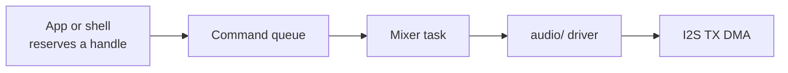
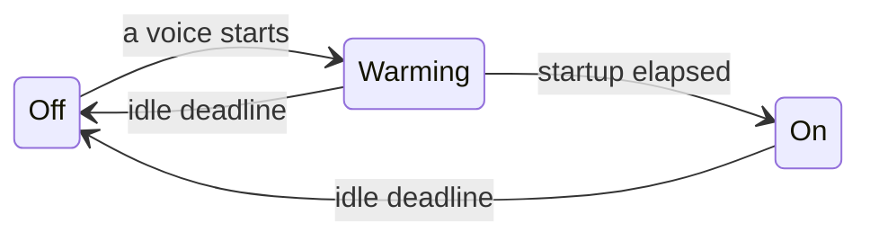
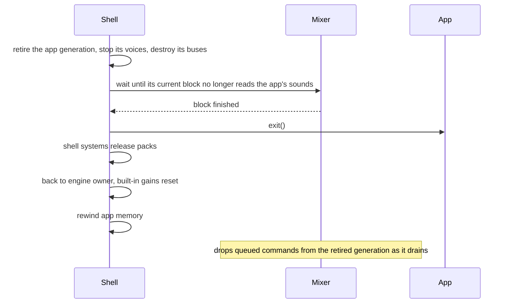
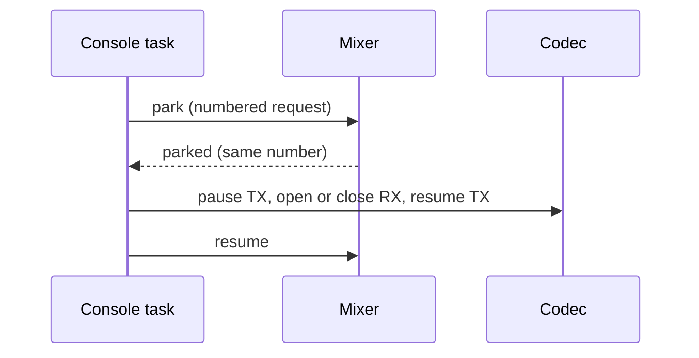

# Sound mixer

The sound mixer plays [stored sounds](Sound-Assets.md) on the speaker: an app
asks for a sound, and one background task mixes every playing sound into the
codec (the audio chip that drives the speaker). The app API is `sound/sound_play.h`; the shell and boot use
`sound/sound_engine.h`.

## Playing a sound

An app opens a sound from an asset pack once, keeps it in app state, and plays
it by pointer. A pack is the read-only bundle of baked content in flash
([Asset packs](../assets/README.md)); the engine pack ships a `tap` click any
app may use:

```c
#include "asset/asset_store.h"                          /* asset_store_pack, ASSET_ENGINE_PACK */
#include "sound/sound_play.h"

static sound_t tap;                                       /* app state, not a stack local */
if (sound_open(asset_store_pack(ASSET_ENGINE_PACK), "tap", &tap) != ASSET_OK) { /* no click */ }
sound_voice_t v = sound_play(&tap, NULL);                 /* SFX bus, full gain, once */
sound_stop(v);                                            /* optional; stale handles are ignored */
```

`sound_play()` never waits: it returns a handle at once and the mixer starts
the sound within one block of 128 samples, about 5.8 ms. If the open failed,
or sound is off, `sound_play()` returns the null voice and nothing plays.

### Your own sound

To add your own sound, put `NAME.sound.toml` and its WAV in your app's pack
folder; the build bakes it into entry `NAME` ([Sound assets](Sound-Assets.md),
[Packs](../assets/README.md#packs)). Then open it from your pack with
`asset_store_pack()` the same way.

| Format | Pack size per second | Example: 220 ms click |
|---|---|---|
| PCM16, 22,050 Hz mono | about 44 KB | about 9.7 KB |
| IMA-ADPCM (4:1 compressed, slightly lossy) | about 11 KB | about 2.5 KB (the engine `tap`) |

A sound costs no RAM beyond its small `sound_t`: samples are read from the
pack in flash.

### Which bus

| Sound | Bus |
|---|---|
| UI feedback: taps, clicks, confirmations | `SOUND_BUS_SYSTEM`, so the shell's UI volume applies |
| Game effects | `SOUND_BUS_SFX`, the default |
| Music | `SOUND_BUS_MUSIC` |

Pass the bus in `sound_play_opts_t`; NULL options mean SFX, full gain,
`SOUND_PRIORITY_NORMAL` and no loop.

### First-click delay

The speaker amplifier switches off 2 s after the last sound and needs about
250 ms to warm up (`SOUND_AMP_IDLE_MS`, `AUDIO_OUT_AMP_STARTUP_MS`). The first
click after a quiet spell therefore starts about 250 ms late; later clicks
start within one block.

### Keep the sound alive until the app exits

`sound_play()` stores your pointer and copies no samples, so the `sound_t` and
its pack must stay valid until the app exits. Stopping a voice, losing it to a
steal, or `sound_is_playing()` returning false do not free it: the mixer may
still read it for up to one block.

App exit is safe: the shell stops every voice and bus the app started and
waits for the mixer before it releases packs and app memory
([App exit](#app-exit)).

## Cost

A click costs its pack bytes in flash (2.5 KB for the engine `tap`), no RAM
beyond its `sound_t`.

The mixer allocates internal heap at boot whether or not anything plays.
Heap and display measurements, with a development build:

| Cost | Value |
|---|---|
| Frame time, one voice looping vs silence | See [Frame time with a voice playing](#frame-time-with-a-voice-playing) |
| Internal heap, vs the same build without the mixer | −6,300 B free (2.2 % of 282,739); largest free block −4,096 B |
| Extra RAM while a development capture runs | about 1.4 KB of microphone buffers (`open_dma_bytes` 1,448): TX is already open, so only RX is new; freed when it closes, within a few dozen bytes. [Audio-Path's RAM capture](Audio-Path.md#ram) predates the mixer and opened both |

Internal RAM is the chip's fast on-die memory; the 8 MB PSRAM (slower external
RAM) is not used.

The table comes from [sound_mix_capture.py](../../launcher/tools/audio/sound_mix_capture.py)
captures; regenerate it with
`python launcher/tools/audio/audio_doc_tables.py --write`.

<!-- generated: sound-mix-cost sha256=18cffb8a90bbc107bb23525669d005df0278fbc1fa04673871853a229396e9e4 -->
> Generated by: `python launcher/tools/audio/audio_doc_tables.py --write`

[raw capture](data/sound_mix_capture_v32.txt).

capacity **32 voices**, window **1.5 s**, block period **5804.99 µs**.

<picture>
  <source media="(prefers-color-scheme: dark)" srcset="../images/audio/sound_mix_capture_v32-dark.png">
  <source media="(prefers-color-scheme: light)" srcset="../images/audio/sound_mix_capture_v32.png">
  
</picture>

<details>
<summary>Numeric data</summary>

| Sound | Voices | Average µs | Worst µs | Core-1 load, average % | Core-1 load, worst % | Blocks | present ms/frame | Frame total ms/frame | present change ms/frame |
|---|---|---|---|---|---|---|---|---|---|
| tap (adpcm) | 0 | 4.00 | 23.00 | 0.07 | 0.40 | 2601 | 9.04 | 17.63 | +0.00 |
| tap (adpcm) | 1 | 54.90 | 99.00 | 0.95 | 1.71 | 2596 | 9.05 | 17.74 | +0.01 |
| tap (adpcm) | 4 | 143.30 | 192.00 | 2.47 | 3.31 | 2602 | 9.10 | 17.74 | +0.07 |
| tap (adpcm) | 8 | 258.30 | 319.00 | 4.45 | 5.50 | 2600 | 9.19 | 17.80 | +0.15 |
| tap (adpcm) | 16 | 483.70 | 554.00 | 8.33 | 9.54 | 2599 | 9.39 | 18.09 | +0.35 |
| tap (adpcm) | 32 | 928.70 | 1026.00 | 16.00 | 17.67 | 2604 | 10.03 | 18.83 | +0.99 |
| tap_pcm16 (pcm16) | 1 | 31.00 | 63.00 | 0.53 | 1.09 | 2602 | 9.05 | 17.61 | +0.01 |
| tap_pcm16 (pcm16) | 4 | 69.50 | 114.00 | 1.20 | 1.96 | 2604 | 9.08 | 17.63 | +0.04 |
| tap_pcm16 (pcm16) | 8 | 117.30 | 168.00 | 2.02 | 2.89 | 2601 | 9.09 | 17.83 | +0.05 |
| tap_pcm16 (pcm16) | 16 | 207.30 | 284.00 | 3.57 | 4.89 | 2600 | 9.13 | 17.81 | +0.09 |
| tap_pcm16 (pcm16) | 32 | 387.40 | 508.00 | 6.67 | 8.75 | 2601 | 9.30 | 18.05 | +0.26 |

</details>

Highest-point memory (bytes):

| stack_min_free | margin | stack | voices | queue | mixer |
|---|---|---|---|---|---|
| 596 | 512 | 2560 | 896 | 1108 | 2132 |

> Generated by: `python launcher/tools/audio/audio_doc_tables.py --write`

[raw capture](data/sound_mix_capture_v8.txt).

capacity **8 voices**, window **1.5 s**, block period **5804.99 µs**.

<picture>
  <source media="(prefers-color-scheme: dark)" srcset="../images/audio/sound_mix_capture_v8-dark.png">
  <source media="(prefers-color-scheme: light)" srcset="../images/audio/sound_mix_capture_v8.png">
  
</picture>

<details>
<summary>Numeric data</summary>

| Sound | Voices | Average µs | Worst µs | Core-1 load, average % | Core-1 load, worst % | Blocks | present ms/frame | Frame total ms/frame | present change ms/frame |
|---|---|---|---|---|---|---|---|---|---|
| tap (adpcm) | 0 | 3.70 | 16.00 | 0.06 | 0.28 | 2600 | 8.72 | 17.13 | +0.00 |
| tap (adpcm) | 1 | 53.30 | 104.00 | 0.92 | 1.79 | 2602 | 8.70 | 17.08 | -0.02 |
| tap (adpcm) | 4 | 140.70 | 199.00 | 2.42 | 3.43 | 2598 | 8.59 | 16.89 | -0.13 |
| tap (adpcm) | 8 | 253.60 | 310.00 | 4.37 | 5.34 | 2597 | 8.65 | 17.01 | -0.07 |
| tap_pcm16 (pcm16) | 1 | 30.00 | 65.00 | 0.52 | 1.12 | 2602 | 8.54 | 16.82 | -0.18 |
| tap_pcm16 (pcm16) | 4 | 61.90 | 101.00 | 1.07 | 1.74 | 2598 | 8.55 | 16.83 | -0.17 |
| tap_pcm16 (pcm16) | 8 | 117.49 | 180.00 | 2.02 | 3.10 | 2598 | 8.56 | 16.85 | -0.16 |

</details>

Highest-point memory (bytes):

| stack_min_free | margin | stack | voices | queue | mixer |
|---|---|---|---|---|---|
| 596 | 512 | 2560 | 224 | 340 | 788 |
<!-- /generated: sound-mix-cost -->

### Frame time with a voice playing

The same build runs on both sides: one looping voice vs silence over the
repository's standard seeded perf suites. The exact command is `command`
in [the comparison data](data/sound_gate.json).

<!-- generated: sound-gate sha256=ca02d5812f23570c7e5bae0dfdb423e20549ac4625137ef8f8196777a56efadf -->
> Generated by: `python launcher/tools/audio/sound_gate_tables.py --write`

[raw capture](data/sound_gate.json).

Seed cap 4 per side; threshold ±1%; alpha 0.05.

| Rows measured | inconclusive | no change | regressed | Worst Delta time % | Worst row interval (Delta %) | Intervals wholly above zero |
|---|---|---|---|---|---|---|
| 75 | 27 | 45 | 3 | 2.88 | -4.26, 10.57 | 55 |
<!-- /generated: sound-gate -->

<!-- generated: sound-gate-mix sha256=0c77585bd431f0b066134638b056e642abba0fd53ab613486cc13d99e96b9219 -->
> Generated by: `python launcher/tools/audio/sound_gate_tables.py --write`

[raw capture](data/sound_gate.json).

| Arm | Average ms/block | Worst ms/block | Blocks |
|---|---|---|---|
| Silence | 0.00 | 0.02 | 180265 |
| One looping voice | 0.04 | 0.12 | 113842 |
<!-- /generated: sound-gate-mix -->

Block counts differ between arms because some captures have no mixer entry.
Averages cover the blocks in captures that report it.

### Measuring it

| Number | Command |
|---|---|
| Measurement image | `python launcher/tools/audio/sound_mix_image.py SCRATCH --sound tap --format pcm16 --voices N` prepares a detached scratch copy; flash it with `autana --project SCRATCH flash dev` |
| Mix capture | From the scratch tree, `python launcher/tools/audio/sound_mix_capture.py --tree . --board ID --sounds tap,tap_pcm16 --out docs/audio/data/sound_mix_capture_NAME.txt`; copy the capture here and run `audio_doc_tables.py --write` |
| CPU | the `sound_mix` entry in the frame-cost report a development build prints, average/worst ms per block |
| Heap and largest block | `autana heap --json`, against a build without the mixer |
| Frame time with a voice | Use the repeat command in [the comparison data](data/sound_gate.json) |
| Mixer sizes and stack headroom | `autana sound stats` |
| Capture RX DMA | `open_dma_bytes` in `autana tone ... --json` |

Hold one board lock across flashing and capture. The image script's header
contains the scratch-copy recipe.

The capture checks silence before each point and active voices before
monitoring. Tables reject missing voice checks and rising drop counts.

Present and frame-total times are means of window averages. Present change
uses the same capture's silent point.

The mixer runs on another task, so `profile/frame_cost.c` adds its time to the
report separately instead of bracketing it like a frame stage.

### Internal RAM

`autana sound stats` prints the mixer's own allocations:

| Part | Bytes | Where it lives |
|---|---|---|
| Task stack (`stack`) | 2,560 | `SOUND_MIXER_TASK_STACK`; holds the block's mix, decode and output buffers |
| TX sample buffers (`tx_samples`) | 1,024 | `AUDIO_CODEC_DMA_BLOCKS` x `AUDIO_CODEC_BLOCK_SAMPLES` x 16-bit, allocated once at boot |
| Mixer and control state (`mixer`) | 828 | voice table, bus table and development stats |
| Command queue (`queue`) | 340 | `SOUND_MIXER_QUEUE_DEPTH` 16-byte entries plus the queue's own control block |
| Total | 4,752 | |

The other 1.6 KB of the heap cost is ESP-IDF's: the I2S channel, DMA
descriptors, codec handles, the task control block and allocation headers.

`stack_min_free` in `sound stats` is the stack's high-water mark. The playback
peak was 1,964 bytes, so `SOUND_MIXER_STACK_PLAYBACK_BYTES` rounds it up to
2,048 and `SOUND_MIXER_STACK_MARGIN_BYTES` adds 512.

## Voices and buses

A voice is one playing sound, and a bus is a volume group that voices play
through. The limits are named in `sound_play.h`.

### Handles and stealing

Each voice slot keeps a voice generation: a counter it bumps every time the
slot is reused, so an old handle can never reach a newer sound in its slot.

| Rule | Behaviour |
|---|---|
| Capacity | 8 voices at once (`SOUND_VOICE_COUNT`); 32 is the measured ceiling, where present loses about 1 ms per frame ([Cost](#cost)) |
| Handle | `sound_voice_t.id` encodes the slot and its voice generation; 0 is the null voice |
| Stale handle | after a stop or a steal, stop and gain calls do nothing and `sound_is_playing()` is false |
| Full table | a new play always steals: the lowest priority voice, then the oldest among equals |

### Buses and gain

| Bus | Purpose |
|---|---|
| `SOUND_BUS_SYSTEM` | UI sounds; one volume for the shell and every app |
| `SOUND_BUS_SFX` | game sound effects; the default |
| `SOUND_BUS_MUSIC` | music |
| custom | `sound_bus_create(name)`, up to `SOUND_BUS_COUNT_MAX` buses in all; invalid handle when full |
| `SOUND_BUS_MASTER` | gain only: scales every bus |

Every bus feeds master directly; there is no nesting. Gains are percents up to
`SOUND_GAIN_MAX_PCT`, and out-of-range values are ignored. Each sample is
scaled by:

`voice gain x bus gain x master gain`

The mixer folds the three into one fixed-point factor per voice per block, so a
sample costs one 32-bit multiply and shift. The codec's own volume is fixed at
`AUDIO_OUT_CODEC_VOLUME` in `audio_out.c`; apps never change it.

Destroying a bus stops its voices and frees its slot. The three built-in buses
are never destroyed.

### Loops

- A sound with loop points loops inside them by itself (`sound_read()` wraps).
- `opts.loop` on a sound without loop points restarts it from frame 0.
- A sound with loop points played without `opts.loop` stops at `loop_end`; de-click fades the cut at that boundary.

## Development console

Development builds can play pack sounds from a terminal with
[`autana`](../tools/Autana-CLI.md), the board's command-line tool.

| Command | Result |
|---|---|
| `autana sound play tap` | play the engine pack's tap sound once |
| `autana sound play tap loop 50` | loop it at 50 % gain |
| `autana sound stop <voice>` | stop the voice the play returned |
| `autana sound stop all` | stop every voice, SYSTEM included |
| `autana sound stats` | ready state, drops, amplifier state, voices and RAM sizes |

Replies end in `SOUND_END` or `SOUND_ERR <reason>`. The console keeps opened
sounds in PSRAM so playback outlives its command.

The `tone` verb plays an engine tone on the SYSTEM bus through the mixer.
See its [capture and detection](Audio-Path.md#development-check) output.

## Clicks at start, stop and amplifier changes

When a voice stops, is stolen or reaches its end, the mixer decays its last
sample to zero with time constant `sound.declick_us` instead of cutting it.
The decay plays only while the amplifier is ON; turning it OFF clears it.

The playback API has no fade control. Seamless loops are the asset's job.
Decay rounds toward zero by at least one PCM unit per sample.
Mid-block ends start tails at their exact sample offset.

`autana sound onset <event> [hz] [gain]` streams microphone blocks on the
console task. It reports second-difference peaks before and after the trigger,
their difference (`excess_db`), and the post-trigger peak's `at_ms`.

| Event | Pre-trigger state | Trigger and capture |
|---|---|---|
| `amp-on` | All voices stopped, amplifier OFF | Start a silent holder; capture through amplifier startup plus one margin window |
| `start` | Silent holder, amplifier ON | Start the probe; short window |
| `stop` | Steady probe and silent holder, amplifier ON | Stop the probe; short window |
| `steal` | Oldest probe and silent holders fill the voice table | Add a holder; short window |
| `amp-off` | All voices stopped, amplifier ON | Wait out `SOUND_AMP_IDLE_MS` plus one margin window |

Defaults are `CONSOLE_SOUND_ONSET_HZ` and `CONSOLE_SOUND_ONSET_GAIN` in
`console_sound_parse.h`. The second difference suppresses a steady low tone;
its peak is normalized to PCM full scale, so a sharp transient can exceed 0 dBFS.

After capture opens, `AUDIO_LOOPBACK_SETTLE_MS` of microphone input is
discarded before preparation or the pre-window, including when the amplifier
is already OFF.

Capture windows derive from amplifier timing and the mixer block period.
`at_ms` starts after the pre-window, which counts toward the `amp-off` idle
deadline. `at_ms` includes queue and RX DMA latency.

[sound_onset_capture.py](../../launcher/tools/audio/sound_onset_capture.py)
measures the named arms in argument order, then resets the tunable to its
firmware default. Each capture record is `<arm>\t<command>\t<reply>`.

A failed onset is retried once; failures retain stdout, stderr, arm and event.
Exhausted retries leave fewer successful runs without stopping capture.

`audio_doc_tables.py --write` reads every `sound_onset_capture_*.txt` file in
`docs/audio/data`; `--check` rejects stale or invalid data.
`render_doc_images.sh --audio` renders the themed onset plot.

<!-- generated: sound-onset sha256=5231b926a95f10a44be89d67c1785d6b59bcf58374af895371147491fcdf6e88 -->
<picture>
  <source media="(prefers-color-scheme: dark)" srcset="../images/audio/sound-onset-dark.png">
  <source media="(prefers-color-scheme: light)" srcset="../images/audio/sound-onset.png">
  
</picture>

Lines show the median of capture medians; bands span their minimum to maximum.

Numeric cells show median (worst) excess dB; run counts appear only when incomplete.

Capture 1

> Generated by: `python launcher/tools/audio/audio_doc_tables.py --write`

[raw replies](data/sound_onset_capture_20e8.txt).

<details>
<summary>Numeric data</summary>

| Event | off | 500us | 1ms | 2ms | 5ms |
|---|---|---|---|---|---|
| amp-on | 3.8 (10.9) | 3.3 (10.1) | 2.5 (13.3) | 3.2 (8.5) | 2.8 (10.5) |
| start | 0.8 (1.3) | 0.8 (1.2) | 0.1 (1.2) | -0.1 (1.0) | -0.1 (0.5) |
| stop | 10.3 (11.9) | 0.0 (0.5) | -1.1 (0.3) | 0.0 (0.6) | 1.4 (2.0) |
| steal | 10.9 (12.2) | 0.0 (1.3) | -0.3 (0.3) | -0.1 (2.0) | 0.3 (1.6) |
| amp-off | 2.0 (4.0) | 2.7 (4.3) | 2.8 (4.1) | 3.6 (4.2) | 3.6 (3.9) |

</details>

Capture 2

> Generated by: `python launcher/tools/audio/audio_doc_tables.py --write`

[raw replies](data/sound_onset_capture_2124.txt).

<details>
<summary>Numeric data</summary>

| Event | off | 500us | 1ms | 2ms | 5ms |
|---|---|---|---|---|---|
| amp-on | 6.4 (6.9) | 6.0 (7.5) | 0.4 (7.8) | 1.0 (8.5) | 2.0 (7.9) |
| start | 0.2 (1.0) | 0.2 (1.8) | -0.3 (1.0) | 0.1 (1.6) | -0.1 (0.2) |
| stop | 13.5 (13.8) | 0.3 (1.2) | -0.4 (1.3) | 0.3 (0.7) | 0.0 (0.2) |
| steal | 13.0 (13.6) | -0.2 (0.5) | 0.5 (1.2) | 0.1 (1.0) | 0.6 (0.9) |
| amp-off | 6.2 (6.8) | 6.5 (7.4) | 6.8 (7.3) | 6.1 (7.0) | 5.9 (6.6) |

</details>

Capture 3

> Generated by: `python launcher/tools/audio/audio_doc_tables.py --write`

[raw replies](data/sound_onset_capture_a308.txt).

<details>
<summary>Numeric data</summary>

| Event | off | 500us | 1ms | 2ms | 5ms |
|---|---|---|---|---|---|
| amp-on | 4.7 (5.1) | 5.2 (5.6) | 5.3 (11.5) | 4.0 (6.0) | 4.7 (6.1) |
| start | -0.2 (0.2) | 0.1 (0.6) | -0.2 (1.1) | 0.3 (1.5) | -0.3 (0.6) |
| stop | 9.3 (9.8) | 0.1 (0.9) | 0.0 (0.9) | 0.0 (0.8) | 0.7 (1.5) |
| steal | 1.4 (9.6) | 0.1 (0.6) | 0.0 (0.2) | -1.2 (0.2) | -0.2 (1.0) |
| amp-off | 3.7 (6.9) | 5.3 (5.4) | 5.3 (6.3) | 6.0 (6.2) | 5.1 (6.2) |

</details>
<!-- /generated: sound-onset -->

| Hot tunable | Effect |
|---|---|
| `sound.declick_us` | Exponential decay time constant in microseconds (tau in frames after sample-rate conversion); zero disables it |

A decay with a 1 ms time constant (`SOUND_DECLICK_US` in `sound_mixer.h`)
removes stop and steal clicks; half of that already does, so the default
has 2x margin. Live changes require `--hot-tunables`.

De-click does not change amplifier on/off transients; codec mute and the
DAC soft ramp do not reduce them either.

## Task and queue

From here on the page is for firmware contributors. One task on core 1 is the
only writer to the speaker: callers queue commands, and the task mixes and
writes one block at a time.



### Scheduling

| Constant (`sound_engine.h`) | What it limits | Where its value comes from |
|---|---|---|
| `SOUND_MIXER_TASK_CORE` | the core the mixer runs on | core 1, beside present and the job worker |
| `SOUND_MIXER_TASK_PRIORITY` | its priority | above `PRESENT_TASK_PRIORITY` and `JOB_CORE1_PRIORITY` |
| `SOUND_MIXER_TASK_STACK` | its stack | `SOUND_MIXER_STACK_PLAYBACK_BYTES` + `SOUND_MIXER_STACK_MARGIN_BYTES` |
| `SOUND_MIXER_COMMANDS_PER_VOICE` | commands per voice between drains | one play and one control call |
| `SOUND_MIXER_QUEUE_DEPTH` | queued commands | `SOUND_MIXER_COMMANDS_PER_VOICE * SOUND_VOICE_COUNT` |
| `SOUND_MIXER_BLOCK_FRAMES` | frames mixed per write | `AUDIO_CODEC_BLOCK_SAMPLES` |

A block lasts `SOUND_MIXER_BLOCK_FRAMES / AUDIO_OUT_SAMPLE_RATE_HZ` seconds.

Present (the task that pushes frames to the display) and the job worker (the
background task for frame work) share core 1. The mixer preempts both, then
blocks in the driver's write for most of each block. Each block it applies
queued commands, mixes into 32-bit sums, saturates to 16-bit and writes.

### Locking

Callers never wait for the mixer. A short lock covers only handle reservation;
decoding, mixing and I2S writes happen outside it. The full rules are in the
comment at `control_lock` in `sound_mixer_device.c`.

### Queue and overflow

| Field of a queue entry | Holds |
|---|---|
| Opcode and flags | play, stop, gain, bus or capture command; loop and tone flags |
| Voice handle | the slot and its voice generation |
| App generation | which app sent it, so commands from an exited app are dropped |
| Options | bus, gain and priority |
| Payload | the sound pointer, a tone frequency or a capture sequence number |

Each entry is 16 bytes, checked at compile time against `SOUND_COMMAND_BYTES`.

When the queue is full the command is dropped:

| Call | Result |
|---|---|
| `sound_play()` | the null voice |
| `sound_bus_create()` | an invalid bus |
| stop and gain calls | nothing changes |
| any dropped command | `dropped_commands` in `autana sound stats` goes up |

### Amplifier

The amplifier is powered only while sound plays, with a warm-up before the
first sample.



| State | Output |
|---|---|
| Off | silence; the first voice turns the amplifier on without sleeping |
| Warming | silence for `AUDIO_OUT_AMP_STARTUP_MS`; every voice's position holds |
| On | the mix; off again after `SOUND_AMP_IDLE_MS` with no voice |

During silence the task keeps writing blocks, so the DMA never runs dry. The
TX channel's auto-clear setting zeroes stale data if it ever does.

## App exit and capture

Both points stop the mixer from reading something that is about to change: the
app's memory at exit, and the codec's input channel during a capture.

### App exit

At exit the shell retires the app's sounds before anything is freed. Each app
gets a new app generation when it enters; every voice, bus and queued command
records the app generation that made it.



- Calls made during the app's `exit()` change nothing, and `sound_play()` returns the null voice.
- Sounds the shell plays (engine owned) survive every exit; their storage must too.
- The SYSTEM bus keeps the shell's UI volume; SFX, MUSIC and master reset.
- If the mixer does not finish within `SOUND_EXIT_READ_TIMEOUT_MS` it is stuck, and the board aborts rather than free memory it might read.

### Capture

A development capture (`autana tone`) parks the mixer while its own task
changes the codec's input. Parked means the mixer stops between blocks and
holds every voice's position.



The ESP32-S3 codec adapter refuses to change RX (the microphone input) while
TX (the speaker output) runs, which is why TX pauses. Each request carries a
number, so a late reply to a timed-out request never satisfies the next one.

## Initialization failure

If the codec or the task cannot start, sound is off and boot continues.

| Where | What happens |
|---|---|
| Log | the failed step, once |
| POST (the power-on self-test) | `audio: init failed (<step>)` |
| `sound_play()` | the null voice |
| `sound_bus_create()` | an invalid bus |
| `sound_is_playing()` | false |
| Other calls | nothing |

Later driver errors are logged each time; POST keeps the first startup failure.
