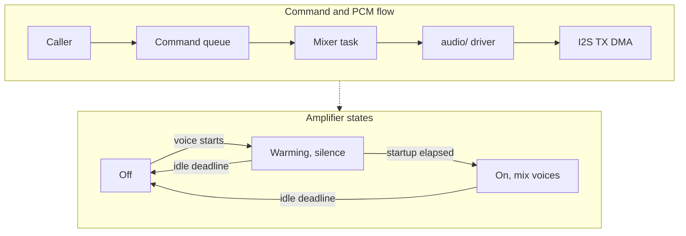

# Sound mixer

The engine's `sound/` layer plays [stored sounds](Sound-Assets.md) through the
platform `audio/` driver. `sound_play.h` is the app API. `sound_engine.h` is for
boot, the shell and development inspection; `sound_mixer.h` contains the
portable control plane and PCM renderer.

## Task and commands

`SOUND_MIXER_TASK_CORE`, `SOUND_MIXER_TASK_PRIORITY`, `SOUND_MIXER_TASK_STACK`,
`SOUND_MIXER_QUEUE_DEPTH` and `SOUND_MIXER_BLOCK_FRAMES` in `sound_engine.h`
own the scheduling and buffering limits. The block size derives from
`AUDIO_CODEC_BLOCK_SAMPLES`; a block lasts
`SOUND_MIXER_BLOCK_FRAMES / AUDIO_OUT_SAMPLE_RATE_HZ` seconds.

The mixer preempts present and the job worker on core 1, then blocks in the
driver's PCM write for most of the block interval. It drains commands before
mixing into an int32 accumulator and saturating with `maths_saturate()`. The
mixer alone calls `audio_out_write()`; it writes silence while idle and while
the amplifier warms. TX auto-clear is enabled.

Applications never wait for the mixer. A short control lock protects handle
reservation and a zero-wait queue send; decoding, mixing and I2S writes happen
outside that lock. The renderer owns its cursors separately from the control
plane, so producers can reserve or stop voices while the task is writing.
Completion publication only retires the matching handle and cannot revive a
stopped voice or overwrite a newer reservation.

Queue entries carry an opcode, full voice handle and app generation, packed
options, and a payload shared by sound pointers, tone frequency and capture
completion. Their size is asserted against `SOUND_MIXER_COMMAND_BYTES`; the
depth permits a play and a control call per voice within one frame.

Keep the `sound_t` and its pack alive while every voice using it plays: use
app state, never a stack local. Voices hold the caller's pointer through the
cursor. Sample bytes remain in the mapped pack. The queue copies options,
not sound views or sample data. A full queue drops a command without changing the control state,
returns a null voice or invalid bus for allocating calls, and increments
`dropped_commands`, visible in `autana sound stats`.

## Voices and buses

| Contract | Owner or behavior |
|---|---|
| Voice capacity | `SOUND_VOICE_COUNT` in `sound_play.h` |
| Voice handle | Slot and generation encoded in `sound_voice_t.id`, zero is null |
| Default options | SFX bus, full percent gain, `SOUND_PRIORITY_NORMAL`, one-shot |
| Full voice table | Steal the lowest priority, then the oldest start among equals |
| Stale handles | Stop and gain changes have no effect; `sound_is_playing()` is false |
| Bus capacity | `SOUND_BUS_COUNT_MAX`, including SYSTEM, SFX and MUSIC |
| Custom buses | Flat routes to master, created by name, invalid when capacity is exhausted |
| Bus destruction | Stops its voices; the slot is available for another create |
| Built-in buses | Remain allocated across application exits |
| Master | `SOUND_BUS_MASTER` is accepted by `sound_set_bus_gain()` |

All gains are percent values bounded by `SOUND_GAIN_MAX_PCT`. Out-of-range
values are ignored. Once per block, the renderer multiplies each bus gain by
master gain. Each voice applies its gain and that bus factor to the samples
before accumulation. Codec output volume is fixed by
`AUDIO_OUT_CODEC_VOLUME` in `audio_out.c`; application gain never changes it.

`sound_play()` borrows the supplied `sound_t`; its view and pack must outlive
every voice using it. Authored loops wrap inside `sound_read()`. With `opts.loop` enabled on
a sound without loop points, a short read re-seeks to frame zero. One-shot
playback of a sound with loop points stops at `loop_end`, with no release tail.

## Amplifier and lifetime

| State | Output and transition |
|---|---|
| Off | Silence; the first active voice enables the amplifier without sleeping |
| Warming | Silence, every voice position holds until `AUDIO_OUT_AMP_STARTUP_MS` |
| On | Mix active voices; disable after `SOUND_AMP_IDLE_MS` without a voice |

`sound_init()` runs at boot beside the audio POST check. The driver opens TX
once and keeps its DMA. RX DMA exists only during a development capture.
Capture open and close are commands executed by the mixer: they briefly pause
TX through the shared codec adapter while allocating or releasing RX, then
resume it. Voice positions hold during those operations. The adapter's
ESP32-S3 safeguard against stopping RX while TX runs remains in force.

`shell_exit_app()` calls `sound_stop_app_voices()` before rewinding the app
arena. This increments the app generation, stops non-SYSTEM voices and frees
custom buses. The hook waits until any read from the retired app generation
finishes, making arena-owned views safe to release. The read epoch covers
command application and PCM mixing, not blocking I2S writes or capture.
`SOUND_EXIT_READ_TIMEOUT_MS` guards this nonblocking reader section: a breach
logs the cause and aborts rather than releasing borrowed memory early. Failed
initialization returns immediately from the hook. The mixer rejects queued commands from older app generations
and retires their active renderer voices. SYSTEM commands and voices survive;
their views and packs need storage that survives the app.

On initialization failure the engine records the failed step, logs it once
and leaves playback disabled. POST prints `audio: init failed (<step>)` and
boot continues. Playback calls become silent no-ops: a play returns a null
voice, a bus create returns an invalid bus, and playing queries return false.

## Development console

| Command | Result |
|---|---|
| `autana sound play tap` | Play the engine pack's tap sound once |
| `autana sound play tap loop 50` | Loop at the requested percent gain |
| `autana sound stop <voice>` | Stop the returned voice handle |
| `autana sound stop all` | Stop all voices, including SYSTEM |
| `autana sound stats` | Ready state, drops, amp state, voice metadata and RAM sizes |

Successful console replies end in `SOUND_END`; errors start with `SOUND error:`
or `SOUND usage:`. The CLI waits for that terminal reply when collecting voice
states. The console retains immutable named sound views in PSRAM with the
mounted engine pack, so returning from a command leaves its voices' views
valid. The `tone` verb uses a SYSTEM tone source rendered with the existing
`audio_tone` synthesizer; [capture and detection](Audio-Path.md#development-check)
keep their console output and JSON fields.

The frame-cost report includes `sound_mix` average/worst milliseconds per
block and its block count in the same reporting window as the frame stages.
`profile/frame_cost.c` accumulates that foreign-task duration separately;
frame-task brackets and hardware counters retain their task ownership.

## Internal RAM

`autana sound stats` reports `sizeof` values from the firmware and, in a
development build, `stack_min_free` from `uxTaskGetStackHighWaterMark()` in
bytes. `SOUND_MIXER_STACK_BASE_BYTES` plus the named
`SOUND_MIXER_STACK_MARGIN_BYTES` owns the stack budget; the margin stays in
place while board measurements establish the required headroom. The planning
estimate is 5.1 KB; the allocation formula below includes both control and
renderer state and the configured stack. Board heap deltas also include the
IDF's channel, codec and allocator metadata and are measured separately.
Static mixer, control and queue storage reduces free internal heap before boot
code runs; task and driver allocations appear during `sound_init()`. A total
comparison uses boot headroom between builds, not just the initialization delta.

| Allocation | Computed owner | Board measurement |
|---|---|---|
| Renderer voice table | `sizeof mixer.voices` (`voices` field in stats) | Maintainer capture |
| Mixer/control/progress state | `sizeof mixer + sizeof control + sizeof positions`, plus the dev task handle (`mixer`, includes voice table) | Maintainer capture |
| Queue payload and control | `sizeof queue_storage + sizeof queue_control` (`queue`) | Maintainer capture |
| Task stack, including PCM scratch buffers | `SOUND_MIXER_TASK_STACK` (`stack`) | Maintainer capture |
| TX DMA sample payload | `AUDIO_CODEC_DMA_BLOCKS * AUDIO_CODEC_BLOCK_SAMPLES * sizeof(int16_t)` (`tx_samples`) | Maintainer capture |
| Accounted permanent total | `mixer + queue + stack + tx_samples` (voice table already included) | Maintainer capture |
| Driver and scheduler overhead | IDF DMA descriptors, channel/data interfaces, codec state, task control block and allocation headers | Maintainer capture |

The output, accumulator and decode scratch arrays live on the mixer stack.
Capture buffers live on the console stack and RX DMA is released at capture
close. The engine's pack remains mounted for playback. A renderer voice keeps
its handle, routing/gain/loop options, and playing/source flags,
and a union of cursor or tone state; it holds no copied sound view or decoded
sample buffer. Control voices keep handles, start order, routing/options and
playing/audible flags. Console view-cache entries live in PSRAM, with only the
list head in internal RAM.
