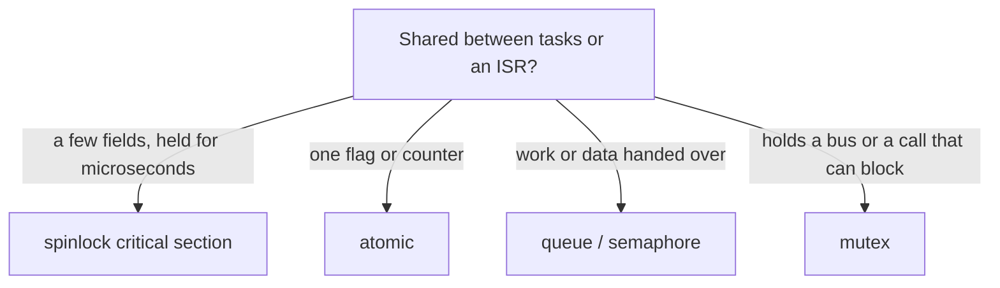

# Concurrency

Tasks, cores and shared state in first-party C: which primitive to pick and where the code
already does it. Part of the [C style guide](../C-Style-Guide.md).

## Who runs where

The ESP32-S3 has two cores. The shell's frame loop is on core 0; the background tasks the
engine creates are:

| Task | Core | Priority | Created in |
|---|---|---|---|
| present (`gfx_present`) | 1 | 5 | [`gfx_present.c:299`](../../launcher/main/gfx/present/gfx_present.c#L299) |
| job (`core1_job`) | 1 | 3 | [`job.c:84`](../../launcher/main/core/job.c#L84) |
| sound mixer | 1 | 6 | [`sound_mixer_device.c:443`](../../launcher/main/sound/sound_mixer_device.c#L443) |
| touch poll | any | 6 | [`touch.c:264`](../../launcher/main/input/touch/touch.c#L264) |
| buttons poll | any | 5 | [`buttons.c:79`](../../launcher/main/input/buttons/buttons.c#L79) |
| console | any | 4 | [`console.c:236`](../../launcher/main/console/console.c#L236) |

Pin a task (`...PinnedToCore`) only when it must not share a core with the frame loop. A
task that only waits on I/O uses plain `xTaskCreate`. An app's `update` never blocks; see
[Firmware architecture](../Firmware-Architecture.md).

## Pick the primitive

| Need | Use | Example |
|---|---|---|
| Update a few fields together | `portMUX_TYPE` with `portENTER_CRITICAL`/`portEXIT_CRITICAL` | [`touch.c:48`](../../launcher/main/input/touch/touch.c#L48), [`console_frame_request.c:33`](../../launcher/main/console/console_frame_request.c#L33) |
| One flag taken by whoever gets there first | `atomic_flag` | [`sound_mixer_device.c:48`](../../launcher/main/sound/sound_mixer_device.c#L48) |
| A lock-free ring with one reader | `__atomic_*` with acquire on read and release on write | [`frame_watch.c:82`](../../launcher/main/profile/frame_watch.c#L82) |
| Signal a task from an ISR | `xSemaphoreGiveFromISR` then `portYIELD_FROM_ISR` | [`gfx_present.c:173`](../../launcher/main/gfx/present/gfx_present.c#L173) |
| Serialise an operation that blocks | a static mutex | [`audio_out.c:27`](../../launcher/main/audio/audio_out.c#L27) |
| Pass commands to a task | a queue; drop and log when full | [`console.c:148`](../../launcher/main/console/console.c#L148) |

## Critical sections

A spinlock section is correct on one or two cores, and it disables interrupts on the core
that holds it. Keep it to a few field updates ([`touch.c:45`](../../launcher/main/input/touch/touch.c#L45)
says the same).

| Do | Do not |
|---|---|
| Copy the state out, leave, then work on the copy | call a driver, log, or take a semaphore inside |
| Initialise with `portMUX_INITIALIZER_UNLOCKED` | allocate or free inside |
| Release on every path (the early return is where it leaks) | nest two locks |

## Atomics and volatile

`volatile` stops the compiler caching a value; it does not make two fields change together
and it orders nothing between cores. It is enough for a lone flag written by one side and read
by the other, as in [`touch.c:53`](../../launcher/main/input/touch/touch.c#L53). Anything that
publishes data behind a flag needs a release store and an acquire load, as `frame_watch.c`
does at lines 94 and 201. `memory_order_relaxed` is for counters nothing else depends on.

## Starting tasks

Create static state first, the task last, and check the return. A task that fails to start
logs and leaves the feature off ([`touch.c:264`](../../launcher/main/input/touch/touch.c#L264),
[`console.c:236`](../../launcher/main/console/console.c#L236)). Prefer
`xTaskCreateStaticPinnedToCore` with a stack from `memory_alloc(..., MEMORY_INTERNAL)` where
the stack must stay in internal RAM ([`job.c:76`](../../launcher/main/core/job.c#L76)).
