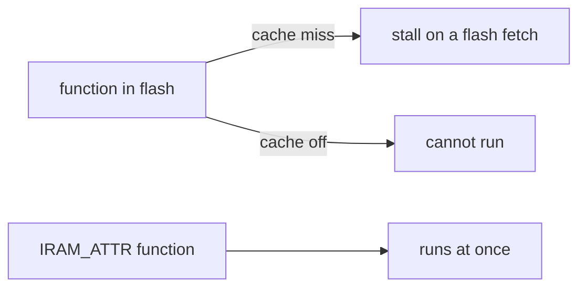

# Function attributes

Which GCC and ESP-IDF attributes this firmware puts on functions, when, and what each one
costs. Part of the [C style guide](README.md).

| Attribute | Use it when | Cost | Example |
|---|---|---|---|
| `IRAM_ATTR` | the function must not wait on a flash fetch: an ISR callback, a heap hook, or a per-frame hot path | internal RAM, counted in a budget | [`on_strip_sent`](../../launcher/main/gfx/present/gfx_present.c#L173) |
| `__attribute__((noinline))` | a measurement or a placement needs the function to stay one symbol | a call per use | [`gfx_present.c:743`](../../launcher/main/gfx/present/gfx_present.c#L743) |
| `static inline __attribute__((always_inline))` | a tiny helper in a hot loop that the compiler must not outline | code size per call site | [`memory.h:65`](../../launcher/main/core/memory.h#L65) |
| `__attribute__((constructor))` | a self-registering table entry, run before `main` | none at run time | [`app.h:103`](../../launcher/main/app/app.h#L103) |
| `__attribute__((aligned(N)))` | a buffer or entry point must sit on a boundary | padding | [`job.c:33`](../../launcher/main/core/job.c#L33) |
| `__attribute__((cold))` | a rare path the optimiser should keep out of the hot code | none | [`r3d_pipeline.c:438`](../../launcher/main/render/r3d_pipeline.c#L438) |

## IRAM_ATTR

Code in flash runs through the instruction cache. A miss costs a flash read, and while the
cache is off (flash writes, PSRAM tuning) a flash-resident function cannot run at all.
`IRAM_ATTR` puts the function in internal RAM, which has neither problem and is scarce.

Rules, each enforced by `launcher/tools/build/memory_map.py` (see
[Internal memory map](../memory/Internal-Memory-Map.md)):

| Rule | Why |
|---|---|
| A comment directly above gives the reason and `IRAM budget: N B` | the byte count is compared with the linked size, so growth is a visible diff |
| Put the attribute on the function, not only in a linker fragment | the compiler's clones (`.isra`, `.constprop`, `.cold`) inherit an attribute but not a fragment entry; see [Linker fragments](../memory/Linker-Fragments.md) |
| Code that runs with the flash cache off, and every callee, must be in IRAM or inline | a flash callee faults then; [`frame_watch.c:64`](../../launcher/main/profile/frame_watch.c#L64) states it for the heap hooks |
| Wrap the attribute in a macro that is empty on the host | the host build has no IRAM; `GFX_PRESENT_IRAM_ATTR` ([`gfx_present.c:38`](../../launcher/main/gfx/present/gfx_present.c#L38)) and `RENDER_IRAM_ATTR` ([`code_layout.h:21`](../../launcher/main/render/code_layout.h#L21)) do this |

An ISR callback needs `IRAM_ATTR` only if its interrupt is registered with the IRAM flag. The
panel bus uses interrupt flags 0, so [`on_strip_sent`](../../launcher/main/gfx/present/gfx_present.c#L173)
takes it only to avoid cache misses, and says so.

## noinline and always_inline

| Pair | Reason to choose it |
|---|---|
| `noinline` on a function a perf test times | the timed code stays a symbol, so the test measures a call it can name |
| `noinline, cold` on a rare slow path | the fallback leaves the hot loop's code alone ([`r3d_pipeline.c:438`](../../launcher/main/render/r3d_pipeline.c#L438)) |
| `always_inline` on a one-line accessor | `inline` alone is a hint; in a pixel loop the call must vanish ([`gfx_target.h:89`](../../launcher/main/gfx/target/gfx_target.h#L89)) |

Do not add either to speed something up without a measurement; the budgets in
[Performance and budgets](../testing/Performance-and-Budgets.md) decide whether it paid.

## Registration constructors

`APP_REGISTER` and the console verb macros expand to a `constructor` function that adds the
entry to a table, so a new file registers by existing. The function must be `static` and
named from the macro argument, as in [`app.h:103`](../../launcher/main/app/app.h#L103) and
[`console_verbs.h:143`](../../launcher/main/console/console_verbs.h#L143).
