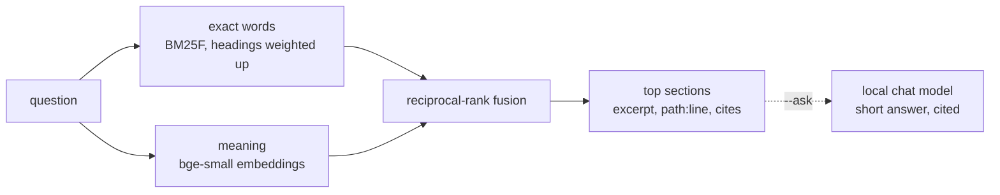

# Docs search

`autana docs <question>` answers a question from the repository's
documentation one section at a time: the three sections that answer it best,
excerpted to the paragraphs that carry the question, each with the
`path:line` range to read on and the code it cites, then five more places to
look. It runs locally, needs no board, and never sends anything off the
machine.

```sh
autana docs how do I make a function testable on the host
autana docs --section docs/testing/QEMU.md:36                     # one section whole
autana docs --outline docs/testing/QEMU.md                 # headings, lines, sizes
autana docs --ask can an app call vTaskDelay inside frame     # a written answer, with sources
```

`python scripts/docs/docs_search.py` takes the same arguments, plus `--json`,
`--top N`, `--budget CHARS` and `--lexical`.

## Commands

`autana help docs` lists the same commands.

<!-- generated: cli-docs check: python scripts/autana/cli_reference.py --check -->
| Command | What it does |
|---|---|
| `autana docs <question...>` | the three best sections, excerpted with their path:line, then five more to read on |
| `autana docs --section <path:line>` | one section whole, or path#heading words; --deep adds subsections |
| `autana docs --outline <path>` | a document's headings, with lines and sizes |
| `autana docs --ask <question...>` | a short answer from the local chat model |
| `autana docs --usage [--days N]` | what this machine has looked up: counts, repeats, misses, documents refused whole |
<!-- /generated: cli-docs -->

## What it reads

| Source | Unit |
|---|---|
| Every `*.md` anywhere in the checkout, except `third_party/` and `launcher/components/` | a heading and the text up to the next heading |
| The Markdown files and folders the project's `docs_extra` setting names | the same |
| The module docstring or leading comment of each `.py`, `.sh` or `.mjs` file under `scripts/`, `launcher/tools/`, `launcher/test/` and `launcher/main/apps/`, except tests | one section per script |

A section copied verbatim into two files is kept once. The index is rebuilt on
every run, so it is never stale; an edit is searchable at once. It is a plain
filesystem walk of the checkout, not a VCS index; no git command runs.

A directory is never walked if it is named `.something`,
`managed_components`, `node_modules` or `results`, if it contains its own
`CMakeCache.txt` (a real build tree, wherever it lands), or if it contains its
own `.git` (a fetched clone, such as a tool pulled straight from GitHub).
Build trees and clones are judged by what the directory holds, never by its
name, so `launcher/tools/build/`, a real source folder, is never mistaken for one.

The `docs_extra` key of `autana.local.toml` lets notes kept outside the
checkout join the index ([Settings](Settings.md)). It is a list of
paths, each relative to the checkout unless absolute. A named folder is walked
like the checkout, with no ignore file consulted; a named file must end in `.md`.

A named folder's own `eval_questions.tsv` joins `--eval`, its rows citing
documents by the path search shows for them.

## How it ranks



BM25F<sup>[[46]](../Citations.md#robertson-2004)</sup> ranks the words, and reciprocal-rank fusion<sup>[[47]](../Citations.md#cormack-2009)</sup> merges its list with the
embeddings'.

Plans, `docs_extra` notes and sections headed "Related" or "See also"
rank below documents of record: a plan describes code that does not exist
yet, notes from outside the tree are not the record, and a list of links
names every topic and answers none. A question whose words no
document uses says so and offers the nearest indexed spellings; a result
that neither holds most of the question's words nor is close in meaning is
flagged as a weak match.

## How well it finds

`scripts/docs/eval_questions.tsv` pairs questions with the section that
answers each. Many are real questions, each answer checked by hand. `--eval` prints where each one ranks in the top ten. It then scores
the set:

| Score | Meaning |
|---|---|
| MRR | mean of 1/rank, 0 for a miss: 1.0 is every answer first |
| top-1, top-3 | share of answers ranked first, and in the first three |

Each run appends its scores to `eval/history.jsonl` in the [log
folder](#what-it-logs) and prints the last run over the same number of
questions, so a ranking change shows its effect. With the embeddings cached,
a run is quick. The unit tests hold exact-word MRR and top-3 to floors on
the set and check that every row still names a real section, so a rename
that orphans a question fails too.

## What it logs

Every question, `--ask`, `--section` and `--outline` appends one JSON line to
`queries.jsonl` in `%LOCALAPPDATA%/autana/usage` (elsewhere
`$XDG_CACHE_HOME/autana/usage`, by default `~/.cache/autana/usage`): the
time, the question, the best results with their scores, how long it took,
how many characters it printed, whether meaning was used, and whether the
answer was weak. It stays on the machine; deleting the folder loses only the
history.

To group lookups by session, run the commands with `AUTANA_SESSION=<label>`
in their environment (per process, nothing is stored), or list in the
`session_vars` [setting](Settings.md) variables your terminal already sets
per session; the first one set labels the row. `autana docs --usage` counts
the sessions, and `python scripts/docs/query_log.py --session <label>` shows
one.

Every lookup tool logs through `query_log.py`, which documents the call a
tool makes and keeps one evaluation history for all of them; `python
scripts/docs/eval_summary.py --tool NAME` reports a tool's last score.

`autana docs --usage` summarises every `*.jsonl` in that folder. Another
tool that writes rows in the format `scripts/docs/query_log.py` documents is
summarised too:

| Part | Shows |
|---|---|
| Per tool and kind | count, share weak, share where a result was opened next (when a row records it), median time, printed output in tokens (`CHARS_PER_TOKEN` in `query_log.py`) |
| Most asked | questions asked more than once |
| Missed | weak or empty answers of any kind: the documents to write or retitle |

`--days N` keeps the last N days.

## Requirements

| To get | Needs |
|---|---|
| Exact-word search | Python 3.9 or later. Nothing to install. |
| Search by meaning (`docs_llama.py setup`) | About 130 MB of disk and 200 MB of memory while in use. Any 64-bit CPU; no GPU. |
| Written answers (`setup --chat`) | About 2.5 GB more disk and 3 GB of free memory. Runs on a CPU; a GPU answers sooner. |

## Local models

Without them, search is exact words only and says so on its first line.
`python scripts/docs/docs_llama.py setup` adds meaning: a pinned
`llama-server` build (Vulkan on Windows, CPU on Linux) and the
bge-small-en-v1.5 embedding model. `setup --chat` adds Qwen3-4B-Instruct for
`--ask`. Every download is checked against the SHA-256 in
`scripts/docs/docs_llama.py` before use.

Everything installs in `%LOCALAPPDATA%/autana/llama` (elsewhere
`$XDG_CACHE_HOME/autana/llama`, by default `~/.cache/autana/llama`), shared by every worktree. Setup
ends by embedding the documentation once; after that only a section whose text
changed is embedded again. A cached vector is dropped once no checkout has
asked for it for `KEEP_DAYS` (in `docs_llama.py`), so worktrees with different
documents keep theirs.

One `llama-server` in router mode serves both models on `127.0.0.1:8765`. The first query starts it, it loads a model on first
use and unloads it after ten idle minutes. `docs_llama.py status` shows what
is installed and running; `docs_llama.py stop` ends the server it started and
no other. A GPU recognised as integrated is left out when another is present;
llama.cpp's own `LLAMA_ARG_DEVICE`, set to names from `llama-server
--list-devices`, chooses instead, from the next time the server starts.

`--ask` passes the four best sections to the chat model with an instruction
to answer from them alone and cite each claim. The source list names the
sections it was given; read one with `autana docs --section <path:line>` to
check the answer.
