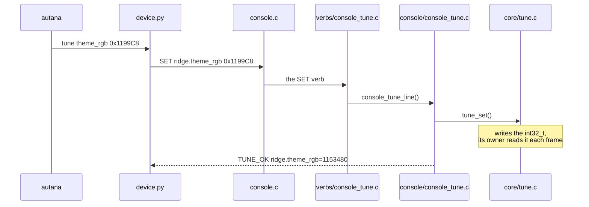

#Live tuning

Changing a number on a running device, by name,
    with no build and no flash.For a constant that is judged by eye : how a theme starts, how high a wave is,
    where each guess otherwise costs a build and a flash.

`autana` alone opens a console session with the device,
    and everything below works in it without the prefix.A bare word is never an implicit tunable lookup; `tune` is always the way to one, in the session and on the command
line alike:

```
autana> tune wave                 # the tunables whose names contain "wave"
autana> tune theme                # show matching tunables
autana> tune theme_rgb 0x1199C8   # change it: on the screen a frame later
```

Each is also a command of its own, for a script or a single change:

```sh
autana tune                       # every tunable, its value and its range
autana tune theme_rgb
autana tune theme_rgb 0x1199C8
```

A name may drop its owner when that is unambiguous: `theme_rgb` for
`ridge.theme_rgb`, and when it is not exactly one tunable's own, `tune <name>`
falls back to the same filtered listing `tune [text]` gives. `autana` is the
terminal command: every command it takes is in
[the command index](README.md). It calls `scripts/device/device.py send`,
which takes the device lock like everything else that touches the board.

## Commands

`autana help tune` lists the same commands.

<!-- generated: cli-tune check: python scripts/autana/cli_reference.py --check -->
| Command | What it does |
|---|---|
| `autana tune [text] [--json]` | list the tunables with ranges; names containing text |
| `autana tune <name> [value]` | show one, or set it on the board (lost on reboot) |
| `autana tune reset <name>` | back to the value the source declares |
<!-- /generated: cli-tune -->

**Development builds only, and the device keeps nothing.** A release build
has no listener, no registry and no names: the same declaration compiles to
a plain constant there. A value set on a device is gone at its next reboot.

The source stays the truth. `autana` only talks to the device, so a source
tool puts a session's values into the source:

```sh
autana tune --json | python launcher/tools/tune/apply.py
```

It rewrites the initial value in each tunable's `TUNE` line, in the tree
`apply.py` lives in, and nothing else. The result is an ordinary diff to
review and commit, and the next build, release included, is made with it.

## How it works

See [Device-Lock.md](Device-Lock.md) for the lock and the port `send`
starts from. From there:



The console protocol is four lines, answered by `console/console_tune` from
the registry in `core/tune`:

| line | replies |
|---|---|
| `SET <name> <value>` | `TUNE_OK <name>=<value>`, or `TUNE_ERR <reason> ...` |
| `GET <name>` | `TUNE_OK <name>=<value>`, or `TUNE_ERR unknown <name>` |
| `RESET <name>` | the same as `SET`, the value being the declared one again |
| `TUNE` | `TUNE <name>=<value> min=<low> max=<high> default=<initial>` per tunable in name order, `TUNE_ERR clash <name>` per name declared twice, then `TUNE_END count=<n>` |

A value is a whole number, decimal or `0x` hex, and one outside the
tunable's range is refused rather than clamped. The protocol is pure: a line
comes in and replies go out through a callback, against a registry, so
`test/suites/suite_tune.c` drives all of it on a host with a registry of its
own. The console answers from the shared one, `tune_shared()`.

## Making something tunable

<!-- generated: cli-tune-example check: python launcher/tools/gen/examples_doc.py --check -->
```c
/* Tune: expose a colour under its owner. */
#include "core/tune.h"

TUNE_OWNER(glow); /* once per file, before its tunables */
TUNE(glow, theme_rgb, 0x1199C8, 0, 0xffffff);
```
<!-- /generated: cli-tune-example -->

- That one line is the whole declaration: the variable `theme_rgb`, its name
  `glow.theme_rgb`, the value it ships with and its range. On a development
  build it is a `static int32_t` and an entry that joins the registry by
  itself before `app_main()`, the way `APP_REGISTER` works, so there is
  nothing to call and every tunable linked into the image is listed from
  boot. On a release build it is an `enum` constant and nothing else, so the
  code that reads it is the same in both and release pays nothing.
- The compiler refuses a value outside its own range and a name over 32
  characters (`<owner>.<what>`; a `SET` line has to fit the console's
  `CONSOLE_LINE_MAX`, 49).
- The registry is a list threaded through the entries, so there is no table
  to outgrow. Two declarations of one name are a mistake: the first keeps the
  name and `TUNE` reports the clash.
- A tunable is a variable in one build and a constant in the other, so it
  cannot size an array or label a `case`, and a development build does not
  fold it the way release does; a timing taken on one is a little
  pessimistic.
- `TUNE_HOT` is the same declaration for code whose layout is pinned or
  measured, such as the raster's inner loops: a constant in every
  build, live only on an image built with `--hot-tunables`
  ([Build-Variants.md](../tools/Build-Variants.md)), which is what
  `launcher/tools/perf/perf_sweep.sh` flashes.
- `TUNE_SETTING` is the same declaration for a value the image's own
  controls also set, such as a menu toggle: a variable in release too, with
  no registry there. `TUNE_SETTING_SET(what, value)` writes it within its
  range, and on a development build through the registry, so `GET` sees it.
- A value read every frame takes effect at once. One baked into a table needs
  its owner to notice:
  `TUNE_GENERATION(ridge)` goes up on every `SET` or `RESET` of one of that
  owner's tunables, and of no one else's, and the owner rebuilds when it
  differs from the one it last built for. It is the constant 0 in release.
  `shell/ui/ui_ridge.c` is the model.
- A `SET` is written from the console listener's task, not the frame loop. A
  tunable is one aligned word, so its reader sees the old value or the new.

## Related

- [`tools/Build-Variants.md`](../tools/Build-Variants.md): what a development build is
