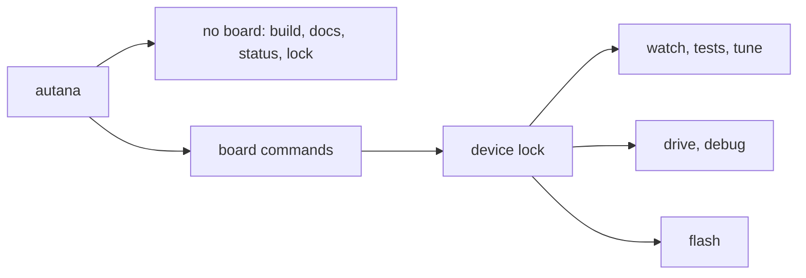

# The autana command

`autana` is the one command that drives development: build and flash, run
suites, watch the board, drive it, change a number live, share it between
people and CI jobs, and search these docs. `build` and `flash` act on the
current directory or `--project PATH`; the rest work from anywhere.
It asks the board and never reads or writes `launcher/main` or
`launcher/packages`: source tools such as `launcher/tools/tune/apply.py` do
that (`scripts/gates/check_autana_source.py` holds it to this).

New here: set up `autana` as in [the README](../../README.md#run-it-on-the-board),
then run `autana flash dev` and `autana monitor 30` (Git Bash on Windows).
No board? Try the [host render](../../README.md#try-it-without-a-board).

## Where each command lives

| Group | Page |
|---|---|
| Build and flash | [Build-and-Flash.md](Build-and-Flash.md), then [Flash-and-Captures.md](Flash-and-Captures.md) for what a flash proves and where captures land |
| Tests and A/B testing | [Tests.md](Tests.md) |
| Watch the board | [Watch.md](Watch.md) |
| Drive | [Drive.md](Drive.md), [App-Commands.md](App-Commands.md) for an app's own commands |
| Tune | [Live-Tuning.md](Live-Tuning.md) |
| Debug | [Debug.md](Debug.md) |
| Docs | [Docs-Search.md](Docs-Search.md) |
| Sharing the board | [Device-Lock.md](Device-Lock.md) |
| Sessions and settings | [Sessions.md](Sessions.md), [Settings.md](Settings.md) |

## I want to...

| Goal | Command |
|---|---|
| Build and flash | `autana flash dev` |
| Read the console for 30 s | `autana monitor 30` |
| See the screen | `autana screenshot -o shot` (`shot.png` plus `shot.json`) |
| Read or set a live value | `autana tune ridge_trail` |
| Run tests | `autana flash diag`, then `autana suite list` and `autana suite <name>` |
| Compare two versions for speed | [A/B testing](Tests.md#ab-testing) |
| Check memory | `autana heap` |
| Pause and step the app | `autana debug freeze`, `debug step 3`, `debug resume` |
| Share one board | `autana status`; wrap work in `autana lock run -- <command>` |
| Fail a CI job rather than queue | `autana --wait 0 --owner my-job lock run -- <command>` (busy board: exit 75) |
| Ask the docs a question | `autana docs how do I make a function testable on the host` |

## Variants

Builds come in `dev` (the console, for daily work), `diag` (dev plus the test
suites) and `rel` (no console). Board commands need `dev` or `diag`.

## Global flags

`autana help flags` prints this table. Global flags go anywhere on the line;
the project file that sets them for a checkout is in [Settings.md](Settings.md).

<!-- generated: cli-flags check: python scripts/autana/cli_reference.py --check -->
| Flag | What it does | Commands |
|---|---|---|
| `--lock-token TOKEN` | run inside this board's live hold | every board command |
| `--wait SECONDS` | how long to wait for the board's lock; 0 fails at once (exit 75) | every board command |
| `--owner NAME` | the lock owner's label | every board command |
| `--board SERIAL` | USB serial or short id; -b is an alias | every board command |
| `--out PATH` | write the one capture here instead of the default path | selftest, suite, monitor |
| `--expect-build-id ID` | refuse to run a suite unless the board, or the image `--flash` just wrote, carries this BUILD_ID | suite |
| `--project PATH` | act on PATH instead of the current directory - it must itself carry launcher/CMakeLists.txt, no searching parent directories | build, flash, selftest, suite, docs |
<!-- /generated: cli-flags -->

`--version` (or `-V`) prints autana's own version and exits.

## JSON fields

| Command | Fields |
|---|---|
| `status`, `devices` | `boards`, one object per board ([Device-Lock.md](Device-Lock.md#exit-codes-and-json-status)). |
| `buildid` | `build_id` |
| `tone` | `hz`, `pulse_ms`, `tone_db`, `silence_db`, `heard`, `open_dma_bytes`, `shake_rms_mg`, `shake_peak_mg`, `silence_shake_rms_mg`, `gx_mg`, `gy_mg`, `gz_mg` |
| `heap` | `free`, `largest`, `total` (bytes in `MEMORY_DMA`) |
| `framewatch` | `frames`, `allocs`, `frees`, `console`, `repeating`, `dropped`, `sites` |
| `apps` | `apps`: `name`, `running` |
| `suite list` | `suites`: `name`, `on_request` |
| `tune` | `tunables`: `name`, `value`, `min`, `max`, `default` |

A filter that matches nothing gives an empty array.

## For maintainers

The command tables on these pages are written from `COMMAND_GROUPS` and
`BOARD_FLAGS` in `scripts/autana/autana.py` by
`python scripts/autana/cli_reference.py`, and the generated-document gate
fails when one is stale. Change a command's summary in the source and rerun it.
