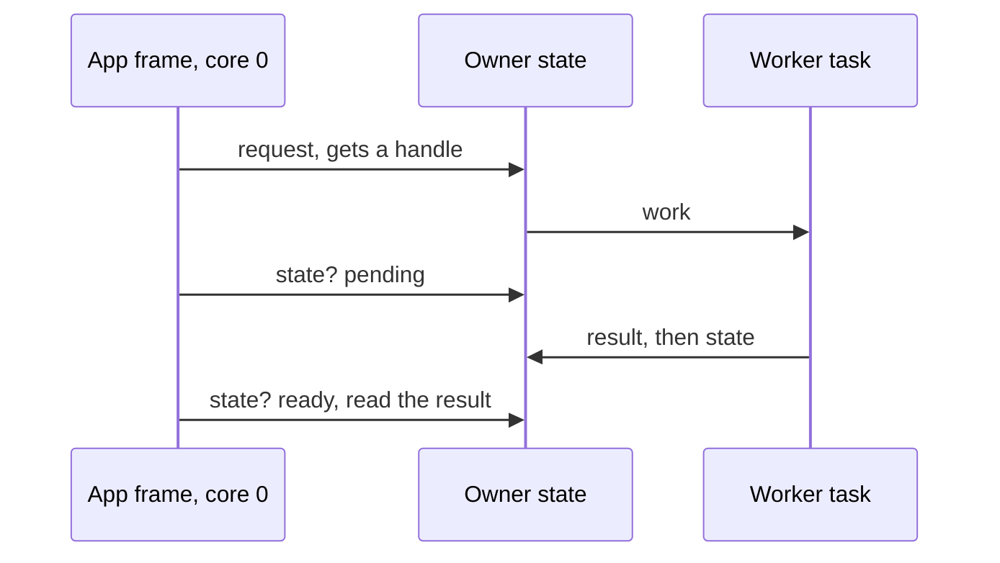

# Four Rules That Shape Everything

## 1. There is exactly one framebuffer by default

368 × 448 × 2 bytes = **322 KiB**, allocated in PSRAM (`MEMORY_PSRAM` in
`core/memory.h`), so it does not count against the internal heap
([Board-and-Memory.md](../notes/Board-and-Memory.md)).

"One framebuffer" is really "one destination at a time":

| Destination | How an app gets it | Effect on the framebuffer |
|---|---|---|
| band ring | asks at `enter()`: a few strips of rows, sent as each fills | gfx frees it while the ring is held |
| index image | asks at `enter()`: one byte per pixel through a palette | gfx frees it while the image is held |
| `GFX_LAYOUT_DOUBLE_FB` | asks at `enter()` | adds a back buffer, so a front is sent while a back is drawn ([memory policy](../gfx/Present.md#presentation-memory-policy), [transfer payload](../notes/Display-and-Rendering.md#transfer-payload)) |

The modes are in [Gfx](../gfx/Targets-and-Modes.md#modes).

The span rasterizer (`render/r3d_span.h`) follows the same rule and owns no
framebuffer: it fills a caller's window of rows, with a depth plane only as tall
as that window, where a full colour+depth pair would want ~1.3 MB here.

`math/linear/` supplies the vector, quaternion, matrix and transform maths that
`render/` and boot share, and no rasterizer.

## 2. There is exactly one frame loop, and it belongs to the shell

Apps do not loop, present, block or yield. An app's `frame()` draws and returns,
so:

- switching apps is instant: no teardown of a running loop
- no app can wedge the device by forgetting to yield
- the shell decides when to present, and can draw its own chrome afterwards

The rule is about apps. The boot animation runs a loop of its own and
`show_post_failures()` blocks for 8 s, but both run *before* the shell's loop
exists, when there is nothing to switch to.

## 3. Apps are callbacks, not processes

One binary, one address space, no isolation: a misbehaving app can corrupt the
shell, and nothing stops a task on either core from touching another app's
state. That is the accepted trade for instant switching and no flash-partition
machinery; revisit it only if third-party apps become a goal.

## 4. Work on another core reports back on the app's frame

Nothing calls app code from another core or task. Work that finishes elsewhere
leaves its result where the app reads it on its own frame, in one of three shapes:

| Shape | For | Example |
|---|---|---|
| handle + state, read each frame | one request, one result | `sound_play()` returns a `sound_voice_t`; `sound_is_playing()` turns false when it ends |
| one-frame edge | "it just happened" | `input_t.pressed`, true only on the frame of the press |
| queue the app empties in its update | a stream | `console_take_unclaimed_line()` until it returns false |

| Rule | Why |
|---|---|
| a handle is a slot plus a generation; a stale one reads as finished and is otherwise ignored | a reused slot never answers for an old request |
| finished is not released | the owner may still read what the request was given until it is released |
| no request reports back through a callback | app code runs only inside its own frame |

This is what keeps rule 3's shared address space workable: no other core ever runs app code.
